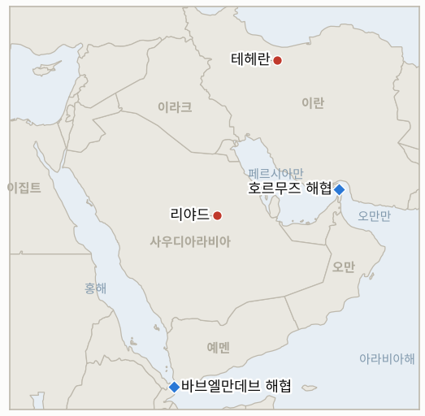

# 중동 일일 브리핑

**2026년 10월 11일**

- **보고 기간:** 약 24시간, 10월 10일 06:00 ~ 10월 11일 06:00 (한국시간)
- **종합 평가:** 후티가 토요일 리야드 킹 칼리드 공항을 다시 공격해 공항이 폐쇄되고 부상자와 사망 보도가 나왔으며 항공편 324편이 취소됐다. 트럼프는 미국이 사우디의 후티 공격에 "합류할 수도 있다"며 11월 3일 전 이란을 공격하지 않겠다는 약속이 바뀔 수 있는지 "살펴보겠다"고 말했다(§1.1). 예멘 정부군과 후티는 바브엘만데브와 마이윤 섬을 두고 다투고 있으며 사우디 주도 연합군은 표적 136곳을 파괴했다고 밝혔다(§1.2). 이란 혁명수비대는 호르무즈에서 유조선이 기뢰에 부딪혔다고 주장했고, 크렘린은 푸틴이 이란의 견해를 트럼프에게 전했다고 밝혔다(§1.3). 금요일 브렌트유는 러시아산 경유 공급 발표 속에 경유 선물이 4.6% 내리는 가운데 약 104.7달러에 마감했다(§1.4). 토요일이라 한국 증시는 열리지 않았으며 금요일 수준이 그대로 유지된다.

**정정 및 업데이트:** 10월 10일 브리핑(§1.3)은 금요일 브렌트유를 호가 기준 약 103달러로 전했으나, 정산 자료상 10월 9일 종가는 약 104.7달러(출처별 104.43달러 ~ 약 105달러)여서 브렌트유가 브리핑의 설명처럼 내리지 않았다. 10월 10일 브리핑(§1.4)은 10월 8일 사우디인 3명 사망을 전했으나, 다른 보도(Al-Monitor, 검색 요약)는 공항 두 곳에서 3명이 숨지고 30명 넘게 다쳤으며 킹 칼리드 공항에서는 1명이 숨졌다고 전해 사상자 규모는 여전히 정리되지 않았다.

---

## 1. 무슨 일이 있었나

<figure style="float:right; width:46%; margin:2pt 0 8pt 14pt;">

<figcaption style="font-size:8pt; color:#666; text-align:center; margin-top:3pt; font-style:italic;">주요 논의 지점</figcaption>
</figure>

### 1.1 리야드 공항 재공격, 트럼프는 미국이 후티 공격에 합류할 수 있다고 말한다

사우디 민간항공청은 토요일 킹 칼리드 국제공항에 대한 추가 공격을 확인했고, 부상자 수는 파악되지 않았으며 공항은 피해 평가를 위해 폐쇄됐다([Al Jazeera](https://www.aljazeera.com/news/liveblog/2026/10/10/iran-war-live-kremlin-says-trump-welcomed-russia-effort-in-iran-deal)). CBS에 따르면 공항은 이날 두 차례 공격받고 대피했으며, FlightAware는 취소 항공편을 324편으로 집계했고 미국, 캐나다, 독일, 스페인 대사관은 자국민에게 인근을 피하라고 당부했다([CBS News](https://www.cbsnews.com/live-updates/iran-war-trump-us-elections-saudi-arabia-yemen-houthis/)). 타임스오브이스라엘은 AFP와 병원 관계자를 인용해 최소 2명(이집트인 승무원과 팔레스타인인)이 숨지고 5명 이상이 중환자실에 있다고 전했으나 사우디 당국은 이를 확인하지 않았다. 트럼프는 미국이 사우디의 후티 공격에 "합류할 수도 있다"며 "살펴보겠다"고 했고 곧 결정하겠다고 말했다. 중간선거 전 이란 공격 계획이 바뀔 수 있느냐는 질문에는 "살펴보겠다"고 답했다. **신뢰도: 공격, 폐쇄, 트럼프 발언은 높음; 사망자 수는 낮음(병원 관계자 단일 출처); 미국 참전 결정은 낮음.**

### 1.2 바브엘만데브와 마이윤 섬이 엇갈리고 연합군은 표적 136곳 파괴를 주장한다

토요일 예멘 정부군이 바브엘만데브 인근에서 진격했다고 보도됐고, 후티는 공격을 격퇴했으며 마이윤 섬을 여전히 장악하고 있다고 밝혔다. 금요일 한 사우디 외교관은 예멘군이 두 곳을 모두 장악했다고 말했다([CBS News](https://www.cbsnews.com/live-updates/iran-war-trump-us-elections-saudi-arabia-yemen-houthis/)). 사우디 주도 연합군은 후티 장악 지역의 군사 표적 136곳을 파괴했다고 밝혔고, 파키스탄은 사우디에 방어 목적의 상당한 병력이 있다고 말했다. 후티는 리야드행 인도주의 항공편에도 자신들의 허가가 필요하다고 주장했다. 양측의 장악 주장은 정면으로 엇갈리며 독립적 확인은 없다. **신뢰도: 주장이 있었다는 점은 높음; 해협 연안 장악 주체는 낮음; 136곳 수치는 중간(연합군 발표).**

### 1.3 이란: 호르무즈 기뢰 타격 주장, 푸틴의 전언, 루비오와의 설전

이란 국영 매체는 혁명수비대를 인용해 신원 미상의 유조선이 호르무즈 해협에서 기뢰에 부딪혀 폭발하고 불이 났다고 전했다([Times of Israel](https://www.timesofisrael.com/liveblog-october-10-2026)). 선박명, 선적국, UKMTO의 확인은 찾지 못했다. 크렘린은 푸틴이 금요일 통화에서 가능한 평화 합의에 대한 이란의 견해를 트럼프에게 전했고 트럼프가 러시아의 노력을 환영했다고 밝혔으며, CBS는 외교가 여름 이후 교착 상태라고 전했다. 에스마일 바가이 외무부 대변인과 모흐센 레자이 안보 관계자 등 이란 당국자들은 루비오 국무장관이 10월 7일 아테네 연설에서 이란 지도부를 "죽음의 숭배 집단"이라 부른 것을 "시대착오"라고 반박했다([Al Jazeera](https://www.aljazeera.com/news-analysis/2026/10/10/anachronism-rubios-civilisational-rhetoric-prompts-pushback-from-iran)). 트럼프는 금요일 유세에서 이란 문제가 "어떤 식으로든" 해결될 것이라고 말했다. **신뢰도: 발언은 높음; 기뢰 타격은 낮음(혁명수비대 주장뿐); 푸틴 채널이 이란의 입장을 바꾼다는 점은 낮음.**

### 1.4 러시아산 경유 합의에 경유 선물이 내리는 가운데 브렌트유 약 104.7달러 마감

금요일 브렌트유 종가는 한 주간 요약에서 104.72달러, 블룸버그에서 약 105달러, Trading Economics에서 104.43달러로 전해진다. WTI는 91.85달러였고 브렌트유는 10월 2일의 102.25달러보다 약 2% 오른 채 한 주를 마쳤다([Oil Monitor 주간 요약](https://unbiasednews.substack.com/p/oil-monitor-weekly-summary-brent-19b); [DTN](https://www.dtnpf.com/agriculture/web/ag/news/world-policy/article/2026/10/09/ulsd-futures-fall-4-us-russia-diesel)). 트럼프가 러시아가 경유 30만 톤을 공급하겠다고 했다고 밝힌 뒤 ULSD 선물은 갤런당 4.73달러로 4.6% 내렸다. 공식 확인된 것은 OFAC 일반 허가뿐이며 물량은 트럼프의 게시글에서 나왔다. 주간 요약이 인용한 연방 자료에 따르면 걸프 산유량의 약 63%(128만 bpd)가 목요일까지 생산 중단됐다. **신뢰도: 브렌트유 수준은 중간(출처 간 약 0.6달러 차이); 경유 하락이 발표에 따른 것이라는 점은 중간; 러시아 인도는 낮음.**

---

## 2. 심층 분석: 동기와 유인

### 2.1 후티는 왜 유전이 아니라 리야드 공항을 거듭 노리는가?

공항은 눈에 잘 띄고 비용이 낮은 표적이다. 타격마다 결항, 대사관 경고, 세계적 보도가 따르는 반면 석유 시설 피해는 사우디와 미국의 더 강한 대응을 부를 수 있다. 며칠 사이 되풀이된 공격은 연합군이 주장하는 136곳 파괴에도 후티가 공세 강도를 유지할 수 있음을 보여 주며, 예멘 지상 공세를 뒷받침하는 리야드의 비용을 키운다.

### 2.2 트럼프는 왜 이란 공격 자제를 약속하면서 사우디의 후티 공격 합류를 검토하는가?

두 약속은 서로 다른 청중을 향한다. 자제 약속은 11월 3일 전 전쟁 부담을 줄이고, 공격받는 동맹 사우디를 돕는 후티 작전은 호르무즈 전쟁을 직접 다시 여는 것이 아니어서 정치적으로 더 쉬운 표적이다. 이란 공격 계획이 바뀔 수 있느냐는 질문에 "살펴보겠다"고 한 것은 선택지를 열어 두겠다는 신호이며, 이란은 이를 다른 경로로의 전쟁 확대로 읽는다.

### 2.3 크렘린은 왜 이란과의 채널 역할을 공개하는가?

모스크바는 워싱턴과 테헤란 양쪽에서 입지를 얻고, 경유 합의와 제재 허가를 통해 실질적 이익도 챙긴다. 푸틴을 이란의 견해 전달자로 내세우면 어떤 합의에서도 러시아가 필수적이라는 위치가 만들어져, 우크라이나 등 다른 협상에서 러시아의 협상력이 강화된다.

### 2.4 이란은 왜 루비오의 수사에 강하게 대응하는가?

루비오가 이란 지도부를 "죽음의 숭배 집단"이라 규정한 것은 체제의 정당성을 겨냥한 것이며, 이란 당국자들은 역사로 맞받았다. 이는 수정한 제안을 테이블에 올려 둔 채, 강압에는 저항으로 답하겠다는 신호를 보내는 이중 경로로, 약자의 입장에서 협상한다는 인상을 피하게 해 준다.

---

## 3. 한국에 대한 정책적 시사점

**노출도 요약:** 한국은 원유의 약 70.7%, LNG의 약 20.4%를 중동에서 들여온다(`instructions/korea-exposure.md`, 갱신 불필요). 금요일은 휴장이었고 토요일에도 장이 없어 마지막 수치는 10월 8일의 코스피 6,625.93과 달러당 1,338.5원이다. 브렌트유 약 104.7달러는 10월 7일 종가 100.20달러보다 높다. 한국의 다음 거래일은 10월 12일 월요일이다.

**사안별 시사점:**

- **리야드 공항(§1.1):** 현지 한국 건설사와 교민은 폐쇄된 공항과 서방 대사관 경고에 직면하며, 항공편 324편 취소는 철수를 어렵게 한다. 이 기간 외교부 안내문은 찾지 못했다(IND-20261011-3).
- **미국의 후티 공격 개입(§1.1):** 미국이 개입하면 사우디와 홍해 선박이 더 넓은 표적이 되고 약속 기간이 일찍 끝날 수 있다. 걸프 원유의 한국 홍해 경로가 노출돼 있다(IND-20261011-1).
- **호르무즈(§1.3):** 기뢰 주장은 한국행 화물의 전쟁 위험 할증을 키운다. 호르무즈 파견 결정은 여전히 열려 있다(IND-20260928-2).
- **유가·경유(§1.4):** 약 105달러의 브렌트유는 주간 2% 상승을 유지한다. 경유 안정은 미국과 유럽의 문제로, 원유 의존이 큰 한국에는 영향이 제한적이다.
- **시장:** 월요일 장은 외국인 매도세 지속(IND-20261009-3, IND-20261010-1)과 주말 위험 증가가 겹친다.

**검증 가능한 지표:**

- **IND-20261011-1** (신규, 진행 중): 2026-10-25경까지 후티 표적에 대한 미국의 공습 또는 군사 참여 발표가 공개되면 "합류할 수 있다"는 발언이 정책이 됐음을 확인하고, 없으면 반증한다.
- **IND-20261011-2** (신규, 진행 중): 2026-10-18경까지 킹 칼리드 국제공항이 정기 상업 출발편을 재개하면 정상화를 확인하고, 없으면 반증한다.
- **IND-20261011-3** (신규, 진행 중): 2026-10-25경까지 한국 외교부가 리야드 또는 사우디 여행 경보를 상향하거나 철수 권고를 내면 확인, 없으면 반증한다.
- **IND-20261004-1** (해소, 반증): 10월 11일 기한까지 리야드 남쪽 아람코 시설 타격 주장에 대한 사우디, 아람코, 독립적 확인이 없었다.
- **IND-20261006-1** (해소, 확인): 사우디 당국이 킹 칼리드 공항의 후티 공격과 인명 피해를 확인했다.
- **IND-20261010-1**, **IND-20261010-2**, **IND-20261010-3**, **IND-20261009-1**, **IND-20261008-1** 및 나머지 기존 진행 중 항목: 이 기간 해소 정보 없음. 트럼프 발언은 공개된 미국 공습이 아니며(IND-20261009-1), 금요일 브렌트유는 105달러를 분명히 넘지 않았다(IND-20261008-1).

---

## 4. 관찰 목록

- **미국이 사우디의 후티 공격에 합류할지에 대한 결정(IND-20261011-1).**
- **리야드 공항 재개 여부와 복귀하는 항공사(IND-20261011-2, IND-20261010-3).**
- **이란의 수정 제안에 대한 미국의 대응과 푸틴 채널의 후속 조치(IND-20261010-2).**
- **호르무즈 기뢰 타격 주장과 NV 선샤인 타격에 대한 UKMTO 또는 선주의 확인.**
- **바브엘만데브와 마이윤 섬 장악 여부(IND-20261007-1).**
- **10월 12일 월요일 코스피 외국인 수급(IND-20261010-1, IND-20261009-3).**

---

## 5. 출처 품질 요약

| 주장 | 출처 | 신뢰도 |
| --- | --- | --- |
| 리야드 공항 재공격, 폐쇄, 부상자 | Al Jazeera, CBS News | 높음 |
| 리야드 공항 최소 2명 사망, 5명 중환자 | Times of Israel (AFP 병원 관계자 인용) | 낮음 |
| 항공편 324편 취소, 대사관 경고 | CBS News (FlightAware 인용) | 중간 |
| 트럼프: 미국이 사우디의 후티 공격에 합류할 수 있음 | CBS News, Al Jazeera, Times of Israel | 발언으로서 높음 |
| 바브엘만데브·마이윤 섬 장악 | CBS News, 당사자 주장 | 낮음 |
| 연합군 표적 136곳 파괴 | CBS News (연합군 인용) | 중간 |
| 호르무즈에서 유조선 기뢰 피격 | Times of Israel (이란 국영 매체 인용) | 낮음 |
| 푸틴이 이란의 견해를 트럼프에게 전달 | CBS News (크렘린 인용) | 중간 |
| 루비오 연설과 이란의 반응 | Al Jazeera | 높음 |
| 금요일 브렌트유 약 104.7달러, WTI 91.85달러, ULSD 4.73달러 | 주간 요약, 블룸버그, Trading Economics, DTN (검색 요약) | 중간 |
| 걸프 산유량 약 63% 중단 | 주간 요약 (연방 자료 인용) | 낮음 |
| 10월 9일과 주말 한국 증시 휴장 | 달력 | 높음 |
