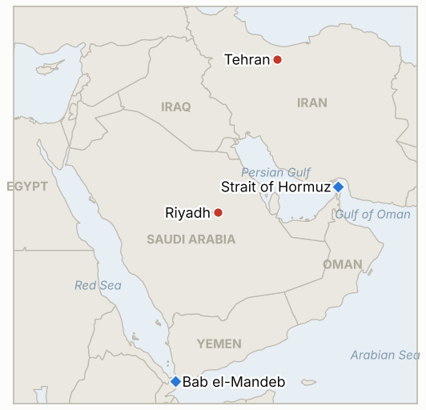

# Middle East Daily Briefing

**October 11, 2026**

- **Reporting window:** ~24 hours, October 10, 06:00 to October 11, 06:00 KST
- **Overall assessment:** Houthi forces attacked Riyadh's King Khalid airport again, at least once more on Saturday, with the airport closed, injuries and reported deaths, and 324 flights cancelled; Trump then said the US "may" join Saudi Arabia's fight against the Houthis and would "take a look" at whether this changes his pledge not to strike Iran before November 3 (§1.1). Yemeni government forces and the Houthis contest Bab el-Mandeb and Mayyun Island while the Saudi led coalition says it destroyed 136 targets (§1.2). Iran's IRGC says a tanker hit a mine in Hormuz, and the Kremlin says Putin relayed Iran's views on a deal to Trump (§1.3). Brent settled near $104.7 on Friday as diesel futures fell 4.6% on the Russian supply announcement (§1.4). It was a Saturday: Korean markets did not trade, and Friday's levels stand.

**Corrections and updates:** The October 10 brief (§1.3) put Brent at about $103 on Friday from a quote; settle data now put the October 9 settle near $104.7 (sources range from $104.43 to about $105), so Brent did not ease as the brief described. The October 10 brief (§1.4) cited three Saudi deaths on October 8; another account (Al-Monitor via search summary) reports three killed and over 30 injured across two airports, including one killed at King Khalid, so the casualty picture remains unsettled.

---

## 1. What Happened

<figure style="float:right; width:46%; margin:2pt 0 8pt 14pt;">

<figcaption style="font-size:8pt; color:#666; text-align:center; margin-top:3pt; font-style:italic;">Major places of discussion</figcaption>
</figure>

### 1.1 Riyadh airport hit again; Trump says the US may join the fight against the Houthis

Saudi Arabia's Civil Aviation Authority confirmed a further attack on King Khalid International Airport on Saturday, with an undetermined number of wounded and the airport closed for damage assessment ([Al Jazeera](https://www.aljazeera.com/news/liveblog/2026/10/10/iran-war-live-kremlin-says-trump-welcomed-russia-effort-in-iran-deal)). CBS reported the airport was attacked and evacuated twice during the day, FlightAware counted 324 cancelled flights, and the US, Canadian, German and Spanish embassies told citizens to avoid the area ([CBS News](https://www.cbsnews.com/live-updates/iran-war-trump-us-elections-saudi-arabia-yemen-houthis/)). The Times of Israel, citing AFP and a hospital source, said at least two people were killed (an Egyptian flight attendant and a Palestinian) and at least five were in intensive care; that count is unconfirmed by Saudi authorities. Trump said the US "may" join Saudi Arabia in striking the Houthis ("we're gonna look at it") and would decide quickly; asked whether this could change his plan not to strike Iran before the midterms, he said "we're gonna take a look." **Confidence: High that the attack, closure and Trump's words occurred; Low on the death toll (single hospital source); Low that US participation is decided.**

### 1.2 Bab el-Mandeb and Mayyun Island contested as the coalition reports 136 targets destroyed

On Saturday Yemeni government forces reportedly advanced near Bab el-Mandeb; the Houthis said they repelled the assault and still hold Mayyun Island (Mayun), while a Saudi diplomat had said Friday that Yemeni forces controlled both ([CBS News](https://www.cbsnews.com/live-updates/iran-war-trump-us-elections-saudi-arabia-yemen-houthis/)). The Saudi led coalition said it destroyed 136 military targets in Houthi held areas, and Pakistan said it has substantial forces in Saudi Arabia for defensive purposes. The Houthis separately claimed humanitarian flights to Riyadh need their authorization. The two sides' control claims remain flatly contradictory with no independent confirmation. **Confidence: High that the claims were made; Low on who holds the strait coast; Medium on the 136 target figure (coalition statement).**

### 1.3 Iran: a reported mine strike in Hormuz, a Putin message and a war of words with Rubio

Iranian state media quoted the IRGC saying an unnamed tanker exploded and caught fire after hitting a naval mine in the Strait of Hormuz ([Times of Israel](https://www.timesofisrael.com/liveblog-october-10-2026)); no flag, name or UKMTO corroboration was found. The Kremlin said Putin relayed Iran's views on a possible peace deal to Trump in Friday's call and that Trump welcomed Russia's effort; CBS notes diplomacy has been stalled since summer. Iranian officials, including Foreign Ministry spokesman Esmaeil Baghaei and security official Mohsen Rezaei, rejected Secretary of State Rubio's October 7 Athens speech, which called Iran's leaders a "death cult," as an "anachronism" ([Al Jazeera](https://www.aljazeera.com/news-analysis/2026/10/10/anachronism-rubios-civilisational-rhetoric-prompts-pushback-from-iran)). At a Friday rally Trump said Iran will be resolved "one way or the other." **Confidence: High on the statements; Low on the mine strike (IRGC claim only); Low that the Putin channel changes Iran's position.**

### 1.4 Brent settles near $104.7 as diesel futures fall on the Russian supply deal

Friday's Brent settle is reported at $104.72 in one weekly summary, near $105 by Bloomberg and $104.43 by Trading Economics; WTI was $91.85, and Brent finished the week up about 2% from $102.25 on October 2 ([Oil Monitor weekly summary](https://unbiasednews.substack.com/p/oil-monitor-weekly-summary-brent-19b); [DTN](https://www.dtnpf.com/agriculture/web/ag/news/world-policy/article/2026/10/09/ulsd-futures-fall-4-us-russia-diesel)). ULSD futures settled at $4.73 a gallon, down 4.6%, after Trump said Russia would supply 300,000 tonnes of diesel; only an OFAC general license is officially confirmed, and the tonnage comes from Trump's post. Federal data cited in the weekly summary say producers had shut in about 63% of Gulf oil output (1.28 million bpd) by Thursday. **Confidence: Medium on the Brent level (sources differ by about $0.6); Medium that diesel moved on the announcement; Low on Russian delivery.**

---

## 2. Deep Dive: Incentives and Motives

### 2.1 Why are the Houthis hitting Riyadh's airport repeatedly rather than oil sites?

An airport is a visible, low cost target: each strike produces cancellations, embassy warnings and global headlines, while damage to oil infrastructure would risk a heavier Saudi and American response. Repeating the strikes within days shows the Houthis can sustain tempo despite the coalition's claimed 136 targets, and it raises the price of Riyadh's backing for the Yemeni ground offensive.

### 2.2 Why would Trump consider joining Saudi strikes while pledging not to hit Iran?

The two commitments serve different audiences. The pledge limits war exposure before November 3 and a Houthi campaign is a politically easier target than Iran, since Saudi Arabia is an ally under attack and strikes on Yemen do not reopen the Hormuz war directly. His own answer, "we're gonna take a look" on whether Iran strikes change, signals he is keeping the option open, and Iran sees it as widening the war by another path.

### 2.3 Why does the Kremlin publicize its role as a channel to Iran?

Moscow gains standing with both Washington and Tehran and, through the diesel deal and sanctions license, tangible relief. Presenting Putin as a carrier of Iran's views positions Russia as indispensable to any deal, which strengthens its hand in other negotiations such as Ukraine.

### 2.4 Why does Iran answer Rubio's rhetoric so heavily?

Rubio's framing of Iran's leaders as a "death cult" targets the regime's legitimacy, and officials responded with history of their own. It lets Tehran signal that talk of coercion will be met with defiance while it keeps its revised proposals on the table, a double track that avoids appearing to negotiate from weakness.

---

## 3. Policy Implications for South Korea

**Exposure snapshot:** South Korea draws about 70.7% of its crude and 20.4% of its LNG from the Middle East (`instructions/korea-exposure.md`, no update needed). Korean markets were closed Saturday and Friday was a holiday, so the last prints remain KOSPI 6,625.93 and 1,338.5 won per dollar from October 8; Brent at about $104.7 is above the $100.20 settle of October 7. The first Korean session is Monday, October 12.

**Implications by development:**

- **Riyadh airport (§1.1):** Korean contractors and residents in the capital face a closed airport and Western embassy warnings; the 324 cancellations complicate any evacuation. No Korean Foreign Ministry advisory text was found in this window (IND-20261011-3).
- **US involvement against the Houthis (§1.1):** a US role would make attacks on Saudi and Red Sea shipping a wider target set and could end the pledge window earlier; Korean Red Sea routing for Gulf crude is exposed (IND-20261011-1).
- **Hormuz (§1.3):** a reported mine adds to war risk premia on Korea bound cargoes; the pending Korean Hormuz deployment decision remains open (IND-20260928-2).
- **Oil and diesel (§1.4):** Brent near $105 keeps the 2% weekly gain; diesel relief is a US and European story, with limited effect on Korea's crude heavy imports.
- **Markets:** Monday's session combines a week of foreign selling (IND-20261009-3, IND-20261010-1) with a higher weekend risk backdrop.

**Testable indicators:**

- **IND-20261011-1** (open, new): a disclosed US strike or announced US military participation against Houthi targets in Yemen by ~2026-10-25 confirms Trump's "may join" statement became policy; none falsifies.
- **IND-20261011-2** (open, new): King Khalid International Airport resumes scheduled commercial departures by ~2026-10-18 confirms operations normalize; none falsifies.
- **IND-20261011-3** (open, new): South Korea's Foreign Ministry raises its travel advisory or issues an evacuation advisory for Riyadh or Saudi Arabia by ~2026-10-25 confirms Seoul's exposure response; none falsifies.
- **IND-20261004-1** (resolved, falsified): no Saudi, Aramco or independent confirmation of the claimed strike on an Aramco facility south of Riyadh by the October 11 deadline.
- **IND-20261006-1** (resolved, confirmed): Saudi authorities confirmed Houthi attacks and casualties at King Khalid airport.
- **IND-20261010-1**, **IND-20261010-2**, **IND-20261010-3**, **IND-20261009-1**, **IND-20261008-1** and the remaining older open items (open): no resolving information in the window; Trump's statement is not a disclosed US strike (IND-20261009-1), and Friday's Brent settle did not clearly exceed $105 (IND-20261008-1).

---

## 4. Watch List

- **A US decision on joining the Saudi campaign against the Houthis (IND-20261011-1).**
- **Whether Riyadh's airport reopens and which airlines return (IND-20261011-2, IND-20261010-3).**
- **A US response to Iran's revised proposals and any Putin channel follow up (IND-20261010-2).**
- **UKMTO or owner confirmation of the reported Hormuz mine strike and NV Sunshine strike.**
- **Bab el-Mandeb and Mayyun Island control (IND-20261007-1).**
- **KOSPI foreign flows on Monday, October 12 (IND-20261010-1, IND-20261009-3).**

---

## 5. Source Quality Summary

| Claim | Sources | Confidence |
| --- | --- | --- |
| Riyadh airport attacked again, closed, injuries | Al Jazeera, CBS News | High |
| At least two killed, five in intensive care at Riyadh airport | Times of Israel citing AFP hospital source | Low |
| 324 cancelled flights; embassy warnings | CBS News citing FlightAware | Medium |
| Trump: US may join Saudi fight against Houthis | CBS News, Al Jazeera, Times of Israel | High as a statement |
| Bab el-Mandeb, Mayyun Island control | CBS News, partisan claims | Low |
| Coalition destroyed 136 targets | CBS News citing coalition | Medium |
| Tanker hit mine in Hormuz | Times of Israel citing Iranian state media | Low |
| Putin relayed Iran's views to Trump | CBS News citing the Kremlin | Medium |
| Rubio speech and Iranian responses | Al Jazeera | High |
| Brent about $104.7 Friday; WTI $91.85; ULSD $4.73 | Weekly summary, Bloomberg, Trading Economics, DTN (search summaries) | Medium |
| Gulf output shut in about 63% | Weekly summary citing federal data | Low |
| Korean markets closed Oct 9 and weekend | Calendar | High |
