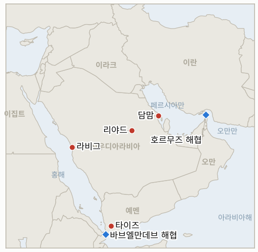

# 중동 일일 브리핑

**2026년 10월 12일**

- **보고 기간:** 약 24시간, 10월 11일 06:00 ~ 10월 12일 06:00 (한국시간)
- **종합 평가:** 사우디 민간항공청은 토요일 후티의 리야드 킹 칼리드 공항 미사일 공격 사상자를 사망 12명, 부상 309명으로 집계했으며, 이는 10년 넘게 사우디를 겨냥한 공격 가운데 가장 치명적이다. 일요일에도 공항과 담맘에 추가 공격이 있었다(§1.1). 리야드와 연합군은 단호한 대응을 천명했고 트럼프는 공격이 "용납될 수 없다"면서도 미국의 참여를 결정하지 않았다(§1.2). 예멘 지상전은 타이즈와 홍해 연안 일대로 번지고 있다(§1.3). 이란 외무차관은 호르무즈를 지렛대라고 불렀고 혁명수비대는 기뢰 주장에 세부 내용을 더했다(§1.4). 일요일이라 유가와 한국 시장 시세는 없었으며 월요일 서울 장이 다음 지표다(§3).

**정정 및 업데이트:** 10월 11일 브리핑(§1.1)은 토요일 리야드 공항 공격의 부상자 수를 파악되지 않았다고 전하고 병원 관계자 한 명을 인용한 최소 2명 사망(미확인)을 소개했다. 이후 사우디 항공 당국은 사망 12명, 부상 309명으로 집계해, 해당 브리핑은 피해를 크게 과소 서술했다. 같은 브리핑은 토요일 공격을 연속 공격 중 "추가 공격"으로 묘사했으나, 알자지라와 타임은 사망 12명을 토요일 터미널에 대한 단일 공격에 귀속시키며 일요일 공격은 별개로 본다.

---

## 1. 무슨 일이 있었나

<figure style="float:right; width:46%; margin:2pt 0 8pt 14pt;">

<figcaption style="font-size:8pt; color:#666; text-align:center; margin-top:3pt; font-style:italic;">주요 논의 지점</figcaption>
</figure>

### 1.1 리야드 공항 공격 사상자 사망 12명·부상 309명으로 늘고 일요일 추가 공격

사우디 민간항공청에 따르면 토요일 킹 칼리드 국제공항에 대한 미사일 공격으로 12명이 숨지고 309명이 다쳤으며 일부는 위독하다. 사망자는 사우디인 4명, 방글라데시인 2명, 미국·이집트·요르단·시리아·팔레스타인·수단인 각 1명이다([Al Jazeera](https://www.aljazeera.com/news/2026/10/11/yemen-fighting-expands-as-houthis-attack-saudi-airport-what-to-know), [Gulf News](https://gulfnews.com/world/mena/12-dead-over-300-hurt-in-riyadh-airport-attack-as-trump-weighs-us-action-against-houthis-1.500706148)). 일요일에는 신원 미상의 발사체가 4터미널을 타격해 화재가 났고 인근에서 순항미사일이 요격됐으며, 이후 담맘 킹 파하드 국제공항이 공격받았다는 보도가 있으나 피해는 평가 중이다. 리야드 공항 운영은 중단된 상태이고 flydubai는 10월 14일까지 리야드 노선을, 에티하드는 10월 13일까지 일부 노선을 취소했으며 리야드 학교는 일주일간 원격 수업으로 전환했다. 타임은 이번 주 공항 공격의 누적 사망자를 최소 19명으로 집계한다. **신뢰도: 민간항공청 집계와 일요일 폐쇄는 높음, 담맘 공격은 중간(후속 단일 보도), 타임의 누적 집계는 중간.**

### 1.2 리야드는 "단호한" 대응을 천명하고 트럼프는 "용납될 수 없다"면서도 결정을 미룬다

사우디 주도 연합군은 토요일 공격을 "전면적 전쟁범죄"로 규정했고, 투르키 알말리키 대변인은 "처벌받지 않고 넘어가지 않을 것"이라고 말했다. 연합군은 일요일 이른 시간 알카르즈를 겨냥한 탄도미사일과 동부 주 상공의 드론을 격추했다고 밝혔다([Time](https://time.com/article/2026/10/10/trump-says-u-s-may-join-saudi-strikes-on-houthis-after-riyadh-airport-attacks/)). 트럼프는 미국이 합류할 "수도 있다"며 공격이 "용납될 수 없다"고 말하고 무함마드 빈 살만 왕세자와 통화하겠다고 했으며, 루비오 국무장관은 미국인 1명의 사망을 확인했다. 알자지라가 인용한 미국 언론 보도에 따르면 워싱턴은 이미 예멘 공세에 정보, 표적 식별, 기획을 지원하고 있다. 유엔, EU, 프랑스, UAE, 카타르, 파키스탄, 튀르키예, 이집트, 인도 등이 공격을 규탄했다. **신뢰도: 발언은 높음, 기존 미국 지원은 중간(미국 언론 보도, 워싱턴 미확인), 미국의 타격 결정은 낮음.**

### 1.3 예멘 지상전 확대: "예멘의 새벽" 공세, 타이즈 포위, 홍해 정유시설 타격 주장

사우디가 지원하는 정부군은 10월 4일 "예멘의 새벽" 공세를 시작해 모카와 두밥 지구를 탈환했다고 밝히며 후티 1,150명을 사살했다고 주장했다. 후티는 이를 부인하며 알자지라도 검증하지 못했다. 후티는 도시 남쪽 지역을 장악한 뒤 타이즈 포위를 강화했고 전투는 마리브와 알자우프까지 번졌다. 후티는 홍해 연안 아람코 라비그 정유시설에 불을 질렀다고도 주장했으나 사우디 당국은 즉각 확인하지 않았다. 이 주장의 시점은 불분명하며 한국 언론이 10월 7일 비슷한 주장을 전한 바 있다. 타임은 후티가 모카와 페림 섬을 장악해 바브엘만데브 접근로에 자리 잡았다고 전하는데, 이는 앞서 사우디 외교관이 정부군이 장악했다고 한 주장과 상충한다. **신뢰도: 공세와 타이즈 포위는 중간, 모카·페림·해협 연안의 장악 주체는 낮음, 라비그 화재는 낮음.**

### 1.4 이란: 호르무즈는 "지렛대", 기뢰 타격 주장의 세부 내용

이란 외무차관은 새로운 군사 행동에 대한 이란의 대응이 과거와 다를 것이라며 호르무즈 해협을 지렛대라고 불렀다([Gulf News](https://gulfnews.com/world/mena/12-dead-over-300-hurt-in-riyadh-airport-attack-as-trump-weighs-us-action-against-houthis-1.500706148)). 혁명수비대 해군은 10월 10일 기뢰에 부딪혀 폭발한 초대형 유조선이 항법 장치를 끈 채 허가받지 않은 항로로 빠져나가던 중이었다며 "규정을 따르지 않는 모든 유조선"의 운명이 화재라고 경고했다([Deccan Herald](https://www.deccanherald.com/world/middle-east/irans-guards-say-tanker-exploded-after-hitting-mine-in-strait-of-hormuz-4178427)). 인도인 선원 11명이 다쳤다는 보도와 인도의 규탄이 있으나 이 선박과의 연관은 확인되지 않으며, 선박은 이름이 공개되지 않았고 UKMTO 확인도 없다. 타임은 11월 3일 이전 이란 공격 자제 약속이 후티에는 적용되지 않는다고 지적한다. **신뢰도: 발언은 높음, 기뢰 타격과 인도인 부상 연관은 낮음.**

---

## 2. 심층 분석: 동기와 유인

### 2.1 후티는 왜 사우디 공항을 타격하고 항공사에 사우디 영공 회피를 경고하는가?

민간 항공은 사우디 체계 가운데 가장 눈에 띄고 방어하기 어려운 부문이어서, 309명 사상 공격과 항공사 운항 중단은 물리적 피해를 훨씬 넘는 경제적, 평판상 비용을 부과한다. 메카와 메디나를 제외한 경고는 사우디 상업을 끊으려 하면서도 성지 타격이 부를 종교적 반발은 피하겠다는 의도적 신호다. 지상 공세가 후티 해안으로 향하는 시점의 공격은 리야드가 공세의 이익과 국내 피해 비용을 저울질하게 만들려는 목적도 있다.

### 2.2 리야드는 왜 휴전을 받아들이지 않고 확전하는가?

지역 소식통은 앞서 AFP에 정부가 잃은 영토를 되찾기 전에는 리야드가 휴전에 동의하지 않을 것이라고 전했고, 이번 사망자 규모로 자제는 국내 정치적으로 더 큰 부담이 됐다. 튀르키예, 파키스탄, 사우디 협정이 10월 5일 억지 조치를 가동해 리야드의 후방이 넓어졌다. 확전은 9월부터 타격을 요청해 온 워싱턴에 대한 압박이기도 하며, 미국인 사망은 트럼프에게 움직일 명분을 준다.

### 2.3 트럼프는 왜 사우디 합류와 이란 회피 사이에서 양다리를 걸치는가?

전쟁은 인기가 없고(AP-NORC 조사에서 69%가 치를 가치가 없다고 응답) 11월 3일 중간선거는 이란에 대한 가시적 자제를 보상한다. 후티 작전은 이란 약속을 형식상 깨지 않으면서 동맹과 미국인 희생자를 방어하는 길이며, 보도된 정보 지원이 사실이라면 이미 조용한 개입이 진행 중일 수 있다. 공격이 용납될 수 없다고 말하면서 확약은 피하는 것은 리야드에 대한 영향력을 유지하고 선거 전 홍해 전쟁을 피하는 방법이다.

### 2.4 이란은 왜 기뢰 주장을 상세히 밝히면서 호르무즈를 지렛대로 규정하는가?

유조선이 "허가받지 않은 항로"로 항법 장치를 끄고 갔다는 설명은 재난을 이란 통항 규칙의 집행으로 재포장해, 기뢰 부설을 인정하지 않으면서 통제권 주장을 뒷받침한다. 호르무즈를 지렛대라고 부른 것은 후티에 대한 미국의 움직임이나 이란 공격에 다른 대응이 따를 것이라는 경고이자, 후티가 눈에 띄는 전투를 맡는 동안 확전을 억지하려는 신호다.

---

## 3. 한국에 대한 정책적 시사점

**노출도 요약:** 한국은 원유의 약 70.7%, LNG의 약 20.4%를 중동에서 들여온다(`instructions/korea-exposure.md`, 갱신 불필요). 일요일에는 시장이 열리지 않아 마지막 시세는 브렌트유 104.72달러, WTI 91.85달러(10월 9일), 코스피 6,625.93, 원·달러 1,338.5원(10월 8일)이다. 10월 12일 월요일은 휴일과 주말 이후 첫 한국 거래일로, 더 치명적인 리야드 사상자와 확대된 예멘 전쟁 속에 개장한다.

**전개별 시사점:**

- **리야드 공항(§1.1):** 리야드 거주 교민과 건설 인력은 공항 운영 중단과 10월 13일, 14일까지 이어지는 항공사 결항에 직면한다. 이번 주 초 제다 총영사관은 라비그 사건과 관련한 한국인 피해가 확인되지 않는다고 밝혔고, 사우디 여행경보 조정은 찾지 못했다(IND-20261011-3).
- **사우디 보복과 미국의 역할 가능성(§1.2):** 사우디와 미국의 작전 확대는 홍해 해운과 사우디 유전 타격 가능성을 높여 한국의 걸프산 원유 흐름에 타격을 줄 수 있다(IND-20261011-1, IND-20261012-1).
- **홍해 연안과 라비그(§1.3):** 10월 7일 한국 언론에 따르면 현대자동차 공장 건설 현장은 라비그 정유시설에서 약 6~7km 떨어져 있고, 회사는 직원 피해가 없다고 밝혔다. 이 지역의 확인된 타격은 한국 기업 노출도를 시험하게 된다.
- **호르무즈(§1.4):** 미확인 기뢰 타격과 이란의 지렛대 발언은 한국행 화물의 전쟁 위험 할증을 유지시키며, 호르무즈 파견 결정은 계류 중이다(IND-20260928-2, IND-20261012-2).
- **시장:** 월요일 코스피 종가는 IND-20261010-1(6,625.93 초과 마감)과 외국인 수급(IND-20261009-3)의 시험대이며, 월요일 장이 사상자 소식에 상승하면 브렌트유 105달러 초과(IND-20261008-1)도 가능하다.

**검증 가능한 지표:**

- **IND-20261012-1**(진행 중, 신규): 2026-10-26경까지 사우디 당국 또는 아람코가 후티 공격으로 인한 아람코 시설 피해를 확인하면 작전이 공항에서 석유로 옮겨갔음을 확인하며, 확인이 없으면 반증한다.
- **IND-20261012-2**(진행 중, 신규): 2026-10-19경까지 UKMTO, 선주 또는 선적국이 혁명수비대가 호르무즈에서 기뢰에 부딪혔다고 주장한 유조선을 특정해 확인하면 사건이 확인된 것이며, 확인이 없으면 반증한다.
- **IND-20261011-1**, **IND-20261011-2**, **IND-20261011-3**, **IND-20261010-1** 및 나머지 기존 진행 중 항목(진행 중): 이번 기간에 판정할 정보 없음. 트럼프의 "합류할 수도 있다"는 아직 발언이며 킹 칼리드 공항 운영은 일요일에도 중단 상태였고, IND-20261010-1은 이 브리핑 이후 나올 월요일 코스피 종가로 판정된다.

---

## 4. 관찰 목록

- **트럼프와 무함마드 빈 살만 왕세자의 통화, 미국의 타격 결정(IND-20261011-1).**
- **사우디 보복 규모와 담맘, 아람코, 홍해 시설에 대한 후티의 후속 공격(IND-20261012-1).**
- **리야드 공항 재개와 10월 13일, 14일 항공사 복귀 여부(IND-20261011-2, IND-20261010-3).**
- **모카, 페림, 바브엘만데브 연안 장악과 타이즈 포위(IND-20261007-1).**
- **호르무즈 기뢰 타격의 확인(IND-20261012-2).**
- **월요일 코스피 종가와 외국인 수급(IND-20261010-1, IND-20261009-3).**

---

## 5. 출처 품질 요약

| 주장 | 출처 | 신뢰도 |
| --- | --- | --- |
| 리야드 공항 공격 사망 12명, 부상 309명 | Al Jazeera, Gulf News (민간항공청 인용) | 높음 |
| 이번 주 공항 공격 누적 사망 최소 19명 | Time | 중간 |
| 일요일 4터미널 타격, 리야드 운영 중단, 항공사 결항 | Gulf News | 높음 |
| 담맘 킹 파하드 공항 공격 | Gulf News (후속 보도) | 중간 |
| 사우디의 대응 천명, 연합군의 "전쟁범죄" 규정 | Al Jazeera, Time, Gulf News | 높음 |
| 트럼프: 미국 합류 "수도 있다", 왕세자와 통화 예정 | Al Jazeera, Time | 발언으로서 높음 |
| 미국의 기존 정보·표적 지원 | Al Jazeera (미국 언론 인용) | 중간 |
| "예멘의 새벽" 성과, 후티 1,150명 사살 | Al Jazeera (예멘 정부 주장) | 낮음 |
| 후티의 모카·페림 섬 장악 | Time | 낮음 |
| 라비그 정유시설 화재 | Al Jazeera (후티 주장 인용), 한국 언론 | 낮음 |
| 이란: 호르무즈는 지렛대 | Gulf News | 중간 |
| 혁명수비대 기뢰 주장 세부 내용 | Deccan Herald, Times of Israel (혁명수비대 인용) | 낮음 |
| 일요일 시장 시세 없음 | 달력 | 높음 |
