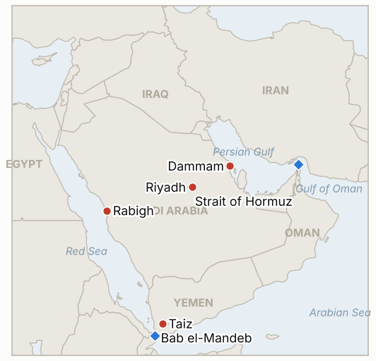

# Middle East Daily Briefing

**October 12, 2026**

- **Reporting window:** ~24 hours, October 11, 06:00 to October 12, 06:00 KST
- **Overall assessment:** Saudi Arabia's aviation authority now puts Saturday's Houthi missile strike on Riyadh's King Khalid airport at 12 dead and 309 wounded, the deadliest attack on the kingdom in over a decade, and further strikes hit the airport and Dammam on Sunday (§1.1). Riyadh and the coalition vow a decisive response, Trump calls the attack "not acceptable" and has not decided on US participation (§1.2), while the Yemeni ground war widens around Taiz and the Red Sea coast (§1.3). Iran's deputy foreign minister called Hormuz leverage, and the IRGC added detail to its mine claim (§1.4). Sunday meant no oil or Korean market prints; Monday's Seoul session is the next read (§3).

**Corrections and updates:** The October 11 brief (§1.1) described the Saturday Riyadh airport attack as having an undetermined number of wounded and cited an unconfirmed count of at least two dead from a single hospital source. Saudi aviation officials have since put it at 12 dead and 309 wounded, so that brief badly understated the toll. The same brief called the Saturday strike "a further attack" in a series; Al Jazeera and Time date the 12 deaths to Saturday's single strike on the terminal, with Sunday's strikes separate.

---

## 1. What Happened

<figure style="float:right; width:46%; margin:2pt 0 8pt 14pt;">

<figcaption style="font-size:8pt; color:#666; text-align:center; margin-top:3pt; font-style:italic;">Major places of discussion</figcaption>
</figure>

### 1.1 Riyadh airport toll rises to 12 dead and 309 wounded; more strikes follow Sunday

Saudi Arabia's General Authority of Civil Aviation says the Saturday missile strike on King Khalid International Airport killed 12 people and wounded 309, some critically; the dead include four Saudis, two Bangladeshis and one each from the US, Egypt, Jordan, Syria, Palestine and Sudan ([Al Jazeera](https://www.aljazeera.com/news/2026/10/11/yemen-fighting-expands-as-houthis-attack-saudi-airport-what-to-know); [Gulf News](https://gulfnews.com/world/mena/12-dead-over-300-hurt-in-riyadh-airport-attack-as-trump-weighs-us-action-against-houthis-1.500706148)). On Sunday an unidentified projectile hit Passenger Terminal 4 and started a fire, a cruise missile was intercepted nearby, and a later attack reportedly hit King Fahd International Airport in Dammam, with damage still being assessed. Riyadh operations stayed suspended, flydubai cancelled Riyadh flights until October 14, Etihad cancelled selected routes until October 13, and Riyadh schools moved online for a week. Time counts at least 19 deaths across the week's airport attacks. **Confidence: High on the GACA toll and the Sunday closure; Medium on the Dammam strike (single later report); Medium on the Time cumulative count.**

### 1.2 Riyadh vows a "decisive" response; Trump calls it "not acceptable" but has not decided

The Saudi-led coalition called Saturday's attack a "full-fledged war crime," Saudi spokesman Turki al-Malki said it "will not go unpunished," and the coalition said it shot down a ballistic missile aimed at al-Kharj and a drone over the Eastern Province early Sunday ([Time](https://time.com/article/2026/10/10/trump-says-u-s-may-join-saudi-strikes-on-houthis-after-riyadh-airport-attacks/)). Trump said the US "may" join Saudi strikes, called the attack "not acceptable," and said he would speak with Crown Prince Mohammed bin Salman; Secretary of State Rubio confirmed an American died. US media reports cited by Al Jazeera say Washington already provides intelligence, target identification and planning help for the Yemeni offensive. The UN, EU, France, the UAE, Qatar, Pakistan, Turkey, Egypt and India condemned the attacks. **Confidence: High on the statements; Medium on existing US support (media reports, unconfirmed by Washington); Low that a US strike is decided.**

### 1.3 The Yemeni ground war widens: "Dawn of Yemen," the Taiz siege and a claimed Red Sea refinery hit

Saudi-backed government forces launched the "Dawn of Yemen" offensive on October 4 and say they retook Mocha and Dhubab district, claiming 1,150 Houthis killed; the Houthis dispute this, and Al Jazeera could not verify it. The Houthis have tightened their siege of Taiz after taking ground south of the city, and fighting has reached Marib and al-Jawf. The Houthis also claimed a fire at Aramco's Rabigh refinery on the Red Sea coast, which Saudi authorities did not immediately confirm; the claim's date is unclear and Korean press reported a similar claim on October 7. Time says the Houthis hold Mokha and Perim Island, which would put them on the Bab el-Mandeb approaches, contradicting the Saudi diplomat's earlier claim. **Confidence: Medium that the offensive and Taiz siege are as described; Low on who holds Mocha, Perim and the strait coast; Low on the Rabigh fire.**

### 1.4 Iran: Hormuz as "leverage" and more detail on the claimed mine strike

Iran's deputy foreign minister said Iran's response to any new military action would differ from its past responses and described the Strait of Hormuz as leverage ([Gulf News](https://gulfnews.com/world/mena/12-dead-over-300-hurt-in-riyadh-airport-attack-as-trump-weighs-us-action-against-houthis-1.500706148)). The IRGC Navy said the supertanker that exploded after hitting a mine on October 10 was leaving by an unauthorized route with its navigation systems off, and warned that fire is the fate of "any non-compliant oil tanker" ([Deccan Herald](https://www.deccanherald.com/world/middle-east/irans-guards-say-tanker-exploded-after-hitting-mine-in-strait-of-hormuz-4178427)). One report mentions 11 injured Indian crew and Indian condemnation, but nothing ties it to this vessel, and the ship is unnamed with no UKMTO confirmation. Time notes the US pledge not to strike Iran before November 3 does not cover the Houthis. **Confidence: High on the statements; Low on the mine strike and any link to Indian casualties.**

---

## 2. Deep Dive: Incentives and Motives

### 2.1 Why are the Houthis hitting Saudi airports and warning airlines off Saudi airspace?

Civil aviation is the Saudi system that is most visible and hardest to shield; a 309 casualty strike plus airline suspensions imposes economic and reputational cost far beyond the damage. The warning exempting Mecca and Medina is a deliberate signal that they seek to cut Saudi commerce while avoiding the religious backlash a pilgrimage strike would bring. Attacking while the ground offensive pushes toward their coast also aims to make Riyadh weigh the offensive against the cost at home.

### 2.2 Why would Riyadh escalate rather than accept a truce now?

A regional source told AFP earlier that Riyadh will not agree to a truce until the government recovers lost territory, and the toll now makes restraint politically costly at home. The Turkey, Pakistan and Saudi pact activated deterrence measures on October 5, giving Riyadh a wider backstop. Escalating also presses Washington, which Riyadh has lobbied for strikes since September, and the death of an American gives Trump a reason to move.

### 2.3 Why is Trump hedging between joining Saudi strikes and avoiding Iran?

The war is unpopular (69% in an AP-NORC poll said it was not worth fighting) and the November 3 midterms reward visible restraint toward Iran. A Houthi campaign defends a partner and an American victim without technically breaking the Iran pledge, and the reported intelligence role means a quiet deeper involvement may already exist. Calling the attack unacceptable while declining to commit keeps leverage over Riyadh and avoids a Red Sea war before the vote.

### 2.4 Why does Tehran frame Hormuz as leverage while detailing the mine claim?

Publicizing that the tanker took an "unauthorized route" with its systems off recasts a disaster as enforcement of Iran's transit rules, which supports its claim of control without admitting laying mines. Calling Hormuz leverage warns that a US move against the Houthis or Iran would meet a different response, deterring escalation while the Houthis do the visible fighting.

---

## 3. Policy Implications for South Korea

**Exposure snapshot:** South Korea draws about 70.7% of its crude and 20.4% of its LNG from the Middle East (`instructions/korea-exposure.md`, no update needed). No market traded on Sunday, so the last prints remain Brent $104.72 and WTI $91.85 (October 9), KOSPI 6,625.93 and 1,338.5 won per dollar (October 8). Monday, October 12 is the first Korean session after the holiday and weekend, and it opens against a deadlier Riyadh toll and a wider Yemen war.

**Implications by development:**

- **Riyadh airport (§1.1):** Korean residents and contractors in Riyadh face an airport suspended with airline cancellations running to October 13 and 14; Seoul's Jeddah consulate said earlier in the week that no Korean casualties were confirmed from the Rabigh incident, and I found no Korean advisory change for Saudi Arabia (IND-20261011-3).
- **Saudi retaliation and possible US role (§1.2):** a wider Saudi and US campaign raises the chance of strikes on Red Sea shipping and Saudi oil sites, which would hit Korea's Gulf crude flows (IND-20261011-1, IND-20261012-1).
- **Red Sea coast and Rabigh (§1.3):** Hyundai Motor's plant construction site is about 6 to 7 km from the Rabigh refinery, per Korean press on October 7; the company then reported no staff harm. A confirmed hit would test Korean corporate exposure in the area.
- **Hormuz (§1.4):** the unconfirmed mine strike and Iran's leverage language keep war risk premia on Korea bound cargoes; the pending Hormuz deployment decision remains open (IND-20260928-2, IND-20261012-2).
- **Markets:** Monday's KOSPI close is the test for IND-20261010-1 (close above 6,625.93) and foreign flows (IND-20261009-3); Brent above $105 (IND-20261008-1) is plausible if Monday trades up on the toll.

**Testable indicators:**

- **IND-20261012-1** (open, new): Saudi authorities or Aramco confirm damage to an Aramco facility from a Houthi attack by ~2026-10-26 confirms the campaign has moved from airports to oil; none falsifies.
- **IND-20261012-2** (open, new): UKMTO, a ship owner or flag state identifies and confirms the tanker the IRGC says hit a mine in Hormuz by ~2026-10-19 confirms the incident; none falsifies.
- **IND-20261011-1**, **IND-20261011-2**, **IND-20261011-3**, **IND-20261010-1** and the remaining older open items (open): no resolving information in the window. Trump's "may join" is still a statement, King Khalid operations remained suspended Sunday, and IND-20261010-1 resolves on Monday's KOSPI close, due after this brief.

---

## 4. Watch List

- **A Trump and Mohammed bin Salman call, and any US decision on strikes (IND-20261011-1).**
- **Saudi retaliation scale and Houthi follow ups on Dammam, Aramco and Red Sea sites (IND-20261012-1).**
- **Riyadh airport reopening, and the airlines' October 13 and 14 return dates (IND-20261011-2, IND-20261010-3).**
- **Control of Mocha, Perim and the Bab el-Mandeb coast, and the Taiz siege (IND-20261007-1).**
- **Confirmation of the Hormuz mine strike (IND-20261012-2).**
- **Monday's KOSPI close and foreign flows (IND-20261010-1, IND-20261009-3).**

---

## 5. Source Quality Summary

| Claim | Sources | Confidence |
| --- | --- | --- |
| Riyadh airport strike: 12 dead, 309 wounded | Al Jazeera, Gulf News citing GACA | High |
| Cumulative at least 19 airport deaths this week | Time | Medium |
| Sunday Terminal 4 hit, Riyadh suspended, airline cancellations | Gulf News | High |
| Dammam King Fahd airport struck | Gulf News (later report) | Medium |
| Saudi vow of response; coalition "war crime" | Al Jazeera, Time, Gulf News | High |
| Trump: US "may" join; call with MBS planned | Al Jazeera, Time | High as a statement |
| US already provides intelligence and targeting help | Al Jazeera citing US media | Medium |
| "Dawn of Yemen" gains; 1,150 Houthis killed | Al Jazeera (Yemeni government claims) | Low |
| Houthis hold Mokha and Perim Island | Time | Low |
| Rabigh refinery fire | Al Jazeera citing Houthi claim; Korean press | Low |
| Iran: Hormuz as leverage | Gulf News | Medium |
| IRGC mine claim details | Deccan Herald, Times of Israel citing IRGC | Low |
| No Sunday market prints | Calendar | High |
