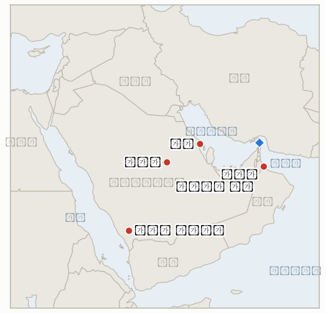

# 중동 일일 브리핑

**2026년 10월 13일**

- **보고 기간:** 약 24시간, 10월 12일 06:00 ~ 10월 13일 06:00 (한국시간)
- **종합 평가:** 후티의 사우디 공항 공격이 한국의 정책 사안이 되었다. 외교부는 사우디 전역을 출국 권고로 상향했고, 리야드 공항은 폐쇄가 이어지는 가운데 리야드와 카미스 무샤이트로 미사일이 추가 발사되었다(§1.1). 트럼프는 사우디 타격 합류를 아직 결정하지 않았다(§1.2). 이란은 호르무즈 관련 미국의 답신을 불충분하다고 평가했고, 오만 소하르 앞바다에서 유조선이 드론에 피격되었다(§1.3). 시장은 이를 반영했다. 브렌트유는 9월 15일 이후 최고치인 106.65달러에 마감했고, 코스피는 외국인 매도로 3.65% 급락한 6,384.24에 마감했다(§1.4).

**정정 및 업데이트:** 10월 12일 브리핑(§3)은 사우디에 대한 한국의 여행경보 변경을 확인하지 못했다고 적었다. 그러나 외교부는 조현 장관 주재 합동 상황점검회의를 거쳐 해당 브리핑의 보고 기간 안인 10월 11일 오후 10시(한국시간)에 사우디 전역을 4단계 중 3단계인 '출국 권고'로 상향했다([Nate News](https://m.news.nate.com/view/20261012n21106); [JKN](https://news.jkn.co.kr/post/1017461)). 또 일요일 4터미널 공격은 파키스탄 거주자 1명 사망, 11명 부상으로 보도되었고, 토요일 공격의 사망자는 매체에 따라 12명 또는 13명으로 전해진다.

---

## 1. 무슨 일이 있었나

<figure style="float:right; width:46%; margin:2pt 0 8pt 14pt;">

<figcaption style="font-size:8pt; color:#666; text-align:center; margin-top:3pt; font-style:italic;">주요 논의 지점</figcaption>
</figure>

### 1.1 리야드 공항 폐쇄가 이어지고 사우디 도시로 미사일이 추가 발사되며, 서울은 출국 권고를 발령한다

CNN에 따르면 킹 칼리드 국제공항은 추후 공지가 있을 때까지 폐쇄되며, 항공고시보(NOTAM)는 최소 10월 17일까지를 가리킨다. 사우디 전역에서 취소된 항공편도 수백 편에 이른다([CNN](https://www.cnn.com/2026/10/10/middleeast/riyadh-airport-saudi-houthis-intl)). 사우디 방공망은 월요일 이른 시각 리야드와 카미스 무샤이트를 향해 발사된 탄도미사일을 각각 요격했다고 밝혔고, 인근 아브하에서는 민방위 경보가 발령되었다([Arab News](https://www.arabnews.com/saudi-arabia/saudi-arabias-air-defenses-intercept-houthi-missile-in-khamis-mushait-3005840)). 일요일 미사일 공격으로 파키스탄 거주자 1명이 숨지고 11명이 다친 것으로 전해진다. 서울의 외교부는 사우디 전역을 출국 권고로 상향해, 체류 국민에게 긴요한 용무가 아니면 출국하고 여행 예정자에게는 일정을 취소하거나 연기하라고 요청했다([Nate News](https://m.news.nate.com/view/20261012n21106)). **신뢰도: 폐쇄와 한국의 경보는 높음, 파키스탄인 사상 보도는 중간(동일 계열 단일 출처), NOTAM 날짜는 중간.**

### 1.2 트럼프는 사우디 타격 합류를 여전히 결정하지 않았고, 통화와 미국의 타격은 확인되지 않았다

보고 기간 중 트럼프와 무함마드 빈 살만 왕세자의 통화나 미국의 후티 타격은 보도되지 않았다. 공개된 마지막 입장은 "그럴 수 있다"는 합류 시사와 "용납될 수 없다"는 발언이다([NBC News](https://www.nbcnews.com/world/middle-east/saudi-airport-attack-trump-us-join-fight-houthis-rcna602744)). CBS와 뉴욕타임스는 왕세자가 트럼프에게 타격을 직접 압박했고, 이란 전쟁이 해결되지 않은 상황에서 제2전선의 위험을 이유로 9월 말 미국의 타격이 막판에 취소되었다고 보도했다([CBS News](https://www.cbsnews.com/news/saudi-arabia-mbs-trump-houthis-yemen/); [Ynet](https://www.ynetnews.com/article/skx791kqge)). 현재 워싱턴의 역할은 정보와 표적 지원으로 알려져 있다. **신뢰도: 미국 타격이 공개되지 않았다는 점은 높음, 배경 보도는 중간(관리를 인용한 이스라엘·미국 매체).**

### 1.3 이란은 미국의 호르무즈 답신을 "불충분"하다고 평가하고, 소하르 앞바다에서 유조선이 드론에 피격된다

이란의 모흐센 레자이 국가안보 수장은 해협 재개방을 위한 이란의 7개 조건에 대한 미국의 답신이 미흡하며, 일부는 수용되었으나 조건이 충족될 때까지 해협은 미국에 열리지 않고 협상도 없을 것이라고 말했다([Anadolu, ANews](https://www.anews.com.tr/middle-east/2026/10/11/iran-says-us-response-to-conditions-for-reopening-strait-of-hormuz-insufficient); [Benzinga](https://www.benzinga.com/news/politics/26/10/62291540/iran-says-us-accepted-some-demands-to-reopen-strait-of-hormuz-but-response-is-inadequate-araghchi-warns-of-ecological-damage)). 별도로 영국해사무역기구(UKMTO)는 오만 소하르 정박지 인근에서 유조선이 드론에 피격되었음을 확인하고 이를 공격으로 재분류했다. 일부 매체는 니카라과 선적 페트로 돌핀(Petro Dolphin)호를 지목했고 한 선원 노조는 인도인 선원 14명 중 2명이 실종되었다고 주장하나 UKMTO는 이를 확인하지 않았다([Arab News](https://www.arabnews.com/middle-east/uk-maritime-says-tanker-struck-by-drone-in-vicinity-of-omans-sohar-anchorage-3005832); [Seatrade Maritime](https://www.seatrade-maritime.com/security/iran-hits-tanker-in-sohar-and-two-in-hormuz-us-disables-bulker)). Rudaw가 인용한 워싱턴 근동정책연구소 집계로는 9월 28일 이후 호르무즈와 주변 해역에서 최소 17건의 유조선 공격이 있었고 대부분 이란과 연계된 것으로 분류된다. **신뢰도: UKMTO의 드론 공격 확인은 높음, 이란의 입장은 중간(이란 당국자 발언의 전언), 귀속과 실종 선원은 낮음.**

### 1.4 브렌트유는 106.65달러에 마감하고 코스피는 3.65% 급락해 6,400선이 무너진다

브렌트유는 1.93달러 오른 106.65달러에 마감해 9월 15일 이후 최고치를 기록했고, WTI는 약 2% 오른 93.74달러에 마감했다. 트럼프가 러시아산 경유 추가 공급을 발표했지만 사우디에 대한 후티의 공격과 유조선 피격이 이를 압도했다(로이터, CNBC 인용). 서울에서는 코스피가 3.65% 내린 6,384.24에 마감해 8월 11일 이후 처음으로 6,400 아래로 내려갔고, 외국인은 약 2.02조 원을 순매도했다. 원·달러 환율은 수출업체의 달러 매도로 약 2년 만의 원화 강세 수준인 1,335.1원 안팎에서 마감했다([FN News](https://en.fnnews.com/news/202610121518291365); [SBS](https://news.sbs.co.kr/english/article.do?news_id=N1008793041)). Trading Economics는 1,333.91원으로 집계하며, 국내 보도는 하락 원인으로 중동뿐 아니라 인공지능 및 실적 우려도 거론했다. **신뢰도: 유가 정산가와 코스피 종가는 높음, 환율 종가는 중간(출처 간 약 1원 차이), 코스피 하락을 전쟁 탓으로 돌리는 부분은 중간.**

---

## 2. 심층 분석: 동기와 유인

### 2.1 서울은 왜 지금 사우디에 출국 권고를 발령하는가?

대형 공항이 며칠 새 두 차례 공격받았고 미국인이 사망했으며 공항마저 폐쇄되어 대피 시간이 줄어들고 있다. 과거 걸프 위기에서 정부 대응이 늦었다는 비판을 받은 선례도 있다. 4단계(철수 권고 이상)로 올리지 않은 것은 단계별 확대의 여지를 남기고, 한국 건설업체와 라비그 현대차 공사 현장에 사우디가 철수가 필요할 만큼 위험하다는 신호를 주지 않기 위해서다. 한국인 피해 발생 시 정부가 질 책임도 줄인다.

### 2.2 트럼프는 왜 후티 타격을 여전히 주저하는가?

9월 말 취소 보도, 11월 3일 중간선거, 그 전에는 이란을 공격하지 않겠다는 공언은 모두 같은 방향을 가리킨다. 예멘 타격은 호르무즈에 닿는 보복의 악순환을 부를 수 있다. "그럴 수 있다"에 머무르면 리야드의 의존을 유지하고 정보 지원만으로 충분하다고 주장할 여지도 생긴다. 대가는 민간인 사망이 늘 경우 사우디가 느낄 불만이다.

### 2.3 이란은 왜 일부 요구가 수용되었다고 하면서도 미국의 답신이 불충분하다고 말하는가?

레자이의 표현은 미국의 양보를 이란의 지렛대가 통한다는 증거로 삼으면서도 해협은 열지 않는 방식이어서, 유가 프리미엄과 봉쇄 압박을 워싱턴에 계속 안긴다. 부분 수용은 강경파에게 전선이 유지되고 있다고 말할 근거를 주고, 페제시키안 진영에는 채널을 살려 둔다. 호르무즈 밖인 소하르 앞바다 드론 타격은 압박이 오만 해안까지 닿았음을 보여 주며, 오만의 중재자 역할을 어렵게 한다.

### 2.4 시장은 왜 유가 변동만으로 설명되는 것보다 한국을 더 세게 팔았는가?

코스피의 3.65% 하락은 브렌트유의 1.8% 상승보다 훨씬 크다. 외국인은 이미 며칠째 순매도 중이었고, 원화가 강세여서 달러 기준 매도 비용이 낮았으며, 국내 보도는 인공지능과 실적 우려도 지목한다. 중동은 한국 에너지 수입업체와 걸프 건설 노출에 대한 위험 프리미엄을 키우지만, 하락 폭으로 볼 때 유일한 원인이라기보다 방아쇠에 가깝다.

---

## 3. 한국에 대한 정책적 시사점

**노출도 요약:** 한국은 원유의 약 70.7%, LNG의 약 20.4%를 중동에서 들여온다(`instructions/korea-exposure.md`, 갱신 불필요). 오늘의 시세는 브렌트유 106.65달러와 WTI 93.74달러(10월 12일 정산가), 코스피 6,384.24(10월 8일 6,625.93에서 하락), 환율 1,335.1원(1,338.5원에서 하락)이다. 원화 강세는 주가 하락 속에서도 에너지 수입 부담을 일부 완충한다.

**전개별 시사점:**

- **출국 권고(§1.1):** 사우디에 대한 첫 공식 조치이며 IND-20261011-3을 판정한다. 다음 단계는 철수 권고 이상의 경보나 전세기 대피이며, 리야드·제다·라비그의 건설·무역 기업은 보험과 인력 결정에 직면한다(IND-20261013-4).
- **미국의 역할(§1.2):** 미국이 후티를 타격하면 홍해 해운과 사우디 유전에 대한 후티의 행동 가능성이 커지며, 둘 모두 한국행 원유·제품 흐름과 닿는다(IND-20261011-1).
- **호르무즈(§1.3):** 이란의 입장은 단기 재개방이 없음을 뜻해 한국행 화물의 전쟁 위험 할증을 유지시키고 호르무즈 파견 문제를 미결로 둔다(IND-20260928-2, IND-20261013-3). 소하르 피격은 걸프 우회 선적에 쓰이는 오만으로 위험 지역을 넓힌다.
- **시장(§1.4):** 코스피 종가가 반등 전망을 반증했고(IND-20261010-1) 외국인 순매도는 이어졌다(IND-20261009-3). 7,000 회복 목표(IND-20261008-2)는 멀어 보인다.

**오늘 판정된 지표:** IND-20261010-1 반증(코스피 6,384.24, 6,625.93 이하), IND-20261011-3 확인(출국 권고), IND-20261008-1 확인(브렌트유 106.65달러, 105달러 초과), IND-20260927-3 확인(두 주 안에 아브하와 담맘 등으로 후티 공격 확대), IND-20261005-1 만료(아람코 시설 확인은 없었으나 브렌트유가 105달러를 넘어 어느 조건도 충족되지 않음).

**검증 가능한 지표:**

- **IND-20261013-1**(진행 중, 신규): 2026-10-20경까지 사우디 주도 연합이 사나 공항 또는 호데이다 항구 타격을 발표하면 "단호한 대응"이 시작된 것으로 확인되고, 없으면 반증된다.
- **IND-20261013-2**(진행 중, 신규): 2026-10-16경까지 코스피가 6,200 아래로 마감하면 매도세 심화가 확인되고, 없으면 반증된다.
- **IND-20261013-3**(진행 중, 신규): 2026-10-20경까지 이란의 공식 답신 또는 미·이란 문서 교환이나 회동이 공개되면 레자이의 발언에도 외교가 살아 있음이 확인되고, 없으면 반증된다.
- **IND-20261013-4**(진행 중, 신규): 2026-10-26경까지 외교부가 사우디를 철수 권고 이상으로 올리거나 전세기 대피를 발표하면 한국의 대응 격상이 확인되고, 없으면 반증된다.
- **IND-20261011-1**, **IND-20261011-2**, **IND-20261010-3** 및 나머지 기존 진행 중 항목(진행 중): 이번 기간에 판정할 정보가 없었다. 미국의 타격은 공개되지 않았고 리야드 공항은 폐쇄 상태였다.

---

## 4. 관찰 목록

- **미국의 타격 합류 여부와 트럼프·무함마드 빈 살만 통화(IND-20261011-1).**
- **사우디 연합의 사나·호데이다 보복(IND-20261013-1).**
- **리야드 공항 재개와 10월 17일 공지(IND-20261011-2).**
- **이란의 공식 답신과 소하르 공격에 대한 오만·걸프의 반응(IND-20261013-3).**
- **타이즈, 모카, 바브엘만데브 연안(IND-20261007-1).**
- **코스피 외국인 수급과 6,200선(IND-20261013-2, IND-20261009-3).**
- **10월 16일이 기한인 브렌트유 95달러·100달러 하방 시험(IND-20261003-2, IND-20261006-2).**

---

## 5. 출처 품질 요약

| 주장 | 출처 | 신뢰도 |
| --- | --- | --- |
| 한국, 사우디 전역 출국 권고로 상향 | Nate News, JKN | 높음 |
| 리야드 공항 폐쇄, NOTAM 최소 10월 17일 | CNN | 중간 |
| 리야드·카미스 무샤이트행 미사일 요격 | Arab News(사우디 발표) | 높음 |
| 일요일 파키스탄인 사망, 11명 부상 | 국내 보도(동일 계열) | 중간 |
| 트럼프·왕세자 통화 및 미국 타격 미공개 | 검색 결과 부재 | 중간 |
| 트럼프, 9월 말 타격 취소 | 뉴욕타임스(Ynet 인용), CBS | 중간 |
| 이란: 미국 답신 "불충분" | ANews(Anadolu), Benzinga | 중간 |
| 소하르 앞바다 유조선 드론 피격 | UKMTO(Arab News 인용), Seatrade | 높음 |
| 페트로 돌핀호와 인도인 선원 2명 실종 | Maritime Executive, 선원 노조 | 낮음 |
| 9월 28일 이후 유조선 공격 17건 | 워싱턴 근동정책연구소(Rudaw 인용) | 중간 |
| 브렌트유 106.65달러, WTI 93.74달러 | 로이터(CNBC 인용) | 높음 |
| 코스피 6,384.24, 환율 약 1,335.1원 | FN News, SBS | 높음 / 중간 |
| 호르무즈 일일 통과량 | 신뢰할 만한 출처 없음 | 미보고 |
