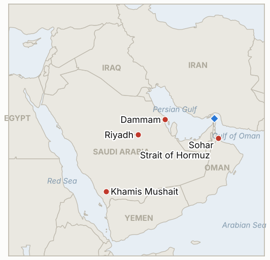

# Middle East Daily Briefing

**October 13, 2026**

- **Reporting window:** ~24 hours, October 12, 06:00 to October 13, 06:00 KST
- **Overall assessment:** The Houthi campaign against Saudi airports is now a Korean policy event: Seoul raised all of Saudi Arabia to a departure recommendation, while Riyadh's airport stays closed and fresh missiles were fired at Riyadh and Khamis Mushait (§1.1). Trump has still not committed to join Saudi strikes (§1.2). Iran called Washington's Hormuz reply insufficient and a tanker was hit by a drone off Oman's Sohar (§1.3). Markets priced it in: Brent settled at $106.65, its highest since September 15, and KOSPI fell 3.65% to 6,384.24 on foreign selling (§1.4).

**Corrections and updates:** The October 12 brief (§3) said no Korean advisory change for Saudi Arabia had been found. The Foreign Ministry had in fact raised all of Saudi Arabia to the third of four levels, "departure recommendation," at 10 p.m. KST on October 11, inside that brief's window, after a joint situation review chaired by Minister Cho Hyun ([Nate News](https://m.news.nate.com/view/20261012n21106); [JKN](https://news.jkn.co.kr/post/1017461)). Reports also give the Sunday Terminal 4 strike as one dead and 11 wounded (a Pakistani resident), and the Saturday toll as 12 or 13 dead depending on the outlet.

---

## 1. What Happened

<figure style="float:right; width:46%; margin:2pt 0 8pt 14pt;">

<figcaption style="font-size:8pt; color:#666; text-align:center; margin-top:3pt; font-style:italic;">Major places of discussion</figcaption>
</figure>

### 1.1 Riyadh airport stays closed as more missiles are fired at Saudi cities; Seoul orders a departure recommendation

CNN reports King Khalid International Airport will stay closed until further notice, with a notice to airmen indicating at least October 17, and flights cancelled across the kingdom run to the high hundreds ([CNN](https://www.cnn.com/2026/10/10/middleeast/riyadh-airport-saudi-houthis-intl)). Saudi air defenses said they destroyed a ballistic missile fired toward Riyadh and another toward Khamis Mushait early Monday, and Civil Defense issued an alert in nearby Abha ([Arab News](https://www.arabnews.com/saudi-arabia/saudi-arabias-air-defenses-intercept-houthi-missile-in-khamis-mushait-3005840)). Sunday's missile attack reportedly killed a Pakistani resident and wounded 11. The Foreign Ministry in Seoul raised all of Saudi Arabia to a departure recommendation, asking Koreans there to leave unless their business is essential and asking would-be travelers to cancel or postpone ([Nate News](https://m.news.nate.com/view/20261012n21106)). **Confidence: High on the closure and the Korean advisory; Medium on the Pakistani casualty report (single source family); Medium on the NOTAM date.**

### 1.2 Trump still undecided on joining Saudi strikes; no call or US strike confirmed

I found no reporting of a Trump and Mohammed bin Salman call or of US strikes on the Houthis in the window. The last on-record position remains Trump's "we may" join and "not acceptable" ([NBC News](https://www.nbcnews.com/world/middle-east/saudi-airport-attack-trump-us-join-fight-houthis-rcna602744)). CBS and the New York Times reported that the crown prince personally pressed Trump to strike and that US strikes were called off at the last minute in late September, with officials citing the risk of a second front while the Iran war is unresolved ([CBS News](https://www.cbsnews.com/news/saudi-arabia-mbs-trump-houthis-yemen/); [Ynet](https://www.ynetnews.com/article/skx791kqge)). Washington's current role is reported as intelligence and targeting help. **Confidence: High that no strike was disclosed; Medium on the background reporting (Israeli and US outlets citing officials).**

### 1.3 Iran calls the US reply on Hormuz "insufficient"; a drone hits a tanker off Sohar

Iran's security chief Mohsen Rezaei said Washington's reply to Iran's seven conditions for reopening the strait fell short, though the US accepted some, and that the strait stays closed to the US and no negotiations will occur until the conditions are met ([Anadolu via ANews](https://www.anews.com.tr/middle-east/2026/10/11/iran-says-us-response-to-conditions-for-reopening-strait-of-hormuz-insufficient); [Benzinga](https://www.benzinga.com/news/politics/26/10/62291540/iran-says-us-accepted-some-demands-to-reopen-strait-of-hormuz-but-response-is-inadequate-araghchi-warns-of-ecological-damage)). Separately UKMTO confirmed a tanker was hit by a drone near Oman's Sohar anchorage and reclassified it as an attack; outlets name the Nicaragua-flagged Petro Dolphin and a Seafarers' union says two of 14 Indian crew are missing, which UKMTO has not confirmed ([Arab News](https://www.arabnews.com/middle-east/uk-maritime-says-tanker-struck-by-drone-in-vicinity-of-omans-sohar-anchorage-3005832); [Seatrade Maritime](https://www.seatrade-maritime.com/security/iran-hits-tanker-in-sohar-and-two-in-hormuz-us-disables-bulker)). A Washington Institute tally cited by Rudaw counts at least 17 tanker attacks in and around Hormuz since September 28, mostly linked to Iran. **Confidence: High on UKMTO's drone attack; Medium on the Iranian position (Iranian official, relayed); Low on attribution and the missing crew.**

### 1.4 Brent settles at $106.65 and KOSPI drops 3.65% below 6,400

Brent settled at $106.65, up $1.93, its highest close since September 15, and WTI at $93.74, up about 2%, as Houthi strikes on Saudi Arabia and the tanker incidents outweighed Trump's announcement of more Russian diesel supply (Reuters via CNBC). In Seoul, KOSPI closed at 6,384.24, down 3.65% and the first close below 6,400 since August 11, with foreigners net selling about 2.02 trillion won; the won closed at about 1,335.1 per dollar, near a two year high, as exporters sold dollars ([FN News](https://en.fnnews.com/news/202610121518291365); [SBS](https://news.sbs.co.kr/english/article.do?news_id=N1008793041)). Trading Economics shows 1,333.91, and Korean coverage tied part of the fall to AI and earnings worries, not only the Middle East. **Confidence: High on oil settles and the KOSPI close; Medium on the won close (sources differ by about 1 won); Medium on attributing the KOSPI fall to the war.**

---

## 2. Deep Dive: Incentives and Motives

### 2.1 Why does Seoul raise Saudi Arabia to a departure recommendation now?

Two attacks on a major airport within days, a US citizen among the dead and the airport itself closed mean an evacuation window is shrinking; Seoul has precedent for being criticized when it moved late in earlier Gulf crises. The step stops short of the fourth level (mandatory departure), which keeps the option of an escalation ladder and avoids signaling to Korean contractors and Hyundai's Rabigh site that the kingdom is unsafe to the point of withdrawal. It also protects the government from blame if a Korean is hurt.

### 2.2 Why is Trump still holding back from striking the Houthis?

His reported late September cancellation, the November 3 midterms and the stated pledge not to attack Iran before then all point the same way: a Yemen strike risks a retaliation spiral that touches Hormuz. Holding at "we may" keeps Riyadh dependent and gives him a way to claim the intelligence role as sufficient. The cost is Saudi frustration if more civilians die.

### 2.3 Why does Tehran insist the US reply is insufficient while saying some demands were accepted?

Rezaei's phrasing banks the US concession as proof Iran's leverage works while refusing to reopen the strait, which keeps the oil premium and the blockade pressure on Washington. Partial acceptance lets hardliners say the line is holding, and it keeps a channel alive for the Pezeshkian camp. The drone strike off Sohar, outside Hormuz proper, shows the pressure now reaches Oman's coast, which complicates Oman's mediator role.

### 2.4 Why did markets sell Korea harder than the oil move alone implies?

A 3.65% KOSPI fall is much larger than a 1.8% Brent rise. Foreign investors had already been net sellers for days, the won was strong so selling could be done cheaply in dollars, and Korean coverage points to AI and earnings concerns. The Middle East raises the risk premium on Korean energy importers and on Gulf construction exposure, but the size of the fall suggests it is the trigger more than the sole cause.

---

## 3. Policy Implications for South Korea

**Exposure snapshot:** South Korea draws about 70.7% of its crude and 20.4% of its LNG from the Middle East (`instructions/korea-exposure.md`, no update needed). Today's prints: Brent $106.65 and WTI $93.74 (October 12 settles), KOSPI 6,384.24 (from 6,625.93 on October 8), and 1,335.1 won per dollar (from 1,338.5). A strong won partly cushions the imported energy bill even as equities fall.

**Implications by development:**

- **Departure recommendation (§1.1):** this is the first formal Korean step on Saudi Arabia and resolves IND-20261011-3. The next rungs are an evacuation charter or mandatory departure, and Korean construction and trading firms in Riyadh, Jeddah and Rabigh now carry insurance and staffing decisions (IND-20261013-4).
- **US role (§1.2):** a US strike on the Houthis would raise the chance of Houthi action against Red Sea shipping and Saudi oil sites, both of which carry Korean crude and product flows (IND-20261011-1).
- **Hormuz (§1.3):** Iran's stance means no reopening in the near term, keeping war risk premia on Korea bound cargoes and keeping the Hormuz deployment question unresolved (IND-20260928-2, IND-20261013-3). The Sohar strike widens the area of risk to Oman, a route used for Gulf bypass loadings.
- **Markets (§1.4):** the KOSPI close falsified the rebound call (IND-20261010-1), and the foreign selling streak continued (IND-20261009-3). The 7,000 recovery target (IND-20261008-2) now looks distant.

**Resolved today:** IND-20261010-1 falsified (KOSPI 6,384.24 at or below 6,625.93); IND-20261011-3 confirmed (departure recommendation); IND-20261008-1 confirmed (Brent settled $106.65, above $105); IND-20260927-3 confirmed (Houthi attacks reached further Saudi cities, including Abha and Dammam, within the two weeks); IND-20261005-1 expired (no confirmation of the Aramco sites, and Brent above $105 so neither condition triggered).

**Testable indicators:**

- **IND-20261013-1** (open, new): the Saudi led coalition announces strikes on Sanaa airport or Hodeidah port by ~2026-10-20 confirms the "decisive response" has begun; none falsifies.
- **IND-20261013-2** (open, new): a KOSPI close below 6,200 by ~2026-10-16 confirms deepening sell off; none falsifies.
- **IND-20261013-3** (open, new): a disclosed Iranian formal reply to the US, or a US Iran exchange of text or a meeting, by ~2026-10-20 confirms diplomacy is alive despite Rezaei; none falsifies.
- **IND-20261013-4** (open, new): the Foreign Ministry raises Saudi Arabia to mandatory departure or announces an evacuation charter by ~2026-10-26 confirms escalation of the Korean response; none falsifies.
- **IND-20261011-1**, **IND-20261011-2**, **IND-20261010-3** and the other older open items (open): no resolving information in the window. No US strike was disclosed and Riyadh's airport stayed closed.

---

## 4. Watch List

- **Whether the US joins strikes, and the Trump and Mohammed bin Salman call (IND-20261011-1).**
- **Saudi coalition retaliation on Sanaa or Hodeidah (IND-20261013-1).**
- **Riyadh airport reopening and the October 17 notice (IND-20261011-2).**
- **Iran's formal answer and whether the Sohar attack draws an Omani or Gulf response (IND-20261013-3).**
- **Taiz, Mocha and the Bab el-Mandeb coast (IND-20261007-1).**
- **KOSPI foreign flows and the 6,200 line (IND-20261013-2, IND-20261009-3).**
- **Brent against the $95 and $100 downside tests due October 16 (IND-20261003-2, IND-20261006-2).**

---

## 5. Source Quality Summary

| Claim | Sources | Confidence |
| --- | --- | --- |
| Korea raised Saudi Arabia to a departure recommendation | Nate News, JKN | High |
| Riyadh airport closed, NOTAM to at least Oct 17 | CNN | Medium |
| Missiles intercepted toward Riyadh and Khamis Mushait | Arab News (Saudi statement) | High |
| Pakistani resident killed Sunday, 11 wounded | Korean press, single family | Medium |
| No Trump and Mohammed bin Salman call or US strike disclosed | Absence in search results | Medium |
| Trump called off strikes in late September | NYT via Ynet, CBS | Medium |
| Iran: US reply "insufficient" | ANews (Anadolu), Benzinga | Medium |
| Tanker hit by drone off Sohar | UKMTO via Arab News, Seatrade | High |
| Petro Dolphin and two missing Indian crew | Maritime Executive, seafarers' union | Low |
| 17 tanker attacks since Sep 28 | Washington Institute via Rudaw | Medium |
| Brent $106.65, WTI $93.74 | Reuters via CNBC | High |
| KOSPI 6,384.24, won about 1,335.1 | FN News, SBS | High / Medium |
| Hormuz daily transit count | None reliable | Not reported |
