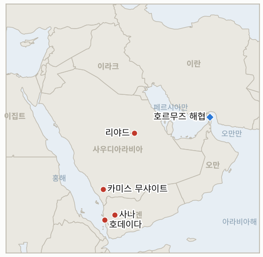

# 중동 일일 브리핑

**2026년 10월 14일**

- **보고 기간:** 약 24시간, 10월 13일 06:00 ~ 10월 14일 06:00 (한국시간)
- **종합 평가:** 사우디와 후티의 전쟁이 공항에서 에너지로 옮겨갔다. 사우디 주도 연합군이 사나와 호데이다의 후티 연료 시설을 타격했고, 후티는 사우디 석유 시설이 이제 정당한 표적이라고 맞섰다(§1.1). 리야드 공항은 폐쇄가 이어지는 가운데 미사일이 추가로 요격되었다(§1.2). 이란은 사우디와 후티 간 대화 중재를 제안했으나 호르무즈 협상은 동결 상태이고 유조선 공격은 계속된다(§1.3). 가장 큰 시장 사건은 서울에서 나왔다. 코스피가 반도체 업종 급락과 4조 5천억 원대 외국인 매도로 5.46% 하락한 6,035.35에 마감했으며, 중동은 방아쇠가 아니라 배경이었다(§1.4).

**정정 및 업데이트:** 10월 13일 브리핑(§1.1)은 토요일 리야드 공항 공격의 사망자를 12명 또는 13명으로 적었다. 이후 보도는 사망 13명, 부상 308명으로 정리되며, 주말 후티 공격 전체의 사망자는 14~18명으로 전해진다([The National](https://www.thenationalnews.com/news/mena/2026/10/13/saudi-led-coalition-and-houthis-trade-threats-over-oil-installations/); [Gulf News](https://gulfnews.com/world/gulf/saudi/riyadh-airport-hit-again-in-fresh-houthi-strike-1-pakistani-killed-11-wounded-1.500706943)). 10월 13일 브리핑의 원·달러 환율 종가 약 1,335.1원은 그대로이며, 10월 13일 종가는 아래 1,345.1원이다.

---

## 1. 무슨 일이 있었나

<figure style="float:right; width:46%; margin:2pt 0 8pt 14pt;">

<figcaption style="font-size:8pt; color:#666; text-align:center; margin-top:3pt; font-style:italic;">주요 논의 지점</figcaption>
</figure>

### 1.1 사우디 주도 연합군이 후티 연료 시설을 타격하고, 후티는 사우디 석유 시설을 표적으로 선언한다

연합군은 사나 지역 민간인에게 대피를 촉구한 뒤, 사나의 알사바하 주유소와 호데이다 항의 연료 선적 부두 등 후티 장악 에너지 시설에 대한 타격을 발표했다. 연합군 대변인 투르키 알말리키 소장은 후티가 민간 기반시설을 이용해 무기고를 보급한다고 말했다([The National](https://www.thenationalnews.com/news/mena/2026/10/13/saudi-led-coalition-and-houthis-trade-threats-over-oil-installations/); [AP, US News](https://www.usnews.com/news/world/articles/2026-10-13/saudis-and-yemens-houthi-rebels-exchange-threats-to-escalate-conflict)). 후티는 사우디의 석유 시설이 이제 정당한 표적이라며 현지 민간인에게 접근하지 말라고 경고했다. 앞서 사우디 에너지장관 압둘아지즈 빈 살만 왕자는 대응이 "그에 못지않게 엄중해야 한다"고 밝혔다([Gulf News](https://gulfnews.com/world/gulf/saudi/riyadh-airport-hit-again-in-fresh-houthi-strike-1-pakistani-killed-11-wounded-1.500706943)). 연합군 타격의 인명 피해는 공개되지 않았다. **신뢰도: 타격 발표는 높음(연합군 성명, AP), 피해와 사상자는 낮음, 후티의 위협 발표는 높음이나 실행 여부는 중간.**

### 1.2 리야드 공항 운영 중단이 연장되고 미사일 3발이 추가 요격되며, 미국은 관망을 이어간다

사우디 민간항공청(GACA)은 킹 칼리드 국제공항의 운영 중단을 재개 일정 없이 연장했다. 걸프에어는 10월 17일까지, 에티하드는 10월 19일까지 리야드 운항을 취소했고, 델타는 10월 23일로 예정한 애틀랜타 노선 개설을 미뤘다([Gulf News](https://gulfnews.com/world/gulf/saudi/riyadh-airport-hit-again-in-fresh-houthi-strike-1-pakistani-killed-11-wounded-1.500706943)). 연합군은 월요일 저녁과 화요일에 리야드로 1발, 카미스 무샤이트로 2발의 미사일을 요격했다. 리야드 학교는 원격수업으로 전환했으나 주민들은 거리가 평소와 다름없다고 전했다([The National](https://www.thenationalnews.com/news/mena/2026/10/13/saudi-led-coalition-and-houthis-trade-threats-over-oil-installations/)). 후티 당국자는 미국이 타격에 합류하면 "신속하고 고통스러운" 대응을 하겠다고 경고했다([CBS News](https://www.cbsnews.com/live-updates/iran-war-us-trump-saudi-arabia-houthi/)). 공개된 미국의 타격은 확인되지 않았다. **신뢰도: 운영 중단과 요격은 높음, 미국 타격이 없었다는 점은 중간(보도 부재에 근거).**

### 1.3 이란이 사우디와 후티 간 중재를 제안하고, 호르무즈 외교는 동결된 채 유조선 공격이 이어진다

이란 외무부 대변인은 테헤란이 "깊이 우려"하며 대화를 촉진할 용의가 있다고 밝혔다. 아라그치 외무장관은 사우디 외무장관 파이살 빈 파르한 왕자와 통화했고, 이집트 외무장관은 아라그치에게 사우디 공격 중단을 촉구했다([Gulf News](https://gulfnews.com/world/gulf/saudi/riyadh-airport-hit-again-in-fresh-houthi-strike-1-pakistani-killed-11-wounded-1.500706943); [The National](https://www.thenationalnews.com/news/mena/2026/10/13/saudi-led-coalition-and-houthis-trade-threats-over-oil-installations/)). 아라그치는 7일 호르무즈 계획에 대한 미국의 답신에 "며칠 내" 답하겠다고 말했다([Fox News](https://foxnews.com/live-news/iran-war-news-us-trump-houthis-saudi-arabia-october-12)). 한편 영국해사무역기구(UKMTO)는 10월 12일 제품유 운반선 피격과, UAE 서쪽 13해리 해상 선박에 대한 발사체 공격으로 화재가 난 사실을 보고했고, 이란 혁명수비대(IRGC)는 이틀간 초대형 유조선 3척을 타격했다고 주장했다. 미 중부사령부는 월요일 걸프 파트너들이 해협으로 1,900만 배럴 넘는 원유를 선적하도록 도왔다고 밝혔다. **신뢰도: 이란의 중재 제안은 중간(당국자 발언의 전언), UKMTO 사건은 중간, IRGC 주장과 귀속은 낮음.**

### 1.4 코스피는 반도체주 급락으로 5.46% 하락한 6,035.35에 마감하고, 브렌트유는 105.69달러 안팎에 마감한다

코스피는 장중 저점 약 5,911을 찍고 오전 9시 47분 매도 사이드카가 발동된 끝에 5.46% 내린 6,035.35에 마감했다. 외국인은 약 4.51조 원을 순매도했고 SK하이닉스는 10.09%, 삼성전자는 7.39% 하락했으며, 12개월 선행 PER은 사상 최저인 4.54배까지 내려갔다. 분석가들은 자사주 매입이라는 완충 장치의 소멸, CXMT의 신규 서버용 메모리 계획, 오픈AI 매출이 이전 보도보다 약 30% 낮다는 보도, 반도체 투자심리 악화를 지목했고 중동은 배경 요인으로 언급되었다([The Korea Times](https://www.koreatimes.co.kr/economy/20261013/kospi-plunges-546-as-foreign-selling-drives-valuations-to-record-low); [KED Global](https://www.kedglobal.com/korean-stock-market/newsView/ked202610130001)). 원화는 달러당 약 10원 약세인 1,345.1원에 마감했다. 브렌트유는 96센트 내린 105.69달러 안팎에, WTI는 40센트 오른 94.14달러에 정산되었다. 러시아산 경유 공급 확대 기대가 사우디와 후티 위험을 상쇄했고, 골드만삭스는 지정학 위험이 유가에 20달러 남짓을 더한다고 추정한다(CNBC, 검색 요약 인용). **신뢰도: 코스피 종가와 수급은 높음, 원인 귀속은 중간, 유가 정산가는 중간(로이터의 2차 요약).**

---

## 2. 심층 분석: 동기와 유인

### 2.1 연합군은 왜 공항이나 군사 표적이 아니라 연료 시설을 먼저 타격했는가?

연료는 후티의 보급 병목이면서 눈에 보이는 표적 가운데 확전 위험이 가장 낮다. 민간인 대피를 알린 뒤 사나 주유소를 타격하면 능력과 절제를 동시에 보여주고, 예멘의 식량과 구호품이 드나드는 항구로 번지지 않으면서 리야드에 쏟아지는 대응 압박에 답할 수 있다. 미국의 합류 여부가 정해지기 전에 내보일 대응 카드가 생기고, 더 큰 타격은 유보할 수 있다.

### 2.2 후티는 왜 지금 사우디 석유 시설을 위협하는가?

연합군 타격이 후티의 자금과 보급을 겨눴기 때문이다. 아람코 시설을 위협하면 사우디 확전의 비용이 올라가고, 브렌트유가 100달러를 웃도는 상황에서 리야드뿐 아니라 세계 청중에 대한 영향력도 생긴다. 민간인에게 접근하지 말라고 한 것은 법적·선전적 틀이기도 해서, 어떤 공격이든 사전에 경고했다는 주장을 준비하는 것이다.

### 2.3 이란은 왜 사우디와 후티 간 중재를 제안하는가?

이란은 후티의 공세로 워싱턴을 계속 분산시키되, 사우디가 이란에 맞서 미국과 공식 연합하도록 몰리는 것은 원치 않는다. 아라그치와 리야드의 통화를 곁들인 중재 제안은 걸프 국가들에 출구가 테헤란에 있음을 보여주면서, 호르무즈에서 물러서지 않아 11월 3일 중간선거를 앞둔 워싱턴을 압박하는 유가 프리미엄을 유지한다.

### 2.4 서울의 매도는 왜 유가 움직임보다 훨씬 컸는가?

이날 브렌트유는 내렸는데 코스피는 5.46% 급락했으므로 유가가 원인은 아니었다. 지수는 메모리 반도체 두 종목에 쏠려 있고, 가격을 떠받치던 자사주 매입이 끝나가며, 중국 경쟁사의 신제품 발표와 AI 수요 의구심이 같은 날 겹쳤다. 선행 PER 4.54배는 시장이 큰 폭의 이익 감소를 반영하고 있음을 뜻한다. 전쟁 위험과 높은 연료비는 투자 심리의 여력을 깎지만, 이번은 주로 업종 충격이었다.

---

## 3. 한국에 대한 정책적 함의

**노출도 요약:** 한국은 원유의 약 70.7%, LNG의 약 20.4%를 중동에서 들여온다(`instructions/korea-exposure.md`, 갱신 불필요). 오늘 수치는 브렌트유 105.69달러, WTI 94.14달러(10월 13일 정산가), 코스피 6,035.35(6,384.24에서 하락), 원·달러 환율 1,345.1원(1,335.1원에서 상승)이다. 원화는 외국인의 주식 매도 속에 최근의 강세를 일부 반납했다.

**전개별 함의:**

- **연합군 타격과 후티의 위협(§1.1):** 후티가 사우디 석유 시설을 공격하면 한국이 의존하는 원유와 제품 흐름에 타격이 가고, 동부 지방과 라비그의 한국 기업도 리야드와 같은 보험·인력 결정에 직면한다(IND-20261014-2, IND-20261013-4).
- **리야드 공항(§1.2):** 공항이 최소 10월 17일까지 닫혀 있어, 3단계 경보 아래 한국인의 출국은 육로나 다른 공항에 의존해야 하고 이는 의무 출국이나 전세기 투입 결정의 실행을 어렵게 만든다(IND-20261013-4).
- **호르무즈 외교(§1.3):** 며칠 내로 예고된 이란의 답변이 한국행 화물 위험 프리미엄의 다음 분기점이다(IND-20261013-3).
- **시장(§1.4):** 코스피 하락은 매도세 심화(IND-20261013-2)를 확인하며, 7,000 목표(IND-20261008-2)는 10월 16일 기한까지 사실상 도달 불가가 되었다. 당국은 시장 안정 조치와 원화 방어 여부를 결정해야 한다. 밸류에이션 저점과 자사주 매입 종료로 볼 때 다음 움직임은 중동이 아니라 반도체 이야기가 좌우할 가능성이 크다(IND-20261014-1, IND-20261014-3).

**오늘 종결된 지표:** IND-20261013-1 확인(10월 13일 연합군이 호데이다 항 연료 선적 부두와 사나 주유소를 타격), IND-20261013-2 확인(코스피 종가 6,035.35로 6,200 아래).

**검증 가능한 지표:**

- **IND-20261014-1** (진행, 신규): 2026-10-21경까지 코스피가 6,400 위에서 마감하면 반도체 급락 후 반등으로 확인되고, 그렇지 않으면 반증된다.
- **IND-20261014-2** (진행, 신규): 2026-10-21경까지 사우디나 아람코가 인정하거나 독립 영상으로 확인되는 후티의 사우디 석유 시설 공격이 있으면 위협이 실행된 것으로 확인되고, 없으면 반증된다.
- **IND-20261014-3** (진행, 신규): 2026-10-21경까지 원화 종가가 달러당 1,360원보다 약세이면 통화 압력 지속으로 확인되고, 그렇지 않으면 반증된다.
- **IND-20261008-2**, **IND-20261009-3**, **IND-20261011-1**, **IND-20261011-2**, **IND-20261010-3** 및 기타 기존 진행 지표(진행): 기간 중 결론을 낼 정보 없음. 외국인은 대규모 순매도였고, 미국의 타격은 공개되지 않았으며, 리야드 공항은 운영 중단이 이어졌다.

---

## 4. 주시 목록

- **후티의 사우디 석유 시설 공격 여부와 아람코의 대응(IND-20261014-2, IND-20261012-1).**
- **후티 항구와 연료 공급(호데이다, 사나)에 대한 연합군의 추가 타격.**
- **호르무즈에 대한 미국 답신에 대한 이란의 답변과 유조선 공격 속도(IND-20261013-3, IND-20261007-2).**
- **미국의 타격 합류 여부(IND-20261011-1).**
- **10월 17일과 19일 항공사 일정에 비춰 본 리야드 공항 재개(IND-20261011-2, IND-20261010-3).**
- **코스피 외국인 수급, 반도체 종목, 6,000선(IND-20261014-1, IND-20261009-3).**
- **10월 16일이 기한인 브렌트유 95달러와 100달러 하방 시험(IND-20261003-2, IND-20261006-2).**

---

## 5. 출처 품질 요약

| 주장 | 출처 | 신뢰도 |
| --- | --- | --- |
| 연합군이 사나 주유소와 호데이다 부두 타격 | The National, AP(US News) | 높음 |
| 후티가 사우디 석유 시설을 정당한 표적으로 선언 | The National, AP | 높음 |
| 리야드 공항 운영 중단 연장, 항공사 취소 | Gulf News | 높음 |
| 미사일 3발 요격(리야드, 카미스 무샤이트) | The National(연합군 성명) | 높음 |
| 토요일 사망 13명·부상 308명, 주말 합계 14~18명 | The National, Gulf News | 중간 |
| 미국의 타격 미공개 | 검색 결과 부재 | 중간 |
| 이란의 사우디·후티 중재 제안, 아라그치와 파이살 통화 | Gulf News, The National | 중간 |
| 아라그치: "며칠 내" 답변 | Fox News 라이브 | 중간 |
| 호르무즈 인근 유조선·선박 사건, IRGC 주장 | UKMTO(검색 요약 인용) | 중간 / 낮음 |
| 코스피 6,035.35, 외국인 4.51조 원 순매도, 반도체 낙폭 | The Korea Times, KED Global | 높음 |
| 원화 약 1,345.1원 | The Korea Times(한 곳은 1,344.40원) | 중간 |
| 브렌트유 약 105.69달러, WTI 94.14달러 | 로이터/CNBC(검색 요약 인용) | 중간 |
| 호르무즈 일일 통항 건수 | 신뢰할 만한 출처 없음 | 미보고 |
