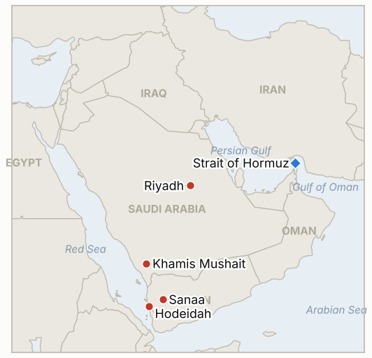

# Middle East Daily Briefing

**October 14, 2026**

- **Reporting window:** ~24 hours, October 13, 06:00 to October 14, 06:00 KST
- **Overall assessment:** The Saudi Houthi war moved from airports to energy: the Saudi led coalition struck Houthi fuel sites at Sanaa and Hodeidah, and the Houthis answered that Saudi oil installations are now legitimate targets (§1.1). Riyadh's airport stays shut with more missiles intercepted (§1.2). Iran offered to broker Saudi Houthi dialogue while its Hormuz track stays frozen and tanker attacks continue (§1.3). The sharpest market event was in Seoul: KOSPI fell 5.46% to 6,035.35, mostly on a chip sector rout and 4.5 trillion won of foreign selling, with the Middle East a backdrop, not the trigger (§1.4).

**Corrections and updates:** The October 13 brief (§1.1) gave the Saturday toll at Riyadh airport as 12 or 13 dead; later reports settle on 13 dead and 308 wounded, with the total across the weekend's Houthi attacks put at 14 to 18 dead ([The National](https://www.thenationalnews.com/news/mena/2026/10/13/saudi-led-coalition-and-houthis-trade-threats-over-oil-installations/); [Gulf News](https://gulfnews.com/world/gulf/saudi/riyadh-airport-hit-again-in-fresh-houthi-strike-1-pakistani-killed-11-wounded-1.500706943)). The October 13 brief's won close of about 1,335.1 stands; the October 13 close below is 1,345.1.

---

## 1. What Happened

<figure style="float:right; width:46%; margin:2pt 0 8pt 14pt;">

<figcaption style="font-size:8pt; color:#666; text-align:center; margin-top:3pt; font-style:italic;">Major places of discussion</figcaption>
</figure>

### 1.1 Saudi led coalition strikes Houthi fuel sites; Houthis name Saudi oil installations as targets

The coalition announced strikes on Houthi held energy sites, including the Al Sabahah fuel station in Sanaa and fuel loading piers at Hodeidah port, after urging civilians to leave the Sanaa area. Spokesman Maj Gen Turki Al Malki said the Houthis use civilian infrastructure to supply their arsenals ([The National](https://www.thenationalnews.com/news/mena/2026/10/13/saudi-led-coalition-and-houthis-trade-threats-over-oil-installations/); [AP via US News](https://www.usnews.com/news/world/articles/2026-10-13/saudis-and-yemens-houthi-rebels-exchange-threats-to-escalate-conflict)). The Houthis replied that oil installations in Saudi Arabia are now legitimate targets and told civilians there to stay away. Saudi Energy Minister Prince Abdulaziz bin Salman had said earlier that the response "must be equally serious" ([Gulf News](https://gulfnews.com/world/gulf/saudi/riyadh-airport-hit-again-in-fresh-houthi-strike-1-pakistani-killed-11-wounded-1.500706943)). No casualty figure for the coalition strikes was given. **Confidence: High that the strikes were announced (coalition statement, AP); Low on damage and casualties; High that the Houthi threat was issued, Medium on its follow through.**

### 1.2 Riyadh airport suspension extended; three more missiles intercepted; US stays on the sidelines

Saudi aviation authority GACA extended the suspension of King Khalid International Airport with no reopening date; Gulf Air cancelled Riyadh flights through October 17 and Etihad through October 19, and Delta delayed its planned October 23 Atlanta service ([Gulf News](https://gulfnews.com/world/gulf/saudi/riyadh-airport-hit-again-in-fresh-houthi-strike-1-pakistani-killed-11-wounded-1.500706943)). The coalition intercepted three missiles on Monday evening and Tuesday, one aimed at Riyadh and two at Khamis Mushait; Riyadh schools moved to remote learning though residents described normal street life ([The National](https://www.thenationalnews.com/news/mena/2026/10/13/saudi-led-coalition-and-houthis-trade-threats-over-oil-installations/)). A Houthi official warned of a "swift and painful" response if the US joins the strikes ([CBS News](https://www.cbsnews.com/live-updates/iran-war-us-trump-saudi-arabia-houthi/)). I found no disclosed US strike. **Confidence: High on the suspension and interceptions; Medium on the absence of a US strike (absence of reporting).**

### 1.3 Iran offers to broker Saudi Houthi talks; Hormuz diplomacy frozen and tanker attacks continue

Iran's foreign ministry spokesman said Tehran was "deeply concerned" and ready to facilitate dialogue; Foreign Minister Araghchi spoke by phone with Saudi counterpart Prince Faisal bin Farhan, and Egypt's foreign minister urged Araghchi to halt attacks on Saudi Arabia ([Gulf News](https://gulfnews.com/world/gulf/saudi/riyadh-airport-hit-again-in-fresh-houthi-strike-1-pakistani-killed-11-wounded-1.500706943); [The National](https://www.thenationalnews.com/news/mena/2026/10/13/saudi-led-coalition-and-houthis-trade-threats-over-oil-installations/)). Araghchi said Iran would answer the US reply to its seven day Hormuz plan "within a few days" ([Fox News](https://foxnews.com/live-news/iran-war-news-us-trump-houthis-saudi-arabia-october-12)). Meanwhile UKMTO reported a product tanker struck on October 12 and a projectile hit on a vessel 13 nautical miles west of the UAE that caused a fire, and the IRGC claimed three supertankers hit in two days. CENTCOM said it helped Gulf partners ship more than 19 million barrels through the strait on Monday. **Confidence: Medium on Iran's mediation offer (official statements, relayed); Medium on the UKMTO incidents; Low on the IRGC claim and on attribution.**

### 1.4 KOSPI plunges 5.46% to 6,035.35 as chip stocks crack; Brent settles near $105.69

KOSPI closed at 6,035.35, down 5.46%, after an intraday low of about 5,911 and a sell side sidecar at 9:47 a.m.; foreigners net sold about 4.51 trillion won, SK hynix fell 10.09% and Samsung Electronics 7.39%, and the 12 month forward P/E hit a record low of 4.54. Analysts pointed to the end of buyback support, CXMT's new server memory plan, a report that OpenAI's revenue is about 30% below an earlier figure, and weak sentiment on chips; the Middle East was a backdrop ([The Korea Times](https://www.koreatimes.co.kr/economy/20261013/kospi-plunges-546-as-foreign-selling-drives-valuations-to-record-low); [KED Global](https://www.kedglobal.com/korean-stock-market/newsView/ked202610130001)). The won weakened about 10 won to 1,345.1 per dollar. Brent settled near $105.69, down 96 cents, and WTI at $94.14, up 40 cents, as hopes for more Russian diesel offset Saudi Houthi risk; Goldman Sachs estimates geopolitics adds just over $20 a barrel (CNBC via search summary). **Confidence: High on the KOSPI close and flows; Medium on causal attribution; Medium on oil settles (secondary summary of Reuters).**

---

## 2. Deep Dive: Incentives and Motives

### 2.1 Why did the coalition hit fuel sites and not the airport or military targets first?

Fuel is the Houthis' logistics chokepoint and also the least escalatory visible target: striking Sanaa's fuel station after a civilian warning signals capability and restraint at once, and it answers the pressure on Riyadh to respond without widening to the ports that carry Yemen's food and aid. It also gives Riyadh a response to show before Washington decides whether to join, keeping the option of larger strikes in reserve.

### 2.2 Why do the Houthis threaten Saudi oil installations now?

The coalition strike hit their funding and supply. Threatening Aramco assets raises the price of Saudi escalation and, with Brent above $100, gives the Houthis leverage over a global audience, not only Riyadh. Telling civilians to stay away is also a legal and propaganda frame: it prepares the claim that any attack was warned in advance.

### 2.3 Why does Tehran offer mediation between Saudi Arabia and the Houthis?

Iran wants the Houthi campaign to keep Washington stretched but not to push Saudi Arabia into formal alignment with the US against Iran. Offering a channel, backed by an Araghchi call with Riyadh, shows Gulf states that Tehran is the way out, while its refusal to move on Hormuz keeps the oil premium that pressures Washington before the November 3 midterms.

### 2.4 Why was Seoul's selloff much bigger than the oil move?

Brent fell on the day while KOSPI fell 5.46%, so oil was not the driver. The index is concentrated in two memory chipmakers; buyback programs that cushioned prices are ending, a Chinese competitor announced a new product, and AI demand doubts landed on the same day. A 4.54 forward multiple means the market is pricing a deep earnings decline. War risk and high fuel costs weaken the reserve of investor confidence, but this was mainly a sector shock.

---

## 3. Policy Implications for South Korea

**Exposure snapshot:** South Korea draws about 70.7% of its crude and 20.4% of its LNG from the Middle East (`instructions/korea-exposure.md`, no update needed). Today's prints: Brent $105.69 and WTI $94.14 (October 13 settles), KOSPI 6,035.35 (from 6,384.24), and 1,345.1 won per dollar (from 1,335.1). The won gave back part of its recent strength as foreigners sold equities.

**Implications by development:**

- **Coalition strikes and Houthi threat (§1.1):** a Houthi attack on Saudi oil sites would hit crude and product flows that Korea relies on, and Korean firms in the Eastern Province and Rabigh would face the same insurance and staffing choices as in Riyadh (IND-20261014-2, IND-20261013-4).
- **Riyadh airport (§1.2):** with the airport shut through at least October 17, a Korean departure under the level 3 advisory depends on land routes or other airports, which makes any move to mandatory departure or a charter harder to execute (IND-20261013-4).
- **Hormuz diplomacy (§1.3):** the Iranian answer due in days is the next hinge for Korea bound cargo risk premia (IND-20261013-3).
- **Markets (§1.4):** the KOSPI fall confirms the deepening sell off (IND-20261013-2) and makes the 7,000 target (IND-20261008-2) effectively unreachable by its October 16 deadline. Authorities face a decision on market stabilization steps and won support; the firm's valuation low and buyback ending suggest the chip story, not the Middle East, sets the next move (IND-20261014-1, IND-20261014-3).

**Resolved today:** IND-20261013-1 confirmed (coalition struck fuel loading piers at Hodeidah port and a Sanaa fuel station on October 13); IND-20261013-2 confirmed (KOSPI closed at 6,035.35, below 6,200).

**Testable indicators:**

- **IND-20261014-1** (open, new): a KOSPI close above 6,400 by ~2026-10-21 confirms a rebound after the chip rout; none falsifies.
- **IND-20261014-2** (open, new): a Houthi strike on a Saudi oil installation, acknowledged by Saudi Arabia or Aramco or confirmed by independent imagery, by ~2026-10-21 confirms the threat was carried out; none falsifies.
- **IND-20261014-3** (open, new): a won close weaker than 1,360 per dollar by ~2026-10-21 confirms continued currency pressure; none falsifies.
- **IND-20261008-2**, **IND-20261009-3**, **IND-20261011-1**, **IND-20261011-2**, **IND-20261010-3** and the other older open items (open): no resolving information in the window. Foreigners were heavy net sellers, no US strike was disclosed, and Riyadh's airport stayed suspended.

---

## 4. Watch List

- **Whether the Houthis attack Saudi oil sites, and Aramco's response (IND-20261014-2, IND-20261012-1).**
- **Further coalition strikes on Houthi ports and fuel supply (Hodeidah, Sanaa).**
- **Iran's reply to the US Hormuz answer and the pace of tanker attacks (IND-20261013-3, IND-20261007-2).**
- **Whether the US joins strikes (IND-20261011-1).**
- **Riyadh airport reopening against the October 17 and 19 airline dates (IND-20261011-2, IND-20261010-3).**
- **KOSPI foreign flows, chip names, and the 6,000 line (IND-20261014-1, IND-20261009-3).**
- **Brent against the $95 and $100 downside tests due October 16 (IND-20261003-2, IND-20261006-2).**

---

## 5. Source Quality Summary

| Claim | Sources | Confidence |
| --- | --- | --- |
| Coalition struck Sanaa fuel station and Hodeidah piers | The National, AP via US News | High |
| Houthis declare Saudi oil sites legitimate targets | The National, AP | High |
| Riyadh airport suspension extended; airline cancellations | Gulf News | High |
| Three missiles intercepted (Riyadh, Khamis Mushait) | The National (coalition statement) | High |
| Saturday toll 13 dead, 308 wounded; weekend total 14 to 18 | The National, Gulf News | Medium |
| No US strike disclosed | Absence in search results | Medium |
| Iran offers Saudi Houthi mediation; Araghchi Faisal call | Gulf News, The National | Medium |
| Araghchi: reply "within a few days" | Fox News live blog | Medium |
| Tanker and vessel incidents near Hormuz, IRGC claim | UKMTO via search summaries | Medium / Low |
| KOSPI 6,035.35, foreigners sold 4.51tn won, chip moves | The Korea Times, KED Global | High |
| Won about 1,345.1 | The Korea Times (one source reports 1,344.40) | Medium |
| Brent about $105.69, WTI $94.14 | Reuters/CNBC via search summary | Medium |
| Hormuz daily transit count | None reliable | Not reported |
