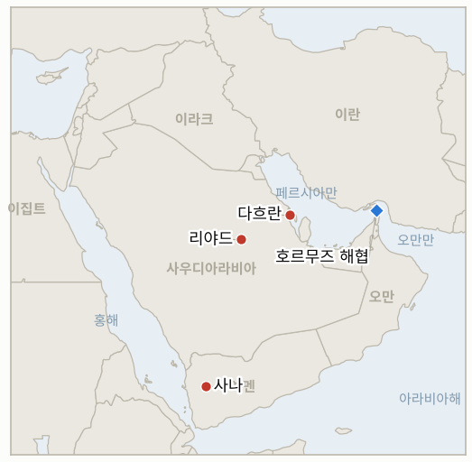

# 중동 일일 브리핑

**2026년 10월 15일**

- **보고 기간:** 약 24시간, 10월 14일 06:00 ~ 10월 15일 06:00 (한국시간)
- **종합 평가:** 후티의 사우디 석유 위협이 실행으로 옮겨갔다. 사우디 에너지부는 후티 미사일이 다흐란의 아람코 행정동을 타격해 제한적 화재가 났다고 확인했고, 후티는 공항과 석유 시설에 대한 추가 공격을 공언했다(§1.1, §1.2). 호르무즈 인근 선박 공격은 이어졌으며 혁명수비대(IRGC)는 컨테이너선이 기뢰로 침몰했다고 주장했다(§1.3). 브렌트유는 106.56달러, WTI는 3주 만의 최고치로 올랐고, 코스피는 0.44% 내린 6,008.81로 6거래일 연속 하락하며 6,000선을 간신히 지켰다(§1.4).

---

## 1. 무슨 일이 있었나

<figure style="float:right; width:46%; margin:2pt 0 8pt 14pt;">

<figcaption style="font-size:8pt; color:#666; text-align:center; margin-top:3pt; font-style:italic;">주요 논의 지점</figcaption>
</figure>

### 1.1 후티 미사일이 다흐란의 아람코 행정동을 타격한다

후티는 다흐란의 아람코 시설, 리야드의 아람코 정유시설, 킹 칼리드 국제공항을 겨냥했다고 밝혔다. 밤사이 사우디 에너지부는 다흐란의 아람코 행정동이 피격되어 제한적 화재가 났다고 확인했다([Al Jazeera](https://www.aljazeera.com/news/2026/10/14/saudi-led-coalition-intercepts-houthi-missile-launched-towards-riyadh); [The Korea Times](https://www.koreatimes.co.kr/world/20261015/oil-prices-gain-on-attacks-in-saudi-arabia-irans-new-tactics-to-target-tankers)). 인명 피해와 생산 차질은 보고되지 않았고, 리야드 정유시설 타격 주장은 확인되지 않았다. 후티가 사우디 석유 시설을 정당한 표적이라고 선언한 지 하루쯤 뒤에 나온 이번 공격은, 이번 작전에서 사우디가 아람코 시설의 피해를 인정한 첫 사례다. **신뢰도: 다흐란 건물 피격은 높음(사우디 정부 확인), 리야드 정유시설 피해는 낮음(후티 주장뿐).**

### 1.2 후티가 공항·석유 시설 추가 공격을 공언하고, 리야드로 향한 미사일이 또 요격된다

연합군은 리야드를 겨냥한 후티 탄도미사일을 요격해 파괴했다고 밝혔고, 사우디 민방위는 수도와 알카르즈에 경보를 발령했다가 위험이 지나갔다고 알렸다. 화요일 순항미사일 2발을 요격하면서 떨어진 파편으로 리야드의 주택이 피해를 입었다. 후티는 앞으로 며칠간 사우디 공항과 석유 기반시설을 계속 표적으로 삼겠다고 밝혔다([Al Jazeera](https://www.aljazeera.com/news/2026/10/14/saudi-led-coalition-intercepts-houthi-missile-launched-towards-riyadh); [CBS News](https://www.cbsnews.com/live-updates/iran-war-us-houthi-saudi-arabia-trump/)). 주말 킹 칼리드 공항 공격의 피해는 사망 14명, 부상 300명 이상으로 집계되며, 아브하 공항 공격으로 2명이 더 숨졌다. 미 국무부는 직원들이 사우디 내 모든 공항을 이용하려면 별도 승인을 받도록 했고, 트럼프 대통령은 미국의 역할을 저울질하는 것으로 전해졌으나 공개된 미국의 타격은 확인되지 않았다. **신뢰도: 요격과 후티 성명은 높음, 사상자 집계는 중간(매체별로 상이), 미국 타격이 없었다는 점은 중간(보도 부재에 근거).**

### 1.3 호르무즈 인근 선박 공격이 이어지고, IRGC는 컨테이너선이 기뢰로 침몰했다고 주장한다

영국해사무역기구(UKMTO)는 해협 안에서 컨테이너선과 유조선이 정체불명의 발사체에 피격되었다고 보고했다. IRGC는 컨테이너선이 해협 남쪽에서 기뢰에 부딪혀 불이 난 뒤 침몰했다고 밝혔고, 한 보도는 혁명수비대가 전날 4척에 이어 화요일 2척을 타격했다고 전했다. 이란 당국자들은 새 전술의 내용을 설명하지 않았으나, 한 명은 약 10일 전부터 공격 방식을 바꿨다고 말했다([The Korea Times](https://www.koreatimes.co.kr/world/20261015/oil-prices-gain-on-attacks-in-saudi-arabia-irans-new-tactics-to-target-tankers); [Sunday Guardian](https://sundayguardianlive.com/world/crude-oil-prices-today-october-14-why-are-oil-prices-rising-today-brent-crude-hits-10658-as-saudi-aramco-attack-and-strait-of-hormuz-risks-offset-hopes-of-higher-russian-diesel-exports-305338/)). 미국의 봉쇄로 이란의 원유 수출은 0이 되었다. 7일 호르무즈 계획에 대한 이란의 새 답변은 확인되지 않았다. **신뢰도: UKMTO 사건은 중간, 침몰과 원인은 낮음(선박이 특정되지 않은 IRGC 주장), 일일 공격 건수는 낮음.**

### 1.4 브렌트유는 106.56달러, WTI는 3주 만의 최고치로 오르고, 코스피는 6,008.81로 밀린다

다흐란 타격과 선박 공격이 러시아산 경유 공급 확대 기대를 압도하면서 브렌트유는 0.82% 오른 106.56달러, WTI는 1.55% 오른 95.60달러로 3주 만의 최고치를 기록했다. 트럼프 대통령은 러시아가 경유를 공급하기로 했다고 밝혔고 행정부는 러시아산 경유 제재를 한시 해제했으나, 국제에너지기구(IEA)는 러시아의 제한된 정제 능력 때문에 세계 경유 수급은 크게 달라지지 않을 것이라고 평가했다([The Korea Times](https://www.koreatimes.co.kr/world/20261015/oil-prices-gain-on-attacks-in-saudi-arabia-irans-new-tactics-to-target-tankers)). 코스피는 2% 넘게 오른 6,190선에서 출발해 반락한 끝에 26.54포인트(0.44%) 내린 6,008.81로 6거래일 연속 하락 마감했다. 외국인이 약 1.18조 원, 기관이 약 1.81조 원을 순매도했고 개인이 사들였다. SK하이닉스는 1.66% 하락했고 삼성전자는 23만 2,000원으로 보합이었다([Businesskorea](https://www.businesskorea.co.kr/news/articleView.html?idxno=278811); [Newspim](https://www.newspim.com/news/view/20261014001181)). 원·달러 환율은 6.8원 내린 1,338.3원에 마감했다. **신뢰도: 코스피와 환율 종가는 높음, 유가 정산가는 중간(로이터 기반 보도의 등락률, 수준은 전날 정산가와 부합).**

---

## 2. 심층 분석: 동기와 유인

### 2.1 후티는 왜 생산 시설이 아니라 아람코 사무 건물을 쳤는가?

동부 지방의 회사 거점인 다흐란의 행정동을 치면 후티는 위협을 실행하고 왕국 전역에 닿는 능력을 과시하면서도, 수출에 타격을 주어 미국 개입을 포함한 훨씬 큰 대응을 부르는 선은 넘지 않는다. 위협이 실제였음을 증명하는 가장 값싼 방법이기도 하다. 리야드가 직접 확인한 피격은 표적이 무엇이든 헤드라인이 된다. 관건은 다음 단계가 상징적일지 산업적일지다.

### 2.2 리야드는 왜 입을 닫지 않고 피해를 확인했는가?

사무 건물의 제한적 화재이고 생산 차질은 없다고 확인하면 이야기를 통제하고 시장을 진정시킬 수 있다. 앞선 아람코 관련 주장에 침묵했을 때는 소문이 퍼질 여지가 있었다. 또한 워싱턴의 합류와 연합군의 후티 연료 공급 추가 타격을 정당화하는 근거가 된다. "제한적"이라는 표현 자체가 메시지다.

### 2.3 이란은 왜 지금 호르무즈 인근에서 선박을 타격하는 방식을 바꾸는가?

기뢰와 귀속이 불분명한 발사체는 해운과 보험사에 압박을 유지하면서 책임을 부인할 여지를 남긴다. 미국의 봉쇄로 이란 수출이 0이고 11월 3일 중간선거가 다가온 지금 이 점이 중요하다. 7일 계획에 대한 미국 답신에 답하지 않은 채 꾸준히 공격을 이어가면, 이란이 아직 검토 중이라는 협상의 공식 결렬 없이도 유가 프리미엄이 높게 유지된다.

### 2.4 코스피는 왜 2% 넘게 오르며 출발하고도 다시 하락했는가?

시초가 반등은 전날 5.46% 급락에 대한 반응이었고, 외국인과 기관이 이를 매도 기회로 삼았다. 지수가 메모리 반도체 두 종목에 쏠려 있고 자사주 매입 지지가 끝나가면서, 반등은 매물로 소화되고 있다. 원화는 전반적인 달러 약세로 강세였으므로 주식 약세는 환율 때문이 아니었고, 유가도 소폭 올랐을 뿐이다.

---

## 3. 한국에 대한 정책적 함의

**노출도 요약:** 한국은 원유의 약 70.7%, LNG의 약 20.4%를 중동에서 들여온다(`instructions/korea-exposure.md`, 갱신 불필요). 오늘 수치는 브렌트유 106.56달러, WTI 95.60달러(10월 14일 정산가), 코스피 6,008.81(6,035.35에서 하락), 원·달러 환율 1,338.3원(1,345.1원에서 하락)이다. 이 기간 사우디에 대한 새로운 한국 정부 발표는 확인되지 않았으며, 정부의 출국 권고(3단계)는 유지되고 있다.

**전개별 함의:**

- **다흐란 타격(§1.1):** 동부 지방은 한국 엔지니어링·건설 기업과 원유 구매자가 활동하는 곳이어서, 후티의 타격 범위가 다흐란까지 닿으면 리야드를 넘어선 보험과 인력 배치 문제가 생기고 더 강한 경보 조치의 근거가 커진다(IND-20261015-1, IND-20261013-4). 한국행 원유는 걸프 연안에서 선적되므로, 수출 선적에 닿는 타격이라면 사무 건물 피격보다 훨씬 중대하다.
- **후티의 공언과 리야드(§1.2):** 공항 공격이 예고된 만큼 항공편을 이용한 철수는 여전히 불확실하다(IND-20261013-4, IND-20261011-2).
- **호르무즈(§1.3):** 기뢰 침몰이 확인된다면 한국행 화물과 해역에 남은 한국인 선원에게 새로운 위험 요인이 된다(IND-20261015-2, IND-20261013-3).
- **시장(§1.4):** 브렌트유 106.56달러는 한국의 수입 비용과 물가 압력을 높게 유지시킨다. 코스피가 6,000선을 간신히 지킨 만큼 다음 움직임은 반도체 수급이 좌우한다(IND-20261014-1, IND-20261015-3). 원화가 1,338.3원으로 강세를 보여 단기 통화 압력은 줄었다(IND-20261014-3).

**오늘 종결된 지표:** IND-20261014-2 확인(사우디 에너지부가 후티 미사일의 다흐란 아람코 행정동 타격을 확인했으나 생산 시설은 아님), IND-20261012-1 확인(같은 사건으로 아람코 시설 피해 확인, 생산 차질은 없음).

**검증 가능한 지표:**

- **IND-20261015-1** (진행, 신규): 2026-10-22경까지 사우디, 아람코 또는 영상으로 확인되는 후티 공격이 생산, 정제 또는 수출 선적(예: 라스타누라, 아브카이크, 얀부, 리야드 정유시설)에 차질을 빚으면 산업 표적으로의 확전이 확인되고, 없으면 반증된다.
- **IND-20261015-2** (진행, 신규): 2026-10-22경까지 UKMTO, 선주, 기국 또는 중부사령부가 IRGC가 기뢰로 침몰했다고 주장한 컨테이너선과 그 원인을 특정하면 확인되고, 없으면 반증된다.
- **IND-20261015-3** (진행, 신규): 2026-10-22경까지 브렌트유 근월물 정산가가 110달러를 넘으면 상승 확대가 확인되고, 없으면 반증된다.
- **IND-20261014-1**, **IND-20261014-3**, **IND-20261008-2**, **IND-20261009-3**, **IND-20261011-1**, **IND-20261011-2**, **IND-20261010-3** 및 기타 기존 진행 지표(진행): 기간 중 결론을 낼 정보 없음. 코스피는 6,008.81로 6,400이나 7,000 위가 아니었고, 원화는 1,338.3원으로 1,360원보다 약하지 않았으며, 외국인은 계속 순매도했고 미국의 타격은 공개되지 않았다.

---

## 4. 주시 목록

- **후티가 생산·정제·선적 시설에 닿는지 여부(IND-20261015-1).**
- **후티 항구와 연료 공급(호데이다, 사나)에 대한 연합군의 추가 타격과 미국 합류 결정(IND-20261011-1).**
- **호르무즈 계획에 대한 이란의 답변과 기뢰를 포함한 선박 공격 속도(IND-20261013-3, IND-20261015-2, IND-20261007-2).**
- **10월 17일과 19일 항공사 일정에 비춰 본 리야드 공항 재개(IND-20261011-2, IND-20261010-3).**
- **코스피 외국인 수급, 반도체 종목, 6,000선(IND-20261014-1, IND-20261009-3).**
- **10월 16일이 기한인 브렌트유 95달러와 100달러 하방 시험, 그리고 110달러 상방 시험(IND-20261003-2, IND-20261006-2, IND-20261015-3).**

---

## 5. 출처 품질 요약

| 주장 | 출처 | 신뢰도 |
| --- | --- | --- |
| 후티 미사일이 다흐란 아람코 행정동 타격, 제한적 화재 | Al Jazeera, The Korea Times(사우디 에너지부) | 높음 |
| 후티의 리야드 정유시설·공항 타격 주장 | Al Jazeera(후티 성명) | 낮음 |
| 후티의 공항·석유 시설 추가 공격 공언 | Al Jazeera, CBS News | 높음 |
| 리야드로 향한 탄도미사일 요격 | Al Jazeera(연합군 성명) | 높음 |
| 주말 사망 14명·부상 300명 이상, 아브하 사망 2명 | Al Jazeera | 중간 |
| 미국의 타격 미공개 | 검색 결과 부재 | 중간 |
| UKMTO: 컨테이너선·유조선 발사체 피격 | The Korea Times, Sunday Guardian | 중간 |
| IRGC: 컨테이너선 기뢰 침몰 | The Korea Times(IRGC 주장) | 낮음 |
| 브렌트유 106.56달러, WTI 95.60달러 | The Korea Times(로이터 기반) | 중간 |
| 러시아산 경유와 정제 능력에 대한 IEA 평가 | The Korea Times | 중간 |
| 코스피 6,008.81, 외국인 1.18조 원 순매도, 원화 1,338.3원 | Businesskorea, Newspim | 높음 |
| 호르무즈 일일 통항 건수 | 신뢰할 만한 출처 없음 | 미보고 |
