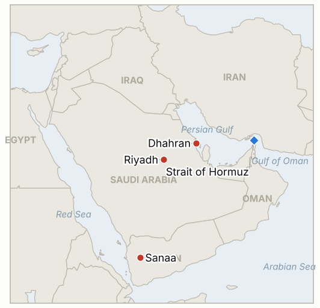

# Middle East Daily Briefing

**October 15, 2026**

- **Reporting window:** ~24 hours, October 14, 06:00 to October 15, 06:00 KST
- **Overall assessment:** The Houthi threat to Saudi oil became an act: the Saudi Energy Ministry confirmed that a Houthi missile hit an Aramco administrative building in Dhahran, causing a limited fire, and the Houthis promised more strikes on airports and oil sites (§1.1, §1.2). Ship attacks continued near Hormuz, with the IRGC saying a container ship sank on a mine (§1.3). Brent rose to $106.56 and WTI to a three week high, while KOSPI slipped 0.44% to 6,008.81 for a sixth straight loss, holding the 6,000 line only barely (§1.4).

---

## 1. What Happened

<figure style="float:right; width:46%; margin:2pt 0 8pt 14pt;">

<figcaption style="font-size:8pt; color:#666; text-align:center; margin-top:3pt; font-style:italic;">Major places of discussion</figcaption>
</figure>

### 1.1 Houthi missile hits an Aramco administrative building in Dhahran

The Houthis said they targeted Aramco facilities in Dhahran, an Aramco refinery in Riyadh and King Khalid International Airport. Overnight, the Saudi Ministry of Energy confirmed that an Aramco administrative building in Dhahran was hit, causing a limited fire ([Al Jazeera](https://www.aljazeera.com/news/2026/10/14/saudi-led-coalition-intercepts-houthi-missile-launched-towards-riyadh); [The Korea Times](https://www.koreatimes.co.kr/world/20261015/oil-prices-gain-on-attacks-in-saudi-arabia-irans-new-tactics-to-target-tankers)). No casualties or production impact were reported, and the Riyadh refinery claim was not confirmed. The strike came about a day after the Houthis named Saudi oil installations as legitimate targets, and it is the first Saudi acknowledgment of damage to an Aramco site in this campaign. **Confidence: High that the Dhahran building was hit (Saudi ministry); Low on any damage to the Riyadh refinery (Houthi claim only).**

### 1.2 Houthis vow more airport and oil strikes; another missile aimed at Riyadh is intercepted

The coalition said it intercepted and destroyed a Houthi ballistic missile aimed at Riyadh, and Saudi Civil Defence issued alerts for the capital and Al-Kharj before saying the danger had passed. Shrapnel from the interception of two cruise missiles on Tuesday damaged homes in Riyadh. The Houthis said they would keep targeting Saudi airports and oil infrastructure in the coming days ([Al Jazeera](https://www.aljazeera.com/news/2026/10/14/saudi-led-coalition-intercepts-houthi-missile-launched-towards-riyadh); [CBS News](https://www.cbsnews.com/live-updates/iran-war-us-houthi-saudi-arabia-trump/)). The weekend attacks on King Khalid airport are now put at 14 dead and more than 300 wounded, with two more killed at Abha airport. The State Department told its employees to get special authorization to use any airport in the kingdom, and Trump is reported to be weighing a US role; I found no disclosed US strike. **Confidence: High on the interception and the Houthi statement; Medium on casualty totals (they vary by outlet); Medium on the absence of a US strike (absence of reporting).**

### 1.3 Ship attacks continue near Hormuz; IRGC says a container ship sank on a mine

UKMTO reported a container ship and a tanker hit by unidentified projectiles inside the strait. The IRGC said a container ship sank south of the strait after hitting a naval mine and catching fire; one report said the Guards hit two ships on Tuesday after four the day before. Iranian officials did not describe the new tactics, though one said Iran changed its offensive methods about 10 days ago ([The Korea Times](https://www.koreatimes.co.kr/world/20261015/oil-prices-gain-on-attacks-in-saudi-arabia-irans-new-tactics-to-target-tankers); [Sunday Guardian](https://sundayguardianlive.com/world/crude-oil-prices-today-october-14-why-are-oil-prices-rising-today-brent-crude-hits-10658-as-saudi-aramco-attack-and-strait-of-hormuz-risks-offset-hopes-of-higher-russian-diesel-exports-305338/)). A US blockade has cut Iranian oil exports to zero. I found no new Iranian reply on the seven day Hormuz plan. **Confidence: Medium on the UKMTO incidents; Low on the sinking and its cause (IRGC claim, no vessel named); Low on the daily attack tally.**

### 1.4 Brent rises to $106.56 and WTI to a three week high; KOSPI slips to 6,008.81

Brent rose 0.82% to $106.56 and WTI 1.55% to $95.60, a three week high, as the Dhahran strike and ship attacks outweighed hopes for more Russian diesel. Trump said Russia agreed to supply diesel and the administration temporarily lifted sanctions on Russian diesel, but the IEA said limited Russian refining capacity means little change to the global diesel balance ([The Korea Times](https://www.koreatimes.co.kr/world/20261015/oil-prices-gain-on-attacks-in-saudi-arabia-irans-new-tactics-to-target-tankers)). KOSPI closed at 6,008.81, down 26.54 points (0.44%), its sixth straight loss, after opening more than 2% higher near 6,190 and reversing; foreigners net sold about 1.18 trillion won and institutions about 1.81 trillion, while individuals bought. SK hynix fell 1.66% and Samsung Electronics ended flat at 232,000 won ([Businesskorea](https://www.businesskorea.co.kr/news/articleView.html?idxno=278811); [Newspim](https://www.newspim.com/news/view/20261014001181)). The won closed at 1,338.3 per dollar, stronger by 6.8 won. **Confidence: High on the KOSPI and won closes; Medium on oil settles (percentage moves reported by Reuters based coverage, levels consistent with the prior day's settles).**

---

## 2. Deep Dive: Incentives and Motives

### 2.1 Why did the Houthis hit an Aramco office building and not a production site?

An administrative building in Dhahran, the company's Eastern Province hub, lets the Houthis make good on their threat and show reach across the kingdom while staying below the line that would damage exports and invite a far larger response, including US participation. It is also the cheapest way to prove the threat was real: a hit that Riyadh itself confirms is a headline, whatever the target. The open question is whether the next step is symbolic or industrial.

### 2.2 Why does Riyadh confirm the damage when it could stay quiet?

Confirming a limited fire at an office building, with no production impact, contains the story and keeps markets calm, while staying silent on the earlier Aramco claims left room for rumor. It also supports the case for Washington to join, and for the coalition to justify further strikes on Houthi fuel supply. Limiting the description to a "limited" fire is the message.

### 2.3 Why is Iran changing how it hits ships near Hormuz now?

Mines and unattributed projectiles keep the pressure on shipping and insurers while leaving room to deny responsibility, which matters with Washington's blockade at zero Iranian exports and the November 3 midterms approaching. Silence on the US reply to the seven day plan, combined with steady attacks, keeps the oil premium high without a formal break in the talks Tehran says it is still weighing.

### 2.4 Why did KOSPI fall again after opening more than 2% higher?

The opening bounce was a reaction to the prior day's 5.46% plunge, and foreign and institutional sellers used it to exit. With the index concentrated in two memory chipmakers and buyback support ending, rallies are being sold. The won strengthened on broad dollar weakness, so the equity weakness was not currency driven, and oil was up only modestly.

---

## 3. Policy Implications for South Korea

**Exposure snapshot:** South Korea draws about 70.7% of its crude and 20.4% of its LNG from the Middle East (`instructions/korea-exposure.md`, no update needed). Today's prints: Brent $106.56 and WTI $95.60 (October 14 settles), KOSPI 6,008.81 (from 6,035.35), and 1,338.3 won per dollar (from 1,345.1). I found no new Korean government announcement on Saudi Arabia in this window; Seoul's departure recommendation (level 3) stands.

**Implications by development:**

- **Dhahran strike (§1.1):** the Eastern Province is where Korean engineering and construction firms and oil buyers operate, so a Houthi reach to Dhahran raises insurance and staffing questions beyond Riyadh and strengthens the case for a sharper advisory (IND-20261015-1, IND-20261013-4). Korean crude cargoes load from the Gulf coast, so a strike that touched export loading would matter far more than an office hit.
- **Houthi vow and Riyadh (§1.2):** with attacks on airports promised, evacuation by air remains uncertain (IND-20261013-4, IND-20261011-2).
- **Hormuz (§1.3):** a mine sinking, if confirmed, adds a new hazard for Korean bound cargo and the Korean crews still in the area (IND-20261015-2, IND-20261013-3).
- **Markets (§1.4):** Brent at $106.56 keeps Korea's import bill and inflation pressure high; the KOSPI close above 6,000 by a narrow margin leaves the next move to chip flows (IND-20261014-1, IND-20261015-3). The won's rise to 1,338.3 reduces near term currency pressure (IND-20261014-3).

**Resolved today:** IND-20261014-2 confirmed (Saudi Energy Ministry confirmed a Houthi missile hit an Aramco administrative building in Dhahran, though not a production site); IND-20261012-1 confirmed on the same event (damage to an Aramco facility, with no production impact).

**Testable indicators:**

- **IND-20261015-1** (open, new): a Saudi, Aramco or imagery confirmed Houthi strike that disrupts production, refining or export loading (for example Ras Tanura, Abqaiq, Yanbu or the Riyadh refinery) by ~2026-10-22 confirms escalation to industrial targets; none falsifies.
- **IND-20261015-2** (open, new): UKMTO, an owner, a flag state or CENTCOM identifying the container ship the IRGC says sank on a mine, and its cause, by ~2026-10-22 confirms; none falsifies.
- **IND-20261015-3** (open, new): a Brent front month settle above $110 by ~2026-10-22 confirms the extension; none falsifies.
- **IND-20261014-1**, **IND-20261014-3**, **IND-20261008-2**, **IND-20261009-3**, **IND-20261011-1**, **IND-20261011-2**, **IND-20261010-3** and the other older open items (open): no resolving information in the window. KOSPI closed at 6,008.81 (not above 6,400 or 7,000), the won closed at 1,338.3 (not weaker than 1,360), foreigners kept selling, and no US strike was disclosed.

---

## 4. Watch List

- **Whether the Houthis reach production, refining or loading facilities (IND-20261015-1).**
- **Further coalition strikes on Houthi ports and fuel supply (Hodeidah, Sanaa), and any US decision to join (IND-20261011-1).**
- **Iran's answer on the Hormuz plan and the pace of ship attacks, including mines (IND-20261013-3, IND-20261015-2, IND-20261007-2).**
- **Riyadh airport reopening against the October 17 and 19 airline dates (IND-20261011-2, IND-20261010-3).**
- **KOSPI foreign flows, chip names, and the 6,000 line (IND-20261014-1, IND-20261009-3).**
- **Brent against the $95 and $100 downside tests due October 16 and the $110 upside test (IND-20261003-2, IND-20261006-2, IND-20261015-3).**

---

## 5. Source Quality Summary

| Claim | Sources | Confidence |
| --- | --- | --- |
| Houthi missile hit Aramco administrative building in Dhahran, limited fire | Al Jazeera, The Korea Times (Saudi Energy Ministry) | High |
| Houthi claims of strikes on Riyadh refinery and airport | Al Jazeera (Houthi statement) | Low |
| Houthis vow more airport and oil strikes | Al Jazeera, CBS News | High |
| Ballistic missile aimed at Riyadh intercepted | Al Jazeera (coalition statement) | High |
| Weekend toll 14 dead, more than 300 wounded; two dead at Abha | Al Jazeera | Medium |
| No US strike disclosed | Absence in search results | Medium |
| UKMTO: container ship and tanker hit by projectiles | The Korea Times, Sunday Guardian | Medium |
| IRGC: container ship sank on a mine | The Korea Times (IRGC claim) | Low |
| Brent $106.56, WTI $95.60 | The Korea Times (Reuters based) | Medium |
| IEA on Russian diesel and refining capacity | The Korea Times | Medium |
| KOSPI 6,008.81, foreigners sold 1.18tn won, won 1,338.3 | Businesskorea, Newspim | High |
| Hormuz daily transit count | None reliable | Not reported |
