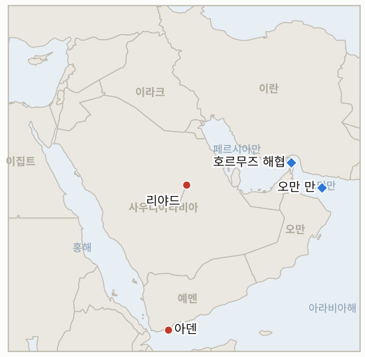

# 중동 일일 브리핑

**2026년 10월 16일**

- **보고 기간:** 약 24시간, 10월 15일 06:00 ~ 10월 16일 06:00 (한국시간)
- **종합 평가:** 호르무즈 작전에 선박 이름과 숫자가 붙었다. 미 중부사령부(CENTCOM)는 컨테이너선 GFS 프라이드호가 IRGC의 타격으로 침몰했다고 특정했고, 10월 11일 이후 최소 10척이 피격되었다(§1.1). 후티는 리야드에서 아덴의 대통령궁으로 타격 대상을 옮겼고, 리야드는 이란이 후티를 무장시킨다고 비난하며 EU 걸프 정상회의를 연기했다(§1.2, §1.3). 가장 큰 충격은 걸프가 아니라 서울에서 나왔다. 코스피가 7.57% 내린 5,554.22로 마감하며 서킷브레이커가 발동되었는데, 주된 요인은 미국 물가와 AI 투자 우려였고 중동발 유가 리스크는 배경이었다(§1.4).

---

## 1. 무슨 일이 있었나

<figure style="float:right; width:46%; margin:2pt 0 8pt 14pt;">

<figcaption style="font-size:8pt; color:#666; text-align:center; margin-top:3pt; font-style:italic;">주요 논의 지점</figcaption>
</figure>

### 1.1 중부사령부가 침몰 선박을 지목하며 IRGC의 타격이라고 밝히고, 10월 11일 이후 약 10척이 피격된다

미 중부사령부(CENTCOM)는 IRGC가 컨테이너선 GFS 프라이드호를 타격했고 이 배가 예인 도중 침몰했다고 밝히며, 이란이 해협을 통제한다는 주장을 반박했다. 또 지난 24시간 동안 40척 넘는 선박이 해협을 통과했다고 전했다. IRGC는 이 배가 기뢰에 부딪혔다고 주장해 왔으므로, 선박은 특정되었지만 원인은 여전히 다툼이 있다([Fox News](https://www.foxnews.com/live-news/us-iran-war-peace-donald-trump-strait-hormuz-oil-prices-midterms-october-15); [Gulf News](https://gulfnews.com/world/mena/middle-east-conflict-us-destroys-iranian-linked-dhow-as-tehran-shifts-tactics-near-hormuz-1.500711139)). Gulf News는 일요일 이후 호르무즈와 인근에서 최소 10척이 피격되어 개전 이후 최다라고 집계했고, 이란 군 매체는 유조선이 "금지 구역"에 들어간 뒤 오만 만에서 불이 났다고 전했으나 원인은 불분명하다. 로이터는 미군이 이란 레이더를 약화시킨 뒤 IRGC가 소형 보트의 비무장 관측 요원을 활용하고 있다고 보도했다. **신뢰도: CENTCOM이 GFS 프라이드호를 지목하고 피격이라고 밝힌 점은 높음, 원인은 중간(CENTCOM과 IRGC의 설명이 상충), 10척 집계는 중간(단일 종합 매체), 유조선 화재는 낮음(이란 국영 매체, 미확인).**

### 1.2 후티 미사일이 아덴 대통령궁을 타격하고, 리야드는 후티가 회담을 거부했다며 이란을 비난한다

후티 미사일이 아덴의 알마아시크 대통령궁 단지를 타격했다. 로이터는 예멘 당국자를 인용해 경호원 2명이 숨졌다고 전했고 AFP는 사망 4명, 부상 10명으로 집계했으며, 장관들은 무사했다. 연합군은 메디나 인근에서 순항미사일을, 카미스 무샤이트 상공에서 드론을 요격했다고 밝혔고(후티는 메디나 공격을 부인), 후티 무기고와 발사대 127곳을 파괴했다고 주장했다([Fox News](https://www.foxnews.com/live-news/us-iran-war-peace-donald-trump-strait-hormuz-oil-prices-midterms-october-15); [The New Arab](https://www.newarab.com/news/iran-us-tensions-soar-ships-sink-hormuz-fighting-taiz)). 한 사우디 당국자는 확전 초기에 무스카트에서 후티와 회담을 열자고 제안했으나 후티가 거부했다고 밝혔고, 사우디는 이란이 후티를 무장시키고 부추긴다고 비난하면서도 테헤란과의 소통은 유지한다고 말했다. 연합군 대변인 투르키 알말리키는 리야드 공항 공격의 피해를 10월 7~11일 사망 17명, 부상 333명으로 밝혀, 어제 인용된 사망 14명에서 늘었다. **신뢰도: 대통령궁 피격은 높음(복수 매체), 사상자는 중간(2명과 4명), 공항 피해는 중간(연합군 수치), 127곳 파괴 주장은 낮음(연합군 발표, 독립 검증 없음).**

### 1.3 EU 걸프 정상회의가 연기되고, 트럼프는 전쟁이 "매우 빨리" 끝난다고 말하며, CNN은 MOAB 사용 방안을 보도한다

EU는 안보 우려를 이유로 10월 24일 리야드에서 열릴 예정이던 걸프 국가들과의 정상회의를 연기했고, 인디고(IndiGo)는 리야드, 제다, 담맘, 메디나행 항공편을 10월 24일까지 취소했다. 트럼프 대통령은 몬태나 유세에서 누구와 협상하는지 모르겠다며 "지도자들을 남겨뒀어야 했다"고 말했고, 전쟁이 "어느 쪽으로든 매우 빨리" 끝날 것이라고 밝혔다([Fox News](https://www.foxnews.com/live-news/us-iran-war-peace-donald-trump-strait-hormuz-oil-prices-midterms-october-15); [The New Arab](https://www.newarab.com/news/iran-us-tensions-soar-ships-sink-hormuz-fighting-taiz)). CNN은 전투가 재개될 경우 미국 기획 부서가 이란의 에너지·핵 시설에 GBU-43/B "모든 폭탄의 어머니"(MOAB)를 쓰는 방안을 마련했다고 보도했으나 Fox는 확인하지 못했다. 이란 의회 의장 칼리바프는 협상하면서도 전쟁에 대비해야 한다고 말했다. 미국이나 이란, 후티에 대한 공개된 미국의 타격은 확인되지 않았다. **신뢰도: 정상회의 연기와 트럼프 발언은 높음, MOAB 보도는 낮음(CNN 단독, 미확인), 미국 타격이 없었다는 점은 중간(보도 부재에 근거).**

### 1.4 브렌트유 105.92달러, WTI 97.97달러로 급등하고, 코스피는 7.57% 폭락한 5,554.22로 서킷브레이커가 발동된다

12월물 브렌트유는 14센트 내린 105.92달러에 정산했고, 11월물 WTI는 미국 원유 재고의 큰 폭 감소로 2.88달러 올라 97.97달러가 되었다. 국제에너지기구(IEA) 월간 보고서와 호르무즈 공격도 영향을 미쳤다([CNBC](https://www.cnbc.com/2026/10/15/oil-prices-today-brent-wti.html)). 이 전일 대비 수치로 역산하면 10월 14일 정산가는 약 106.06달러와 95.09달러로, 어제 적은 106.56달러와 95.60달러와 소폭 다르나 차이는 50센트 미만이다. 코스피는 454.59포인트(7.57%) 급락한 5,554.22로 마감했다. 7거래일 연속 하락이며 4월 7일 이후 최저로, 오전 사이드카에 이어 낮 12시 38분 서킷브레이커로 20분간 거래가 중단되었다. 코스닥은 7.65% 내린 760.82였다([UPI](https://www.upi.com/Top_News/World-News/2026/10/15/korea-KOSPI-Korea-Stock-Index-crash-seven-percent-AI-sector/4891792056904/); [SBS Biz](https://biz.sbs.co.kr/article/20000340199)). 외국인이 약 3.62조 원을 순매도했고 기관과 개인은 순매수했다. SK하이닉스는 11.06% 내린 126만 원, 삼성전자는 9.48% 내린 21만 원이었다. 보도들은 미국 9월 소비자물가(전월 대비 0.6% 상승)로 금리 인상 우려가 커진 점, AI 투자 지속성 의문, 메모리 경쟁을 원인으로 꼽았고 중동 뉴스는 언급하지 않았다. 금융당국은 증시상황 긴급 점검회의를 열어 필요시 컨틴전시 플랜을 시행하겠다고 밝히고 신용융자와 시장교란 행위를 경계했다([한국일보](https://www.hankookilbo.com/news/article/A2026101516110000918)). 원·달러 환율은 2.3원 오른 1,344.6원에 마감했다. **신뢰도: 코스피, 수급, 환율은 높음(연합뉴스, 로이터, SBS), 유가 정산가는 중간(CNBC와 Globe and Mail이 일치하나 거래소 자료 없음), 원인은 중간(언론의 해석).**

---

## 2. 심층 분석: 동기와 유인

### 2.1 중부사령부는 왜 GFS 프라이드호를 공개적으로 지목하며 IRGC의 타격이라고 말하는가?

선박 이름과 책임 주체를 공식 기록으로 남기면, 테헤란이 의도적 공격을 부인할 수 있게 해 준 IRGC의 기뢰 주장을 반박하고, 이란이 해협을 통제하지 못한다는 논지를 뒷받침한다. "24시간 40척 넘게 통과"라는 수치도 같은 메시지로, 위험은 실재하지만 해협은 닫히지 않았다는 것이다. 워싱턴이 확전을 택할 경우 공격의 공개 기록이 필요하기도 한데, MOAB 보도로 그 압박은 커진다.

### 2.2 후티는 왜 다른 사우디 표적이 아니라 아덴 대통령궁을 쳤는가?

예멘 정부의 중심부를 치면 사우디 쪽 사상자 집계로 리야드의 태도가 굳어지는 것을 피하면서 도달 범위를 과시하고 연합군의 현지 파트너를 응징할 수 있다. 메디나 발사를 부인한 것과도 맞아떨어진다. 자신이 책임질 수 있는 예멘 내부 표적은 택하고, 더 북쪽에서는 부인할 여지를 남기는 것이다. 무스카트 회담을 거부하면 연합군의 무기고 타격이 이어지는 동안 협상 지렛대를 유지할 수 있다.

### 2.3 리야드는 왜 지금 회담 거부를 공개하고 이란을 비난하는가?

무스카트 회담을 제안했다고 밝히면 사우디는 긴장 완화를 추구하는 쪽으로 비치고, 보호와 제재를 저울질하는 EU, 프랑스, 워싱턴에 유리하다. 테헤란을 비난하면서도 대화는 계속한다고 말해 뒷채널을 열어 둔다. 왕국에는 공개적 결별보다 이란이 후티를 자제시켜 주는 것이 더 필요하기 때문이다.

### 2.4 유가는 거의 움직이지 않았는데 코스피는 왜 7.57% 빠졌는가?

방아쇠는 연준 인상 우려를 되살린 미국 물가 지표였고, 메모리 반도체 두 종목에 쏠려 이미 6거래일 하락한 지수에 떨어졌으며 외국인 순매도는 1.18조 원에서 3.62조 원으로 커졌다. 105달러대 유가는 한국의 수입 부담을 키우고 금리 우려를 이어 가게 하지만, 하루 낙폭 자체는 반도체와 금리의 문제였다. 개인 매수와 컨틴전시 대책 예고는 당국이 중동 충격보다 강제 청산 가능성을 걱정함을 보여 준다.

---

## 3. 한국에 대한 정책적 함의

**익스포저 현황:** 한국은 원유의 약 70.7%, LNG의 약 20.4%를 중동에서 들여온다(`instructions/korea-exposure.md`, 갱신 불필요). 오늘 수치는 브렌트유 105.92달러, WTI 97.97달러(10월 15일 정산가), 코스피 5,554.22(6,008.81에서 하락), 원·달러 환율 1,344.6원(1,338.3원에서 상승)이다. 금융위원회가 증시상황 긴급 점검회의를 열었다. 사우디에 대한 새로운 한국 정부 발표는 확인되지 않아 3단계 출국 권고는 유지된다.

**사안별 함의:**

- **GFS 프라이드호와 선박 공격(§1.1):** CENTCOM이 의도적 타격이라고 지목하고 닷새 동안 최소 10척이 피격되었으므로, 한국행 화물의 전쟁 보험료와 선원 안전 우려가 커진다. 다만 하루 40척 넘는 통과는 한국 원유 흐름이 아직 이어지고 있음을 시사한다(IND-20261013-3, IND-20261007-2).
- **후티, 아덴, EU 정상회의(§1.2, §1.3):** 리야드 정상회의 연기와 10월 24일까지의 항공편 취소로 사우디 체류 한국인의 항공 철수는 계속 불확실하다(IND-20261013-4, IND-20261011-2, IND-20261016-3).
- **시장(§1.4):** 코스피 폭락은 대부분 글로벌 반도체·금리 사안이지만, 106달러 안팎의 유가는 한국의 수입 부담을 키우고 1,344.6원의 환율은 외국인 자금 유출에 대한 완충 여력이 작다. 관건은 당국의 컨틴전시 플랜이 실제 조치로 이어지는지다(IND-20261016-1, IND-20261016-2, IND-20261014-1).

**오늘 해소된 지표:** IND-20261015-2 확증(CENTCOM이 GFS 프라이드호를 지목하고 IRGC의 타격이라고 밝힘, 기뢰냐 타격이냐는 여전히 다툼). IND-20261007-1 반증(10월 16일 기한까지 모하 정부군 장악에 대한 독립 확인 없음).

**검증 가능한 지표:**

- **IND-20261016-1** (진행, 신규): 금융위원회, 한국거래소 또는 기획재정부가 구체적인 안정 조치(안정기금, 공매도 제한, 국가 지원 자사주 매입, 증거금 규정 변경)를 ~2026-10-23까지 발표하면 확증, 없으면 반증.
- **IND-20261016-2** (진행, 신규): 코스피가 ~2026-10-23까지 5,300 아래에서 마감하면 하락 심화로 확증, 없으면 반증.
- **IND-20261016-3** (진행, 신규): 사우디와 후티의 회동이 ~2026-10-26까지 공개되면 확증, 없으면 반증.
- **IND-20261015-1**, **IND-20261015-3**, **IND-20261014-1**, **IND-20261014-3**, **IND-20261008-2**, **IND-20261009-2**, **IND-20261009-3**, **IND-20261003-2**, **IND-20261006-2** 및 기타 기존 진행 지표(진행): 기간 내 해소 정보 없음. 브렌트유는 105.92달러로 정산해 110달러 초과도 100달러 미만도 아니었고, 환율은 1,344.6원으로 1,360원보다 약하지 않았으며, 코스피는 5,554.22로 6,400을 넘지 못했고, 외국인은 순매도했다. CENTCOM의 40척은 전체 선박 수치라 IND-20261009-2가 요구하는 유조선 통과 수가 아니다. 일부는 10월 16일에 만료되며 다음 브리핑에서 그날 종가로 판정한다.

---

## 4. 관찰 목록

- **호르무즈 인근 선박 공격의 원인과 건수, 그리고 "금지 구역" 유조선 화재의 확인 여부(IND-20261007-2, IND-20261013-3).**
- **사우디와 후티의 회동 여부, 연합군의 무기고 타격 확대(IND-20261016-3, IND-20261011-1).**
- **11월 3일 중간선거 전 MOAB 방안이나 타격에 대한 미국의 결정(IND-20261009-1).**
- **정부의 컨틴전시 플랜과 5,300선 대비 코스피 외국인 수급(IND-20261016-1, IND-20261016-2, IND-20261009-3).**
- **10월 16일 만료: 브렌트유 95달러·100달러 하방 시험, 코스피 7,000, 외국인 순매수(IND-20261003-2, IND-20261006-2, IND-20261008-2, IND-20261009-3).**
- **리야드 공항과 항공사 운항 중단, 인디고는 10월 24일까지 취소(IND-20261011-2, IND-20261010-3).**

---

## 5. 출처 신뢰도 요약

| 주장 | 출처 | 신뢰도 |
| --- | --- | --- |
| CENTCOM: IRGC가 GFS 프라이드호 타격, 예인 중 침몰, 24시간 40척 넘게 통과 | Fox News 라이브 블로그 (CENTCOM 발표) | 높음 |
| 10월 11일 이후 호르무즈 인근 최소 10척 피격 | Gulf News | 중간 |
| 오만 만 유조선 화재 | Gulf News, The New Arab (이란 국영 매체) | 낮음 |
| IRGC의 소형 보트 관측 요원 활용 | Gulf News (로이터) | 중간 |
| 후티 미사일이 아덴 대통령궁 타격, 사망 2~4명 | Fox News (로이터), Gulf News (AFP) | 타격 높음, 사상자 중간 |
| 메디나 인근 순항미사일 요격, 후티 부인 | Gulf News, The New Arab | 중간 |
| 리야드 공항 피해 사망 17명, 부상 333명 (10월 7~11일) | Gulf News, The New Arab (연합군) | 중간 |
| 사우디: 후티가 무스카트 회담 거부, 이란 비난 | Gulf News | 중간 |
| EU 걸프 정상회의 연기, 인디고 10월 24일까지 취소 | Fox News, Gulf News | 높음 |
| CNN의 MOAB 방안 보도 | Fox News (미확인), The New Arab | 낮음 |
| 브렌트유 105.92달러, WTI 97.97달러 | CNBC, The Globe and Mail | 중간 |
| 코스피 5,554.22, 서킷브레이커, 외국인 3.62조 원 순매도, 환율 1,344.6원 | UPI (연합뉴스), SBS Biz, 로이터 | 높음 |
| 금융당국 증시상황 긴급 점검회의 | 한국일보 | 높음 |
| 호르무즈 일일 통과 선박 수 | CENTCOM "40척 넘게" (전체 선박) | 정확한 수치는 미보고 |
