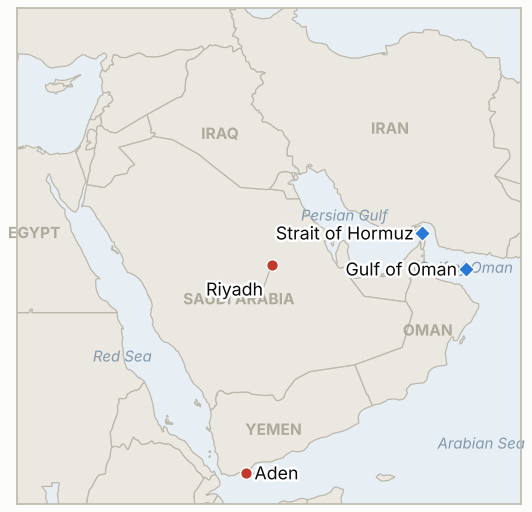

# Middle East Daily Briefing

**October 16, 2026**

- **Reporting window:** ~24 hours, October 15, 06:00 to October 16, 06:00 KST
- **Overall assessment:** The Hormuz campaign got a name and a number: CENTCOM identified the container ship M/V GFS Pride as struck by the IRGC and sunk, and at least 10 ships have been hit since October 11 (§1.1). The Houthis shifted from Riyadh to Aden's presidential palace while Riyadh accused Tehran of arming them and postponed an EU Gulf summit (§1.2, §1.3). The sharpest move was in Seoul, not the Gulf: KOSPI fell 7.57% to 5,554.22 and tripped a circuit breaker, driven mainly by US inflation and AI spending worries, with Middle East oil risk as a backdrop (§1.4).

---

## 1. What Happened

<figure style="float:right; width:46%; margin:2pt 0 8pt 14pt;">

<figcaption style="font-size:8pt; color:#666; text-align:center; margin-top:3pt; font-style:italic;">Major places of discussion</figcaption>
</figure>

### 1.1 CENTCOM names the sunk ship and says the IRGC struck it; about 10 ships hit since October 11

CENTCOM said the IRGC struck the container ship M/V GFS Pride, which later sank while under tow, rejecting Iranian claims to control the strait and saying more than 40 vessels transited in the past 24 hours. The IRGC had said the ship hit a naval mine, so the vessel is now identified but the cause is still disputed ([Fox News](https://www.foxnews.com/live-news/us-iran-war-peace-donald-trump-strait-hormuz-oil-prices-midterms-october-15); [Gulf News](https://gulfnews.com/world/mena/middle-east-conflict-us-destroys-iranian-linked-dhow-as-tehran-shifts-tactics-near-hormuz-1.500711139)). Gulf News counted at least 10 ships struck in and around Hormuz since Sunday, the most since the war began, and Iranian military media said a tanker was on fire in the Gulf of Oman after entering a "prohibited zone"; the cause is unclear. Reuters reported the IRGC is using unarmed spotters in small boats after US forces degraded its radar. **Confidence: High that CENTCOM named GFS Pride and said it was struck; Medium on the cause (CENTCOM and IRGC accounts conflict); Medium on the count of 10 ships (single aggregator); Low on the tanker fire (Iranian state media, unverified).**

### 1.2 Houthi missiles hit Aden's presidential palace; Riyadh says the Houthis refused talks and blames Iran

Houthi missiles struck the Al-Maashiq presidential palace complex in Aden; Reuters, citing Yemeni officials, reported two security guards killed, while AFP put the toll at four dead and 10 wounded, and ministers were unharmed. The coalition said it intercepted a cruise missile near Medina and a drone over Khamis Mushait, which the Houthis denied for Medina, and said it had destroyed 127 Houthi weapons depots and launch platforms ([Fox News](https://www.foxnews.com/live-news/us-iran-war-peace-donald-trump-strait-hormuz-oil-prices-midterms-october-15); [The New Arab](https://www.newarab.com/news/iran-us-tensions-soar-ships-sink-hormuz-fighting-taiz)). A Saudi official said Riyadh proposed talks with the Houthis in Muscat at the start of the escalation and they refused, and Saudi Arabia accused Iran of arming and encouraging the group while saying it remains in contact with Tehran. Coalition spokesman Turki al-Maliki put the Riyadh airport toll at 17 dead and 333 wounded for October 7 to 11, up from the 14 dead cited yesterday. **Confidence: High that the palace was hit (multiple outlets); Medium on the palace toll (two versus four); Medium on the airport toll (coalition figure); Low on the 127 sites claim (coalition statement, no independent check).**

### 1.3 EU Gulf summit postponed; Trump says the war ends "very quickly"; CNN reports MOAB options

The EU postponed its October 24 summit with Gulf states in Riyadh over security concerns, and IndiGo cancelled flights to Riyadh, Jeddah, Dammam and Madinah through October 24. At a Montana rally Trump said he "should have probably left the leaders" because he does not know who the US is negotiating with, and that the war will end "very quickly, one way or the other" ([Fox News](https://www.foxnews.com/live-news/us-iran-war-peace-donald-trump-strait-hormuz-oil-prices-midterms-october-15); [The New Arab](https://www.newarab.com/news/iran-us-tensions-soar-ships-sink-hormuz-fighting-taiz)). CNN reported US planners have options to use the GBU-43/B "Mother of All Bombs" on Iranian energy and nuclear sites if combat resumes, which Fox could not verify; Iran's parliament speaker Qalibaf said Iran must prepare for war while negotiating. I found no disclosed US strike on Iran or the Houthis. **Confidence: High on the summit postponement and Trump's remarks; Low on the MOAB report (single CNN account, unverified); Medium on no US strike (absence of reporting).**

### 1.4 Brent settles at $105.92 and WTI jumps to $97.97; KOSPI plunges 7.57% to 5,554.22 and trips a circuit breaker

Brent for December fell 14 cents to settle at $105.92 and WTI for November rose $2.88 to $97.97 on a large US crude stock draw, with the IEA's monthly report and Hormuz attacks in the mix ([CNBC](https://www.cnbc.com/2026/10/15/oil-prices-today-brent-wti.html)). Those prior day levels imply Oct 14 settles near $106.06 and $95.09, slightly different from the $106.56 and $95.60 I carried yesterday; the gap is under 50 cents. KOSPI closed at 5,554.22, down 454.59 points (7.57%), its seventh straight loss, the lowest close since April 7 and 20 minutes of halted trading from a 12:38 circuit breaker after a morning sidecar; KOSDAQ fell 7.65% to 760.82 ([UPI](https://www.upi.com/Top_News/World-News/2026/10/15/korea-KOSPI-Korea-Stock-Index-crash-seven-percent-AI-sector/4891792056904/); [SBS Biz](https://biz.sbs.co.kr/article/20000340199)). Foreigners net sold about 3.62 trillion won while institutions and individuals bought; SK hynix fell 11.06% to 1.26 million won and Samsung Electronics 9.48% to 210,000 won. Reports blamed hot US September CPI (up 0.6% on the month) lifting rate hike fears, doubts over AI spending, and memory competition, not Middle East news. Finance authorities held an emergency market meeting, promised contingency plans if needed, and warned on margin lending and market manipulation ([Hankook Ilbo](https://www.hankookilbo.com/news/article/A2026101516110000918)). The won closed at 1,344.6 per dollar, weaker by 2.3 won. **Confidence: High on KOSPI, flows and won (Yonhap, Reuters, SBS); Medium on oil settles (CNBC and Globe and Mail agree, no exchange page); Medium on the causes (press attribution).**

---

## 2. Deep Dive: Incentives and Motives

### 2.1 Why does CENTCOM publicly name GFS Pride and say the IRGC struck it?

Putting a vessel name and an attribution on record rebuts the IRGC's mine story, which let Tehran deny a deliberate attack, and it supports the line that Iran does not control the strait. The "more than 40 transits in 24 hours" figure carries the same message: traffic is moving, so the risk is real but the strait is not closed. Washington also needs a public record of attacks if it chooses escalation, a pressure that grows with the MOAB leak.

### 2.2 Why did the Houthis strike the Aden palace instead of another Saudi target?

Hitting the seat of Yemen's government shows reach and punishes the coalition's local partners without a Saudi casualty count that would harden Riyadh. It also fits the Houthis' denial of the Medina launch: they select targets they can own, in Yemen, while keeping deniability further north. Refusing Muscat talks keeps leverage while the coalition's depot strikes continue.

### 2.3 Why does Riyadh publicize the refused talks and blame Iran now?

Disclosing that it offered Muscat talks casts Saudi Arabia as the party seeking de-escalation, which helps with the EU, France and Washington as they weigh protection and sanctions. Blaming Tehran while saying it still talks to Tehran keeps a back channel open, because the kingdom needs Iran to restrain the Houthis more than it needs a public break.

### 2.4 Why did KOSPI fall 7.57% when oil barely moved?

The trigger was a US inflation print that revived fears of Fed hikes, landing on an index concentrated in two memory chipmakers already down six sessions, with foreign selling rising from 1.18 trillion won to 3.62 trillion. Oil at about $106 raises the cost of importing for Korea and keeps rate worries alive, but the one day move was a chip and rates story. Retail buying and a pledge of contingency measures show authorities are worried about forced selling more than about a Middle East shock.

---

## 3. Policy Implications for South Korea

**Exposure snapshot:** South Korea draws about 70.7% of its crude and 20.4% of its LNG from the Middle East (`instructions/korea-exposure.md`, no update needed). Today's prints: Brent $105.92 and WTI $97.97 (October 15 settles), KOSPI 5,554.22 (from 6,008.81), and 1,344.6 won per dollar (from 1,338.3). The Financial Services Commission held an emergency market meeting; I found no new Korean announcement on Saudi Arabia, so the level 3 departure recommendation stands.

**Implications by development:**

- **GFS Pride and ship attacks (§1.1):** a CENTCOM attribution of deliberate strikes, with at least 10 ships hit in five days, raises war risk insurance and crew safety concerns for Korean bound cargo. CENTCOM's 40 plus daily transits suggest Korean crude flows are still moving (IND-20261013-3, IND-20261007-2).
- **Houthis, Aden and the EU summit (§1.2, §1.3):** the postponed Riyadh summit and flight cancellations through October 24 mean evacuation by air stays uncertain for Koreans in Saudi Arabia (IND-20261013-4, IND-20261011-2, IND-20261016-3).
- **Markets (§1.4):** the KOSPI plunge is mostly a global chip and rates event, but $106 oil raises Korea's import bill and the won at 1,344.6 leaves little cushion for foreign outflows. The test is whether Seoul's contingency plan becomes an actual measure (IND-20261016-1, IND-20261016-2, IND-20261014-1).

**Resolved today:** IND-20261015-2 confirmed (CENTCOM named GFS Pride and said the IRGC struck it; the mine versus strike cause is still disputed). IND-20261007-1 falsified (no independent confirmation of government control of Mokha by the October 16 deadline).

**Testable indicators:**

- **IND-20261016-1** (open, new): an announced concrete stabilization measure from the Financial Services Commission, Korea Exchange or Ministry of Economy and Finance (stabilization fund, short selling curb, state backed buyback or margin rule change) by ~2026-10-23 confirms; none falsifies.
- **IND-20261016-2** (open, new): a KOSPI close below 5,300 by ~2026-10-23 confirms deepening; none falsifies.
- **IND-20261016-3** (open, new): a disclosed Saudi Houthi meeting by ~2026-10-26 confirms; none falsifies.
- **IND-20261015-1**, **IND-20261015-3**, **IND-20261014-1**, **IND-20261014-3**, **IND-20261008-2**, **IND-20261009-2**, **IND-20261009-3**, **IND-20261003-2**, **IND-20261006-2** and the other older open items (open): no resolving information in the window. Brent settled at $105.92 (not above $110, not below $100), the won at 1,344.6 (not weaker than 1,360), KOSPI at 5,554.22 (not above 6,400), foreigners were net sellers, and CENTCOM's 40 vessel figure covers all ships, not the tanker count IND-20261009-2 needs. Several expire on October 16, to be scored on that day's closes in the next brief.

---

## 4. Watch List

- **Cause and count of ship attacks near Hormuz, and whether the "prohibited zone" tanker fire is verified (IND-20261007-2, IND-20261013-3).**
- **Whether Saudi Arabia and the Houthis meet, and whether the coalition widens depot strikes (IND-20261016-3, IND-20261011-1).**
- **Any US decision on the MOAB options or a strike before the November 3 midterms (IND-20261009-1).**
- **Seoul's contingency plan and KOSPI foreign flows against the 5,300 line (IND-20261016-1, IND-20261016-2, IND-20261009-3).**
- **October 16 expiries: Brent $95 and $100 downside tests, KOSPI 7,000, foreign net buying (IND-20261003-2, IND-20261006-2, IND-20261008-2, IND-20261009-3).**
- **Riyadh airport and airline suspensions, now cancelled through October 24 by IndiGo (IND-20261011-2, IND-20261010-3).**

---

## 5. Source Quality Summary

| Claim | Sources | Confidence |
| --- | --- | --- |
| CENTCOM: IRGC struck M/V GFS Pride, which sank under tow; 40 plus transits in 24 hours | Fox News live blog (CENTCOM statement) | High |
| At least 10 ships struck near Hormuz since Oct 11 | Gulf News | Medium |
| Tanker on fire in Gulf of Oman | Gulf News, The New Arab (Iranian state media) | Low |
| IRGC using spotters in small boats | Gulf News (Reuters) | Medium |
| Houthi missiles hit Aden presidential palace, 2 to 4 dead | Fox News (Reuters), Gulf News (AFP) | High on the strike, Medium on toll |
| Cruise missile near Medina intercepted; Houthis deny | Gulf News, The New Arab | Medium |
| Riyadh airport toll 17 dead, 333 wounded (Oct 7 to 11) | Gulf News, The New Arab (coalition) | Medium |
| Saudi says Houthis refused Muscat talks; blames Iran | Gulf News | Medium |
| EU Gulf summit postponed; IndiGo cancels through Oct 24 | Fox News, Gulf News | High |
| CNN report on MOAB options | Fox News (unverified), The New Arab | Low |
| Brent $105.92, WTI $97.97 | CNBC, The Globe and Mail | Medium |
| KOSPI 5,554.22, circuit breaker, foreigners sold 3.62tn won, won 1,344.6 | UPI (Yonhap), SBS Biz, Reuters | High |
| Emergency market meeting by finance authorities | Hankook Ilbo | High |
| Hormuz daily transit count | CENTCOM "more than 40" (all vessels) | Not reported as an exact count |
