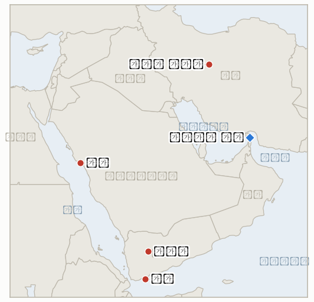

# 중동 일일 브리핑

**2026년 10월 17일**

- **보고 기간:** 약 24시간, 10월 16일 06:00 ~ 10월 17일 06:00 (한국시간)
- **종합 평가:** 호르무즈 해상 전쟁은 이제 주 단위로 집계된다. UKMTO는 7일간 12척이 공격받았다고 집계했고, 싱가포르는 컨테이너선 GFS 프라이드호의 침몰을 확인했다(§1.1). 트럼프는 미국이 이란의 픽액스 마운틴 핵시설을 "타격해야 할 수도 있다"고 말했고 MOAB 방안이 보도되었으나, 미국의 타격은 공개되지 않았다(§1.3). 코스피는 2.05% 반등해 5,668.05로 마감했고 외국인이 9거래일 만에 순매수했지만, 주간으로는 약 14.5% 하락했다(§1.4).

**정정 및 업데이트:** 10월 16일 브리핑은 단일 집계 매체를 근거로 "10월 11일 이후 약 10척 피격"이라고 썼다. UKMTO의 자체 집계는 일주일간 12척 피격(해협 10척, 걸프 1척, 오만 만 1척)이며, 이 중 1척은 침몰하고 2척은 운항 불능이 되었다. 또 Gulf News는 인디고의 사우디 노선 취소를 한 기사에서는 10월 24일까지, 다른 기사에서는 10월 17일까지로 적었다. 10월 24일까지 연장된 것으로 보되 항공사마다 다르다.

---

## 1. 무슨 일이 있었나

<figure style="float:right; width:46%; margin:2pt 0 8pt 14pt;">

<figcaption style="font-size:8pt; color:#666; text-align:center; margin-top:3pt; font-style:italic;">주요 논의 지점</figcaption>
</figure>

### 1.1 UKMTO가 일주일간 12척 피격을 집계하고, 싱가포르가 GFS 프라이드호 침몰을 확인한다

UKMTO는 이번 주 12척이 공격받았다고 밝혔다. 호르무즈 해협 10척, 아라비아만 1척, 오만 만 1척이다. 6척은 항해를 계속하거나 입항했고, 1척은 침몰, 2척은 운항 불능, 3척은 결과가 확인되지 않았다([Fox News](https://www.foxnews.com/live-news/iran-war-trump-strait-hormuz-oil-prices-midterms-october-16); [Gulf News](https://gulfnews.com/uae/us-israel-iran-war-what-uae-residents-need-to-know-oct-16-1.500712552)). 싱가포르 해사항만청은 2,824TEU급 GFS 프라이드호가 10월 14일 화재 후 침몰했고 선원 21명이 모두 대피했다고 밝혔다. CENTCOM은 예인 중 이란 발사체가 명중했다고 하며, 기뢰라는 IRGC 주장과 엇갈린다. CENTCOM은 7월 14일 봉쇄 재개 이후 135척을 회항시켰다고 밝혔고, 이란 육군 대변인은 "미국이 이 지역을 떠나면" 해협을 다시 열겠다고 말했다. Gulf News는 통과량이 전쟁 전보다 약 70% 적다고 전했다. **신뢰도: 침몰과 UKMTO 집계는 높음; 원인은 중간(CENTCOM과 IRGC 주장 상충); 70% 수치는 중간(집계 매체, Kpler의 68%는 10월 13일까지의 원유 흐름 기준).**

### 1.2 사우디가 얀부로 향한 미사일을 요격하고, 후티는 아덴 공항과 마리브를 타격한다

사우디 대변인 투르키 알말리키는 무인기 3기, 홍해 상공의 순항미사일 2기, 그리고 얀부를 겨냥한 탄도미사일 1기를 요격했다고 밝혔다. 얀부는 사우디가 호르무즈를 우회하는 데 의존해 온 홍해 수출항이다. 그는 10월 후티 공격으로 사우디에서 19명이 숨지고 364명이 다쳤다고 말했다([Fox News](https://www.foxnews.com/live-news/iran-war-trump-strait-hormuz-oil-prices-midterms-october-16)). Fox는 대통령궁 공격 하루 뒤 아덴 공항에 미사일이 떨어졌으나 사상자는 없다고 전했고, 예멘 정부는 후티가 마리브 주거지역에 투사체 16발을 쐈다고 밝혔다([Gulf News](https://gulfnews.com/uae/us-israel-iran-war-what-uae-residents-need-to-know-oct-16-1.500712552)). 이란 외무부는 공격을 부추겼다는 주장을 부인했다. Cirium은 10월 15일 사우디 출발 1,178편 중 552편이 취소되거나 운항하지 않았다고 집계했다. **신뢰도: 요격과 사우디 사상자 발표는 높음(연합군·사우디 발표, 독립 확인 없음); 아덴 공항 타격은 중간(단일 라이브 블로그); 예멘군의 후티 700명 사살 주장은 낮음.**

### 1.3 트럼프가 픽액스 마운틴 타격 가능성을 언급하고, MOAB 방안이 보도되며, 신규 제재가 나온다

트럼프는 목요일 인터뷰에서 미국이 요새화된 이란 핵시설 픽액스 마운틴을 "빠르게 제거"해야 할 수도 있다고 말하면서, 핵무기와 지상군 투입은 배제했다. CNN과 ABC는 국방부가 핵·에너지 시설을 겨냥한 MOAB 방안을 마련했으며 시점은 11월 3일 중간선거 전후일 수 있다고 보도했다([Fox News](https://www.foxnews.com/live-news/iran-war-trump-strait-hormuz-oil-prices-midterms-october-16)). 미 재무부는 개인 16명과 기관 10곳을 제재했고, 별도로 이란에 달러를 보낸 혐의의 이라크 은행을 제재했다. 페제시키안 대통령은 이란이 "강압에 굴복하지 않을 것"이며 핵무기를 추구하지 않는다고 말했다. 미국의 이란 또는 후티 타격은 공개되지 않았다. **신뢰도: 트럼프 발언과 제재는 높음; MOAB 계획은 중간(CNN·ABC가 소식통 인용, 공식 확인 없음); 미국 타격 없음은 중간(보도 부재).**

### 1.4 코스피가 2.05% 반등한 5,668.05로 마감하고 외국인이 순매수로 돌아서며, 유가는 소폭 하락하나 주간 상승을 유지한다

코스피는 113.83포인트(2.05%) 오른 5,668.05로 7거래일 연속 하락을 마감했고, 코스닥은 4.46% 오른 794.78이었다. 외국인은 9거래일 만에 약 3,450억 원을 순매수했다. 앞선 8거래일에는 18조1천억 원을 순매도했다. 개인과 기관은 각각 4,880억 원, 6,820억 원을 순매도했고, 외국인은 코스피200 선물을 1조1,400억 원 순매도했다([이투데이](https://www.etoday.co.kr/news/view/2636777); [코리아리포트](https://www.koreareport.co.kr/news/articleView.html?idxno=53725)). CNBC는 주간 하락률을 14.5%, 2008년 10월 이후 최악이라고 전했다. 브렌트유는 금요일 105.5~106.3달러, WTI는 97.4~97.8달러 안팎에서 거래되며 소폭 하락했고, WTI는 주간 약 6%, 브렌트유는 약 1% 올랐다. 공식 정산가와 원·달러 종가(보도상 1,330원대 초반)는 확인하지 못해 비워 둔다. **신뢰도: 코스피·코스닥·수급은 높음(한국거래소 자료 기반 보도); 주간 14.5%는 중간(CNBC 2차 인용); 유가 수준은 낮음(장중 수치 상이).**

---

## 2. 심층 분석: 동기와 유인

### 2.1 워싱턴은 왜 지금 픽액스 마운틴과 MOAB를 거론하는가?

방안을 공개적으로 말하는 데는 비용이 들지 않고, 트럼프는 중간선거 전 타격하지 않겠다는 공약을 지키면서 테헤란을 압박할 수 있다. 그래서 이 위협은 일정이 아니라 협상 카드다. 전쟁이 정체됐다는 국내 비판에도 답이 되며, "선거 전 또는 후"라는 모호한 시점은 부인 여지를 남긴다. 재무부 제재는 공약을 깨지 않고도 쓸 수 있어 병행된다.

### 2.2 이란은 왜 "미국이 떠나야 해협이 열린다"고 하면서 선박 공격을 이어가는가?

공격이 한 번 날 때마다 보험료와 우회 비용이 오르고 유가가 105달러 안팎에 머문다. 해상 수출이 막힌 이란에게 이는 봉쇄에 맞설 핵심 수단이다. 기뢰와 소형 보트 관측 요원 같은 모호한 수단을 쓰면 GFS 프라이드호처럼 고의 공격을 부인할 수 있지만, 주간 집계는 결과적으로 의도된 작전임을 보여 준다.

### 2.3 후티는 왜 얀부, 아덴 공항, 마리브로 타격을 넓히는가?

호르무즈를 우회한 사우디 수출이 얀부에 달려 있으므로, 실패하더라도 얀부를 겨냥하는 것은 유일한 대체 경로를 시험하는 일이다. 아덴과 마리브 공격은 사우디 대량 인명 피해 없이 예멘 정부와 그 후견인을 압박한다. 통제를 부인하는 이란의 입장은 양쪽에 유용하다. 리야드의 대이란 채널이 열려 있기 때문이다.

### 2.4 외국인은 왜 8거래일 매도 끝에 코스피로 돌아왔는가?

7.57% 폭락과 주간 14.5% 하락 뒤 밸류에이션과 글로벌 기술주 반등이 저가 매수를 불렀다. 다만 순매수는 3,450억 원으로 매도 18조 원에 비해 작고, 선물 1조1,400억 원 순매도는 헤지가 이어졌음을 보여 준다. 국면 전환이 아니라 안도 반등으로 읽힌다.

---

## 3. 한국에 대한 정책적 함의

**익스포저 현황:** 한국은 원유의 약 70.7%, LNG의 약 20.4%를 중동에서 들여온다(`instructions/korea-exposure.md`, 갱신 불필요). 오늘 수치는 코스피 5,668.05(5,554.22에서 상승)이며, 브렌트유와 WTI 정산가는 확인되지 않았고(장중 약 105.5달러, 97.5달러) 환율은 1,330원대 초반으로 보도되나 미확인이다. 사우디에 대한 새로운 한국 정부 발표는 확인되지 않아 3단계 출국 권고는 유지된다.

**사안별 함의:**

- **선박 공격(§1.1):** 일주일 12건 공격은 한국행 화물의 전쟁 보험료를 높게 유지하며, 흐름은 평시의 약 3분의 2 수준이다(IND-20261013-3, IND-20261007-2).
- **얀부와 사우디 영공(§1.2):** 얀부를 겨냥한 미사일은 한국 정유사가 의존할 수 있는 우회 경로를 위협하고, 항공편 취소는 항공 철수를 계속 불확실하게 한다(IND-20261013-4, IND-20261011-2, IND-20261015-1).
- **미국의 대이란 방안(§1.3):** 핵시설 타격이 나오면 유가가 IND-20261015-3의 기준인 110달러를 넘을 가능성이 크다(IND-20261009-1, IND-20261017-1).
- **시장(§1.4):** 외국인 순매수로 8거래일 매도가 멈췄지만, 서울의 관건은 이것이 이어지는지와 약속된 안정 조치가 실제로 나오는지다(IND-20261016-1, IND-20261016-2, IND-20261017-2).

**오늘 해소된 지표:** IND-20261009-3 확증(10월 16일 외국인 3,450억 원 순매수). IND-20261007-2 확증(UKMTO 집계 첫 6일 9건에 10월 11~16일 주간 12건을 더해 10월 20건 초과). IND-20261003-2 반증(기한까지 95달러 아래 정산 없음). IND-20261006-2 반증(100달러 아래 정산 없음). IND-20261008-2 반증(코스피가 7,000 위에서 마감한 적 없음). IND-20261009-2 반증(유조선 일일 통과 15척 이상 집계 없음, 전체 선박·원유 물량 수치만 있음).

**검증 가능한 지표:**

- **IND-20261017-1** (진행, 신규): 미국이 픽액스 마운틴 등 이란 핵시설을 타격하거나 GBU-43/B 사용이 ~2026-11-04까지 공개되면 확증, 없으면 반증.
- **IND-20261017-2** (진행, 신규): 10월 19~23일 정규장 5거래일 중 3거래일 이상 외국인이 코스피를 순매수하면 매수세 복귀로 확증, 미달이면 반증.
- **IND-20261015-3**, **IND-20261014-1**, **IND-20261016-1**, **IND-20261016-2**, **IND-20261016-3**, **IND-20261011-2** 및 기타 기존 진행 지표(진행): 기간 내 해소 정보 없음. 브렌트유는 110달러를 넘지 않았고, 코스피는 6,400 위로도 5,300 아래로도 마감하지 않았으며, 구체적인 한국 안정 조치와 사우디·후티 회동은 확인되지 않았다.

---

## 4. 관찰 목록

- **유출된 방안 이후 미국의 픽액스 마운틴 타격 또는 MOAB 사용 여부(IND-20261009-1, IND-20261017-1).**
- **얀부와 사우디 수출 경로에 대한 후티 미사일 공격(IND-20261015-1).**
- **UKMTO 주간 공격 집계와 호르무즈 통과량 회복(IND-20261013-3).**
- **다음 주 코스피 외국인 수급과 정부의 안정 조치(IND-20261016-1, IND-20261017-2).**
- **10월 18~24일까지 이어지는 리야드 공항 및 항공사 운항 중단(IND-20261011-2, IND-20261010-3).**
- **미국이 일부 유조선 제재를 완화할 가능성(보도됨, 미확인).**

---

## 5. 출처 신뢰도 요약

| 주장 | 출처 | 신뢰도 |
| --- | --- | --- |
| UKMTO: 일주일간 12척 피격, 1척 침몰, 2척 운항 불능 | Fox News 라이브 블로그, Gulf News | 높음 |
| GFS 프라이드호 10월 14일 침몰, 선원 21명 대피, 원인 다툼 | Gulf News (싱가포르 해사항만청, CENTCOM, IRGC) | 침몰 높음, 원인 중간 |
| CENTCOM: 7월 14일 이후 135척 회항 | Gulf News | 중간 |
| 사우디, 얀부 겨냥 탄도미사일 등 요격; 10월 사망 19명, 부상 364명 | Fox News (연합군 대변인) | 발표 높음, 독립 확인은 중간 |
| 아덴 공항 피격, 마리브 포격 | Fox News, Gulf News | 중간 |
| 트럼프의 픽액스 마운틴 발언; MOAB 방안 | Fox News (트럼프 인터뷰, CNN, ABC) | 발언 높음, 계획 중간 |
| 재무부 개인 16명·기관 10곳·이라크 은행 제재 | Gulf News, Fox News | 높음 |
| 코스피 5,668.05, 코스닥 794.78, 외국인 3,450억 원 순매수 | 이투데이, 코리아리포트 | 높음 |
| 코스피 주간 14.5% 하락 | CNBC (2차 인용) | 중간 |
| 브렌트유 약 105.5~106.3달러, WTI 약 97.4~97.8달러 (장중) | Gulf News, Business Recorder | 낮음 |
| 원·달러 종가 | 미확인 | 미보고 |
| 호르무즈 일일 통과 척수 | Gulf News, Kpler ("약 70% 감소", "기준 대비 68%") | 정확한 수치 미보고 |
