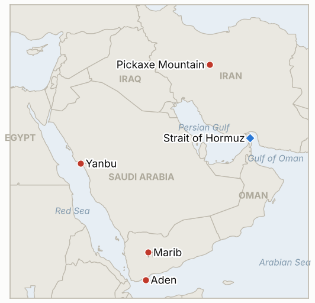

# Middle East Daily Briefing

**October 17, 2026**

- **Reporting window:** ~24 hours, October 16, 06:00 to October 17, 06:00 KST
- **Overall assessment:** The Hormuz shipping war is now counted by the week: UKMTO tallied 12 vessels attacked in seven days, and Singapore confirmed the sinking of the container ship GFS Pride (§1.1). Washington raised the rhetorical stakes, with Trump saying the US "may have to" hit Iran's Pickaxe Mountain nuclear site and reports of MOAB options, but no US strike was disclosed (§1.3). KOSPI bounced 2.05% to 5,668.05 and foreigners bought for the first time in nine sessions, yet the index still lost about 14.5% on the week (§1.4).

**Corrections and updates:** The October 16 brief gave "about 10 ships hit since October 11" from a single aggregator; UKMTO's own count is 12 attacked in the week (10 in the Strait, one in the Gulf, one in the Gulf of Oman), of which one was lost and two disabled. Gulf News also dated the IndiGo Saudi cancellations to October 24 in one item and October 17 in another; I treat October 24 as the extended advisory but the carriers differ.

---

## 1. What Happened

<figure style="float:right; width:46%; margin:2pt 0 8pt 14pt;">

<figcaption style="font-size:8pt; color:#666; text-align:center; margin-top:3pt; font-style:italic;">Major places of discussion</figcaption>
</figure>

### 1.1 UKMTO counts 12 ships attacked in a week; Singapore confirms the GFS Pride sinking

UKMTO said 12 ships were attacked this week: 10 in the Strait of Hormuz, one in the Arabian Gulf and one in the Gulf of Oman. Six continued or reached port, one was lost, two were disabled and three have unconfirmed outcomes ([Fox News](https://www.foxnews.com/live-news/iran-war-trump-strait-hormuz-oil-prices-midterms-october-16); [Gulf News](https://gulfnews.com/uae/us-israel-iran-war-what-uae-residents-need-to-know-oct-16-1.500712552)). Singapore's maritime authority said the 2,824 TEU GFS Pride caught fire and sank on October 14 with all 21 crew evacuated; CENTCOM says an Iranian projectile hit it while under tow, against the IRGC's mine claim. CENTCOM said it has redirected 135 vessels since the blockade resumed on July 14, and an Iranian Army spokesman said the Strait would reopen "if America leaves the region." Gulf News put transits about 70% below pre-war levels. **Confidence: High on the sinking and the UKMTO tally; Medium on the cause (CENTCOM and IRGC conflict); Medium on the 70% figure (aggregator; Kpler's 68% covers crude flows to October 13).**

### 1.2 Saudi Arabia intercepts missiles aimed at Yanbu; Houthis hit Aden's airport and Marib

Saudi spokesman Turki al-Maliki said forces intercepted three drones, two cruise missiles over the Red Sea and a ballistic missile aimed at Yanbu, the Red Sea export port Riyadh has leaned on to bypass Hormuz. He said Houthi attacks in October have killed 19 and injured 364 in Saudi Arabia ([Fox News](https://www.foxnews.com/live-news/iran-war-trump-strait-hormuz-oil-prices-midterms-october-16)). Fox reported missiles struck Aden's airport with no casualties, a day after the presidential palace attack, and Yemen's government said the Houthis fired 16 projectiles at residential areas of Marib ([Gulf News](https://gulfnews.com/uae/us-israel-iran-war-what-uae-residents-need-to-know-oct-16-1.500712552)). Iran's foreign ministry denied encouraging the attacks. Cirium counted 552 of 1,178 scheduled Saudi departures cancelled or not operated on October 15. **Confidence: High on the interceptions and Saudi toll (coalition and Saudi statements, uncorroborated independently); Medium on the Aden airport strike (single live blog); Low on the Yemeni army claim of 700 Houthi dead.**

### 1.3 Trump says the US "may have to" hit Pickaxe Mountain; MOAB options reported; new sanctions

Trump said in a Thursday interview the US may have to strike Pickaxe Mountain, the fortified Iranian nuclear complex, and "knock it out fast," while ruling out nuclear weapons and ground troops. CNN and ABC reported the Pentagon has MOAB options against nuclear and energy sites, possibly before or after the November 3 midterms ([Fox News](https://www.foxnews.com/live-news/iran-war-trump-strait-hormuz-oil-prices-midterms-october-16)). Treasury announced sanctions on 16 individuals and 10 entities and, separately, an Iraqi bank accused of moving dollars to Iran. Pezeshkian said Iran "will not submit to coercion" and is not seeking nuclear weapons. I found no disclosed US strike on Iran or the Houthis. **Confidence: High on Trump's remarks and the sanctions; Medium on the MOAB planning (CNN and ABC cite sources, no official confirmation); Medium on no US strike (absence of reporting).**

### 1.4 KOSPI rebounds 2.05% to 5,668.05 as foreigners turn buyers; oil edges lower but holds weekly gains

KOSPI closed up 113.83 points (2.05%) at 5,668.05, ending a seven session losing streak, and KOSDAQ rose 4.46% to 794.78. Foreigners were net buyers of about 345 billion won for the first time in nine sessions, after net selling 18.1 trillion won over the prior eight, while individuals and institutions sold 488 billion and 682 billion won; foreigners sold 1.14 trillion won of KOSPI 200 futures ([Etoday](https://www.etoday.co.kr/news/view/2636777); [Korea Report](https://www.koreareport.co.kr/news/articleView.html?idxno=53725)). CNBC put the weekly loss at 14.5%, the worst since October 2008. Brent traded around $105.5 to $106.3 and WTI around $97.4 to $97.8 on Friday, down slightly on the day; WTI was up about 6% on the week and Brent about 1%. I could not confirm official settles, or the won's close (reports say the low 1,330s), so those are left blank. **Confidence: High on KOSPI, KOSDAQ and flows (Korean exchange data via Yonhap based outlets); Medium on the 14.5% weekly figure (CNBC via secondary report); Low on oil levels (intraday snapshots differ).**

---

## 2. Deep Dive: Incentives and Motives

### 2.1 Why does Washington talk up Pickaxe Mountain and the MOAB now?

Public talk of options costs nothing and pressures Tehran while Trump keeps his pledge not to strike before the midterms, which makes the threat a bargaining chip rather than a schedule. It also answers domestic critics who say the war has stalled, and the leaked timing "before or after" November 3 preserves deniability. The Treasury sanctions run in parallel because they need no pledge-breaking.

### 2.2 Why is Iran sustaining attacks on shipping while insisting the Strait is "closed until America leaves"?

Each hit raises insurance and rerouting costs and keeps oil near $105, which is Tehran's main lever against a blockade that has left it without sea exports. Using ambiguous tools, such as mines and spotters in small boats, lets it deny deliberate targeting, as with GFS Pride, while the weekly tally shows the campaign is deliberate in effect.

### 2.3 Why are the Houthis widening to Yanbu, Aden's airport and Marib?

Yanbu is the pressure point, since Saudi exports rerouted from Hormuz depend on it, and targeting it, even unsuccessfully, tests the one alternative route. Strikes on Aden and Marib punish Yemen's government and its Saudi backing without needing a Saudi mass casualty event. Iran's denial of control is useful to both sides: it keeps Riyadh's back channel to Tehran open.

### 2.4 Why did foreigners return to KOSPI after eight sessions of selling?

After a 7.57% drop and a 14.5% weekly loss, valuations and a global tech bounce invited bargain hunting, while the buying was small (345 billion won against 18 trillion sold) and futures selling of 1.14 trillion won shows hedging continued. It reads as a relief bounce, not a regime change.

---

## 3. Policy Implications for South Korea

**Exposure snapshot:** South Korea draws about 70.7% of its crude and 20.4% of its LNG from the Middle East (`instructions/korea-exposure.md`, no update needed). Today's prints: KOSPI 5,668.05 (from 5,554.22); Brent and WTI settles not confirmed (intraday about $105.5 and $97.5); won reported in the low 1,330s, not confirmed. I found no new Korean announcement on Saudi Arabia; the level 3 departure recommendation stands.

**Implications by development:**

- **Ship attacks (§1.1):** 12 attacks in a week keep war risk premiums high for Korean bound cargo, with flows still about two thirds of normal (IND-20261013-3, IND-20261007-2).
- **Yanbu and Saudi airspace (§1.2):** a missile aimed at Yanbu threatens the bypass route Korean refiners may rely on, and airline cancellations keep air evacuation uncertain (IND-20261013-4, IND-20261011-2, IND-20261015-1).
- **US options on Iran (§1.3):** a strike on a nuclear site would likely spike oil above $110, which is the threshold in IND-20261015-3 (IND-20261009-1, IND-20261017-1).
- **Markets (§1.4):** foreign net buying ended an eight session selling run, but the test for Seoul is whether it persists and whether the promised stabilization measures materialize (IND-20261016-1, IND-20261016-2, IND-20261017-2).

**Resolved today:** IND-20261009-3 confirmed (foreigners bought 345 billion won on October 16). IND-20261007-2 confirmed (nine UKMTO attacks in the first six days plus 12 in the week of October 11 to 16 exceeds 20 for October). IND-20261003-2 falsified (no Brent settle below $95 by the deadline). IND-20261006-2 falsified (no settle below $100). IND-20261008-2 falsified (KOSPI never closed above 7,000). IND-20261009-2 falsified (no daily tanker count of 15 or more found; only all vessel and crude barrel figures).

**Testable indicators:**

- **IND-20261017-1** (open, new): a disclosed US strike on Pickaxe Mountain or another Iranian nuclear site, or any disclosed use of a GBU-43/B, by ~2026-11-04 confirms; none falsifies.
- **IND-20261017-2** (open, new): foreigners net buying KOSPI on at least three of the five regular sessions October 19 to 23 confirms the return of buyers; fewer falsifies.
- **IND-20261015-3**, **IND-20261014-1**, **IND-20261016-1**, **IND-20261016-2**, **IND-20261016-3**, **IND-20261011-2** and the other older open items (open): no resolving information in the window. Brent was not above $110, KOSPI did not close above 6,400 or below 5,300, no concrete Korean stabilization measure was found, and no Saudi Houthi meeting was disclosed.

---

## 4. Watch List

- **Whether a US strike on Pickaxe Mountain or MOAB use follows the leaks (IND-20261009-1, IND-20261017-1).**
- **Houthi missile fire at Yanbu and Saudi export routes (IND-20261015-1).**
- **UKMTO weekly attack tally and Hormuz transit recovery (IND-20261013-3).**
- **KOSPI foreign flows next week and any Seoul stabilization measure (IND-20261016-1, IND-20261017-2).**
- **Riyadh airport and airline suspensions running to October 18 to 24 (IND-20261011-2, IND-20261010-3).**
- **Possible US easing of sanctions on some tankers, reported but unconfirmed.**

---

## 5. Source Quality Summary

| Claim | Sources | Confidence |
| --- | --- | --- |
| UKMTO: 12 ships attacked in a week, 1 lost, 2 disabled | Fox News live blog, Gulf News | High |
| GFS Pride sank Oct 14, 21 crew evacuated; cause disputed | Gulf News (Singapore MPA, CENTCOM, IRGC) | High on sinking, Medium on cause |
| CENTCOM: 135 vessels redirected since July 14 | Gulf News | Medium |
| Saudi intercepts incl. ballistic missile aimed at Yanbu; October toll 19 dead, 364 injured | Fox News (coalition spokesman) | High on statement, Medium on independent confirmation |
| Aden airport struck, Marib shelling | Fox News, Gulf News | Medium |
| Trump on Pickaxe Mountain; MOAB options | Fox News (Trump interview, CNN, ABC) | High on remarks, Medium on planning |
| Treasury sanctions on 16 individuals, 10 entities, Iraqi bank | Gulf News, Fox News | High |
| KOSPI 5,668.05, KOSDAQ 794.78, foreigners +345bn won | Etoday, Korea Report | High |
| KOSPI down 14.5% on the week | CNBC via secondary report | Medium |
| Brent about $105.5 to $106.3, WTI about $97.4 to $97.8 (intraday) | Gulf News, Business Recorder snippets | Low |
| Won close | Not confirmed | Not reported |
| Hormuz daily transit count | Gulf News, Kpler ("about 70% below", "68% of baseline") | Not reported as an exact count |
