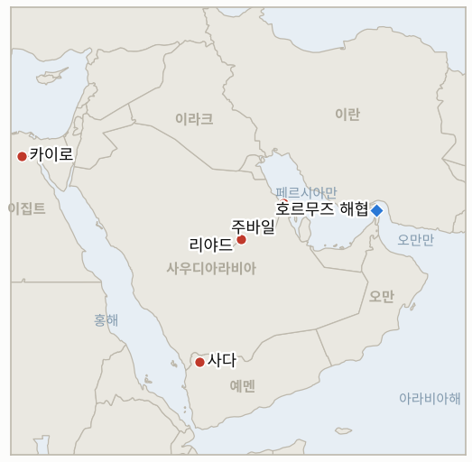

# 중동 일일 브리핑

**2026년 10월 18일**

- **보고 기간:** 약 24시간, 10월 17일 06:00 ~ 10월 18일 06:00 (한국시간)
- **종합 평가:** 호르무즈가 다시 핵심 사안이다. 이란 혁명수비대(IRGC)는 해협이 "폐쇄"됐다고 선언하고 200만 배럴 이상을 실은 초대형 유조선이 기뢰에 피격됐다고 주장했으며, UKMTO는 주바일 앞바다에서 또 다른 유조선이 RPG에 피격됐다고 보고했다. 사상 최고 수준의 공격 주간 직후다(§1.1). 브렌트유는 금요일 109.86달러로 마감하며 장중 110달러를 건드렸고, 이는 어제 브리핑의 정정 사항이다(§1.2). 이집트는 요청이 있으면 사우디를 방어할 용의가 있다고 밝혔고 연합군은 리야드 상공에서 무인기를 계속 격추했다(§1.3). 토요일은 국내 증시가 휴장이었고, 정부의 가시적 대응은 점검회의뿐이다(§1.4).

**정정 및 업데이트:** 10월 17일 브리핑은 10월 16일 브렌트유를 장중 약 105.5~106.3달러, WTI를 약 97.4~97.8달러로 제시하고 유가가 "소폭 하락"했다고 서술했으며 원화 종가를 비워 두었다. 최종 자료에 따르면 브렌트유는 5월 이후 처음 110달러를 장중 터치한 뒤 **109.86달러(+3.7%)**, WTI는 **101.41달러(+3.5%)**로 마감했고, 원화는 달러당 **1,331.4원**(13.2원 하락)으로 마감했다. 주간으로는 브렌트유가 약 4.9%, WTI가 약 10% 올랐으며, "약 1%"와 "약 6%"가 아니다. 관측 로그는 수정했다. 같은 브리핑은 UKMTO가 한 주 12건을 집계했다고 썼으나, 이후 보도는 10월 16일까지 한 주 "최소 10건", 10월 1일 이후 23건이라는 UKMTO 수치를 전하므로 정확한 주간 건수는 출처에 따라 10~12건으로 엇갈린다.

---

## 1. 무슨 일이 있었나

<figure style="float:right; width:46%; margin:2pt 0 8pt 14pt;">

<figcaption style="font-size:8pt; color:#666; text-align:center; margin-top:3pt; font-style:italic;">주요 논의 지점</figcaption>
</figure>

### 1.1 혁명수비대가 해협 "폐쇄"를 선언하고 초대형 유조선 기뢰 피격을 주장하며, UKMTO는 주바일 앞바다 유조선 피격을 보고한다

이란 혁명수비대는 토요일 200만 배럴 이상을 실은 초대형 유조선이 호르무즈 해협에서 기뢰에 부딪혀 불이 났고, 이 선박이 위치 추적을 끈 채 "무허가" 항로를 택했다고 밝혔다. IRNA 등은 유조선 2척이라는 판본을 전했다([Al Jazeera](https://www.aljazeera.com/news/liveblog/2026/10/17/draft-2); [JPost](http://www.jpost.com/middle-east/article-911972)). 혁명수비대 해군은 해협이 "폐쇄"됐다고도 말했다. 별도로 UKMTO는 금요일 주바일에서 약 68해리 떨어진 해상에서 유조선 1척이 미상의 발사체에 피격됐고, 또 다른 유조선은 소형 보트에서 발사한 RPG에 맞았다고 보고했으며 승조원은 안전하다([CBS News](https://www.cbsnews.com/live-updates/iran-war-us-trump-strait-of-hormuz-yemen-houthis-saudi-arabia/)). CBS는 UKMTO 자료를 인용해 10월 16일까지의 주간 공격 건수가 개전 이후 최고이며, 대부분 선박이 피격을 신고하지 않아 UKMTO가 정확한 집계에 "애를 먹고 있다"고 전했다. The National은 통과량이 개전 전보다 약 70% 적다고 보도했고, 미군이 봉쇄를 뚫으려던 화물선을 무력화했으며 오만 만 드론 공격 뒤 인도 선원들이 실종됐다는 제목도 실었다. **신뢰도: 공격이 계속되고 통과량이 크게 낮다는 점은 높음(UKMTO, 복수 매체). 기뢰 주장은 낮음(혁명수비대 단독, 독립 확인 없음). 봉쇄·선원 실종 항목은 낮음(제목만 확인).**

### 1.2 브렌트유가 109.86달러로 마감하며 5월 이후 처음 110달러를 건드린다

브렌트유는 금요일 3.7% 오른 109.86달러로 마감했고 장중 고점은 110달러였다. WTI는 3.5% 오른 101.41달러로 마감했다. 이란의 호르무즈 공격 확대와 후티의 사우디 공격이 배경이며, 우크라이나의 러시아 정유시설 타격도 거론됐다([CNBC](https://www.cnbc.com/2026/10/16/oil-price-today-iran-strait-hormuz-ukraine-russia.html), 검색 요약; [Rigzone](https://www.rigzone.com/news/wire/brent_oil_hits_110_as_supply_risks_mount-16-oct-2026-184870-article/)). WTI는 한 주 동안 10% 넘게, 브렌트유는 5% 가까이 올라 2주 연속 상승했다. 미국은 전략비축유 최대 1,700만 배럴 방출을 제시했고, 미국 휘발유 평균가는 갤런당 6.33달러였다. 이는 10월 17일 브리핑의 정정으로, 그 브리핑은 확인되지 않은 장중 수치를 약 4달러 낮게 제시했다. **신뢰도: 마감가는 높음(CNBC, 블룸버그, 야후 수치 일치. 10월 15일 마감 105.92달러에서의 상승률과도 부합). 주간 등락률은 중간(출처의 반올림).**

### 1.3 연합군이 리야드 상공 무인기를 격추하고 이집트가 사우디 방어 용의를 밝히며, 아락치는 "정치적 과정"을 지지한다

사우디 주도 연합군은 리야드, 동부, 남부 지방 상공에서 무인기 4기를 요격했고 사다에서 미사일 발사대 2기를 파괴했다고 밝혔다. 후티 매체는 사우디 공습으로 어린이 3명을 포함해 최소 12명이 숨졌다고 주장했으나 독립 확인은 없다. 이집트 시시 대통령은 의회 승인을 전제로 "요청이 있으면" 사우디를 방어할 용의가 있다고 말했고, 아락치 이란 외무장관은 바그다드의 이슬람협력기구 회의에서 사우디·후티 분쟁을 끝내기 위한 "정치적 과정"을 지지하며 중재 제안을 되풀이했다. 예멘 외무장관은 이를 비판했다([CBS News](https://www.cbsnews.com/live-updates/iran-war-us-trump-strait-of-hormuz-yemen-houthis-saudi-arabia/); [The National](https://www.thenationalnews.com/news/mena/2026/10/17/live-iran-war-hormuz-houthis-saudi-arabia-yemen/)). 후티는 정부군 포로 159명도 사면으로 석방했으며, The National의 제목은 트럼프가 사우디의 공습 합류를 검토 중이라고 전했다. **신뢰도: 연합군 발표와 시시 발언은 높음. 아락치 제안과 예멘의 반응은 중간(라이브 블로그). 후티 측 사망자 수와 트럼프 관련 제목은 낮음(세부 내용 확인 못 함).**

### 1.4 정부가 폭락 뒤 시장 점검회의를 열었으나 구체 대책은 없고, 원화는 1,331.4원에 마감한다

권대영 재정경제부 1차관은 10월 16일 관계기관 합동 시장상황점검회의를 주재해 미국 국채금리, AI·반도체 업황, 중동 긴장을 변동성 요인으로 꼽았고, 주식시장 불안이 채권·외환·단기자금시장으로 번지는지 살피겠다며 시장교란행위에 엄정 대응하겠다고 밝혔다. 기초여건은 견조하다는 평가를 유지했다([Herald Corp](https://biz.heraldcorp.com/article/10904646); [Dailian](https://www.dailian.co.kr/news/view/1702274/%EC%A0%95%EB%B6%80-%EC%A6%9D%EC%8B%9C-%EB%B3%80%EB%8F%99%EC%84%B1-%ED%99%95%EB%8C%80-%EC%A0%90%EA%B2%80%EC%B1%84%EA%B6%8C%EC%99%B8%ED%99%98%EC%8B%9C-2026)). 안정기금, 공매도 제한, 자사주 매입 등 조치는 발표되지 않았다. 원화는 금요일 달러당 1,331.4원으로 13.2원 강세 마감했고, 코스피는 장중 5,809.94까지 올랐다가 상승분을 반납해 5,668.05로 마감했다([Businesskorea](https://www.businesskorea.co.kr/news/articleView.html?idxno=279010)). 토요일은 휴장이었다. **신뢰도: 회의와 종가는 높음(국내 매체). 다른 조치가 없다는 점은 중간(보도 부재).**

---

## 2. 심층 분석: 동기와 유인

### 2.1 혁명수비대는 왜 해협 "폐쇄"를 선언하면서도 기뢰와 RPG라는 모호한 수단을 쓰는가?

폐쇄 선언은 미국이 "지역을 떠날 때"만 재개방한다는 정치적 노선을 세우고, 기뢰와 소형 보트 같은 부인 가능한 수단은 공식적으로 귀속 가능한 전쟁 행위 없이 해운업계의 비용만 높게 유지한다. 선박이 추적을 끈 채 "무허가" 항로를 택했다고 책임을 돌리면 공격의 비용이 선주에게 전가되고, 미국은 이미 계획해 둔 확전을 정당화할 단일 행위를 내세우기 어려워진다.

### 2.2 새로운 미국의 타격이 없었는데도 유가는 왜 110달러까지 뛰었는가?

상승분은 미국 공격에 따른 공급 감소가 아니라 해운 위험 프리미엄이다. 사상 최고 수준의 공격 건수, 대부분의 선박이 피격을 신고하지 않는다는 보도, 사우디 수출로에 대한 후티의 압박이 겹쳐 수출이 더 줄어들 가능성을 높인다. 1,700만 배럴 전략비축유 제시는 워싱턴이 중간선거 3주 전 가격을 정치적 문제로 본다는 신호지만, 마감가를 누르지는 못했다.

### 2.3 이집트는 왜 지금 사우디 방어를 자청하는가?

시시 대통령은 사우디 요청과 의회 승인을 전제로 하므로 낮은 비용으로 리야드와 걸프 자금 공여국 사이에서 입지를 높인다. 또한 이란과 후티에 사우디가 아랍권의 지원을 받는다는 신호를 보내는데, 이는 어떤 병력 이동보다 의미가 크며, 카이로가 실제 교전을 피할 여지도 남긴다.

### 2.4 서울은 왜 회의는 열면서 조치는 취하지 않는가?

당국은 이번 충격을 반도체·금리·전쟁이 이끈 것이지 금융시스템 위기가 아니라고 판단하므로, 공적 자금을 투입하거나 역효과를 낳을 수 있는 공매도 제한을 꺼내지 않는 점검회의가 가장 값싼 신호다. 대가는 다음 거래일에 다시 손실이 나면 외국인 매도 세력이 이를 관망으로 읽는다는 점이다.

---

## 3. 한국에 대한 정책적 함의

**익스포저 현황:** 한국은 원유의 약 70.7%, LNG의 약 20.4%를 중동에서 들여온다(`instructions/korea-exposure.md`, 갱신 불필요). 최근 수치(10월 16일): 브렌트유 109.86달러(전일 105.92달러), WTI 101.41달러, 코스피 5,668.05, 원/달러 1,331.4원. 사우디 3단계 철수 권고는 유지되고 있으며, 이번 기간에 사우디나 호르무즈 관련 한국 정부의 새 발표는 찾지 못했다.

**사안별 함의:**

- **호르무즈 공격과 "폐쇄"(§1.1):** 공격 지속과 폐쇄 선언은 한국행 화물을 전쟁 위험 프리미엄과 지연에 계속 노출시키며, 통과량은 여전히 정상의 약 70% 아래다(IND-20261018-1, IND-20261013-3).
- **유가 110달러(§1.2):** 원유 10달러 상승마다 한국의 수입 부담이 커지며, 110달러 이상 마감이 IND-20261015-3의 기준선인데 금요일에는 14센트 모자랐다. 금요일 원화 강세는 국면 전환이 아니라 안도 반등에 가깝다(IND-20261014-3).
- **사우디 안보(§1.3):** 이집트의 제안과 리야드 상공의 무인기 요격은 교민과 사우디 건설 현장을 위험 구역에 둔다(IND-20261013-4, IND-20261018-2).
- **정부 대응(§1.4):** 구체적 조치가 없으므로 월요일 장이 첫 시험대다(IND-20261016-1, IND-20261018-3, IND-20261017-2).

**오늘 해소된 지표:** IND-20260925-3 반증(기한까지 얀부 선적 시설 피해 없음). IND-20260926-1 반증(사우디 에너지 시설 보호를 위한 비걸프·비미국 국가의 추가 파병 발표 없음). IND-20261011-2 확증(리야드 정기편 출발이 축소된 규모로 재개).

**검증 가능한 지표:**

- **IND-20261018-1** (진행 중, 신규): 10월 17~23일 UKMTO 집계가 피격 선박 10척 이상이면 사상 최고 수준이 지속된다는 뜻으로 확증, 미만이면 반증. 기한 ~2026-10-24.
- **IND-20261018-2** (진행 중, 신규): ~2026-11-01까지 이집트 의회 승인 또는 이집트의 사우디 파병 발표가 있으면 확증, 없으면 반증.
- **IND-20261018-3** (진행 중, 신규): 10월 19일 코스피가 5,668.05를 넘어 마감하면 반등 지속으로 확증, 같거나 낮으면 반증.
- **IND-20261015-3** (진행 중): 10월 16일 브렌트유 마감 109.86달러로 110달러 기준에 근소하게 못 미침. 기한 10월 22일.
- **IND-20261014-1**, **IND-20261014-3**, **IND-20261016-1**, **IND-20261016-2**, **IND-20261017-2** 및 기타 기존 진행 중 지표(진행 중): 이번 기간에 해소할 정보 없음.

---

## 4. 관찰 목록

- **주말 호르무즈 긴장 고조 이후의 월요일 코스피 개장(IND-20261018-3, IND-20261017-2).**
- **브렌트유의 110달러 돌파 여부와 전략비축유 방출(IND-20261015-3).**
- **UKMTO 주간 공격 집계와 혁명수비대의 "폐쇄" 선언(IND-20261018-1).**
- **트럼프의 후티 공습 합류(IND-20261011-1) 또는 픽액스 마운틴 타격(IND-20261017-1, IND-20261009-1) 여부.**
- **이집트 의회와 아랍권 파병 여부(IND-20261018-2).**
- **정부의 증시 안정 대책과 사우디 교민 철수 대응(IND-20261016-1, IND-20261013-4).**

---

## 5. 출처 신뢰도 요약

| 주장 | 출처 | 신뢰도 |
| --- | --- | --- |
| 혁명수비대: 초대형 유조선(200만 배럴 이상) 기뢰 피격, 해협 "폐쇄" | Al Jazeera 라이브 블로그, JPost, IRNA(타 매체 인용) | 낮음(혁명수비대 주장, 미확인) |
| UKMTO: 주바일 앞바다 유조선 피격(발사체, RPG), 승조원 안전 | CBS 라이브 블로그 외 | 높음 |
| 주간 선박 공격 사상 최고, 10월 1일 이후 23건 | CBS(UKMTO 자료) | 중간(10건 대 12건, 출처별 상이) |
| 통과량 개전 전보다 약 70% 적음 | The National | 중간 |
| 브렌트유 109.86달러(+3.7%), WTI 101.41달러(+3.5%), 전략비축유 1,700만 배럴 | CNBC, Rigzone, Yahoo(검색 요약) | 높음 |
| 연합군 무인기 4기 요격, 사다 발사대 2기 파괴 | CBS 라이브 블로그, Al Jazeera | 높음 |
| 후티 매체: 사우디 공습으로 12명 사망 | 후티 통신(CBS 인용) | 낮음 |
| 시시: 요청 시 사우디 방어 용의 | CBS, The National, New Arab | 높음 |
| 아락치 "정치적 과정" 지지, 예멘 외무장관 비판 | CBS 라이브 블로그 | 중간 |
| 정부 합동 시장 점검회의, 구체 대책 없음 | Herald Corp, Dailian | 높음 |
| 원화 종가 1,331.4원, 코스피 장중 고점 5,809.94 | Businesskorea, Ilyo | 높음 |
| 호르무즈 일별 통과 건수 | 보고되지 않음 | 보고되지 않음 |
