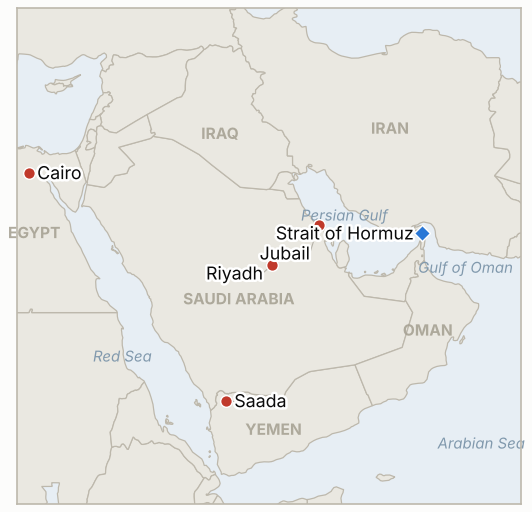

# Middle East Daily Briefing

**October 18, 2026**

- **Reporting window:** ~24 hours, October 17, 06:00 to October 18, 06:00 KST
- **Overall assessment:** Hormuz is the dominant story again: the IRGC declared the Strait "closed," claimed a supertanker of more than 2 million barrels hit a mine, and UKMTO logged another tanker hit by an RPG off Jubail, after a record week of attacks (§1.1). Brent actually settled at $109.86 on Friday, touching $110, which corrects yesterday's brief (§1.2). Egypt said it is ready to defend Saudi Arabia if asked while the coalition kept downing drones over Riyadh (§1.3). Korean markets were closed Saturday; Seoul's only visible response so far is a monitoring meeting (§1.4).

**Corrections and updates:** The October 17 brief gave Brent at about $105.5 to $106.3 and WTI at about $97.4 to $97.8 for October 16 as intraday figures, described oil as "edging lower," and left the settles and the won blank. Final data show Brent settled at **$109.86 (+3.7%)** after touching $110 for the first time since May, WTI at **$101.41 (+3.5%)**, and the won closed at **1,331.4** per dollar (down 13.2 won). Brent rose about 4.9% and WTI about 10% on the week, not "about 1%" and "about 6%." The observation log has been corrected. The same brief cited UKMTO as counting 12 attacks in the week; later reporting relays a UKMTO figure of "at least 10" for the week ending October 16 and 23 since October 1, so the exact weekly count remains uncertain between 10 and 12 depending on the source.

---

## 1. What Happened

<figure style="float:right; width:46%; margin:2pt 0 8pt 14pt;">

<figcaption style="font-size:8pt; color:#666; text-align:center; margin-top:3pt; font-style:italic;">Major places of discussion</figcaption>
</figure>

### 1.1 IRGC declares the Strait "closed" and reports a supertanker mined; UKMTO logs a tanker hit off Jubail

Iran's Revolutionary Guards said on Saturday that a supertanker carrying more than 2 million barrels hit a mine in the Strait of Hormuz and caught fire, and that it had taken an "unauthorised" route with tracking off; IRNA and other outlets carried a version with two tankers ([Al Jazeera](https://www.aljazeera.com/news/liveblog/2026/10/17/draft-2); [JPost](http://www.jpost.com/middle-east/article-911972)). The IRGC Navy also said the Strait is "closed." Separately, UKMTO reported a tanker hit by an unknown projectile about 68 nautical miles off Jubail on Friday, and a second tanker struck by an RPG fired from a small boat; crews were safe ([CBS News](https://www.cbsnews.com/live-updates/iran-war-us-trump-strait-of-hormuz-yemen-houthis-saudi-arabia/)). CBS relayed UKMTO data that attacks in the week to October 16 were the highest weekly total of the war and that UKMTO is "struggling to accurately report" because most ships no longer report. The National put transits about 70% below pre-war and carried headlines that US forces disabled a cargo ship breaching the blockade and that Indian seafarers are missing after a drone attack in the Gulf of Oman. **Confidence: High that attacks continue and transits remain far below normal (UKMTO, multiple outlets); Low on the mine claim (IRGC only, no independent confirmation); Low on the blockade and missing seafarers items (headlines only, details not retrieved).**

### 1.2 Brent settles at $109.86, touching $110 for the first time since May

Brent settled Friday at $109.86, up 3.7%, after a session high of $110, and WTI settled at $101.41, up 3.5%, both on Iran's escalating Hormuz attacks and Houthi fire at Saudi Arabia, with Ukrainian strikes on Russian refineries also cited ([CNBC](https://www.cnbc.com/2026/10/16/oil-price-today-iran-strait-hormuz-ukraine-russia.html), via search summary; [Rigzone](https://www.rigzone.com/news/wire/brent_oil_hits_110_as_supply_risks_mount-16-oct-2026-184870-article/)). WTI gained more than 10% on the week and Brent nearly 5%, a second straight weekly gain. The US offered up to 17 million barrels from the Strategic Petroleum Reserve, and US pump prices averaged $6.33 a gallon. This is a correction to the October 17 brief, which carried unconfirmed intraday figures about $4 lower. **Confidence: High on the settles (CNBC, Bloomberg and Yahoo figures match; Brent's rise implies $105.92 base from October 15); Medium on the weekly percentages (rounded by the source).**

### 1.3 Coalition downs drones over Riyadh as Egypt offers to defend Saudi Arabia; Araghchi backs a "political process"

The Saudi-led coalition said it intercepted four drones over the Riyadh, Eastern and Southern provinces and destroyed two missile launch platforms in Saada; Houthi media said Saudi strikes killed at least 12 in Yemen, including three children, a figure not independently verified. Egyptian President Sisi said Egypt is ready to defend Saudi Arabia "if requested," pending parliamentary approval, and Foreign Minister Araghchi, at an Organization of Islamic Cooperation meeting in Baghdad, backed a "political process" to end the Saudi-Houthi conflict and repeated Iran's mediation offer; Yemen's foreign minister criticized it ([CBS News](https://www.cbsnews.com/live-updates/iran-war-us-trump-strait-of-hormuz-yemen-houthis-saudi-arabia/); [The National](https://www.thenationalnews.com/news/mena/2026/10/17/live-iran-war-hormuz-houthis-saudi-arabia-yemen/)). The Houthis also released 159 pro-government fighters under an amnesty, and The National's headlines said Trump is considering joining Saudi strikes. **Confidence: High on the coalition statement and Sisi's remark; Medium on Araghchi's offer and its rejection (live blogs); Low on the Houthi casualty figure and on the Trump headline (no detail retrieved).**

### 1.4 Seoul reviews markets after the crash but announces no concrete measure; won closed at 1,331.4

Deputy Finance Minister Kwon Dae-young chaired a joint market review on October 16 that named US Treasury yields, AI and chip conditions and Middle East tension as drivers, said it would watch for spillover to bond, FX and short term funding markets, and promised stricter action on market manipulation while calling fundamentals sound ([Herald Corp](https://biz.heraldcorp.com/article/10904646); [Dailian](https://www.dailian.co.kr/news/view/1702274/%EC%A0%95%EB%B6%80-%EC%A6%9D%EC%8B%9C-%EB%B3%80%EB%8F%99%EC%84%B1-%ED%99%95%EB%8C%80-%EC%A0%90%EA%B2%80%EC%B1%84%EA%B6%8C%EC%99%B8%ED%99%98%EC%8B%9C-2026)). No stabilization fund, short selling curb or buyback measure was announced. The won closed at 1,331.4 per dollar on Friday, 13.2 won stronger, and KOSPI's October 16 high was 5,809.94 before it gave back gains to close at 5,668.05 ([Businesskorea](https://www.businesskorea.co.kr/news/articleView.html?idxno=279010)). Korean markets were closed on Saturday. **Confidence: High on the meeting and closes (Korean outlets); Medium on the absence of other measures (absence of reporting).**

---

## 2. Deep Dive: Incentives and Motives

### 2.1 Why does the IRGC both declare the Strait "closed" and let ships go through with mine and RPG ambiguity?

Declaring it closed sets the political line (reopening only if the US "leaves the region") while deniable weapons, mines and small boats, keep the cost to shippers high without a formally attributable act of war. Blaming ships for taking "unauthorised" routes with tracking off shifts the cost of attacks onto owners, and the ambiguity means the US cannot easily cite a single act to justify the escalation it has already planned.

### 2.2 Why did oil jump to $110 despite no new US strike?

The rise is a shipping risk premium, not a supply loss from a US attack: attacks at a record pace, reports that most ships no longer report, and the Houthi pressure on Saudi export routes together raise the odds that exports fall further. The SPR offer of 17 million barrels signals Washington regards the price as a political problem three weeks before the midterms, yet it did not cap the settle.

### 2.3 Why would Egypt volunteer to defend Saudi Arabia now?

Sisi gains standing with Riyadh and Gulf financiers at low cost, since the offer is conditional on a Saudi request and parliamentary approval. It also signals to Iran and the Houthis that Saudi Arabia has Arab backing, which matters more than any troop movement, while leaving Cairo free to avoid actually fighting.

### 2.4 Why does Seoul meet but not act?

Officials judge the shock as chip, rate and war driven, not a financial system failure, so a monitoring meeting is the cheapest signal that avoids committing public funds or short selling curbs that could backfire. The cost is that foreign sellers read it as a wait and see stance if the next session brings new losses.

---

## 3. Policy Implications for South Korea

**Exposure snapshot:** South Korea draws about 70.7% of its crude and 20.4% of its LNG from the Middle East (`instructions/korea-exposure.md`, no update needed). Latest prints (October 16): Brent $109.86 (from $105.92), WTI $101.41, KOSPI 5,668.05, won 1,331.4 per dollar. The Saudi level 3 departure recommendation stands; I found no new Korean announcement on Saudi Arabia or Hormuz in the window.

**Implications by development:**

- **Hormuz attacks and "closure" (§1.1):** continued attacks and a declared closure keep Korean bound cargo exposed to war risk premiums and delays, with flows still about 70% below normal (IND-20261018-1, IND-20261013-3).
- **Oil at $110 (§1.2):** each $10 on crude raises Korea's import bill, and a settle above $110 is the line in IND-20261015-3, missed by 14 cents on Friday; the won's strength on Friday was a relief bounce more than a regime change (IND-20261014-3).
- **Saudi security (§1.3):** Egypt's offer and continued drone interceptions over Riyadh keep Korean expatriates and Saudi construction sites in the risk zone (IND-20261013-4, IND-20261018-2).
- **Seoul's response (§1.4):** no concrete measure has been announced, so Monday's session is the first test (IND-20261016-1, IND-20261018-3, IND-20261017-2).

**Resolved today:** IND-20260925-3 falsified (no damage to Yanbu loading infrastructure by the deadline). IND-20260926-1 falsified (no further non-Gulf, non-US deployment to protect Saudi energy sites found). IND-20261011-2 confirmed (scheduled departures from Riyadh operate again, at reduced levels).

**Testable indicators:**

- **IND-20261018-1** (open, new): UKMTO's tally for October 17 to 23 at 10 or more attacked vessels confirms the record pace persists; fewer falsifies. Deadline ~2026-10-24.
- **IND-20261018-2** (open, new): Egyptian parliamentary approval or an announced Egyptian deployment to Saudi Arabia by ~2026-11-01 confirms; none falsifies.
- **IND-20261018-3** (open, new): KOSPI closing above 5,668.05 on October 19 confirms the rebound holds; at or below falsifies.
- **IND-20261015-3** (open): Brent settled $109.86 on October 16, just short of the $110 test; deadline October 22.
- **IND-20261014-1**, **IND-20261014-3**, **IND-20261016-1**, **IND-20261016-2**, **IND-20261017-2** and the other older open items (open): no resolving information in the window.

---

## 4. Watch List

- **Monday's KOSPI open after a weekend of Hormuz escalation (IND-20261018-3, IND-20261017-2).**
- **Brent against $110 and the SPR release (IND-20261015-3).**
- **UKMTO weekly attack tally and the IRGC's "closed" declaration (IND-20261018-1).**
- **Whether Trump joins Saudi strikes on the Houthis (IND-20261011-1) or moves on Pickaxe Mountain (IND-20261017-1, IND-20261009-1).**
- **Egypt's parliament and any Arab deployment (IND-20261018-2).**
- **Korean government response on stabilization and Saudi evacuation (IND-20261016-1, IND-20261013-4).**

---

## 5. Source Quality Summary

| Claim | Sources | Confidence |
| --- | --- | --- |
| IRGC: supertanker (2m+ barrels) hit mine; Strait "closed" | Al Jazeera live blog, JPost, IRNA via others | Low (IRGC claim, unverified) |
| UKMTO: tankers hit off Jubail (projectile, RPG), crews safe | CBS live blog, others | High |
| Record weekly ship attacks; 23 since Oct 1 | CBS (UKMTO data) | Medium (10 vs 12 count differs by source) |
| Transits about 70% below pre-war | The National | Medium |
| Brent $109.86 (+3.7%), WTI $101.41 (+3.5%), SPR 17m barrels | CNBC, Rigzone, Yahoo via search summaries | High |
| Coalition downs 4 drones, destroys 2 launchers in Saada | CBS live blog, Al Jazeera | High |
| Houthi media: 12 killed in Saudi strikes | Houthi news agency via CBS | Low |
| Sisi: Egypt ready to defend Saudi Arabia if requested | CBS, The National, New Arab | High |
| Araghchi backs "political process"; Yemen FM criticizes | CBS live blog | Medium |
| Seoul joint market review, no concrete measure | Herald Corp, Dailian | High |
| Won close 1,331.4; KOSPI high 5,809.94 | Businesskorea, Ilyo | High |
| Hormuz exact daily transit count | Not reported | Not reported |
