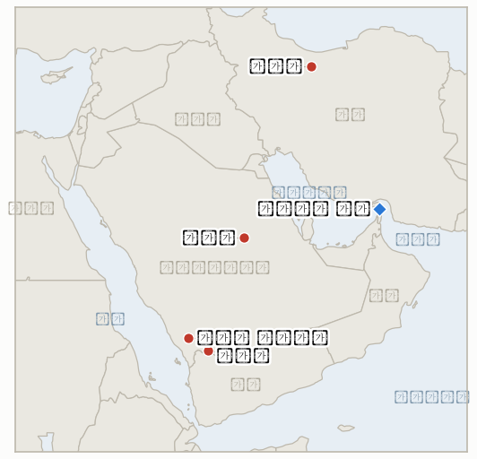

# 중동 일일 브리핑

**2026년 10월 19일**

- **보고 기간:** 약 24시간, 10월 18일 06:00 ~ 10월 19일 06:00 (한국시간)
- **종합 평가:** 일요일은 호르무즈를 둘러싼 서사 경쟁의 날이었다. 아락치 외무장관은 미국이 이란의 7개 항 계획을 수용하면 해협이 6일째에 재개방된다고 말했고, 미 중부사령부(CENTCOM)는 해협이 열려 있으며 선박의 97%가 통과한다고 밝혔으며, UKMTO는 일주일간 최소 10척이 공격받아 개전 이후 최고라고 집계했다(§1.1, §1.2). 후티의 공격은 사우디 영토를 계속 타격해 카미스 무샤이트 방향 미사일, 리야드 방향 무인기, 나즈란 피격이 이어졌다(§1.3). 시장이 열리지 않았으므로 주간 15% 하락 이후 서울의 첫 시험대는 월요일 장이며, 한국은행은 10월 22일 결정을 내린다(§1.4).

---

## 1. 무슨 일이 있었나

<figure style="float:right; width:46%; margin:2pt 0 8pt 14pt;">

<figcaption style="font-size:8pt; color:#666; text-align:center; margin-top:3pt; font-style:italic;">주요 논의 지점</figcaption>
</figure>

### 1.1 아락치가 호르무즈 재개방을 이란의 7개 항 계획과 연계하고, UKMTO는 최악의 한 주를 집계한다

아바스 아락치 외무장관은 일요일 해협 재개방 조건이 여전히 유효하며, 테헤란이 9월에 제시한 7일 휴전안에 대한 미국의 "의견"을 검토 중이라고 밝혔다. 이 계획에 따르면 해협은 6일째에 열리고 협상은 7일째에 시작된다. 조건에는 미국의 해상 봉쇄 해제, 이란산 원유 제재 해제, 전 전선 휴전이 포함된 것으로 알려졌다([CBS News](https://www.cbsnews.com/live-updates/iran-war-us-trump-strait-of-hormuz-yemen-houthis-saudi-arabia/)). 이란군 대변인은 별도로 미국이 지역을 떠나야만 해협이 열린다고 말했고, 새로 임명된 메흐르다드 아클라기 국방장관은 워싱턴이 군사작전을 재개하면 미국과 동맹국이 "막대한 피해"를 입을 것이라고 경고했다. UKMTO는 UAE 앞바다에서 남쪽으로 향하던 예인선이 미상의 발사체 2발에 맞아 손상되고 경상자 1명이 났으나 항해를 이어갔다고 보고했으며, 일요일까지 일주일간 해협 안팎에서 최소 10척이 공격받아 개전 이후 주간 최고이고 10월 1일 이후 23건이라고 밝혔다. **신뢰도: 아락치 발언과 UKMTO 집계는 높음(CBS가 UKMTO를 인용), 계획의 정확한 조건은 중간(라이브 블로그 요약).**

### 1.2 CENTCOM은 해협이 열려 있고 97%가 통과한다고 밝히고, 워싱턴은 그림자 선단 제재 완화를 검토한다

미 중부사령부는 해협이 열려 있고 통과를 시도한 선박의 97%가 안전하게 통과했으며 이란의 공격 대부분이 실패했고, 미군이 이란 항구 봉쇄에 따라 상선 138척의 항로를 돌렸다고 밝혔다([Tribune India](https://www.tribuneindia.com/news/world/us-military-claims-strait-of-hormuz-remains-open-says-97-of-ships-transit-safely-despite-iranian-strikes/)). 이는 지난주 통과량이 개전 전보다 약 70% 적다는 보도와 어긋나 보이지만, 97%는 통과를 시도한 선박만 센 수치라 개전 전 물동량과 비교할 수 없다. 별도로 로이터는(10월 15일) 미국이 기록적인 운임을 낮추기 위해 그림자 선단 유조선 제재를 부분 완화하는 방안을 검토 중이라고 전했다. 제재 대상이 아닌 화물을 실은 선박은 재무부에 신청하는 방식이며, 해운업계는 EU·영국 보험 규정이 여전히 적용되므로 운임이 크게 내리지는 않을 것으로 봤다([gCaptain](https://gcaptain.com/trump-weighs-lifting-shadow-fleet-sanctions-as-tanker-rates-soar/)). **신뢰도: CENTCOM 주장 자체는 높음, 내용의 완전성은 낮음(미군 자체 보고, 독립 검증 없음), 제재 구상은 중간(로이터가 인용한 관리 1인, 백악관 논평 없음).**

### 1.3 후티의 공격이 사우디 영토를 계속 타격한다: 카미스 무샤이트 방향 미사일, 리야드 방향 무인기, 나즈란 피격

사우디군은 카미스 무샤이트 방향으로 발사된 탄도미사일 2발과 리야드를 겨냥한 무인기 1기를 "적대적 공중 위협" 휴대전화 경보 뒤 요격했다. 후티 발사체가 나즈란의 주거지역을 때려 6명이 다쳤다고 사우디 민방위가 밝혔고, 나즈란에서는 AH-6i 헬기가 추락해 국가방위군 승무원 2명이 숨졌는데 연합군은 "기술적 결함" 때문이라고 설명했다. 리야드 킹덤센터 입주사들은 별도 통보 때까지 재택근무하라는 지시를 받았다. 후티 운영 통신 사바는 예멘 북부에서 사우디 공습으로 최소 9명이 숨졌다고 전했다([CBS News](https://www.cbsnews.com/live-updates/iran-war-us-trump-strait-of-hormuz-yemen-houthis-saudi-arabia/)). **신뢰도: 요격과 나즈란 피격은 높음(CBS가 전한 사우디 발표), 헬기 추락 원인은 중간(연합군 설명뿐), 후티 측 사상자 수는 낮음.**

### 1.4 서울은 주간 약 15% 하락 뒤 월요일을 맞고, 한국은행 결정은 10월 22일이다

국내 매체들은 코스피가 일주일 새 15% 가까이 빠져 5,600선까지 내려왔고, NH투자증권 등은 이번 주 V자 반등보다 5,100~6,100 범위를 제시했다고 전했다. 변수로는 외국인 매도, AI 인프라 자금조달 우려, 미국 빅테크 실적, 10월 22일 한국은행 금융통화위원회가 꼽혔다. 한 증권사 연구원은 7거래일간 10% 넘게 떨어진 과거 12건에서 이후 1주일 상승 확률이 83%였으나 1개월 기준으로는 확률이 낮아졌다고 분석했다([머니투데이](https://www.mt.co.kr/stock/2026/10/18/2026101810540120136); [아주뉴스](https://ajunews.com/view/20261018125204714)). 이번 기간에 새로운 정부 시장안정 대책이나 사우디 여행경보 변경은 찾지 못했다. **신뢰도: 전망 보도는 높음(여러 국내 매체), 정부 조치 부재는 중간(보도 부재에 근거).**

참고: 트럼프 대통령은 일요일 네타냐후 총리의 재선 도전을 지지했고, 네타냐후는 두 사람의 협력이 2년 안에 "이란의 위협을 제거"할 것이라고 말했다. 이스라엘 총선은 10월 27일이다(신뢰도: 중간, 라이브 블로그).

---

## 2. 심층 분석: 동기와 유인

### 2.1 아락치는 왜 7일 계획을 테이블에 올려 두는데 혁명수비대는 계속 선박을 공격하는가?

이 계획은 이란에 비용이 들지 않는 협상 입지를 준다. 이란의 가장 큰 부담인 봉쇄와 원유 제재를 재개방의 대가로 명시하는 한편, 공격은 워싱턴이 거부할 때의 비용을 선사와 수입국에 계속 보여 준다. 외무부의 외교와 군의 "미국이 떠나야만" 노선이 갈라져 있어 이란은 어느 쪽에도 묶이지 않고 미국의 유연성을 시험할 수 있다.

### 2.2 CENTCOM은 왜 97%가 통과한다고 강조하는가?

이 수치는 중간선거 3주 전 해운사, 보험사, 미국 유권자에게 봉쇄 전략이 통하고 해협은 닫히지 않았다고 알리며, 확전 필요성을 낮추는 논거도 된다. 그러나 통과를 시도한 선박만 세고 많은 선주가 시도 자체를 포기했으므로, 이 숫자는 물동량이 아니라 살아남은 선박의 성공률을 보여 줄 뿐이다.

### 2.3 워싱턴은 왜 지금 그림자 선단 제재 완화를 검토하는가?

기록적인 운임과 110달러 유가는 중간선거를 앞둔 정치적 부담이며, 제재 대상 노후 유조선은 걸프의 거의 유일한 여분 선복이다. 제재 대상이 아닌 화물에 한정한 것은 폭넓은 완화가 의회와 유럽 동맹국과의 마찰을 부르기 때문이며, 실질보다 신호에 가까울 수 있다.

### 2.4 후티는 왜 공항뿐 아니라 도시와 기지까지 타격하는가?

카미스 무샤이트 방향 미사일과 리야드 방향 무인기는 사우디의 방공망, 보험사, 외국인 고용주를 끊임없이 압박한다. 국경 인근 나즈란 타격은 사우디 영토 깊숙이 도달하는 능력을 과시하면서, 민간인 부상이 리야드 사상자보다 미국의 대응을 부를 가능성은 낮게 유지한다.

---

## 3. 한국에 대한 정책적 함의

**익스포저 현황:** 한국은 원유의 약 70.7%, LNG의 약 20.4%를 중동에서 들여온다(`instructions/korea-exposure.md`, 갱신 불필요). 최근 수치(10월 16일, 이후 거래 없음): 브렌트유 109.86달러, WTI 101.41달러, 코스피 5,668.05, 원/달러 1,331.4원. 사우디 3단계 철수 권고는 유지되고 있으며, 이번 기간에 한국 정부의 새 발표는 찾지 못했다.

**사안별 함의:**

- **7개 항 계획과 CENTCOM 주장(§1.1, §1.2):** 6일째 재개방은 한국행 화물에 가장 큰 안도가 되겠지만, 미국이 봉쇄와 원유 제재를 풀어야 하므로 기본 시나리오가 아니라 가능성으로 다뤄야 한다(IND-20261019-1, IND-20261013-3).
- **기록적 공격 주간(§1.1):** 한국행 화물은 전쟁 위험 프리미엄에 계속 노출되며, 다음 UKMTO 주간 집계가 시험대다(IND-20261018-1).
- **그림자 선단 완화(§1.2):** 공식화되면 한국 정유사의 수입 부담에 반영되는 운임을 낮출 수 있으나 보험 제약상 효과는 제한적일 것이다(IND-20261019-2).
- **사우디 안보(§1.3):** 리야드와 나즈란 인근의 계속된 공격은 교민과 건설 현장을 위험 구역에 둔다(IND-20261013-4, IND-20261018-2).
- **서울 시장(§1.4):** 월요일 장과 10월 22일 한국은행 회의가 첫 시험대이며, IND-20261018-3은 월요일 종가로 판정된다(IND-20261016-1, IND-20261019-3).

**오늘 종결:** IND-20261012-2 반증(10월 10일 혁명수비대의 초대형 유조선 기뢰 주장은 10월 19일 기한까지 독립적으로 확인되지 않았고, 10월 17일 주장 역시 혁명수비대 단독 주장이다).

**검증 가능한 지표:**

- **IND-20261019-1** (신규, 진행 중): 이란의 7개 항 계획에 대한 미국의 공식 회신 또는 미국·이란 직접 교환이 ~2026-10-26까지 공개되면 확인, 없으면 반증.
- **IND-20261019-2** (신규, 진행 중): 재무부가 그림자 선단 제재 완화 허가, 지침 또는 발표를 ~2026-11-02까지 공식화하면 확인, 없으면 반증.
- **IND-20261019-3** (신규, 진행 중): 10월 19~23일 모든 거래일에 코스피가 5,100 이상으로 마감하면 증권사 범위 하단이 유지된 것으로 확인, 5,100 미만 마감이 하루라도 있으면 반증.
- **IND-20261018-3** (진행 중): 10월 19일 종가가 5,668.05를 넘으면 확인. 발행 시점에는 판정할 수 없다.
- **IND-20261018-1** (진행 중): 10월 17~23일 피격 선박 10척 이상 여부. 현재 집계는 다른 주간 기준이므로 다음 주간 집계가 시험대다.
- **IND-20261015-3**, **IND-20261014-1**, **IND-20261016-1** 등 기존 진행 중 지표: 이번 기간에 판정할 정보 없음.

---

## 4. 관찰 목록

- **월요일 코스피와 원화 개장, 10월 22일 한국은행 회의(IND-20261018-3, IND-20261019-3).**
- **이란 7개 항 계획에 대한 미국의 회신(IND-20261019-1)과 통과량에 대한 CENTCOM·이란의 주장.**
- **그림자 선단에 대한 재무부 조치(IND-20261019-2).**
- **시장 재개 시 브렌트유의 110달러 돌파 여부(IND-20261015-3).**
- **카미스 무샤이트, 나즈란, 리야드에 대한 후티 공격과 트럼프의 사우디 공습 합류 여부(IND-20261011-1).**
- **픽액스 마운틴과 MOAB 선택지(IND-20261017-1).**
- **10월 27일 이스라엘 총선과 트럼프의 네타냐후 지지.**

---

## 5. 출처 품질 요약

| 주장 | 출처 | 신뢰도 |
| --- | --- | --- |
| 아락치: 미국이 7개 항 계획 수용 시 6일째 호르무즈 재개방 | CBS 라이브 블로그, Mehr, Al Jazeera | 높음 |
| UKMTO: 일주일 최소 10척, 10월 1일 이후 23건 피격, UAE 앞바다 예인선 피격 | CBS(UKMTO) | 높음 |
| CENTCOM: 통과 97% 안전, 138척 우회 | Tribune India 등 | 낮음~중간(미군 자체 보고) |
| 미국, 그림자 선단 제재 완화 검토 | 로이터(gCaptain 등 경유) | 중간 |
| 사우디, 카미스 무샤이트 방향 미사일 2발·리야드 방향 무인기 요격 | CBS 라이브 블로그 | 높음 |
| 나즈란 주거지역 피격(6명 부상), AH-6i 추락 "기술적 결함" | CBS(사우디 민방위·연합군) | 중간 |
| 예멘 북부 사우디 공습으로 9명 이상 사망 | 후티 사바(CBS 경유) | 낮음 |
| 코스피 주간 약 15% 하락, NH 5,100~6,100, 한은 10월 22일 | 머니투데이, 아주뉴스, 서울파이낸스 | 높음 |
| 트럼프, 네타냐후 지지, 이스라엘 총선 10월 27일 | CBS 라이브 블로그 | 중간 |
| 10월 19일 브렌트유·WTI·코스피·원화 | 아직 없음 | 미보고 |
| 호르무즈 일별 정확한 통과 척수 | 미보고 | 미보고 |
