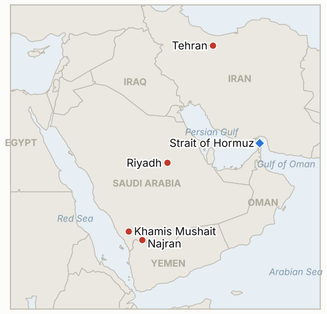

# Middle East Daily Briefing

**October 19, 2026**

- **Reporting window:** ~24 hours, October 18, 06:00 to October 19, 06:00 KST
- **Overall assessment:** Sunday was a day of competing narratives over Hormuz: Foreign Minister Araghchi said the Strait reopens on day six if Washington accepts Iran's seven point plan, CENTCOM said the Strait is open and 97% of ships get through, and UKMTO counted at least 10 vessels attacked in a week, the war's highest (§1.1, §1.2). Houthi fire kept hitting Saudi territory, with missiles toward Khamis Mushait, a drone toward Riyadh and a hit on Najran (§1.3). Markets did not trade, so the first test of Seoul's 15% weekly drop is Monday's session, with the Bank of Korea deciding on October 22 (§1.4).

---

## 1. What Happened

<figure style="float:right; width:46%; margin:2pt 0 8pt 14pt;">

<figcaption style="font-size:8pt; color:#666; text-align:center; margin-top:3pt; font-style:italic;">Major places of discussion</figcaption>
</figure>

### 1.1 Araghchi ties Hormuz reopening to Iran's seven point plan while UKMTO logs its worst week

Foreign Minister Abbas Araghchi said on Sunday that Iran's conditions for reopening the Strait still stand and that Tehran is still reviewing US "comments" on its September seven day ceasefire proposal. Under that plan the Strait would reopen on day six and negotiations would begin on day seven; the conditions reportedly include ending the US naval blockade, lifting sanctions on Iranian oil and a ceasefire on all fronts ([CBS News](https://www.cbsnews.com/live-updates/iran-war-us-trump-strait-of-hormuz-yemen-houthis-saudi-arabia/)). An Iranian army spokesman said separately that the Strait reopens only if America leaves the region, and new Defense Minister Mehrdad Akhlaghi warned of "enormous damage" to the US and its allies if Washington resumes its campaign. UKMTO reported a southbound tugboat off the UAE hit by two unknown projectiles (damaged, one minor casualty, continued on route) and said at least 10 vessels were attacked in or near the Strait in the week to Sunday, the highest weekly figure since the war began, and 23 since October 1. **Confidence: High on Araghchi's statements and the UKMTO counts (CBS relaying UKMTO); Medium on the plan's exact conditions (summary of a live blog).**

### 1.2 CENTCOM says the Strait is open and 97% of ships pass; Washington weighs easing shadow fleet sanctions

US Central Command said the Strait remains open, that 97% of vessels seeking to transit have passed safely, that most Iranian attacks failed, and that US forces have redirected 138 commercial vessels under the blockade of Iranian ports ([Tribune India](https://www.tribuneindia.com/news/world/us-military-claims-strait-of-hormuz-remains-open-says-97-of-ships-transit-safely-despite-iranian-strikes/)). That sits uneasily with last week's reporting of transits about 70% below pre-war; the 97% figure counts only ships that attempted passage, so it cannot be compared with pre-war volumes. Separately, Reuters reported (October 15) that the US is weighing a partial easing of sanctions on shadow fleet tankers, with Treasury applications for vessels carrying non sanctioned cargo, to ease record freight rates; maritime sources doubted it would cut rates because EU and UK insurance rules still bind ([gCaptain](https://gcaptain.com/trump-weighs-lifting-shadow-fleet-sanctions-as-tanker-rates-soar/)). **Confidence: High that CENTCOM made these claims; Low on their completeness (US military self reporting, no independent audit); Medium on the sanctions idea (single official quoted by Reuters, no White House comment).**

### 1.3 Houthi fire keeps hitting Saudi territory: missiles toward Khamis Mushait, a drone at Riyadh, Najran struck

Saudi forces intercepted two ballistic missiles fired toward Khamis Mushait and a drone aimed at Riyadh after a mobile alert warned of a "hostile aerial threat." A Houthi projectile hit a residential area of Najran, injuring six, according to Saudi civil defense, and two National Guard crew died when an AH-6i helicopter crashed in Najran, which the coalition attributed to a "technical malfunction." Tenants of Riyadh's Kingdom Centre were told to work remotely until further notice. Houthi run Saba said a Saudi airstrike in northern Yemen killed at least nine ([CBS News](https://www.cbsnews.com/live-updates/iran-war-us-trump-strait-of-hormuz-yemen-houthis-saudi-arabia/)). **Confidence: High on the interceptions and the Najran hit (Saudi statements relayed by CBS); Medium on the helicopter cause (coalition account only); Low on the Houthi casualty figure.**

### 1.4 Seoul heads into Monday after a roughly 15% weekly drop, with a Bank of Korea decision on October 22

Korean outlets said KOSPI lost close to 15% in a week to the 5,600 area, with brokers such as NH Investment & Securities guiding to a 5,100 to 6,100 range this week rather than a V shaped rebound; named swing factors are foreign selling, AI infrastructure financing worries, US big tech earnings and the Bank of Korea's monetary policy meeting on October 22. One brokerage researcher cited 12 past cases of 10% falls in seven sessions in which the index rose over the next week 83% of the time, though odds worsened over one month ([Money Today](https://www.mt.co.kr/stock/2026/10/18/2026101810540120136); [Ajunews](https://ajunews.com/view/20261018125204714)). I found no new government stabilization measure or Saudi advisory change in the window. **Confidence: High on the outlook reports (several Korean outlets); Medium on absence of government action (absence of reporting).**

Also noted: Trump endorsed Prime Minister Netanyahu's reelection bid on Sunday and Netanyahu said their partnership will "eliminate the Iranian threat" within two years; Israel votes October 27 (confidence: Medium, live blog).

---

## 2. Deep Dive: Incentives and Motives

### 2.1 Why does Araghchi keep a seven day plan on the table while the IRGC keeps attacking ships?

The plan gives Tehran a negotiating position that costs nothing: it names the blockade and oil sanctions, Iran's largest burdens, as the price of reopening, while attacks keep the cost of Washington's refusal visible to shippers and importers. The split between the foreign ministry's diplomacy and the army's "only if America leaves" line lets Iran test US flexibility without committing to either.

### 2.2 Why does CENTCOM stress that 97% of ships get through?

The figure tells shippers, insurers and American voters three weeks before the midterms that the blockade strategy works and the Strait is not closed, which also argues against escalation. But it counts only ships that tried to transit, and many owners have stopped trying, so the number measures the survivors' success, not the flow.

### 2.3 Why would Washington consider easing shadow fleet sanctions now?

Record freight rates and $110 oil are a political liability before the midterms, and old sanctioned tankers are the only spare capacity in the Gulf. The proposal is narrow (non sanctioned cargo only) because a broader easing would invite fights with Congress and European allies, and it may be more signal than substance.

### 2.4 Why do the Houthis keep striking cities and bases rather than only airports?

Missiles toward Khamis Mushait and drones toward Riyadh keep Saudi air defenses, insurers and expatriate employers under constant pressure. Hitting Najran, near the border, lets the Houthis show reach into Saudi territory while civilian injuries there are less likely to bring an American response than a Riyadh casualty would.

---

## 3. Policy Implications for South Korea

**Exposure snapshot:** South Korea draws about 70.7% of its crude and 20.4% of its LNG from the Middle East (`instructions/korea-exposure.md`, no update needed). Latest prints (October 16, no trading since): Brent $109.86, WTI $101.41, KOSPI 5,668.05, won 1,331.4 per dollar. The Saudi level 3 departure recommendation stands; I found no new Korean announcement in the window.

**Implications by development:**

- **Seven point plan and CENTCOM's claim (§1.1, §1.2):** a day six reopening would be the biggest relief for Korean cargo, but the plan depends on the US lifting the blockade and oil sanctions, so treat it as a possibility rather than a base case (IND-20261019-1, IND-20261013-3).
- **Record attack week (§1.1):** Korean bound cargo stays exposed to war risk premiums, and UKMTO's next weekly tally is the test (IND-20261018-1).
- **Shadow fleet easing (§1.2):** if formalized it could ease freight costs that feed Korean refiners' import bill, though insurance limits suggest modest effect (IND-20261019-2).
- **Saudi security (§1.3):** continued strikes near Riyadh and Najran leave expatriates and construction sites in the risk zone (IND-20261013-4, IND-20261018-2).
- **Seoul's markets (§1.4):** Monday and the October 22 Bank of Korea meeting are the first tests; I note IND-20261018-3 resolves on Monday's close (IND-20261016-1, IND-20261019-3).

**Resolved today:** IND-20261012-2 falsified (the IRGC's October 10 supertanker mine claim was never independently identified by its October 19 deadline; the October 17 claim is also IRGC only).

**Testable indicators:**

- **IND-20261019-1** (open, new): A disclosed formal US reply or direct US Iran exchange on Iran's seven point plan by ~2026-10-26 confirms; none falsifies.
- **IND-20261019-2** (open, new): A formal Treasury license, guidance or announcement easing shadow fleet sanctions by ~2026-11-02 confirms; none falsifies.
- **IND-20261019-3** (open, new): KOSPI closes at or above 5,100 on every session October 19 to 23 confirms the low end of brokers' range holds; any close below 5,100 falsifies.
- **IND-20261018-3** (open): Monday October 19 close above 5,668.05 resolves it; not yet knowable at publication.
- **IND-20261018-1** (open): UKMTO count of 10 or more attacked vessels for October 17 to 23; the count so far is at least 10 to October 18 on a different week boundary, so the test is the next weekly tally.
- **IND-20261015-3**, **IND-20261014-1**, **IND-20261016-1** and the other older open items (open): no resolving information in the window.

---

## 4. Watch List

- **Monday's KOSPI and won open, and the October 22 Bank of Korea meeting (IND-20261018-3, IND-20261019-3).**
- **US reply to Iran's seven point plan (IND-20261019-1) and any CENTCOM or Iranian claim on transit numbers.**
- **Treasury action on shadow fleet vessels (IND-20261019-2).**
- **Brent against $110 when markets reopen (IND-20261015-3).**
- **Houthi fire on Khamis Mushait, Najran and Riyadh, and whether Trump joins Saudi strikes (IND-20261011-1).**
- **Pickaxe Mountain and MOAB options (IND-20261017-1).**
- **Israel's October 27 election and Trump's endorsement of Netanyahu.**

---

## 5. Source Quality Summary

| Claim | Sources | Confidence |
| --- | --- | --- |
| Araghchi: Hormuz reopens day six if US accepts seven point plan | CBS live blog, Mehr, Al Jazeera | High |
| UKMTO: at least 10 vessels attacked in week, 23 since Oct 1; tugboat hit off UAE | CBS (UKMTO) | High |
| CENTCOM: 97% of transits safe, 138 vessels redirected | Tribune India, others | Low to Medium (US military self report) |
| US weighs easing shadow fleet sanctions | Reuters via gCaptain, others | Medium |
| Saudi intercepts 2 missiles toward Khamis Mushait, drone at Riyadh | CBS live blog | High |
| Najran residential hit (6 injured); AH-6i crash "technical malfunction" | CBS (Saudi civil defense, coalition) | Medium |
| Saudi strike in north Yemen kills 9+ | Houthi Saba via CBS | Low |
| KOSPI down about 15% on week; NH range 5,100 to 6,100; BOK Oct 22 | Money Today, Ajunews, Seoul Finance | High |
| Trump endorses Netanyahu; Israel votes Oct 27 | CBS live blog | Medium |
| Brent, WTI, KOSPI, won for Oct 19 | Not yet available | Not reported |
| Hormuz exact daily transit count | Not reported | Not reported |
