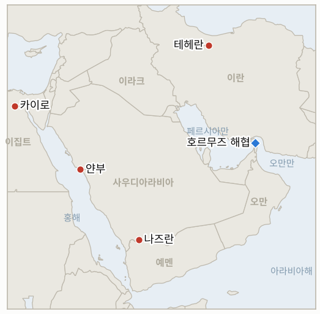

# 중동 일일 브리핑

**2026년 10월 20일**

- **보고 기간:** 약 24시간, 10월 19일 06:00 ~ 10월 20일 06:00 (한국시간)
- **종합 평가:** 월요일의 핵심은 호르무즈를 실제로 얼마나 많은 원유가 지나가는가를 둘러싼 공방이었다. 크리스 라이트 미 에너지장관은 걸프 물동량이 전쟁 전의 약 80%로 회복됐다고 말했지만, Kpler의 추적 자료는 7일 평균이 하루 850만 배럴로 직전 주의 약 2,000만 배럴에서 급감했음을 보여 주며, 브렌트유는 그럼에도 109.55달러에 마감했다(§1.1). 워싱턴은 러시아 에너지 제재를 면제하고 디젤 거래를 발표했는데, 11월 3일 중간선거 전에 유가를 누르려는 노력의 강도를 보여 준다(§1.2). 후티의 공격은 얀부를 겨냥했고 이집트 의회는 사우디 지원 표결을 미뤘다(§1.3). 서울 증시는 3% 넘게 하락 출발한 뒤 1.76% 반등했고, 원화는 약 2년 만의 최고 수준으로 올랐다(§1.4).

---

## 1. 무슨 일이 있었나

<figure style="float:right; width:46%; margin:2pt 0 8pt 14pt;">

<figcaption style="font-size:8pt; color:#666; text-align:center; margin-top:3pt; font-style:italic;">주요 논의 지점</figcaption>
</figure>

### 1.1 워싱턴은 걸프 물동량이 정상의 80% 근처라고 하지만 추적업체는 훨씬 낮게 보고, 혁명수비대는 또 한 척이 기뢰에 맞았다고 주장한다

Rigzone의 시장 기사에 따르면 크리스 라이트 에너지장관은 페르시아만 물동량이 분쟁 전의 약 80%로 회복됐지만 정제 제품 선적은 여전히 제약받고 있다고 말했다([Rigzone](https://www.rigzone.com/news/wire/oil_prices_hover_near_fivemonth_high-19-oct-2026-184878-article/)). 반면 Kpler는 해협 통과 물동량의 7일 평균을 하루 850만 배럴로 집계했으며, 직전 주의 추정치는 약 2,000만 배럴이었다([OilPrice.com](https://oilprice.com/Latest-Energy-News/World-News/Oil-Prices-Slip-as-Trump-Putin-Diesel-Deal-Raises-Supply-Hopes.html)). 라이트 장관은 10월 12일에도 80~90%라는 비슷한 주장을 했다. 그는 호위를 받는 선박이 응답기를 끄기 때문에 추적업체가 과소 집계한다고 주장해 왔고, 그의 수치에는 우회 송유관도 포함되므로 두 수치는 같은 기준이 아니다. 공격 측면에서 Rigzone은 페르시아만에서 유조선 2척이 피격됐다고 전했고, 이란 혁명수비대 해군은 일요일 밤 유조선 한 척이 해협 남부에서 기뢰에 부딪혀 불타고 폭발했다고 밝혔다. 이는 이란 언론이 전한 혁명수비대의 주장이며 선박 이름은 나오지 않았다([New Arab](https://newarab.com/news/saudi-coalition-helicopter-crashes-near-yemen)). 이란은 해협에 대한 통제권을 행사할 "선택의 여지가 없다"고 말했고, 이란 외무부는 라브로프 러시아 외무장관이 월요일 테헤란을 방문한다고 밝혔다. **신뢰도: 관계자와 Kpler가 해당 발언을 했다는 점은 높음; 실제 물동량 수준은 낮음(두 지표가 상충하고 어느 쪽도 검증되지 않음); 기뢰 주장은 낮음(혁명수비대 단독); 유조선 2척 피격은 중간(단일 통신 요약, 선박명 확인 못함).**

### 1.2 트럼프가 러시아 에너지 제재를 면제하고 러시아산 디젤 거래를 발표하는 가운데 브렌트유는 110달러 근처를 유지한다

OilPrice.com에 따르면 트럼프 대통령은 금요일 러시아 에너지 제재를 해제하는 행정명령에 서명했다. 제재 대부분은 지난달 서명된 그레이엄 제재법에서 비롯된 것이다. 또 푸틴과의 합의에 따라 러시아는 이달 약 230만 배럴의 디젤을 미국 등에 공급하고, 11월 이후 760만 배럴을 추가 공급한다. 분석가들은 이 물량이 세계 디젤 수급을 바꾸기에는 너무 작다고 평가했고, 미 의원들은 구매를 막는 법안을 발의했다([OilPrice.com](https://oilprice.com/Latest-Energy-News/World-News/Oil-Prices-Slip-as-Trump-Putin-Diesel-Deal-Raises-Supply-Hopes.html); [Rigzone](https://www.rigzone.com/news/wire/oil_prices_hover_near_fivemonth_high-19-oct-2026-184878-article/)). 브렌트유 12월물은 금요일의 4% 가까운 급등 뒤 0.3% 하락한 109.55달러에 마감했고, WTI는 만기를 앞둔 11월물이 2.2% 올라 103.66달러, 거래가 더 활발한 12월물은 0.5% 내린 98.54달러였다. 현물 두바이드 브렌트(Dated Brent)는 한 주 전보다 약 16달러 낮은 117달러 부근에서 거래됐다. **신뢰도: 중간(같은 보도 계통의 시장 통신 두 건; 다른 곳의 장중 시세는 달랐고 독립적인 정산가 표는 확인하지 못함).**

### 1.3 후티가 얀부를 겨냥하고 이집트 의회는 사우디 지원 표결을 미룬다

Rigzone은 후티 세력이 호르무즈를 우회하는 사우디 원유가 나가는 홍해 수출 거점 얀부를 겨냥했다고 보도했다. 연합군의 결과 발표는 찾지 못해 요격 또는 피해 여부는 확인되지 않았다. 사우디 주도 연합군은 일요일 나즈란 인근 AH-6i 추락으로 국가방위군 장교 2명이 숨졌다고 밝히며 기계 결함 때문이라고 했고, 후티는 격추했다고 주장했다. 7월 적대 행위 재개 이후 첫 군인 사망이다([SBS](https://news.sbs.co.kr/english/article.do?news_id=N1008803332)). 이집트 의원 두 명은 AFP에, 의회가 사우디에 대한 군사 지원을 승인해 달라는 시시 대통령의 요청에 대한 표결을 월요일로 미뤘다고 말했으며, 결과는 확인하지 못했다([New Arab](https://newarab.com/news/saudi-coalition-helicopter-crashes-near-yemen)). **신뢰도: 얀부가 겨냥됐다는 점은 중간(통신 한 줄); 피해는 낮음; 표결 연기는 일요일 기준 높음(AFP 인용); 결과는 알 수 없음.**

### 1.4 서울 증시는 3% 하락 출발 뒤 1.76% 반등하고 원화는 2년 만의 강세를 보인다

코스피는 5,488.41로 3% 넘게 하락 출발한 뒤 1.76% 오른 5,768.01에 마감했다. 2차전지와 자동차주가 반도체 대형주의 하락을 상쇄했고, 기관은 약 5,746억 원을 순매수했다([Korea Times](https://www.koreatimes.co.kr/economy/20261019/kospi-edges-higher-as-battery-auto-gains-power-market); [Seoul Economic Daily](https://en.sedaily.com/finance/2026/10/19/kospi-closes-up-176-percent-at-576801)). 원화는 달러당 1,330.30원으로 1.1원 올라 2년여 만의 최고 수준이었다. 외국인은 KRX 기준으로만 보면 코스피에서 364억 원 순매도였지만 대체거래소 NXT를 포함하면 6,243억 원 순매수였고, 분석가들은 신중론을 폈다. 변동성 지수는 50 근처이며, 메타 실적이 10월 21일, 엔비디아 GTC 베를린 기조연설이 10월 20~22일이다([MoneyToday](https://www.mt.co.kr/en/stock/2026/10/19/2026101916075372592)). 한 매체는 한국은행이 10월 22일 3.00% 동결을 결정할 것으로 내다봤다. 새로운 정부 안정화 조치는 확인하지 못했다. **신뢰도: 종가는 높음(다수 국내 매체); 한국은행 전망은 중간(단일 매체).**

---

## 2. 심층 분석: 동기와 유인

### 2.1 워싱턴은 왜 물동량이 80%라고 말하는데 추적업체는 훨씬 낮게 보는가?

라이트 장관의 수치는 11월 3일 이전에 호위와 봉쇄가 효과를 내고 있다고 유권자에게 말하는 데 도움이 되며, Kpler가 볼 수 없는 우회 송유관과 추적되지 않는 호위 선박까지 포함한다. Kpler의 수치는 위성과 응답기에 잡히는 것만 재므로 어둠 속의 통항을 과소 평가한다. 진실은 두 수치 사이일 가능성이 크고, 그래서 브렌트유가 전쟁 전 수준으로 내려가지 않고 110달러 근처에 머문다. 시장은 물동량만이 아니라 높아진 공격과 보험 위험을 가격에 반영하고 있다.

### 2.2 이란은 왜 해협을 다시 열겠다고 제안하면서 동시에 "통제권을 행사해야 한다"고 고집하는가?

통제권은 7일 계획 뒤에 있는 협상 카드다. 누가 통과하는지를 테헤란이 결정한다는 점을 보여 줄 수 있어야 재개방이 봉쇄 해제와 제재 완화의 대가가 되는 양보로 성립한다. 혁명수비대의 기뢰·발사체 주장은 폐쇄를 입증하지 않고도 보험사와 선주를 계속 조심스럽게 만들며, 라브로프의 방문은 워싱턴이 계속 거부할 경우 테헤란에 외교적 완충재를 준다.

### 2.3 트럼프는 왜 지금 러시아 에너지 제재를 면제하는가?

110달러 근처의 유가와 디젤 부족은 중간선거 전 가장 큰 물가 위험이며, 러시아산 원유는 걸프 밖의 몇 안 되는 공급원이다. 면제를 우크라이나 평화 협상과 묶으면 외교적 명분이 생기지만, 물량이 작아 공급보다 신호의 의미가 더 크고, 의회의 반대가 한계를 정한다.

### 2.4 후티는 왜 얀부를 겨냥하는가?

얀부는 호르무즈가 위험할 때 사우디 원유가 나가는 곳이므로, 타격하거나 위협만 해도 리야드의 우회로와 시장의 마지막 완충을 공격하는 셈이다. 이집트의 망설임은 전쟁 확대의 비용을 보여 준다. 표결이 미뤄지면 사우디는 메카 방위 협정이 시사한 것보다 적은 동맹과 함께 후티를 상대해야 할 수 있다.

---

## 3. 한국에 대한 정책적 함의

**익스포저 현황:** 한국은 원유의 약 70.7%, LNG의 약 20.4%를 중동에서 들여온다(`instructions/korea-exposure.md`, 갱신 불필요). 최근 수치(10월 19일): 브렌트유 109.55달러, WTI 103.66달러(11월물; 12월물 98.54달러), 코스피 5,768.01, 원화 달러당 1,330.3원. 사우디 3단계 철수 권고는 유지되고 있으며, 이번 기간에 새로운 한국 정부 발표는 확인하지 못했다.

**사안별 함의:**

- **물동량 논란(§1.1):** 한국 정유사는 실물 화물 가격을 기준으로 하는데, 117달러 부근의 두바이드 브렌트는 선물 가격보다 높은 현물 긴축을 보여 준다. 주목할 숫자는 워싱턴의 추정이 아니라 Kpler의 주간 평균이다(IND-20261020-1).
- **러시아 면제(§1.2):** 러시아산 디젤은 한국이 수출하는 제품 시장에 소폭 도움이 되지만 물량이 작고 의회가 막을 수 있으며, 한국의 직접 노출은 없다.
- **얀부와 이집트(§1.3):** 얀부는 한국이 사들이는 사우디 원유의 우회 경로이며, 선적이 차질을 빚으면 호르무즈의 주된 대안이 사라진다(IND-20261015-1, IND-20261020-2).
- **서울 시장(§1.4):** 반등으로 IND-20261018-3이 판정됐지만, 50 근처의 변동성 지수와 10월 22일 한국은행 회의가 위험을 높게 유지한다(IND-20261020-3, IND-20261019-3).

**오늘 종결:** IND-20261018-3 확인(월요일 코스피 종가 5,768.01로 금요일 5,668.05 상회).

**검증 가능한 지표:**

- **IND-20261020-1** (신규, 진행 중): Kpler의 호르무즈 7일 평균 물동량이 ~2026-10-27까지 주간 갱신에서 하루 1,200만 배럴을 넘으면 회복 주장이 뒷받침된 것으로 확인, 아니면 반증.
- **IND-20261020-2** (신규, 진행 중): 이집트 의회가 ~2026-10-27까지 사우디에 대한 군사 지원을 승인하면 확인, 부결 또는 표결 없음이면 반증.
- **IND-20261020-3** (신규, 진행 중): 한국은행이 10월 22일 기준금리를 3.00%로 동결하면 확인, 변경하면 반증.
- **IND-20261019-3** (진행 중): 첫날은 유지(종가 5,768.01, 5,100 상회). 4거래일 남음.
- **IND-20261013-3**과 **IND-20261010-2** (진행 중, 오늘 기한): 아락치는 일요일 미국의 "의견"을 검토 중이라고 밝혔고 이는 카타르를 통한 간접 교환을 시사하지만 이번 기간에 공식 공개는 확인하지 못했으며, 다음 브리핑에서 판정한다.
- **IND-20261015-3** (진행 중): 브렌트유 정산가 109.55달러로 이번에도 110달러에 못 미쳤다.
- **IND-20261014-1**, **IND-20261014-3**, **IND-20261016-1**, **IND-20261016-2**, **IND-20261017-2** 등 기존 진행 중 지표: 판정할 정보 없음. 원화 1,330.3원과 코스피 5,768.01은 두 기준선 모두 안쪽이다.

---

## 4. 관찰 목록

- **10월 22일 한국은행 결정(IND-20261020-3)과 AI 투자 흐름을 보여 줄 10월 21일 메타 실적.**
- **Kpler 주간 호르무즈 물동량과 워싱턴의 80% 주장 비교(IND-20261020-1).**
- **이집트 의회 표결과 얀부에 대한 사우디의 입장(IND-20261020-2, IND-20261015-1).**
- **라브로프의 테헤란 방문과 7개 항 계획에 대한 미국의 회신(IND-20261019-1, IND-20261013-3).**
- **러시아산 디젤 구매 차단 법안과 그림자 선단에 대한 재무부 조치(IND-20261019-2).**
- **10월 27일 이스라엘 총선과 11월 3일 미국 중간선거(IND-20260910-3).**

---

## 5. 출처 품질 요약

| 주장 | 출처 | 신뢰도 |
| --- | --- | --- |
| 라이트: 걸프 물동량 전쟁 전의 약 80%; Kpler 7일 평균 하루 850만 배럴 | Rigzone, OilPrice.com | 중간(상충하는 지표) |
| 혁명수비대: 유조선이 해협 남부에서 기뢰에 피격돼 불타고 폭발 | 이란 언론 경유 혁명수비대 해군, New Arab | 낮음 |
| 페르시아만에서 유조선 2척 피격(UKMTO) | Rigzone | 중간 |
| 이란 통제권 행사 "선택의 여지 없음"; 라브로프 테헤란 방문 | Rigzone, New Arab | 중간 |
| 트럼프 러시아 에너지 제재 면제; 230만 배럴 디젤 거래 | OilPrice.com, Rigzone | 중간 |
| 브렌트 109.55달러, WTI 11월물 103.66달러·12월물 98.54달러, 두바이드 브렌트 약 117달러 | Rigzone | 중간 |
| 후티의 얀부 겨냥 | Rigzone | 중간~낮음 |
| 이집트 의회 사우디 지원 표결 월요일로 연기 | AFP 인용 New Arab | 높음(일요일 기준) |
| 코스피 5,768.01(+1.76%), 원화 1,330.3원; 외국인 수급 | Korea Times, Seoul Economic Daily, MoneyToday | 높음 |
| 한국은행 10월 22일 3.00% 동결 | 단일 매체 | 중간 |
| 호르무즈 일별 정확한 통항 수 | 미보고 | 미보고 |
