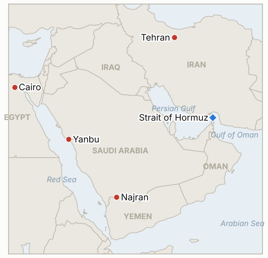

# Middle East Daily Briefing

**October 20, 2026**

- **Reporting window:** ~24 hours, October 19, 06:00 to October 20, 06:00 KST
- **Overall assessment:** Monday's story was a fight over how much oil is really moving through Hormuz: US Energy Secretary Chris Wright says Gulf flows are back to about 80% of pre war levels while Kpler's tracking shows a seven day average of 8.5 million barrels a day against about 20 million the week before, and Brent still settled at $109.55 (§1.1). Washington also waived sanctions on Russian energy and announced a diesel deal, a sign of how hard it is working to cap prices before the November 3 midterms (§1.2). Houthi fire reached toward Yanbu while Egypt's parliament delayed its vote on helping Saudi Arabia (§1.3). Seoul's market rebounded 1.76% after opening more than 3% lower, and the won hit its strongest level in about two years (§1.4).

---

## 1. What Happened

<figure style="float:right; width:46%; margin:2pt 0 8pt 14pt;">

<figcaption style="font-size:8pt; color:#666; text-align:center; margin-top:3pt; font-style:italic;">Major places of discussion</figcaption>
</figure>

### 1.1 Washington says Gulf flows are near 80% of normal, trackers say far less, and the IRGC claims another tanker hit a mine

Rigzone's market wire reported that Energy Secretary Chris Wright said Persian Gulf flows have recovered to about 80% of pre conflict levels, though refined product shipments remain constrained ([Rigzone](https://www.rigzone.com/news/wire/oil_prices_hover_near_fivemonth_high-19-oct-2026-184878-article/)). Kpler, by contrast, put the seven day average flow through the Strait at 8.5 million barrels a day, down from an estimated 20 million the week before ([OilPrice.com](https://oilprice.com/Latest-Energy-News/World-News/Oil-Prices-Slip-as-Trump-Putin-Diesel-Deal-Raises-Supply-Hopes.html)). Wright made a similar 80 to 90% claim on October 12; he has argued before that trackers undercount because escorted ships switch off transponders, and his figure also includes bypass pipelines, so the two numbers are not like for like. On the attack side, Rigzone reported two tankers hit in the Persian Gulf, and Iran's IRGC navy said on Sunday night that an oil tanker struck a mine in the southern Strait, caught fire and exploded; that is an IRGC claim relayed by Iranian media, with no vessel named ([New Arab](https://newarab.com/news/saudi-coalition-helicopter-crashes-near-yemen)). Iran said it has "no choice" but to assert control of the Strait, and Iran's foreign ministry said Russian Foreign Minister Lavrov would visit Tehran on Monday. **Confidence: High that the officials and Kpler said these things; Low on the true flow level (the two measures conflict and neither is audited); Low on the mine claim (IRGC only); Medium on the two tankers hit (single wire summary, no vessel names found).**

### 1.2 Trump waives Russian energy sanctions and announces a Russian diesel deal as Brent holds near $110

OilPrice.com reported that Trump signed an executive order on Friday lifting sanctions on Russian energy, most of which came from the Graham sanctions law signed last month, and agreed with Putin that Russia would supply about 2.3 million barrels of diesel this month to the US and others, with another 7.6 million in November and later. Analysts called the volumes too small to change the global diesel balance, and US lawmakers introduced a bill to block the purchases ([OilPrice.com](https://oilprice.com/Latest-Energy-News/World-News/Oil-Prices-Slip-as-Trump-Putin-Diesel-Deal-Raises-Supply-Hopes.html); [Rigzone](https://www.rigzone.com/news/wire/oil_prices_hover_near_fivemonth_high-19-oct-2026-184878-article/)). Brent's December contract settled at $109.55, down 0.3% after Friday's near 4% jump; WTI's expiring November contract rose 2.2% to $103.66 while the more active December contract fell 0.5% to $98.54. Physical Dated Brent traded near $117, about $16 below a week earlier. **Confidence: Medium (two market wires from one reporting chain; intraday quotes elsewhere differed, and I did not find an independent settlement table).**

### 1.3 Houthis target Yanbu while Egypt's parliament delays its vote on supporting Saudi Arabia

Rigzone reported that Houthi forces targeted Yanbu, the Red Sea export hub that carries Saudi crude around Hormuz; I found no Saudi coalition statement on the outcome, so whether anything was intercepted or hit is unconfirmed. The Saudi led coalition said on Sunday that two National Guard officers died in the AH-6i crash near Najran, attributing it to a technical malfunction while the Houthis claimed a shootdown; it was the first military fatality since hostilities resumed in July ([SBS](https://news.sbs.co.kr/english/article.do?news_id=N1008803332)). Two Egyptian lawmakers told AFP that parliament postponed its vote on President Sisi's request to authorize military support for Saudi Arabia to Monday; I could not find the result ([New Arab](https://newarab.com/news/saudi-coalition-helicopter-crashes-near-yemen)). **Confidence: Medium that Yanbu was targeted (one wire line); Low on any damage; High on the postponed vote as of Sunday (AFP via New Arab); unknown on the outcome.**

### 1.4 Seoul rebounds 1.76% after a 3% lower open, and the won reaches a two year high

KOSPI opened at 5,488.41, more than 3% down, then closed at 5,768.01, up 1.76%, as battery and auto stocks offset losses in chipmakers; institutions bought about 574.6 billion won ([Korea Times](https://www.koreatimes.co.kr/economy/20261019/kospi-edges-higher-as-battery-auto-gains-power-market); [Seoul Economic Daily](https://en.sedaily.com/finance/2026/10/19/kospi-closes-up-176-percent-at-576801)). The won closed at 1,330.30 per dollar, 1.1 won stronger and its best level in just over two years. Foreigners were small net sellers of KOSPI on KRX data alone (36.4 billion won) but net buyers of 624.3 billion won once the NXT alternative venue is included, and analysts urged caution: the volatility index sits near 50, Meta reports on October 21 and Nvidia's GTC Berlin keynote runs October 20 to 22 ([MoneyToday](https://www.mt.co.kr/en/stock/2026/10/19/2026101916075372592)). One outlet expects the Bank of Korea to hold at 3.00% on October 22. I found no new government stabilization measure. **Confidence: High on the closes (several Korean outlets); Medium on the BOK expectation (single outlet).**

---

## 2. Deep Dive: Incentives and Motives

### 2.1 Why does Washington say flows are at 80% when trackers say they are far lower?

Wright's figure helps the administration tell voters before November 3 that escorts and the blockade are working, and it counts bypass pipelines and untracked escorted ships that Kpler cannot see. Kpler's number measures what satellites and transponders show, so it understates dark traffic. The truth is probably between them, which is why Brent stays near $110 rather than falling toward pre war levels: the market is pricing the higher risk of attack and insurance, not just the flow.

### 2.2 Why does Iran insist it must "assert control" of the Strait while offering to reopen it?

Control is the bargaining chip behind the seven day plan: if Tehran can show it decides who passes, then reopening is a concession worth the blockade's end and sanctions relief. Mine and projectile claims by the IRGC also keep insurers and owners cautious without Iran having to prove a closure, and a Lavrov visit gives Tehran a diplomatic cushion if Washington keeps refusing.

### 2.3 Why would Trump waive Russian energy sanctions now?

Oil near $110 and diesel shortages are the largest price risk before the midterms, and Russian barrels are among the few sources outside the Gulf. Tying the waiver to Ukraine peace talks gives it a foreign policy rationale, but the small volumes suggest the signal matters more than the supply, and congressional opposition limits how far it can go.

### 2.4 Why do the Houthis aim at Yanbu?

Yanbu is where Saudi crude goes when Hormuz is risky, so hitting or merely threatening it attacks Riyadh's workaround and the market's last cushion. Egypt's hesitation shows the cost of widening the war: a vote delayed means Saudi Arabia may face the Houthis with fewer allies than the Mecca defense pact implied.

---

## 3. Policy Implications for South Korea

**Exposure snapshot:** South Korea draws about 70.7% of its crude and 20.4% of its LNG from the Middle East (`instructions/korea-exposure.md`, no update needed). Latest prints (October 19): Brent $109.55, WTI $103.66 (November contract; $98.54 for December), KOSPI 5,768.01, won 1,330.3 per dollar. The Saudi level 3 departure recommendation stands; I found no new Korean announcement in the window.

**Implications by development:**

- **Flow dispute (§1.1):** Korean refiners price off physical cargoes, and Dated Brent near $117 shows spot tightness above the futures price; the Kpler weekly average is the number to watch, not Washington's estimate (IND-20261020-1).
- **Russian waiver (§1.2):** Russian diesel is a marginal help to product markets that Korea exports into, but the volumes are small and may be blocked by Congress; no direct Korean exposure.
- **Yanbu and Egypt (§1.3):** Yanbu is the bypass route for Saudi crude that Korea buys; an attack that disrupts loading would remove the main alternative to Hormuz (IND-20261015-1, IND-20261020-2).
- **Seoul's markets (§1.4):** the rebound answers IND-20261018-3, but a VKOSPI near 50 and the October 22 Bank of Korea meeting keep risk high (IND-20261020-3, IND-20261019-3).

**Resolved today:** IND-20261018-3 confirmed (KOSPI closed Monday at 5,768.01, above Friday's 5,668.05).

**Testable indicators:**

- **IND-20261020-1** (open, new): Kpler's seven day average Hormuz flow rising above 12 million barrels a day in any weekly update by ~2026-10-27 confirms that recovery claims have support; none falsifies.
- **IND-20261020-2** (open, new): Egypt's parliament approving military support for Saudi Arabia by ~2026-10-27 confirms; a rejection or no vote falsifies.
- **IND-20261020-3** (open, new): The Bank of Korea holding its policy rate at 3.00% on October 22 confirms the hold expectation; any change falsifies.
- **IND-20261019-3** (open): Day one holds (close 5,768.01, above 5,100); four sessions remain.
- **IND-20261013-3** and **IND-20261010-2** (open, deadline today): Araghchi said Sunday that Tehran is reviewing US "comments", which suggests indirect exchanges through Qatar, but I found no formal disclosure in this window; I will resolve them in the next brief.
- **IND-20261015-3** (open): Brent settled $109.55, short of $110 again.
- **IND-20261014-1**, **IND-20261014-3**, **IND-20261016-1**, **IND-20261016-2**, **IND-20261017-2** and other older open items (open): no resolving information; the won at 1,330.3 and KOSPI at 5,768.01 are inside both levels.

---

## 4. Watch List

- **Bank of Korea decision October 22 (IND-20261020-3) and Meta earnings October 21 as a read on AI spending.**
- **Kpler weekly Hormuz flows against Washington's 80% claim (IND-20261020-1).**
- **Egypt's parliamentary vote and any Saudi statement on Yanbu (IND-20261020-2, IND-20261015-1).**
- **Lavrov's Tehran visit and any US reply on the seven point plan (IND-20261019-1, IND-20261013-3).**
- **Congressional bill to block Russian diesel purchases and Treasury action on shadow fleet vessels (IND-20261019-2).**
- **Israel's October 27 election and the November 3 US midterms (IND-20260910-3).**

---

## 5. Source Quality Summary

| Claim | Sources | Confidence |
| --- | --- | --- |
| Wright: Gulf flows about 80% of pre war; Kpler 7 day average 8.5 million bpd | Rigzone, OilPrice.com | Medium (conflicting measures) |
| IRGC says tanker hit mine, burned and exploded in southern Strait | IRGC navy via Iranian media, New Arab | Low |
| Two tankers hit in the Persian Gulf (UKMTO) | Rigzone | Medium |
| Iran "no choice" but to assert control; Lavrov to visit Tehran | Rigzone, New Arab | Medium |
| Trump waives Russian energy sanctions; 2.3 million barrel diesel deal | OilPrice.com, Rigzone | Medium |
| Brent $109.55, WTI Nov $103.66 / Dec $98.54, Dated Brent near $117 | Rigzone | Medium |
| Houthis targeted Yanbu | Rigzone | Medium to Low |
| Egypt parliament delays vote on Saudi support to Monday | AFP via New Arab | High (as of Sunday) |
| KOSPI 5,768.01 (+1.76%), won 1,330.3; foreign flows | Korea Times, Seoul Economic Daily, MoneyToday | High |
| BOK holds at 3.00% on Oct 22 | One outlet | Medium |
| Hormuz exact daily transit count | Not reported | Not reported |
