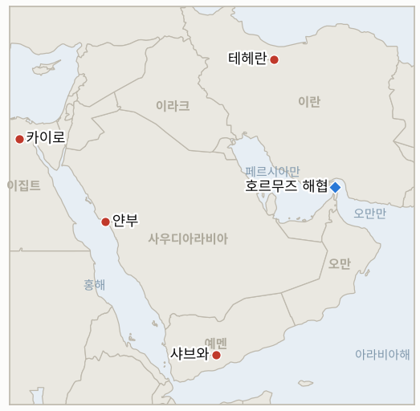

# 중동 일일 브리핑

**2026년 10월 21일**

- **보고 기간:** 약 24시간, 10월 20일 06:00 ~ 10월 21일 06:00 (한국시간)
- **종합 평가:** 화요일 브렌트유는 블룸버그가 미국과 이란이 합의에 근접했다는 보도는 부정확하다고 밝힌 뒤 108.79달러에 정산됐고, 이란 언론은 초대형 유조선 기뢰 피격 주장을 되풀이했으며 라이트 에너지장관은 걸프 물동량이 정상의 약 80%라는 말을 반복했다(§1.1). 라브로프의 테헤란 방문은 이란에 러시아라는 후원자를 보여 주었고 카타르는 미·이란 협상이 계속된다고 말하지만 공식적으로 공개된 것은 없다(§1.2). 후티는 리야드가 확인하지 않은 얀부·샤이바 타격을 주장했고, 이집트 의회는 사우디 지원 표결을 10월 26일로 미뤘다(§1.3). 서울 증시는 월요일 상승분을 반납해 코스피가 3.73% 하락한 5,552.74를 기록했으며 원인은 유가가 아니라 AI 수익성 우려였다(§1.4).

**정정 및 업데이트:** 10월 20일 브리핑(§1.3)은 이집트 의회가 사우디 지원 표결을 월요일로 연기했다고 적었다. 이후 보도에 따르면 일요일과 월요일의 비공개 논의 끝에 표결은 다시 10월 26일로 미뤄졌으며, 이집트 국방위원회는 이미 지원을 승인했다(걸프타임스, 걸프뉴스).

---

## 1. 무슨 일이 있었나

<figure style="float:right; width:46%; margin:2pt 0 8pt 14pt;">

<figcaption style="font-size:8pt; color:#666; text-align:center; margin-top:3pt; font-style:italic;">주요 논의 지점</figcaption>
</figure>

### 1.1 합의 보도가 부정되면서 브렌트유는 108.79달러로 내렸고, 이란 언론은 초대형 유조선 기뢰 피격 주장을 반복한다

블룸버그를 인용한 Rigzone에 따르면 브렌트유 12월물은 미·이란 협상 진전에 관한 미확인 보도로 장중 최대 3.3% 하락했다가 0.7% 내린 108.79달러에 정산됐다. 블룸버그는 이후 양측이 합의에 근접했다는 주장은 부정확하다고 밝혔다([Rigzone](https://www.rigzone.com/news/oil_slips_as_iran_talks_fuel_volatility-20-oct-2026-184889-article)). 이날 만기가 된 WTI 11월물은 101.79달러(-1.8%), 12월물은 97.82달러에 정산됐다. 이란 국영 언론은 초대형 유조선이 호르무즈에서 기뢰에 피격됐다고 다시 보도했고, 라이트 장관은 폭스뉴스에서 걸프 원유 물동량이 전쟁 전의 약 80%로 회복됐으나 정제 제품 선적은 여전히 제약받는다고 말했다. Kpler 자료에서는 추세추종 펀드가 브렌트와 WTI 모두 100% 순매수 상태여서 악재가 아닌 소식에도 가격이 급락할 수 있다. 한 요약은 Kpler가 최근 2주간 최소 18척이 공격받은 것으로 집계했다고 전했다([FinanceFeeds](https://financefeeds.com/brent-crude-oil-price-110-houthi-saudi-attacks-hormuz-mine-bull-113-bear-104/)). **신뢰도: 정산가는 높음(블룸버그 인용 Rigzone, CNBC는 WTI 12월물을 장중 98.28달러로 인용); 기뢰 주장은 낮음(이란 국영 언론만, 선박명 없음); 18척 집계는 중간(2차 요약).**

### 1.2 라브로프의 테헤란 방문이 이란에 러시아라는 후원자를 보여 주지만 미·이란 협상은 확인되지 않는다

라브로프 러시아 외무장관은 바레인에서 열린 러시아·걸프협력회의(GCC) 전략대화에서 걸프국들이 호르무즈 해운 재개를 위해 이란을 설득해 달라고 요청한 뒤 테헤란에서 아락치 이란 외무장관을 만났다. 아락치는 이란과 러시아가 지금처럼 긴밀했던 적이 없다고 말했다([알자지라](https://www.aljazeera.com/news/2026/10/19/russias-lavrov-to-discuss-us-war-and-regional-security-during-tehran-visit); [폭스뉴스](https://www.foxnews.com/live-news/iran-war-news-trump-israel-russia-october-20)). 카타르는 미·이란 협상이 계속되고 있다고 말하지만 어느 쪽도 회담 개최를 확인하지 않았고, 아락치는 7개 항 계획에 대한 미국의 "의견"을 검토 중이라고 밝혔다. 혁명수비대 장교들은 미국이 군사행동을 재개하면 더 강하게 대응하겠다고 말했고, 트럼프는 미국이 "곧 끝장낼 수 있다"고 말했다([Iran International](https://iranintl.com/en/202610193317)). 라브로프 회담의 결과는 확인하지 못했다. **신뢰도: 회동과 아락치 발언은 높음; 카타르의 협상 지속 설명은 중간(워싱턴·테헤란의 확인 없음); 혁명수비대의 군사 주장은 낮음(미검증).**

### 1.3 후티는 얀부·샤이바 타격을 주장하고 이집트 표결은 10월 26일로 미뤄진다

후티는 10월 19일 얀부의 아람코 시설과 샤이바 유전, 리야드와 아브하 공항을 공격했다고 밝혔으나 사우디 당국은 확인하지 않았고 로이터도 검증하지 못했으며 피해 보고는 없다([Cornerstone Futures](https://www.cornerstonefuturesllc.com/post/morning-highlights-houthis-claim-strikes-on-shaybah-oilfield-and-aramco-s-yanbu-site-as-brent-reach)). 별도로 예멘 샤브와주 정부군 캠프에 대한 후티 공격으로 최소 18명이 숨졌다고 로이터가 전했다(Iran International 인용). 이집트 의회는 "요청이 있을 경우" 사우디를 군사 지원하게 해 달라는 시시 대통령의 요청에 대한 표결을 10월 26일로 연기했다. 대다수 의원이 지지하지만 일부는 범위를 분명히 하길 원하며 헌법상 3분의 2 찬성이 필요하다([걸프타임스](https://x.com/GulfTimes_QATAR/status/2112435448157032667); [New Lines](https://newlinesmag.com/running-notes/egypts-parliament-votes-on-sending-military-support-to-saudi-arabia/)). **신뢰도: 얀부·샤이바 피격은 낮음(후티 주장만); 샤브와 사망자 수는 중간(단일 인용 보도); 10월 26일 날짜는 높음(복수 매체).**

### 1.4 코스피는 AI 수익성 우려로 3.73% 하락한 5,552.74를 기록하고 원화는 1,328.1원으로 강세다

코스피는 장중 저점 5,493.24를 거쳐 215.27포인트 내린 5,552.74에 마감했고, 코스닥은 3.33% 하락한 781.97을 기록했다([Seoul Economic Daily](https://en.sedaily.com/finance/2026/10/20/kospi-closes-down-373-percent-at-555274); [톱스타뉴스](https://www.topstarnews.net/news/articleView.html?idxno=16252798)). 외국인은 약 5,300억 원, 기관은 약 1조 48억 원을 순매도했고 개인은 약 8,981억 원을 순매수했다([Digital Today](https://www.digitaltoday.co.kr/en/view/117173/kospi-slumps-3-73-percent-on-foreign-institutional-selling-kosdaq-falls-below-800)). 삼성전자는 2.98%, SK하이닉스는 4.23% 하락했고 전 업종이 내렸다. 분석가들은 코어위브 등 AI 부채·수익성 우려, 4.9%대 프랑스 10년물 금리, AI 클라우드 기업 엘리스의 부진한 상장 첫날(공모가 대비 약 32% 낮게 마감), 10월 21일 메타 실적에 대한 경계를 원인으로 꼽았으며 중동 긴장과 고금리는 부차적 요인으로 언급됐다. 원화는 15시 30분 주간 거래 종가 기준 달러당 1,328.1원으로 2.2원 올랐고 수출업체의 달러 매도가 한몫했다. 새로운 정부 대책은 확인하지 못했고 이들 보도에는 한국은행 관련 내용도 없었다. **신뢰도: 종가는 높음(복수 매체); 수급 수치는 중간(집계 범위별 차이); 원인 분석은 중간(애널리스트 해석).**

---

## 2. 심층 분석: 동기와 유인

### 2.1 합의 관련 보도는 왜 유가를 움직인 뒤 곧 부정되는가?

포지션이 한쪽으로 쏠려 있다. Kpler 자료상 펀드가 최대 순매수 상태여서 합의 암시는 빠른 매도를, 부인은 되사기를 부른다. 양국 정부 모두 모호함에서 이익을 얻는다. 워싱턴은 11월 3일 중간선거 전에 유가를 낮추고 싶어 진전 소식이 유리하고, 테헤란은 확약 없이 합의설이 돌게 두는 것만으로 협상력을 얻는다. 블룸버그의 정정은 서명된 문서에 이른 것이 얼마나 적은지 보여 준다.

### 2.2 러시아는 왜 지금 테헤란을 찾는가?

모스크바는 고유가로 이익을 보고, 디젤과 제재 면제를 놓고 워싱턴에 구애받는 동시에 중재자 역할로 위상을 높인다. 이란에는 러시아 방문이 고립되지 않았다는 신호이자 7개 항 계획의 협상력 강화 수단이다. 걸프국에는 라브로프에게 테헤란을 설득해 달라고 요청하는 것이 워싱턴이 닫지 않은 채널을 시험하는 저비용 방법이다.

### 2.3 후티는 왜 사우디가 확인하지 않는 타격을 발표하는가?

주장은 비용이 들지 않으면서 실제 피해가 없어도 보험사, 항공사, 원유 벤치마크를 움직이므로 리야드에는 압박, 카이로에는 억지 수단이 된다. 샤브와 공격은 후티가 예멘 지상전도 밀어붙이고 있음을 보여 주며, 사우디 시설에 대한 주장은 고립된 무력시위가 아니라 더 넓은 작전의 일부다.

### 2.4 이집트는 왜 다시 표결을 미뤘는가?

시시는 국방위원회의 승인을 받았고 리야드와의 연대를 과시하고 싶지만, 해외 전투를 승인하는 3분의 2 표결은 의원들이 범위를 정의하길 원하는 약속이다. 연기는 또한 사우디에 대한 적대 행위를 멈추게 하려는 구상의 진행을 지켜보고, 꼭 필요하기 전에는 후티의 표적이 되는 것을 피하게 해 준다.

### 2.5 유가가 내린 날 서울은 왜 하락했는가?

방아쇠는 유가가 아니라 AI 매매였다. 반도체 비중이 매우 큰 코스피는 AI 자금 조달 우려에 다른 시장보다 더 크게 흔들리며, 이달 고점 대비 20% 넘는 하락으로 레버리지와 개인 포지션이 취약하다. 유가와 전쟁 위험은 고금리와 위험회피라는 배경을 만들지만 이날의 매도는 미국과 프랑스발 신호를 따랐다.

---

## 3. 한국에 대한 정책적 함의

**익스포저 현황:** 한국은 원유의 약 70.7%, LNG의 약 20.4%를 중동에서 들여온다(`instructions/korea-exposure.md`, 갱신 불필요). 최신 수치(10월 20일): 브렌트유 108.79달러, WTI 101.79달러(11월물; 12월물 97.82달러), 코스피 5,552.74, 원·달러 1,328.1원. 사우디에 대한 여행경보 3단계(철수 권고)는 유지되며 이번 기간에 새로운 한국 정부 발표는 확인하지 못했다.

**사안별 함의:**

- **유가와 합의 보도(§1.1, §1.2):** 보도에 따른 3달러 안팎의 변동은 한국에 실익이 적다. 정유사는 두바이드 브렌트와 Kpler 물동량, 그리고 합의 보도가 아닌 서명된 문서를 봐야 한다(IND-20261020-1, IND-20261021-2).
- **후티 주장(§1.3):** 미확인 얀부 주장이 중요한 것은 얀부가 한국이 사들이는 사우디산 원유의 핵심 우회로이기 때문이며, 실제 피해 확인이 진짜 신호다(IND-20261021-1, IND-20261015-1).
- **서울 시장(§1.4):** 매도는 AI·반도체 심리에서 나왔다. 원화 강세는 수입 비용에 유리하나 지수는 반도체 수출이 좌우하므로, 단기 한국 증시 위험은 호르무즈보다 메타와 엔비디아에 더 달려 있다(IND-20261021-3, IND-20261020-3).

**오늘 종결:** IND-20261014-1 반증(코스피는 6,400선 위에서 마감한 적이 없고 5,552.74로 마감). IND-20261014-3 반증(원화는 1,360원보다 훨씬 강한 수준 유지). IND-20261010-2와 IND-20261013-3은 좁은 해석으로 확인: 아락치가 이란이 미국의 "의견"을 검토 중이라고 밝혔고 트럼프가 7개 항 계획을 거부해 미국의 응답과 교환이 공개됐으나 공식 회신이나 회담은 없었다.

**검증 가능한 지표:**

- **IND-20261021-1**(신규, 진행 중): 10월 19일 후티 주장에 대해 사우디 당국, 아람코 또는 독립 영상이 2026-10-28경까지 얀부 또는 샤이바의 피해를 확인하면 확인, 확인이 없으면 반증.
- **IND-20261021-2**(신규, 진행 중): 양국 정부 또는 중재국(카타르, 파키스탄)이 2026-10-28경까지 미·이란 협상 회의를 공개하면 확인, 공개가 없으면 반증.
- **IND-20261021-3**(신규, 진행 중): 메타 실적 뒤 10월 22일 코스피가 5,552.74를 넘어 마감하면 반등 확인, 이하면 반증.
- **IND-20261020-2**(진행 중): 이집트 표결이 10월 26일로 잡혔으며 2026-10-27경까지 승인되면 확인.
- **IND-20261020-3**(진행 중): 한국은행 결정은 10월 22일이다.
- **IND-20261019-3**(진행 중): 두 거래일 유지(5,768.01, 5,552.74 모두 5,100 이상), 3거래일 남음.
- **IND-20261015-3**(진행 중): 브렌트유는 108.79달러에 정산돼 110달러에 못 미쳤다.
- **IND-20261016-1**, **IND-20261016-2**, **IND-20261017-2** 및 기타 이전 미결 항목(진행 중): 결정할 정보 없음. 코스피 장중 저점 5,493.24는 5,300 위였다.

---

## 4. 관찰 목록

- **10월 21일 메타 실적과 10월 22일 한국은행 결정(IND-20261021-3, IND-20261020-3).**
- **10월 26일 이집트 표결과 얀부·샤이바에 대한 사우디의 입장(IND-20261020-2, IND-20261021-1).**
- **카타르 경유 미·이란 회담 확인 여부와 라브로프 방문 결과(IND-20261021-2, IND-20261019-1).**
- **Kpler 주간 호르무즈 물동량과 워싱턴의 80% 주장 비교(IND-20261020-1).**
- **러시아산 디젤 구매에 대한 의회 조치와 그림자 선단에 대한 재무부 결정(IND-20261019-2).**
- **10월 27일 이스라엘 총선과 11월 3일 미국 중간선거(IND-20260910-3).**

---

## 5. 출처 품질 요약

| 주장 | 출처 | 신뢰도 |
| --- | --- | --- |
| 브렌트 12월물 108.79달러; WTI 11월물 101.79달러·12월물 97.82달러; 합의 주장 부정확 | 블룸버그 인용 Rigzone, CNBC | 높음 |
| 이란 언론: 초대형 유조선 기뢰 피격; 라이트: 물동량 약 80% | Rigzone(블룸버그, 폭스뉴스) | 낮음(기뢰); 중간(라이트 수치는 논란) |
| 2주간 최소 18척 공격받음(Kpler) | FinanceFeeds | 중간 |
| 라브로프·아락치 회담; "이토록 긴밀한 적 없다" | 알자지라, 폭스뉴스 | 높음 |
| 카타르: 미·이란 협상 지속 | 폭스뉴스 | 중간 |
| 후티의 얀부·샤이바 타격 주장, 미확인 | Cornerstone Futures(로이터 인용) | 낮음 |
| 샤브와 공격 최소 18명 사망 | Iran International(로이터) | 중간 |
| 이집트 표결 10월 26일로 연기 | 걸프타임스, New Lines, 걸프뉴스 | 높음 |
| 코스피 5,552.74(-3.73%), 코스닥 781.97 | Seoul Economic Daily, 톱스타뉴스, Digital Today | 높음 |
| 원화 1,328.1원(15시 30분 주간 종가) | 톱스타뉴스 | 중간 |
| 하락 원인: AI 자금 우려, 프랑스 금리, 엘리스 상장 | 톱스타뉴스, Digital Today | 중간 |
| 호르무즈 일별 정확한 통항 수 | 미보고 | 미보고 |
