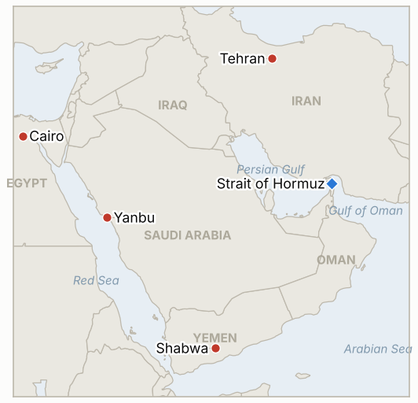

# Middle East Daily Briefing

**October 21, 2026**

- **Reporting window:** ~24 hours, October 20, 06:00 to October 21, 06:00 KST
- **Overall assessment:** Brent settled at $108.79 on Tuesday after Bloomberg said claims that the US and Iran are close to a deal are inaccurate, while Iranian media kept repeating a supertanker mine claim and Energy Secretary Wright repeated that Gulf flows are near 80% of normal (§1.1). Lavrov's Tehran visit gave Iran a Russian backer, and Qatar says US Iran talks are still on, but nothing formal has been disclosed (§1.2). The Houthis claimed strikes on Yanbu and Shaybah that Riyadh has not confirmed, and Egypt's parliament pushed its vote on Saudi support to October 26 (§1.3). Seoul gave back Monday's gain, with KOSPI down 3.73% to 5,552.74 on AI profitability worries rather than on oil (§1.4).

**Corrections and updates:** The October 20 brief (§1.3) said Egypt's parliament postponed its vote on Saudi support to Monday. Later reports say the vote was moved again, to October 26, after closed door sessions on Sunday and Monday; Egypt's National Defence Council has already approved support (Gulf Times; Gulf News).

---

## 1. What Happened

<figure style="float:right; width:46%; margin:2pt 0 8pt 14pt;">

<figcaption style="font-size:8pt; color:#666; text-align:center; margin-top:3pt; font-style:italic;">Major places of discussion</figcaption>
</figure>

### 1.1 Brent slips to $108.79 after a deal report is knocked down, while Iranian media repeat a supertanker mine claim

Bloomberg, relayed by Rigzone, reported that Brent's December contract settled 0.7% lower at $108.79, after falling as much as 3.3% on an unconfirmed report of US Iran talks progress; Bloomberg then said claims that the two sides are close to an agreement are inaccurate ([Rigzone](https://www.rigzone.com/news/oil_slips_as_iran_talks_fuel_volatility-20-oct-2026-184889-article)). WTI's expiring November contract settled at $101.79 (-1.8%) and the December contract at $97.82. Iranian state media again said an oil supertanker hit a mine in Hormuz, and Wright told Fox News that Gulf crude flows have recovered to about 80% of pre war levels while refined product shipments stay constrained. Kpler data show trend following funds at 100% long in both benchmarks, which leaves prices exposed to a sharp drop on bearish news. One summary cited Kpler as counting at least 18 vessels under fire in two weeks ([FinanceFeeds](https://financefeeds.com/brent-crude-oil-price-110-houthi-saudi-attacks-hormuz-mine-bull-113-bear-104/)). **Confidence: High on the settlements (Bloomberg via Rigzone; CNBC quoted $98.28 for WTI December intraday); Low on the mine claim (Iranian state media only, no vessel named); Medium on the 18 vessel count (secondary summary).**

### 1.2 Lavrov in Tehran gives Iran a Russian backer while US Iran talks stay unconfirmed

Russian Foreign Minister Lavrov met Iranian Foreign Minister Araghchi in Tehran after a Russia GCC dialogue in Bahrain where Gulf states asked Moscow to press Tehran on shipping through Hormuz; Araghchi said Iran and Russia have never worked as closely as now ([Al Jazeera](https://www.aljazeera.com/news/2026/10/19/russias-lavrov-to-discuss-us-war-and-regional-security-during-tehran-visit); [Fox News](https://www.foxnews.com/live-news/iran-war-news-trump-israel-russia-october-20)). Qatar says US Iran talks are still on, though neither side has confirmed a session, and Araghchi has said Tehran is still reviewing US "comments" on its seven point plan. Revolutionary Guards officers said Iran would answer any renewed US action more forcefully, and Trump has said the US could "soon finish the job" ([Iran International](https://iranintl.com/en/202610193317)). I found no outcome from the Lavrov talks. **Confidence: High that the meeting and Araghchi's remark happened; Medium on Qatar's account of ongoing talks (no confirmation from Washington or Tehran); Low on IRGC military claims (unverified).**

### 1.3 Houthis claim hits on Yanbu and Shaybah, and Egypt's vote slips to October 26

The Houthis said on October 19 that they attacked an Aramco site in Yanbu and the Shaybah oilfield, plus Riyadh and Abha airports; Saudi authorities have not confirmed the claims, Reuters could not verify them, and no damage has been reported ([Cornerstone Futures](https://www.cornerstonefuturesllc.com/post/morning-highlights-houthis-claim-strikes-on-shaybah-oilfield-and-aramco-s-yanbu-site-as-brent-reach)). Separately, a Houthi attack on a Yemeni government camp in Shabwa province killed at least 18 people, per Reuters as relayed by Iran International. Egypt's parliament has postponed to October 26 its vote on Sisi's request to authorize support for Saudi Arabia "if requested"; reports say most lawmakers back it, some want clarity on scope, and the constitution needs a two thirds majority ([Gulf Times](https://x.com/GulfTimes_QATAR/status/2112435448157032667); [New Lines](https://newlinesmag.com/running-notes/egypts-parliament-votes-on-sending-military-support-to-saudi-arabia/)). **Confidence: Low that Yanbu or Shaybah were hit (Houthi claim only); Medium on the Shabwa toll (single relayed wire); High on the October 26 date (several outlets).**

### 1.4 KOSPI falls 3.73% to 5,552.74 on AI profitability worries, and the won firms to 1,328.1

KOSPI closed at 5,552.74, down 215.27 points, after an intraday low of 5,493.24; KOSDAQ fell 3.33% to 781.97 ([Seoul Economic Daily](https://en.sedaily.com/finance/2026/10/20/kospi-closes-down-373-percent-at-555274); [Topstar News](https://www.topstarnews.net/news/articleView.html?idxno=16252798)). Foreigners sold about 530 billion won and institutions about 1.0048 trillion won while retail bought about 898 billion won ([Digital Today](https://www.digitaltoday.co.kr/en/view/117173/kospi-slumps-3-73-percent-on-foreign-institutional-selling-kosdaq-falls-below-800)). Samsung Electronics fell 2.98% and SK hynix 4.23%, and every sector declined. Analysts pointed to AI debt and profitability concerns (CoreWeave), a 4.9% French 10 year yield, a weak debut by AI cloud firm Elice (about 32% below its offer price) and caution before Meta's earnings on October 21; Middle East tension and high rates were cited as secondary. The won closed the 15:30 day session at 1,328.1 per dollar, 2.2 won stronger, helped by exporter dollar selling. I found no new government measure, and no Bank of Korea item in these reports. **Confidence: High on the closes (several outlets); Medium on flow figures (ranges differ by venue); Medium on attribution (analyst commentary).**

---

## 2. Deep Dive: Incentives and Motives

### 2.1 Why do deal headlines keep moving oil and then get contradicted?

Positioning is lopsided: Kpler shows funds at maximum long, so any hint of a deal triggers fast selling and any denial triggers buying back. Both governments gain from ambiguity. Washington wants lower prices before the November 3 midterms and benefits from talk of progress, while Tehran gains leverage from letting the idea circulate without committing. The Bloomberg correction shows how little of this has reached a signed text.

### 2.2 Why is Russia visiting Tehran now?

Moscow earns from higher prices and gains standing by playing mediator while also being courted by Washington on diesel and sanctions waivers. For Iran, a Russian visit signals it is not isolated and strengthens its hand in the seven point plan. For the GCC, asking Lavrov to lean on Tehran is a low cost way to try a channel that Washington has not closed.

### 2.3 Why do the Houthis announce strikes that Saudi Arabia does not confirm?

A claim costs nothing and moves insurers, airlines and crude benchmarks even when no damage occurs, which is leverage against Riyadh and a deterrent to Cairo. The Shabwa attack shows the group is also pressing its ground fight in Yemen, so claims against Saudi infrastructure serve a wider campaign rather than being isolated shows of force.

### 2.4 Why did Egypt delay again?

Sisi has the council's approval and wants a show of solidarity with Riyadh, but a two thirds vote that authorizes combat abroad is a commitment lawmakers want defined. Delay also lets Cairo watch for the initiative to halt hostile actions against Saudi Arabia and avoid becoming a Houthi target before it must.

### 2.5 Why did Seoul fall on a day oil eased?

The trigger was the AI trade, not oil. With chips a very large share of KOSPI, doubts about AI funding hit Korea harder than other markets, and the 20%-plus drop from the peak this month leaves leverage and retail positions fragile. Oil and war risk set the backdrop of high rates and a risk averse tone, but the day's selling followed US and French signals.

---

## 3. Policy Implications for South Korea

**Exposure snapshot:** South Korea draws about 70.7% of its crude and 20.4% of its LNG from the Middle East (`instructions/korea-exposure.md`, no update needed). Latest prints (October 20): Brent $108.79, WTI $101.79 (November contract; $97.82 for December), KOSPI 5,552.74, won 1,328.1 per dollar. The Saudi level 3 departure recommendation stands; I found no new Korean announcement in the window.

**Implications by development:**

- **Oil and deal headlines (§1.1, §1.2):** Korea gains little from a headline driven $3 swing; refiners should watch physical Dated Brent and Kpler flows, and a signed text rather than reports of one (IND-20261020-1, IND-20261021-2).
- **Houthi claims (§1.3):** An unconfirmed Yanbu claim matters because Yanbu is the main bypass for Saudi crude that Korea buys; confirmation of damage would be the real signal (IND-20261021-1, IND-20261015-1).
- **Seoul's markets (§1.4):** The sell off came from AI and chip sentiment. A stronger won helps import costs but chip exports drive the index, so Korea's equity risk is now more about Meta and Nvidia than Hormuz in the near term (IND-20261021-3, IND-20261020-3).

**Resolved today:** IND-20261014-1 falsified (KOSPI never closed above 6,400; it closed at 5,552.74). IND-20261014-3 falsified (the won stayed far stronger than 1,360). IND-20261010-2 and IND-20261013-3 confirmed on a narrow reading: Araghchi disclosed that Tehran is reviewing US "comments" and Trump rejected the seven point plan, so a US response and an exchange were disclosed, though no formal reply or meeting.

**Testable indicators:**

- **IND-20261021-1** (open, new): Saudi authorities, Aramco or independent imagery confirming damage at Yanbu or Shaybah from the October 19 claims by ~2026-10-28 confirms; no confirmation falsifies.
- **IND-20261021-2** (open, new): A disclosed US Iran negotiating session, in person or through Qatar or Pakistan, confirmed by either government by ~2026-10-28 confirms; none falsifies.
- **IND-20261021-3** (open, new): KOSPI closing October 22 above 5,552.74 after Meta's earnings confirms a rebound; at or below falsifies.
- **IND-20261020-2** (open): Egypt's vote is now set for October 26; approval by ~2026-10-27 confirms.
- **IND-20261020-3** (open): The Bank of Korea decision is due October 22.
- **IND-20261019-3** (open): Two sessions held (5,768.01 and 5,552.74, both above 5,100); three remain.
- **IND-20261015-3** (open): Brent settled $108.79, short of $110.
- **IND-20261016-1**, **IND-20261016-2**, **IND-20261017-2** and other older open items (open): no resolving information; the KOSPI intraday low of 5,493.24 stayed above 5,300.

---

## 4. Watch List

- **Meta earnings October 21 and the Bank of Korea decision October 22 (IND-20261021-3, IND-20261020-3).**
- **Egypt's October 26 vote and any Saudi statement on Yanbu or Shaybah (IND-20261020-2, IND-20261021-1).**
- **Any confirmed US Iran session through Qatar and the outcome of Lavrov's visit (IND-20261021-2, IND-20261019-1).**
- **Kpler weekly Hormuz flows against Washington's 80% claim (IND-20261020-1).**
- **Congressional action on Russian diesel purchases and Treasury shadow fleet decisions (IND-20261019-2).**
- **Israel's October 27 election and the November 3 US midterms (IND-20260910-3).**

---

## 5. Source Quality Summary

| Claim | Sources | Confidence |
| --- | --- | --- |
| Brent Dec $108.79; WTI Nov $101.79 / Dec $97.82; deal claims inaccurate | Bloomberg via Rigzone, CNBC | High |
| Iranian media: supertanker hit mine; Wright: flows about 80% | Rigzone (Bloomberg, Fox News) | Low (mine); Medium (Wright's figure is disputed) |
| At least 18 vessels under fire in two weeks (Kpler) | FinanceFeeds | Medium |
| Lavrov met Araghchi; "never worked as closely" | Al Jazeera, Fox News | High |
| Qatar says US Iran talks still on | Fox News | Medium |
| Houthis claim Yanbu and Shaybah strikes; unconfirmed | Cornerstone Futures (citing Reuters) | Low |
| Shabwa attack killed at least 18 | Iran International (Reuters) | Medium |
| Egypt vote moved to October 26 | Gulf Times, New Lines, Gulf News | High |
| KOSPI 5,552.74 (-3.73%), KOSDAQ 781.97 | Seoul Economic Daily, Topstar News, Digital Today | High |
| Won 1,328.1 (15:30 day session) | Topstar News | Medium |
| Drivers: AI funding fears, French yields, Elice IPO | Topstar News, Digital Today | Medium |
| Hormuz exact daily transit count | Not reported | Not reported |
