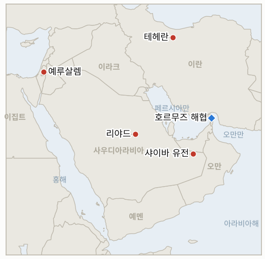

# 중동 일일 브리핑

**2026년 10월 22일**

- **보고 기간:** 약 24시간, 10월 21일 06:00 ~ 10월 22일 06:00 (한국시간)
- **종합 평가:** 아람코 샤이바 유전을 겨냥한 드론의 파편으로 외국인 노동자 2명이 숨졌고, 미국은 사우디 주재 비필수 대사관 인력과 가족에게 철수를 명령했다. 후티 공세를 장기 위협으로 보고 있음을 보여 주는 가장 분명한 신호다(§1.1). 파이낸셜타임스는 트럼프가 10월 초로 계획된 이스라엘의 공습 작전을 막았다고 보도했고, 이란은 간접 협상이 계속된다고 말하며 네타냐후는 이란 정권을 무너뜨리도록 군과 정보기관에 지시했다고 밝혔다(§1.2). 이란 관련 유조선 공격이 역대 최고 수준인데도 브렌트유는 108.82달러로 거의 움직이지 않았다(§1.3). 서울은 반등해 코스피가 반도체주 주도로 3.3% 오른 5,736을 기록했고 원화는 1,325.2원으로 강세였으며 한국은행 결정은 10월 22일이다(§1.4).

**정정 및 업데이트:** 10월 21일 브리핑(§1.3)은 예멘 샤브와주 정부군 캠프에 대한 후티 공격의 사망자를 "최소 18명"으로 적었다. 이후 실시간 보도(CBS 뉴스)는 10월 20일 기준 사망자를 73명으로 전해, 예멘 전쟁에서 가장 치명적인 단일 공격의 하나가 되었다. 또한 10월 21일 브리핑은 메타 실적을 코스피의 다음 시험대로 꼽았으나, 10월 21일 반등은 슈퍼마이크로컴퓨터의 잠정 분기 매출 190억 달러(예상 약 150억 달러)가 계기였던 것으로 전해졌다(ad-hoc-news).

---

## 1. 무슨 일이 있었나

<figure style="float:right; width:46%; margin:2pt 0 8pt 14pt;">

<figcaption style="font-size:8pt; color:#666; text-align:center; margin-top:3pt; font-style:italic;">주요 논의 지점</figcaption>
</figure>

### 1.1 샤이바를 겨냥한 드론으로 외국인 노동자 2명이 숨지고 미국은 사우디 주재 비필수 인력에 철수를 명령한다

사우디 통신(SPA)은 수요일 아침 아람코 샤이바 유전 시설을 노린 드론이 요격됐다고 밝혔고, 에너지부는 떨어진 파편으로 필리핀인과 네팔인 각 1명이 숨지고 2명이 다쳤으며 유전 운영에는 영향이 없다고 말했다([The National](https://www.thenationalnews.com/news/mena/2026/10/21/saudi-aramco-shaybah-houthi-strike/)). 발사 주체는 밝혀지지 않았으나 후티는 10월 19일 샤이바 작전을 주장한 바 있다. 로이터는 미 관리 3명을 인용해 국무부가 걸프 전역 대사관에 철수 명령을 준비 중이라고 먼저 보도했다가 이후 정정했고, 토미 피곳 대변인은 더 넓은 해석이 "부정확하다"며 명령은 사우디 주재 비필수 공무원과 가족에게만 해당한다고 밝혔다([Times of Israel](https://timesofisrael.com/liveblog-october-21-2026); [Yahoo/AP](https://www.yahoo.com/news/us/articles/us-orders-diplomats-leave-saudi-203141313.html)). **신뢰도: 요격과 사망 2명은 높음(사우디 정부 발표). 후티 소행이라는 귀속은 낮음(주장 또는 사우디 지목 없음). 철수 명령이 사우디에 한정된다는 점은 로이터 정정 이후 높음.**

### 1.2 FT는 트럼프가 이스라엘의 공습 계획을 막았다고 전하고, 이란은 간접 협상이 계속된다고 하며 네타냐후는 정권 교체를 공언한다

파이낸셜타임스는 소식통 3명을 인용해, 트럼프가 10월 10일 주말로 계획된 이란 핵 시설·발전소·정권 표적 대상의 며칠간 이스라엘 작전을 막았으며 이유는 11월 3일 중간선거로 알려졌다고 보도했다. 이스라엘 소식통들은 이를 부인하며 정치적 유출일 수 있다고 말했다([Ynet](https://www.ynetnews.com/article/hkbuyph2fx); [CBS 뉴스](https://cbsnews.com/live-updates/iran-war-trump-us-ceasefire-talks-ongoing)). 아락치는 이란의 7일 휴전 제안을 둘러싼 미국과의 간접 협상이 계속된다고 밝혔고, 네타냐후는 군과 정보기관에 이란 정권을 무너뜨리라고 지시했다고 말했다. 카타르와 파키스탄은 동결 자금 60억 달러의 이자를 이란에 주고 IAEA 방문을 허용받는 절충안을 제시했으며, 이란 안보 수장은 농축 우라늄 반출을 다시 거부했다(CBS 뉴스 실시간 보도, 10월 20일). **신뢰도: FT 보도는 중간(익명 소식통, 이스라엘이 반박). 간접 협상 지속은 중간(이란 발언, 미국 확인 없음). 카타르·파키스탄 절충안은 낮음(단일 실시간 보도).**

### 1.3 브렌트유는 108.82달러로 보합이고 호르무즈 선박 공격은 역대 최고 수준이다

블룸버그를 인용한 Rigzone에 따르면 브렌트유 12월물은 거의 변동 없는 108.82달러에 정산된 뒤 확전 우려로 정산 후 110달러 부근에서 거래됐고, WTI는 97.15달러에 정산됐다. 보도는 호르무즈 차질과 우크라이나의 러시아 정유시설 공격을 공급 압력으로 꼽았다([Rigzone](https://www.rigzone.com/news/oil_gains_after_saudi_oil_field_attack-21-oct-2026-184901-article)). 영국해상무역운영기구(UKMTO)는 10월이 3월 이후 호르무즈 선박 공격이 가장 많은 달이라고 밝혔고, 혁명수비대는 세 번째 유조선이 기뢰에 피격됐다고 주장했으나 독립적으로 확인되지 않았다(CBS 뉴스 실시간 보도). 유가는 올해 약 80% 올랐고 디젤은 더 올랐다. 호르무즈 통과 척수의 정확한 수치는 찾지 못했다. **신뢰도: 브렌트유 정산가는 높음(블룸버그, Rigzone). WTI는 중간(같은 보도의 등락률이 전일 12월물 종가와 맞지 않아 월물 교체가 왜곡했을 수 있음). 기뢰 주장은 낮음(혁명수비대 발표뿐).**

### 1.4 코스피는 반도체주 주도로 3.3% 반등한 5,736을 기록하고 한국은행은 10월 22일 결정을 발표한다

코스피는 5,666에 열려 장중 5,816까지 오른 뒤 183포인트 오른 약 5,736에 마감했고, 삼성전자는 5.7%, SK하이닉스는 5.8% 올랐으며 원화는 달러당 1,325.2원에 마감했다([ad-hoc-news](https://www.ad-hoc-news.de/boerse/news/marktberichte/kospi-gains-183-points-as-chip-rebound-lifts-shares/70383311)). 코스피200 선물이 5% 넘게 오르자 한국거래소는 오전 10시 51분 매수 사이드카를 발동했고, 상승 종목 372개 대비 하락 종목 487개로 시장 폭은 약했다. 한국은행은 10월 22일 오전 10시에 결정을 발표하며, 조사 응답자의 95%가 기준금리 3.00% 동결을 예상했다. 이 기간 중동 관련 한국 정부의 새 조치는 찾지 못했다. **신뢰도: 종가는 중간(단일 매체, 반올림 수치). 한국은행 전망은 중간(단일 조사).**

---

## 2. 심층 분석: 동기와 유인

### 2.1 워싱턴은 왜 지금 리야드 주재 인력을 빼는가?

철수 명령은 아람코 시설에서 외국인 노동자가 숨진 공세에 대한 노출을 낮추는 값싸고 되돌릴 수 있는 수단이며, 공격이 현실화될 경우 행정부를 보호한다. 리야드와 카이로에는 워싱턴이 후티 공세가 길어질 것으로 본다는 신호이기도 하다. 로이터 정정 후 명령을 사우디로 한정한 것은 중간선거 전 지역 전체의 공황 신호를 피하려는 의도를 보여 준다.

### 2.2 트럼프는 왜 이스라엘의 공습 작전을 막으려 하는가?

보도된 이유는 11월 3일 중간선거다. 전쟁 재개는 투표 직전 연료 가격과 사상자 위험을 키운다. 10월 27일 총선을 앞둔 네타냐후는 단호해 보일수록 이득이어서 정권 교체 발언의 비용이 적다. FT 보도의 유출은 양쪽 모두에 쓸모가 있다. 트럼프가 이스라엘을 제어한다는 점과 이스라엘이 행동할 태세라는 점을 함께 보여 준다.

### 2.3 이란은 왜 협상이 계속된다고 하면서 조건은 강경하게 유지하는가?

테헤란은 미국이나 이스라엘의 공격을 늦추는 채널을 열어 두는 데서 이익을 얻고, 강경파가 문제 삼을 우라늄·제재 양보는 거부한다. 카타르와 파키스탄이 절충안을 띄우게 하면 조건을 책임지지 않고 시험해 볼 수 있다.

### 2.4 폭력이 늘어도 유가는 왜 안정적인가?

공격은 확대되고 있지만 워싱턴은 걸프 물동량이 정상의 약 80%라고 계속 말하고, 펀드는 매수에 크게 쏠려 있으며, 협상 소식이 상승을 제한한다. 그 결과 호재와 악재가 대체로 상쇄되는 109달러 부근에서 가격이 묶여 있고, 위험은 양쪽으로의 급변이다.

### 2.5 서울은 왜 이렇게 크게 반등했는가?

슈퍼마이크로의 실적으로 AI 투자 우려가 누그러졌고 주간 15% 하락으로 과매도 상태였던 반도체주가 반등을 이끌었다. 사이드카 발동은 선물 거래자가 움직임을 주도했음을 보여 주고, 약한 시장 폭은 상승이 좁았다는 뜻이다. 유가와 전쟁 위험은 원인이 아니라 배경이었다.

---

## 3. 한국에 대한 정책적 시사점

**노출 현황:** 한국은 원유의 약 70.7%, LNG의 약 20.4%를 중동에서 들여온다(`instructions/korea-exposure.md`, 갱신 불필요). 최신 수치(10월 21일): 브렌트유 108.82달러, WTI 97.15달러(12월물), 코스피 약 5,736, 원화 달러당 1,325.2원. 사우디 여행경보 3단계(출국권고)는 유지되고 있으며, 미국의 철수 명령으로 한국의 상향 가능성이 커졌으나 이 기간 새 한국 발표는 찾지 못했다.

**상황별 시사점:**

- **사우디 철수 명령과 샤이바(§1.1):** 한국 원유의 약 70%가 중동산이고 사우디는 주요 공급국이므로, 외교부가 여행경보를 올리는지와 현지 건설·에너지 기업이 인력을 줄이는지 지켜봐야 한다(IND-20261022-1, IND-20261021-1).
- **이스라엘 공습 계획과 협상(§1.2):** 이스라엘과 이란의 전투가 재개되면 호르무즈가 먼저 타격받는다. 한국의 대응 수단은 외교가 아니라 비축유와 우회이므로 실질적 신호는 공개된 협상 회동이나 미국의 공습 결정이다(IND-20261022-2, IND-20261021-2).
- **유가와 호르무즈(§1.3):** 109달러 부근에 묶인 가격은 정유 마진과 수입 비용을 높게 유지하며, 위험은 112달러 상회다(IND-20261022-3, IND-20261015-3).
- **서울 시장(§1.4):** 10월 22일 한국은행 결정이 다음 시험대이며 동결은 95% 예상과 맞는다(IND-20261020-3, IND-20261021-3).

**오늘 해소된 지표:** 없음. IND-20261019-3은 세 거래일(5,768.01, 5,552.74, 약 5,736 모두 5,100 상회)이 지나 이틀이 남아 열려 있다.

**검증 가능한 지표:**

- **IND-20261022-1**(진행 중, 신규): 한국 외교부가 10월 29일경까지 사우디 여행경보를 3단계 위로 올리거나 인력 철수를 명령하면 확인, 변화가 없으면 반증.
- **IND-20261022-2**(진행 중, 신규): 10월 29일경까지 미국 또는 이스라엘의 이란 영토 공습을 어느 한쪽 정부가 인정하면 확인, 없으면 반증.
- **IND-20261022-3**(진행 중, 신규): 10월 29일경까지 브렌트유 12월물이 하루라도 112달러를 넘어 정산하면 확인, 112달러 이하에 머물면 반증.
- **IND-20261021-1**(진행 중): 사우디 당국이 10월 21일 샤이바에서 드론 요격과 사망 2명을 확인했으며 운영 영향은 없다. 10월 19일 얀부·샤이바 피해 주장은 아직 확인되지 않았다.
- **IND-20261021-3**(진행 중): 10월 22일 코스피 종가가 약 5,736을 넘으면 반등 확인, 이하이면 반증.
- **IND-20261020-2**(진행 중): 이집트 표결은 여전히 10월 26일이며 10월 27일경까지 승인되면 확인.
- **IND-20261020-3**(진행 중): 한국은행 결정은 10월 22일이며 동결이 예상된다.
- **IND-20261019-3**(진행 중): 세 거래일 모두 5,100 이상, 이틀 남음.
- **IND-20261021-2**, **IND-20261019-1**, **IND-20261020-1** 등 기존 진행 중 지표: 이란은 간접 협상을 주장하지만 공개된 회동은 없고, Kpler 주간 수치도 찾지 못했다.

---

## 4. 주시 목록

- **10월 22일 한국은행 결정과 코스피 후속 흐름(IND-20261020-3, IND-20261021-3).**
- **미국 철수 명령 이후 한국의 사우디 여행경보(IND-20261022-1).**
- **이집트의 10월 26일 표결과 샤이바 드론의 발사 주체(IND-20261020-2, IND-20261021-1).**
- **카타르·파키스탄이 중재한 미·이란 회동 공개 여부와 이스라엘의 대이란 움직임(IND-20261021-2, IND-20261022-2).**
- **워싱턴의 80% 주장에 대한 Kpler 주간 호르무즈 물동량(IND-20261020-1).**
- **10월 27일 이스라엘 총선과 11월 3일 미국 중간선거(IND-20260910-3).**

---

## 5. 출처 품질 요약

| 주장 | 출처 | 신뢰도 |
| --- | --- | --- |
| 샤이바 드론 요격, 외국인 노동자 2명 사망, 운영 영향 없음 | The National(사우디 통신, 에너지부) | 높음 |
| 샤이바 드론의 발사 주체 | 귀속 없음 | 낮음 |
| 미국 철수 명령은 사우디 주재 비필수 인력에 한정 | Times of Israel, Yahoo/AP(로이터 정정, 국무부) | 높음 |
| 트럼프가 이스라엘의 10월 공습 계획을 막음 | FT(Ynet, CBS 뉴스 경유), 이스라엘 소식통 반박 | 중간 |
| 이란 간접 협상 지속 주장, 네타냐후의 정권 교체 지시 | CBS 뉴스 실시간 보도, 폭스뉴스 | 중간 |
| 카타르·파키스탄 절충안(60억 달러 이자, IAEA 방문) | CBS 뉴스 실시간 보도 | 낮음 |
| 브렌트유 12월물 108.82달러, WTI 12월물 97.15달러 | 블룸버그(Rigzone 경유) | 높음(브렌트유), 중간(WTI) |
| 세 번째 유조선 기뢰 피격(혁명수비대), 3월 이후 최다 호르무즈 공격 | CBS 뉴스 실시간 보도(UKMTO, 혁명수비대) | 중간(UKMTO), 낮음(혁명수비대) |
| 샤브와 사망자 73명 | CBS 뉴스 실시간 보도 | 중간 |
| 코스피 약 5,736(+3.3%), 원화 1,325.2원, 사이드카 | ad-hoc-news | 중간 |
| 호르무즈 일일 통과 척수 정확치 | 보고 없음 | 보고 없음 |
