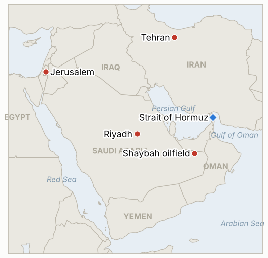

# Middle East Daily Briefing

**October 22, 2026**

- **Reporting window:** ~24 hours, October 21, 06:00 to October 22, 06:00 KST
- **Overall assessment:** A drone aimed at Aramco's Shaybah field killed two foreign workers through falling debris, and Washington ordered non-emergency embassy staff and families out of Saudi Arabia, the clearest sign yet that the Houthi campaign is being treated as a lasting threat (§1.1). The Financial Times reported that Trump blocked an Israeli strike campaign planned for early October, while Iran says indirect talks continue and Netanyahu said he directed Israel's forces to topple the Iranian regime (§1.2). Brent barely moved at $108.82 with Iran-related tanker attacks at record levels (§1.3). Seoul rebounded, with KOSPI up 3.3% to 5,736 on chip shares and the won stronger at 1,325.2, ahead of the Bank of Korea's decision on October 22 (§1.4).

**Corrections and updates:** The October 21 brief (§1.3) put the Houthi attack on a Yemeni government camp in Shabwa at "at least 18" dead. Later live coverage puts the toll at 73 as of October 20 (CBS News live blog), making it one of the deadliest single attacks of the war in Yemen. The October 21 brief also named Meta's earnings as the next test for KOSPI; the October 21 rebound was instead credited to Super Micro Computer's preliminary quarterly revenue of $19 billion against about $15 billion expected (ad-hoc-news, citing market reports).

---

## 1. What Happened

<figure style="float:right; width:46%; margin:2pt 0 8pt 14pt;">

<figcaption style="font-size:8pt; color:#666; text-align:center; margin-top:3pt; font-style:italic;">Major places of discussion</figcaption>
</figure>

### 1.1 A drone aimed at Shaybah kills two foreign workers, and the US orders non-emergency staff out of Saudi Arabia

The Saudi Press Agency said a drone targeting an Aramco facility at the Shaybah oilfield was intercepted on Wednesday morning, and the energy ministry said falling debris killed two people, a Filipino and a Nepali national, and injured two others, with no impact on field operations ([The National](https://www.thenationalnews.com/news/mena/2026/10/21/saudi-aramco-shaybah-houthi-strike/)). No group was named as the launcher, though the Houthis had claimed Shaybah operations on October 19. Reuters first reported, citing three US officials, that the State Department was preparing an ordered departure across Gulf embassies; Reuters later corrected this, and spokesman Tommy Pigott called the broader reading "inaccurate", saying the order covers only non-emergency government employees and families in Saudi Arabia ([Times of Israel live blog](https://timesofisrael.com/liveblog-october-21-2026); [Yahoo/AP](https://www.yahoo.com/news/us/articles/us-orders-diplomats-leave-saudi-203141313.html)). **Confidence: High that the interception and two deaths occurred (Saudi government statements); Low on attribution to the Houthis (no claim or Saudi attribution found); High that the departure order is Saudi only after the Reuters correction.**

### 1.2 FT says Trump blocked an Israeli strike plan, while Iran says indirect talks go on and Netanyahu vows regime change

The Financial Times, citing three people familiar, reported that Trump blocked a multi day Israeli campaign against Iranian nuclear sites, power plants and regime targets planned for the weekend of October 10, reportedly because of the November 3 midterms; Israeli sources disputed the account and suggested a political leak ([Ynet](https://www.ynetnews.com/article/hkbuyph2fx); [CBS News](https://cbsnews.com/live-updates/iran-war-trump-us-ceasefire-talks-ongoing)). Araghchi said indirect negotiations with Washington over Iran's seven day ceasefire proposal continue, while Netanyahu said he had directed the army and intelligence services to topple the Iranian regime. Qatar and Pakistan have floated a compromise that would give Iran interest on $6 billion in frozen funds in exchange for an IAEA visit, and Iran's security chief again rejected moving enriched uranium abroad (CBS News live blog, October 20). **Confidence: Medium on the FT account (anonymous sources, disputed in Israel); Medium on the ongoing indirect talks (Iranian statement, no US confirmation); Low on the Qatar and Pakistan compromise terms (single live blog).**

### 1.3 Brent is flat at $108.82 while attacks on Hormuz shipping stay at record levels

Bloomberg, relayed by Rigzone, said Brent's December contract settled little changed at $108.82, then traded near $110 after the settlement on escalation fears, while WTI settled at $97.15; the report cites Hormuz disruption and Ukrainian strikes on Russian refineries as supply pressures ([Rigzone](https://www.rigzone.com/news/oil_gains_after_saudi_oil_field_attack-21-oct-2026-184901-article)). UKMTO said October is already the worst month for attacks on Hormuz shipping since March, and the IRGC said a third tanker hit a mine, a claim not independently verified (CBS News live blog). Oil is up about 80% this year, and diesel has risen more. I found no exact Hormuz transit count. **Confidence: High on the Brent settlement (Bloomberg via Rigzone); Medium on WTI (the same report's percentage change does not match the prior day's December contract close, so contract rolls may distort it); Low on the mine claim (IRGC statement only).**

### 1.4 KOSPI rebounds 3.3% to 5,736 on chip shares, with the Bank of Korea deciding on October 22

KOSPI closed at about 5,736, up 183 points, after opening at 5,666 and touching 5,816; Samsung Electronics rose 5.7% and SK hynix 5.8%, and the won closed at 1,325.2 per dollar ([ad-hoc-news](https://www.ad-hoc-news.de/boerse/news/marktberichte/kospi-gains-183-points-as-chip-rebound-lifts-shares/70383311)). The Korea Exchange triggered a buy side sidecar at 10:51 a.m. after KOSPI 200 futures rose more than 5%, and breadth was weak, with 487 decliners against 372 advancers. The Bank of Korea announces its decision at 10:00 a.m. on October 22; a survey found 95% of respondents expected the 3.00% rate to be held. I found no new Korean government measure on the Middle East in the window. **Confidence: Medium on the close (one outlet, rounded figures); Medium on the BOK expectation (a single survey).**

---

## 2. Deep Dive: Incentives and Motives

### 2.1 Why is Washington pulling staff from Riyadh now?

An ordered departure is a cheap, reversible way to limit exposure to a campaign that has now killed foreign workers at Aramco sites, and it protects the administration if an attack lands. It also signals to Riyadh and Cairo that Washington expects the Houthi campaign to last. Narrowing the order to Saudi Arabia after the Reuters correction shows it wants to avoid a signal of region wide panic before the midterms.

### 2.2 Why would Trump block an Israeli strike campaign?

The reported reason is the November 3 midterms: renewed war risks higher fuel prices and casualties just before voting. Netanyahu faces an October 27 election and gains from looking resolute, so public talk of regime change costs him little. Leaks of the FT account serve both sides: they show Trump restraining Israel, and show Israel as ready to act.

### 2.3 Why does Iran say talks continue while hardening terms?

Tehran gains from keeping a channel open that slows a US or Israeli strike, while refusing concessions on uranium and sanctions that its hardliners would punish. Letting Qatar and Pakistan float compromises lets it test terms without owning them.

### 2.4 Why is the oil price steady despite more violence?

Attacks are escalating, but Washington keeps saying Gulf flows are near 80% of normal, funds are heavily long, and talk of talks caps rallies. The result is a price pinned near $109 where good and bad news roughly offset, with the risk skewed to jumps either way.

### 2.5 Why did Seoul rebound so sharply?

A chip led bounce followed AI spending relief from Super Micro's results, after a 15% weekly fall had left shares oversold. The sidecar trigger shows futures traders drove the move, and weak breadth means it was narrow. Oil and war risk were background, not the cause.

---

## 3. Policy Implications for South Korea

**Exposure snapshot:** South Korea draws about 70.7% of its crude and 20.4% of its LNG from the Middle East (`instructions/korea-exposure.md`, no update needed). Latest prints (October 21): Brent $108.82, WTI $97.15 (December contract), KOSPI about 5,736, won 1,325.2 per dollar. The Saudi level 3 departure recommendation stands; the US ordered departure for Saudi Arabia raises the odds of a Korean upgrade, but I found no new Korean announcement in the window.

**Implications by development:**

- **Saudi ordered departure and Shaybah (§1.1):** About 70% of Korea's crude comes from the region and Saudi Arabia is a leading supplier, so Seoul will watch whether the foreign ministry raises its travel advisory and whether Korean construction and energy firms in the kingdom pull staff (IND-20261022-1, IND-20261021-1).
- **Israeli strike plan and talks (§1.2):** A resumed Israel Iran campaign would hit Hormuz first; Korea's mitigation is stockpiles and rerouting, not diplomacy, so the practical signal is any disclosed negotiating session or a US strike decision (IND-20261022-2, IND-20261021-2).
- **Oil and Hormuz (§1.3):** A price pinned near $109 keeps refiner margins and the import bill elevated; the risk is a jump above $112 (IND-20261022-3, IND-20261015-3).
- **Seoul's markets (§1.4):** The Bank of Korea decision on October 22 is the next test; a hold fits the 95% survey expectation (IND-20261020-3, IND-20261021-3).

**Resolved today:** None. IND-20261019-3 stays open with three sessions held (5,768.01, 5,552.74 and about 5,736, all above 5,100); two remain.

**Testable indicators:**

- **IND-20261022-1** (open, new): South Korea's foreign ministry raising its Saudi Arabia travel advisory above level 3, or ordering staff departure, by ~2026-10-29 confirms; no change falsifies.
- **IND-20261022-2** (open, new): A US or Israeli strike on Iranian territory acknowledged by either government by ~2026-10-29 confirms; none falsifies.
- **IND-20261022-3** (open, new): Brent December settling above $112 on any day by ~2026-10-29 confirms; staying at or below $112 falsifies.
- **IND-20261021-1** (open): Saudi authorities confirmed a deadly drone interception at Shaybah on October 21 with no operational impact; the October 19 claims of damage at Yanbu or Shaybah remain unconfirmed.
- **IND-20261021-3** (open): KOSPI closing October 22 above about 5,736 confirms a rebound; at or below falsifies.
- **IND-20261020-2** (open): Egypt's vote is still set for October 26; approval by ~2026-10-27 confirms.
- **IND-20261020-3** (open): The Bank of Korea decision is due October 22, with a hold expected.
- **IND-20261019-3** (open): Three sessions held above 5,100; two remain.
- **IND-20261021-2**, **IND-20261019-1**, **IND-20261020-1** and other older open items (open): indirect talks are asserted by Iran but no session has been disclosed; no Kpler weekly figure found.

---

## 4. Watch List

- **Bank of Korea decision October 22 and KOSPI follow through (IND-20261020-3, IND-20261021-3).**
- **Korean advisory for Saudi Arabia after the US ordered departure (IND-20261022-1).**
- **Egypt's October 26 vote and any attribution of the Shaybah drone (IND-20261020-2, IND-20261021-1).**
- **Any disclosed Qatar or Pakistan brokered US Iran session, and any Israeli move against Iran (IND-20261021-2, IND-20261022-2).**
- **Kpler weekly Hormuz flows against Washington's 80% claim (IND-20261020-1).**
- **Israel's October 27 election and the November 3 US midterms (IND-20260910-3).**

---

## 5. Source Quality Summary

| Claim | Sources | Confidence |
| --- | --- | --- |
| Shaybah drone intercepted; two foreign workers killed; no operational impact | The National (Saudi Press Agency, energy ministry) | High |
| Launcher of the Shaybah drone | Not attributed | Low |
| US ordered departure covers non-emergency staff in Saudi Arabia only | Times of Israel live blog, Yahoo/AP (Reuters correction, State Department) | High |
| Trump blocked Israeli October strike plan | FT via Ynet, CBS News; disputed by Israeli sources | Medium |
| Iran says indirect talks continue; Netanyahu directs regime change effort | CBS News live blog, Fox News | Medium |
| Qatar Pakistan compromise ($6 billion interest, IAEA visit) | CBS News live blog | Low |
| Brent Dec $108.82; WTI Dec $97.15 | Bloomberg via Rigzone | High (Brent); Medium (WTI) |
| Third tanker hit a mine (IRGC); worst month for Hormuz attacks since March | CBS News live blog (UKMTO, IRGC) | Medium (UKMTO); Low (IRGC) |
| Shabwa toll 73 | CBS News live blog | Medium |
| KOSPI about 5,736 (+3.3%); won 1,325.2; sidecar | ad-hoc-news | Medium |
| Hormuz exact daily transit count | Not reported | Not reported |
