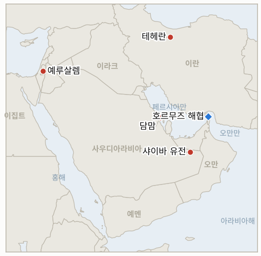
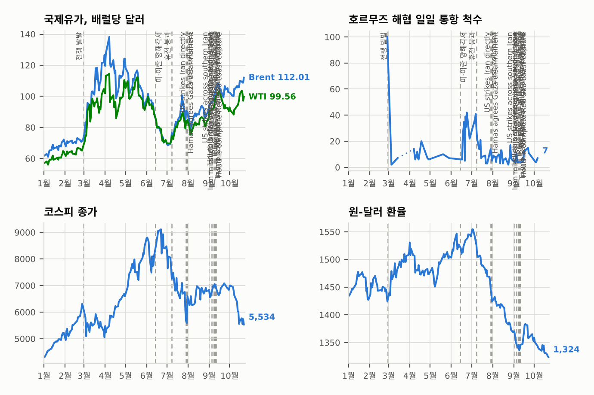

# 중동 일일 브리핑

**2026년 10월 23일**

- **보고 기간:** 약 24시간, 10월 22일 06:00 ~ 10월 23일 06:00 (한국시간)
- **종합 평가:** 후티의 사우디 공격이 샤이바 유전에 이어 담맘의 민간 공항까지 넓어졌고, 미국이 비필수 인력에 철수를 명령한 것을 시장은 공세가 장기화한다는 신호로 읽고 있다(§1.1). 뉴욕타임스는 미국과 이스라엘 군이 11월 3일 중간선거 이후 이란 공습을 재개할 구체적 계획을 마련했다고 보도했고, 이란은 워싱턴을 전혀 신뢰하지 않는다고 밝혔다(§1.2). 브렌트유는 약 3% 올라 5개월 만의 최고치인 약 112달러에 거래됐으나 정산가는 찾지 못했다(§1.3). 서울은 다시 하락해, 한국은행이 3.00%로 동결하면서 추가 인상을 시사하고 메타 실적이 AI 투자 우려를 되살리자 코스피가 3.5% 내린 5,533.77을 기록했다(§1.4).

---

## 1. 무슨 일이 있었나

<figure style="float:right; width:46%; margin:2pt 0 8pt 14pt;">

<figcaption style="font-size:8pt; color:#666; text-align:center; margin-top:3pt; font-style:italic;">주요 논의 지점</figcaption>
</figure>

### 1.1 후티의 공격이 담맘 공항에 닿고 미국은 사우디 주재 비필수 인력을 철수시킨다

사우디 민간항공 당국은 담맘 킹파흐드 국제공항 공격으로 1명이 숨지고 8명이 다쳤다고 밝혔으며, 이는 계약직 노동자 2명이 숨진 샤이바 드론 요격 몇 시간 뒤였다([FinanceFeeds](https://financefeeds.com/brent-crude-oil-price-110-houthi-shaybah-dammam-us-diplomats-leave-saudi-bull-113-bear-105/); [Business Standard](https://www.business-standard.com/amp/markets/commodities/oil-prices-rise-as-houthi-attacks-in-saudi-arabia-fuel-supply-concerns-126102200066_1.html)). 국무부는 사우디 주재 비필수 직원과 가족에게 출국을 명령했고, 관리들은 로이터에 지역 내 다른 공관의 가족도 철수시킬 것이라고 말했다. RTE는 아람코가 다흐란 본사 직원에게 대피해 원격 근무하라고 지시했다고 전했으나 다른 출처에서는 확인하지 못했다([RTE](https://www.rte.ie/news/business/2026/1022/1596480-world-oil-prices/)). **신뢰도: 담맘 사상자와 미국 철수 명령은 높음(민간항공 당국, 국무부·로이터). 다흐란 대피는 낮음(단일 보도). 담맘 공격의 주체는 낮음(언론이 후티와 연결하나 명확한 성명 없음).**

### 1.2 NYT: 미국·이스라엘이 중간선거 이후 이란 공습 재개를 계획하고 협상은 교착이다

CNBC는 뉴욕타임스를 인용해, 미국과 이스라엘 군이 11월 3일 중간선거 이후 이란을 다시 공격할 구체적 계획을 마련했고 한편 미·이란 협상단은 핵 프로그램과 해협을 둘러싼 협상을 이어 가고 있다고 전했다([CNBC](https://www.cnbc.com/2026/10/22/us-iran-trump-hormuz-.html), 제목과 요약만 확인, 본문은 열람 불가). 트럼프는 이란이 선거 전 유가를 올리려고 선박의 기뢰·발사체 피격을 꾸며 낸다고 비난했다([CBS 뉴스](https://www.cbsnews.com/live-updates/iran-war-trump-us-ceasefire-talks-ongoing/)). 이란 외무장관은 평화를 바란다는 미국의 주장을 "전혀 신뢰하지 않는다"고 썼고, 이란 대통령은 미국의 봉쇄가 계속되는 한 협상이 진전될 수 없다고 말했다([OilPrice.com](https://oilprice.com/Latest-Energy-News/World-News/Oil-Prices-Surge-Above-111-as-Houthis-Strike-Saudi-Targets.html)). **신뢰도: NYT 공습 계획은 중간(익명 취재원, 재인용). 이란 발언은 중간(단일 매체). 트럼프 비난은 중간(실시간 보도).**

### 1.3 이란 혁명수비대(IRGC)가 추가 선박 공격을 주장하는 가운데 브렌트유가 5개월 만의 최고치인 약 112달러로 뛴다

브렌트유는 오후 거래에서 3.19달러(2.9%) 올라 112.01달러였고 장중 112.68달러까지 올라 5월 18일 이후 최고치를 기록했다. WTI는 100.09달러를 찍은 뒤 99.56달러였으며, 리비아 송유관 밸브 폐쇄로 유전 두 곳의 생산이 줄어든 것도 상승에 보탬이 됐다([RTE](https://www.rte.ie/news/business/2026/1022/1596480-world-oil-prices/)). PVM의 타마스 바르가는 중간선거 전에는 긴장 완화가 없을 것으로 본다. 검색 결과에는 혁명수비대 해군이 북부 걸프와 호르무즈 서쪽에서 선박 7척을 타격했다는 주장도 있었으나 출처를 열람하지 못했고, 한 요약은 Kpler 기준 지역 물동량이 전쟁 전 수준에 가깝다고 전해 이번 주 앞서 인용된 Kpler의 하루 850만 배럴과 어긋난다. 정산가와 호르무즈 통과 척수의 정확한 수치는 찾지 못했다. **신뢰도: 장중 수준은 중간(오후 시세, 정산가 없음). 선박 7척 주장은 낮음(혁명수비대 발표, 출처 미확인). Kpler 물동량 요약은 낮음(기존 보도와 상충).**

### 1.4 한국은행이 동결하되 추가 인상 가능성을 열어 두자 코스피가 3.5% 내린 5,533.77을 기록한다

코스피는 201.89포인트(3.52%) 내린 5,533.77에 마감했고 장중 저점은 5,486이었다. 삼성전자는 4.0%, SK하이닉스는 5.5% 내렸고 하락 종목이 상승 종목을 710개 대 173개로 앞섰으며 외국인은 1,132억 원을 순매도했다([Aju Press](https://www.ajupress.com/view/20261022153542644)). 한국은행 금융통화위원회는 7월과 8월 각 0.25%포인트 인상 뒤 기준금리를 3.00%로 만장일치 동결했다. 신현송 총재는 다음 행보를 3분기 GDP와 물가에 연계했고, 위원회 전망은 0.25%포인트 추가 인상을 시사했으며, 서울경제신문 조사에서 전문가 20명 중 18명이 다음 달 인상을 예상했다([Aju Press](https://www.ajupress.com/view/20261022153542644); [InvestingLive](https://investinglive.com/central-banks/bank-of-korea-holds-rate-at-3-after-back-to-back-hikes-keeps-door-open-to-november-move/)). 증권사들은 전날 반도체주 급등 뒤의 차익 실현과 메타 실적 이후 되살아난 AI 투자 우려도 원인으로 꼽았다. 원화는 달러당 1,323.7원 부근에서 거래됐다. 이 기간 중동 관련 한국 정부의 새 조치는 찾지 못했다. **신뢰도: 코스피 종가와 한국은행 동결은 높음(여러 매체 일치). 원화는 중간(보도된 전일 대비 변동이 전일 종가와 맞지 않음). 메타 영향은 중간(증권사 해석).**

---

## 2. 심층 분석: 유인과 동기

### 2.1 후티는 왜 지금 공항과 유전으로 공격을 넓히는가?

담맘은 예멘에서 멀리 떨어진 동부 주에 있어, 이곳을 타격한 것은 국경 압박을 넘어 사정거리를 과시하는 일이다. 민간 공항 공격은 걸프 전역의 보험료와 항공사 비용을 높이고 사우디 방공망을 시험하며, 유전 공격은 유가를 밀어 올려 중간선거를 앞둔 워싱턴도 압박한다. 사우디가 본토 핵심부를 지켜야 하는 시간이 길수록 후티는 향후 협상에서 지렛대를 얻는다.

### 2.2 워싱턴과 이스라엘은 왜 11월 3일 이후로 공습을 계획하는가?

시기는 정치적이다. 투표 전 전쟁 재개는 연료 가격과 사상자 위험을 키우므로, 이후로 계획하면 비용을 먼저 치르지 않고도 선택지를 믿을 만하게 유지할 수 있다. 계획을 흘리는 것은 이 휴지기가 일시적임을 테헤란에 알려 협상 조건을 유리하게 만들려는 의도이기도 하다.

### 2.3 이란은 왜 신뢰하지 않는다고 하면서도 협상은 열어 두는가?

테헤란은 강경파를 달래려고 미국의 선의를 공개적으로 부정하면서도 공습을 늦추는 채널은 유지할 수 있다. 협상을 봉쇄 해제에 연계하는 것은 미국이 거부할 것으로 예상되는 전제 조건을 세우는 일이며, 협상이 깨질 때의 책임을 워싱턴에 돌린다.

### 2.4 유가는 왜 109달러 박스권을 벗어났는가?

담맘 공격과 철수 명령은 사우디 공세가 길어진다는 증거로 읽혔고, 리비아 생산 차질이 한계 공급을 더 조였다. 분석가들은 중간선거 때까지 높은 가격이 이어질 것으로 보며, 따라서 호재와 악재의 균형이 위험 쪽으로 기울었다. 다만 정산가를 확인하지 못한 날의 움직임이어서 돌파가 아직 확정된 것은 아니다.

### 2.5 서울은 왜 반등분을 반납했는가?

세 요인이 겹쳤다. 동결하되 인상을 시사한 중앙은행, 좁은 반도체 주도 반등 뒤의 차익 실현, 메타 실적 이후 되살아난 AI 투자 우려다. 약한 시장 폭(하락 710개 대 상승 173개)과 외국인·기관 매도에 맞선 개인 매수는 중동에 직접 반응하기보다 취약해진 시장의 모습을 보여 준다.

---

## 3. 한국에 대한 정책적 함의

**익스포저 현황:** 한국은 원유의 약 70.7%, LNG의 약 20.4%를 중동에서 들여온다(`instructions/korea-exposure.md`, 갱신 불필요). 최신 수치(10월 22일): 브렌트유 장중 약 112달러(정산가 미확인), WTI 장중 약 99.6달러, 코스피 5,533.77, 원화 달러당 약 1,323.7원. 10월 11일 발령된 사우디 여행경보 3단계(출국권고)는 유지되고 있으며, 미국의 철수 명령 이후 새 한국 발표는 찾지 못했다.

**사안별 함의:**

- **담맘과 미국 철수 명령(§1.1):** 담맘이 속한 동부 주에는 한국 건설·에너지 기업이 일하는 석유·산업 기반이 몰려 있으므로, 외교부의 경보 상향이나 기업의 인력 감축이 다음 신호다(IND-20261022-1, IND-20261023-2).
- **중간선거 이후 공습 계획(§1.2):** 호르무즈 충격의 현실적 시점이 11월 3일 이후로 옮겨 간다. 한국의 대응 수단은 외교가 아니라 비축유와 우회다(IND-20261023-3, IND-20261022-2).
- **5개월 만의 유가 고점(§1.3):** 약 112달러는 수입 비용과 정유사 부담을 높이며, 이 수준 위의 정산은 돌파를 확인해 줄 것이다(IND-20261022-3).
- **한국은행과 코스피(§1.4):** 11월 인상 가능성에 112달러 부근 유가, 약해진 증시가 겹치면 가계와 수출기업이 함께 압박받는다(IND-20261023-1).

**오늘 해소된 지표:** IND-20261020-3 **확인**(한국은행이 3.00%로 만장일치 동결). IND-20261021-3 **반증**(10월 22일 코스피 종가 5,533.77이 기준선 5,552.74와 5,736을 모두 밑돎). IND-20261015-1 **반증**(기한인 10월 22일까지 사우디가 확인한 생산·수출 차질 없음. 샤이바 가동은 영향이 없었고 다흐란 대피는 미확인). IND-20261019-3은 네 거래일(5,768.01, 5,552.74, 5,735.66, 5,533.77 모두 5,100 상회)이 지나 하루가 남아 열려 있다. IND-20261015-3(10월 22일까지 브렌트유 정산가 110달러 초과)은 검증된 정산가가 없어 열어 두며, 장중 고점 112.68달러로 보아 확인되었을 가능성이 높다.

**검증 가능한 지표:**

- **IND-20261023-1**(진행 중, 신규): 11월 한국은행 회의에서 기준금리를 3.25%로 올리면 확인, 동결하면 반증(2026년 11월 30일경까지).
- **IND-20261023-2**(진행 중, 신규): 10월 30일경까지 사우디 에너지부, 아람코 또는 독립 영상이 생산·정제·수출 시설의 가동 차질을 확인하거나 아람코가 다흐란 본사 대피를 확인하면 확인, 없으면 반증.
- **IND-20261023-3**(진행 중, 신규): 11월 6일경(중간선거 사흘 뒤)까지 미국 또는 이스라엘의 이란 핵 시설·영토 공습이 공개되면 확인, 없으면 반증.
- **IND-20261022-1**(진행 중): 10월 29일경까지 외교부가 사우디 경보를 3단계 위로 올리거나 철수를 명령하면 확인.
- **IND-20261022-2**(진행 중): 10월 29일경까지 미국 또는 이스라엘의 이란 영토 공습이 인정되면 확인.
- **IND-20261022-3**(진행 중): 10월 29일경까지 브렌트유 12월물이 112달러를 넘어 정산하면 확인. 10월 22일 장중 고점은 112.68달러였고 정산가는 알 수 없다.
- **IND-20261016-2**(진행 중): 10월 23일경까지 코스피 종가가 5,300 아래로 내려가면 확인. 10월 22일의 5,533.77은 아직 해당하지 않는다.
- **IND-20261017-2**(진행 중): 10월 19~23일 닷새 중 사흘 외국인 순매수. 10월 22일은 순매도였다.
- **IND-20261021-1**, **IND-20261020-2**, **IND-20261020-1**, **IND-20261019-1** 등 기존 진행 중 지표: 변화 없음. 이집트 표결은 10월 26일로 유지된다.

---

## 4. 관찰 목록

- **10월 23일 코스피와 11월 한국은행 회의(IND-20261019-3, IND-20261023-1).**
- **담맘 공격 이후 한국의 사우디 여행경보(IND-20261022-1).**
- **아람코 다흐란 본사와 확인된 시설 차질 여부(IND-20261023-2).**
- **112달러 상회 정산과 호르무즈 통과 척수(IND-20261022-3).**
- **이집트의 10월 26일 표결, 이스라엘의 10월 27일 총선, 11월 3일 중간선거(IND-20261020-2, IND-20260910-3).**
- **중간선거 이후 공습 계획에 관한 신호(IND-20261023-3).**

---

## 5. 출처 신뢰도 요약

| 주장 | 출처 | 신뢰도 |
| --- | --- | --- |
| 담맘 공항 공격: 1명 사망, 8명 부상 | FinanceFeeds, Business Standard(사우디 민간항공 당국) | 높음 |
| 미국이 사우디 주재 비필수 인력 철수 명령, 다른 공관 가족도 철수 | FinanceFeeds, RTE(로이터, 국무부) | 높음 |
| 아람코가 다흐란 본사 직원에게 대피 지시 | RTE | 낮음 |
| NYT: 미국·이스라엘의 중간선거 이후 대이란 공습 계획 | CNBC 제목·요약(NYT) | 중간 |
| 트럼프의 이란 선박 공격 조작 주장, 이란의 "불신"과 봉쇄 전제 조건 | CBS 뉴스 실시간 보도, OilPrice.com | 중간 |
| 브렌트유 장중 약 112.01달러(고점 112.68), WTI 99.56달러 | RTE | 중간(정산가 없음) |
| 혁명수비대의 선박 7척 타격 주장 | 검색 요약, 출처 미열람 | 낮음 |
| 코스피 5,533.77(-3.52%), 외국인 1,132억 원 순매도 | Aju Press, ad-hoc-news | 높음 |
| 한국은행 3.00% 동결·인상 시사, 전문가 20명 중 18명이 11월 인상 예상 | Aju Press, InvestingLive | 높음 |
| 원화 약 1,323.7원 | Aju Press | 중간 |
| 호르무즈 일일 통과 척수 정확치 | 보고 없음 | 보고 없음 |
