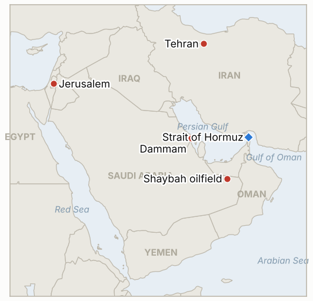

# Middle East Daily Briefing

**October 23, 2026**

- **Reporting window:** ~24 hours, October 22, 06:00 to October 23, 06:00 KST
- **Overall assessment:** Houthi attacks on Saudi Arabia widened to a civilian airport in Dammam on top of the Shaybah oilfield, and the US ordering non-emergency staff out of the kingdom is now being read by markets as a sign the campaign will last (§1.1). The New York Times reported that US and Israeli militaries have drawn up specific plans for renewed strikes on Iran after the November 3 midterms, while Iran says it has no trust in Washington (§1.2). Brent rose about 3% to roughly $112, a five month high, though I could not find the settlement (§1.3). Seoul fell back, with KOSPI down 3.5% to 5,533.77 after the Bank of Korea held at 3.00% but signaled another hike and Meta's results revived doubts about AI spending (§1.4).

---

## 1. What Happened

<figure style="float:right; width:46%; margin:2pt 0 8pt 14pt;">

<figcaption style="font-size:8pt; color:#666; text-align:center; margin-top:3pt; font-style:italic;">Major places of discussion</figcaption>
</figure>

### 1.1 Houthi strikes reach Dammam airport as the US pulls non-emergency staff from Saudi Arabia

Saudi civil aviation authorities said an attack on King Fahd International Airport in Dammam killed one person and injured eight, hours after the Shaybah drone interception that killed two contractors ([FinanceFeeds](https://financefeeds.com/brent-crude-oil-price-110-houthi-shaybah-dammam-us-diplomats-leave-saudi-bull-113-bear-105/); [Business Standard](https://www.business-standard.com/amp/markets/commodities/oil-prices-rise-as-houthi-attacks-in-saudi-arabia-fuel-supply-concerns-126102200066_1.html)). The State Department ordered non-emergency employees and their families out of Saudi Arabia, and officials told Reuters that family members will also be withdrawn from several other regional missions. RTE reported that Aramco told staff to evacuate its Dhahran headquarters and work remotely; I found no second source for that ([RTE](https://www.rte.ie/news/business/2026/1022/1596480-world-oil-prices/)). **Confidence: High on the Dammam casualties and the US departure order (civil aviation authority, State Department via Reuters); Low on the Dhahran evacuation (single report); Low on attribution of the Dammam strike, which press coverage ties to the Houthis without a clear claim.**

### 1.2 NYT: US and Israeli plans for renewed Iran strikes after the midterms, while talks stay stuck

CNBC, summarizing the New York Times, reported that the US and Israeli militaries have drawn up specific plans for renewed strikes on Iran after the November 3 midterms, while US and Iranian negotiators continue talks on the nuclear program and the strait ([CNBC](https://www.cnbc.com/2026/10/22/us-iran-trump-hormuz-.html), headline and summary only; the article body was not retrievable). Trump accused Iran of inventing mine and projectile strikes on ships to push up oil prices before the vote ([CBS News](https://www.cbsnews.com/live-updates/iran-war-trump-us-ceasefire-talks-ongoing/)). Iran's foreign minister wrote that Tehran has "no trust whatsoever" in Washington's professed wish for peace, and the Iranian president said talks cannot proceed while the US blockade continues ([OilPrice.com](https://oilprice.com/Latest-Energy-News/World-News/Oil-Prices-Surge-Above-111-as-Houthis-Strike-Saudi-Targets.html)). **Confidence: Medium on the NYT strike plans (anonymous sourcing, secondhand relay); Medium on the Iranian statements (single outlet); Medium on Trump's accusation (live blog).**

### 1.3 Brent jumps to about $112, a five month high, as the IRGC claims more ship attacks

Brent was up $3.19, or 2.9%, to $112.01 in afternoon trading and touched $112.68, its highest since May 18, while WTI rose to $99.56 after reaching $100.09; a Libyan pipeline valve closure that cut output at two oilfields added to the move ([RTE](https://www.rte.ie/news/business/2026/1022/1596480-world-oil-prices/)). PVM's Tamas Varga expects no de-escalation before the midterms. Search results also carried an IRGC Navy claim that seven vessels were hit in the northern Gulf and west of Hormuz; I could not open a source for it, and one summary said Kpler shows regional flows near pre-war levels, which conflicts with the 8.5 million bpd Kpler figure cited earlier this week. I found no settlement price and no exact Hormuz transit count. **Confidence: Medium on the intraday levels (afternoon print, no settle); Low on the seven vessel claim (IRGC statement, unopened source); Low on the Kpler flow summary (conflicts with prior reporting).**

### 1.4 KOSPI falls 3.5% to 5,533.77 as the Bank of Korea holds but keeps the door open to a hike

KOSPI closed at 5,533.77, down 201.89 points or 3.52%, with a low of 5,486; Samsung Electronics fell 4.0% and SK hynix 5.5%, decliners beat gainers 710 to 173, and foreigners net sold 113.2 billion won ([Aju Press](https://www.ajupress.com/view/20261022153542644)). The Bank of Korea's board voted unanimously to hold the base rate at 3.00% after quarter point hikes in July and August; Governor Shin Hyun-song tied the next move to third quarter GDP and prices, the board's projection implied another 25 basis point rise, and 18 of 20 economists in a Seoul Economic Daily survey expect a hike next month ([Aju Press](https://www.ajupress.com/view/20261022153542644); [InvestingLive](https://investinglive.com/central-banks/bank-of-korea-holds-rate-at-3-after-back-to-back-hikes-keeps-door-open-to-november-move/)). Brokers also pointed to profit taking after Wednesday's chip surge and renewed doubts about AI spending after Meta's results. The won traded near 1,323.7 per dollar. I found no new Korean government measure on the Middle East in the window. **Confidence: High on the KOSPI close and the BOK hold (several outlets agree); Medium on the won (stated daily change does not tie to the prior close); Medium on the Meta attribution (broker commentary).**

---

## 2. Deep Dive: Incentives and Motives

### 2.1 Why are the Houthis widening to airports and oilfields now?

Dammam sits in the Eastern Province, far from Yemen, so hitting it shows reach rather than just border pressure. Civilian airports raise insurance and airline costs across the Gulf and test Saudi air defense, while the oilfield strikes push up prices in a way that also pressures Washington before the midterms. The Houthis gain leverage in any Saudi talks the longer the kingdom must defend its heartland.

### 2.2 Why would Washington and Israel plan strikes for after November 3?

The reported timing is political. A resumed war before voting risks higher fuel prices and casualties, so planning for afterward keeps the option credible without paying the cost first. Leaking the plans also signals to Tehran that the pause is temporary, which Washington hopes improves its terms in the talks.

### 2.3 Why does Iran say it has no trust while keeping talks open?

Tehran can publicly reject Washington's good faith to satisfy hardliners and still keep a channel that slows a strike. Tying talks to the end of the blockade sets a precondition it expects the US to refuse, which keeps the blame on Washington if talks fail.

### 2.4 Why did oil break out of its $109 range?

The Dammam strike and the departure order read as proof the Saudi campaign is lasting, and a Libyan outage tightened supply at the margin. Analysts expect elevated prices until the midterms, so the earlier balance of good and bad news tipped toward risk. The move came on a day when I could not confirm the settle, so the breakout is not yet established.

### 2.5 Why did Seoul reverse the rebound?

Three forces stacked: a central bank that held but signaled a hike, profit taking after a narrow chip led bounce, and renewed doubts about AI spending after Meta's results. Weak breadth (710 decliners to 173) and domestic retail buying against foreign and institutional selling show a market that is fragile rather than reacting to the Middle East directly.

---

## 3. Policy Implications for South Korea

**Exposure snapshot:** South Korea draws about 70.7% of its crude and 20.4% of its LNG from the Middle East (`instructions/korea-exposure.md`, no update needed). Latest prints (October 22): Brent about $112 intraday (no settle found), WTI about $99.6 intraday, KOSPI 5,533.77, won about 1,323.7 per dollar. The Saudi level 3 departure recommendation from October 11 stands; I found no new Korean announcement after the US departure order.

**Implications by development:**

- **Dammam and the US departure order (§1.1):** Dammam is in Saudi Arabia's Eastern Province, home to much of the oil and industrial base where Korean construction and energy firms work, so a foreign ministry upgrade or company staff cuts are the next signals (IND-20261022-1, IND-20261023-2).
- **Post-midterm strike plans (§1.2):** The practical window for a Hormuz shock moves to after November 3; Korea's mitigation is stockpiles and rerouting, not diplomacy (IND-20261023-3, IND-20261022-2).
- **Oil at a five month high (§1.3):** About $112 raises the import bill and refiner costs, and a settle above that level would confirm the breakout (IND-20261022-3).
- **Bank of Korea and KOSPI (§1.4):** A likely November hike on top of oil near $112 and a weakening equity market squeezes households and exporters together (IND-20261023-1).

**Resolved today:** IND-20261020-3 **confirmed** (the Bank of Korea held at 3.00%, unanimously). IND-20261021-3 **falsified** (KOSPI closed October 22 at 5,533.77, below the 5,552.74 and 5,736 reference levels). IND-20261015-1 **falsified** (its October 22 deadline passed with no Saudi-confirmed disruption to production or export; Shaybah operations were unaffected, and the Dhahran evacuation is unverified). IND-20261019-3 stays open with four sessions held above 5,100 (5,768.01, 5,552.74, 5,735.66 and 5,533.77); one remains. IND-20261015-3 (Brent settle above $110 by October 22) stays open for lack of a verified settle; the intraday high of $112.68 suggests it likely confirmed.

**Testable indicators:**

- **IND-20261023-1** (open, new): The Bank of Korea raising the base rate to 3.25% at its November meeting confirms; a hold falsifies (by ~2026-11-30).
- **IND-20261023-2** (open, new): Saudi Energy Ministry, Aramco or independent imagery confirming operational disruption at a production, refining or export facility, or Aramco confirming the Dhahran headquarters evacuation, by ~2026-10-30 confirms; none falsifies.
- **IND-20261023-3** (open, new): A disclosed US or Israeli strike on Iranian nuclear sites or territory by ~2026-11-06 (three days after the midterms) confirms; none falsifies.
- **IND-20261022-1** (open): Seoul's foreign ministry raising its Saudi advisory above level 3 or ordering departure by ~2026-10-29.
- **IND-20261022-2** (open): An acknowledged US or Israeli strike on Iranian territory by ~2026-10-29.
- **IND-20261022-3** (open): A Brent December settle above $112 by ~2026-10-29. October 22's intraday high was $112.68; the settle is unknown.
- **IND-20261016-2** (open): A KOSPI close below 5,300 by ~2026-10-23 confirms; October 22's 5,533.77 does not yet.
- **IND-20261017-2** (open): Foreign net buying on three of five sessions, October 19 to 23; October 22 was net selling.
- **IND-20261021-1**, **IND-20261020-2**, **IND-20261020-1**, **IND-20261019-1** and other older open items (open): no change found; Egypt's vote remains set for October 26.

---

## 4. Watch List

- **KOSPI on October 23 and the November Bank of Korea meeting (IND-20261019-3, IND-20261023-1).**
- **Korean advisory for Saudi Arabia after the Dammam strike (IND-20261022-1).**
- **Aramco's Dhahran headquarters and any confirmed facility disruption (IND-20261023-2).**
- **Oil settle above $112 and any Hormuz transit count (IND-20261022-3).**
- **Egypt's October 26 vote, Israel's October 27 election and the November 3 midterms (IND-20261020-2, IND-20260910-3).**
- **Signals on the post-midterm strike plans (IND-20261023-3).**

---

## 5. Source Quality Summary

| Claim | Sources | Confidence |
| --- | --- | --- |
| Dammam airport attack: one killed, eight injured | FinanceFeeds, Business Standard (Saudi civil aviation authority) | High |
| US ordered non-emergency staff out of Saudi Arabia; families from other missions | FinanceFeeds, RTE (Reuters, State Department) | High |
| Aramco told Dhahran headquarters staff to evacuate | RTE | Low |
| NYT: US and Israeli plans for renewed Iran strikes after midterms | CNBC headline and summary (NYT) | Medium |
| Trump says Iran faked ship attacks; Iran "no trust" and blockade precondition | CBS News live blog, OilPrice.com | Medium |
| Brent about $112.01 intraday, high $112.68; WTI $99.56 | RTE | Medium (no settle) |
| IRGC claim of seven vessels hit | Search summary, source unopened | Low |
| KOSPI 5,533.77 (-3.52%), foreign net sell 113.2bn won | Aju Press, ad-hoc-news | High |
| BOK holds 3.00%, hike signaled, 18 of 20 economists expect November hike | Aju Press, InvestingLive | High |
| Won about 1,323.7 | Aju Press | Medium |
| Hormuz exact daily transit count | Not reported | Not reported |
