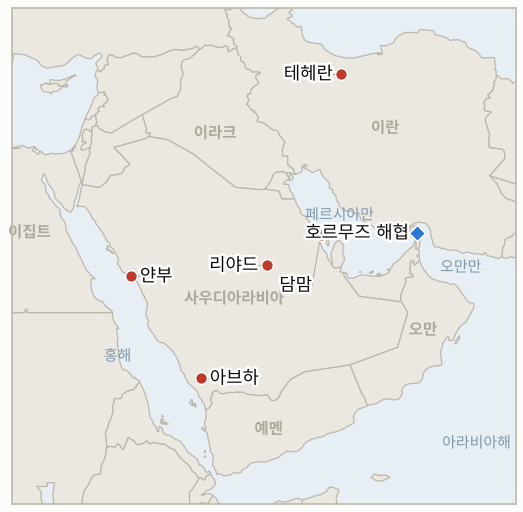

# 중동 일일 브리핑

**2026년 10월 24일**

- **보고 기간:** 약 24시간, 10월 23일 06:00 ~ 10월 24일 06:00 (한국시간)
- **종합 평가:** 후티는 48시간 동안 리야드 국방부, 담맘 공항, 얀부, 아브하 등 사우디 4곳을 공격했다고 주장했고, 아람코는 전쟁 발발 이후 처음으로 다흐란 본사를 대피시켰다(§1.1). 트럼프는 미국이 이란과 협상하지 않으며 "곧 무슨 일이 일어날 것"이라고 말했고, 혁명수비대는 미 군함이 기뢰 해역에서 선박을 호위하면 미군 기지를 공격할 수 있다고 경고했다(§1.2). 브렌트유는 5월 초 이후 최고치인 약 117달러까지 올라 3주 연속 주간 상승세를 보였으나 정산가는 확인하지 못했다(§1.3). 코스피는 장중 4% 넘게 출렁인 끝에 0.3% 오른 5,550.30에 마감했고 원화는 1,325원 부근을 지켰다(§1.4).

---

## 1. 무슨 일이 있었나

<figure style="float:right; width:46%; margin:2pt 0 8pt 14pt;">

<figcaption style="font-size:8pt; color:#666; text-align:center; margin-top:3pt; font-style:italic;">주요 논의 지점</figcaption>
</figure>

### 1.1 후티가 48시간 동안 사우디 4곳 공격을 주장하고 아람코는 다흐란 본사를 대피시킨다

후티 대변인 야히야 사리는 48시간 동안 리야드 국방부 청사, 담맘 킹파흐드 국제공항, 얀부의 아람코 시설, 아브하 국제공항을 공격했다고 밝혔으며, 담맘 공격으로 2명이 숨지고 여러 명이 다쳤다([The National](https://www.thenationalnews.com/business/energy/2026/10/23/oil-prices-rise-as-houthis-launch-another-wave-of-attacks-on-saudi-arabia/); [CBS 뉴스](https://www.cbsnews.com/live-updates/iran-war-trump-us-elections-saudi-arabia-yemen-houthis/)). The National과 걸프뉴스는 아람코가 전쟁 이후 처음으로 다흐란 본사를 대피시켰고 리야드 킹칼리드 공항은 제한적으로만 운항을 재개했다고 전했으며, 에티하드는 아부다비발 리야드·제다·담맘 노선을 10월 24일까지 취소했다([걸프뉴스](https://gulfnews.com/uae/us-israel-iran-war-updates-what-uae-residents-need-to-know-today-oct-23-2026-1.500720751)). 전날 나온 다흐란 보도는 이제 두 매체가 전하지만 어느 쪽도 아람코를 인용하지 않았고, 생산·수출 시설 피해에 대한 사우디 측 발표는 찾지 못했다. **신뢰도: 후티의 공격 주장과 담맘 사망 2명은 높음(여러 매체); 다흐란 대피는 중간(매체 2곳, 아람코 발표 없음); 각 공격이 실제로 타격한 대상은 낮음(주장 대부분 미확인).**

### 1.2 트럼프는 협상이 없으며 "곧 무슨 일이 일어날 것"이라 말하고 혁명수비대는 호위에 경고한다

트럼프는 미국이 이란을 "완전히 두들겼고" 협상은 하지 않으며 "조금 더" 나아갈 수 있다고 하면서 "곧 무슨 일이 일어날 것"이라고 말했다. 뉴욕타임스는 군의 계획이 중간선거 이후의 짧고 강도 높은 작전이며 트럼프가 아직 승인하지 않았다고 보도했다([걸프뉴스](https://gulfnews.com/uae/us-israel-iran-war-updates-what-uae-residents-need-to-know-today-oct-23-2026-1.500720751); [JPost](https://www.jpost.com/middle-east/iran-news/article-912476)). 혁명수비대는 미 해군이 "기뢰 수역"에서 호위하면 지역 내 미군 기지에 직접 대응할 수 있다고 경고했고, 이란 당국자들은 이스라엘과의 "제로 아워" 가능성을 언급했다. 혁명수비대는 유조선 4척이 기름을 옮기다 피격됐고 3척이 더 기뢰에 걸렸다고 주장했으나, 중부사령부는 미 군함이 피격되지 않았다며 해협 인근 폭발 보도를 허위라고 했다([걸프뉴스](https://gulfnews.com/uae/us-israel-iran-war-updates-what-uae-residents-need-to-know-today-oct-23-2026-1.500720751)). JPost는 파키스탄 중재 외교가 이어진다고 전해 트럼프의 발언과 엇갈린다. **신뢰도: 트럼프 발언과 NYT 계획은 중간(걸프뉴스·JPost 전재); 혁명수비대의 선박 피격 주장은 낮음(미확인, 중부사령부 부인); 협상이 진행 중인지는 낮음(출처 상충).**

### 1.3 브렌트유가 5월 초 이후 최고치인 약 117달러로 올라 3주 연속 주간 상승세를 보인다

브렌트유는 걸프 현지 저녁에 약 3.6% 올라 117.20달러였고 앞서 114.50달러 부근에서 거래됐으며, WTI는 약 103달러로 올랐다. 목요일 정산가는 이미 5월 4일 이후 최고였다([The National](https://www.thenationalnews.com/business/energy/2026/10/23/oil-prices-rise-as-houthis-launch-another-wave-of-attacks-on-saudi-arabia/)). 블룸버그 것으로 표시된 검색 요약은 브렌트유가 117달러 아래에서 정산돼 주간 6% 넘게 올랐다고 했는데 지난 금요일 정산가 109.86달러와 맞아떨어지지만 원문을 열람하지 못해 정산가는 확인되지 않았다. MUFG는 호르무즈의 생산·수출 흐름이 개전 전 수준에 가깝지만 운임은 높다고 평가했으며, 정확한 통과 척수는 찾지 못했다. 리비아 송유관 밸브 폐쇄로 일산 약 140만 배럴 규모의 생산이 줄어든 것도 상승에 보탬이 됐다. **신뢰도: 117달러 수준은 중간(단일 매체, 장중); 정산가는 낮음(요약만 확인); MUFG의 흐름 평가는 중간(이번 주 앞서 인용된 Kpler 850만 배럴과 상충).**

### 1.4 코스피가 장중 4% 넘게 빠졌다가 0.3% 반등한 5,550.30에 마감한다

코스피는 16.53포인트(0.3%) 오른 5,550.30에 마감했으며 시초가는 2.36% 낮았고 장중 최대 4.12% 하락했다. 삼성전자는 0.47% 오른 21만 5,500원, SK하이닉스는 4.42% 오른 128만 원이었다([Korea JoongAng Daily](https://www.koreajoongangdaily.com/business/kospi-closes-marginally-higher-on-bargain-hunting/12935698); [TradingKey](https://www.tradingkey.com/analysis/stocks/more/262235221-japan-korea-stocks-close-mixed-kospi-rebound-sk-hynix-samsung-kioxia-tradingkey)). 나스닥이 AI 투자 우려로 전날 2.6% 내렸고 개인은 순매수로 돌아섰으며 외국인 수급은 보도되지 않았다. 원화는 오후 3시 30분 종가 기준 달러당 1,324.6원이었다. 이 기간 중동 관련 한국 정부의 새 조치는 찾지 못했다. **신뢰도: 코스피 종가는 높음(연합뉴스 기반과 독립 출처 일치); 원화는 중간(단일 출처); 외국인 수급은 낮음(찾지 못함).**

---

## 2. 심층 분석: 유인과 동기

### 2.1 후티는 왜 네 곳을 동시에 압박하는가?

수도의 국방부, 공항 두 곳, 아람코 항구를 48시간 안에 겨냥한 것은 왕국 전역에 닿을 수 있음을 보여 주고 사우디 방공망을 넓게 분산시킨다. 민간 항공을 때릴 때마다 걸프 전역의 항공사·보험 비용이 올라, 석유 설비를 파괴하지 않고도 사우디에 경제적 압박을 줄 수 있다. 주장은 값싸고, 피해가 확인되지 않아도 이를 부풀리면 시장 효과가 커진다.

### 2.2 트럼프는 왜 협상을 부인하면서 "곧 무슨 일이 일어날 것"이라 말하는가?

공개적 모호함은 중간선거 전에 두 선택지를 모두 살려 둔다. 행동 위협은 테헤란을 압박하고, 협상 부인은 파키스탄 경로 외교가 실패해도 약해 보이지 않게 한다. 선거 이후 계획을 아직 승인하지 않았다는 보도는 이 발언이 결정이 아니라 신호임을 시사한다.

### 2.3 혁명수비대는 왜 지금 호위 경고와 선박 피격 주장을 내놓는가?

피격과 기뢰를 주장하면 해전 없이도 보험료와 위험 프리미엄이 오르고, 호위 경고는 미국이 무력으로 해협을 열지 못하게 억지하려는 시도다. 트럼프가 유가를 올리려고 주장을 꾸며 낸다고 비난한 데서 보듯, 양측 모두 이 주장을 선거 전 압박 수단으로 다룬다.

### 2.4 호르무즈 흐름이 정상에 가깝다는데 유가는 왜 계속 오르는가?

거래자들은 현재의 물량이 아니라 사우디 수출·정제 위험과 중간선거 이후 전쟁 가능성을 가격에 반영하고 있다. 흐름이 개전 전 수준에 가깝다는 MUFG의 평가는 높은 운임과 공존하므로, 프리미엄은 공급 손실이 아닌 위험에 대한 것이고 따라서 어느 방향의 소식에도 가격이 민감하다.

### 2.5 코스피는 왜 4% 하락을 되돌렸는가?

반도체 저가 매수(SK하이닉스 4.4% 상승)와 개인 매수가 나스닥 2.6% 하락에 따른 저점에서 지수를 끌어올렸다. 시장의 변동 요인이 걸프보다 AI 투자 심리임을 보여 주지만, 한국은행의 인상 시사와 117달러 유가가 완충 여력을 거의 남기지 않는다.

---

## 3. 한국에 대한 정책적 함의

**익스포저 현황:** 한국은 원유의 약 70.7%, LNG의 약 20.4%를 중동에서 들여온다(`instructions/korea-exposure.md`, 갱신 불필요). 최신 수치(10월 23일): 브렌트유 장중 약 117달러(정산가 미확인), WTI 장중 약 103달러, 코스피 5,550.30, 원화 달러당 1,324.6원. 10월 11일의 사우디 3단계 철수 권고는 유지되고 있으며, 리야드·담맘 공격 이후 한국의 새 발표는 찾지 못했다.

**사안별 함의:**

- **사우디 전역 공격과 다흐란 대피(§1.1):** 다흐란과 담맘은 한국 건설·에너지 기업이 활동하는 동부 주에 있어, 4단계 상향이나 기업의 인력 감축이 다음 신호다(IND-20261022-1, IND-20261023-2).
- **미국의 행동 가능성과 호위 경고(§1.2):** 한국의 대응은 비축과 우회이며, 미 호위 선단이나 혁명수비대의 미군 기지 공격이 주시할 확전 신호다(IND-20261024-1, IND-20261023-3).
- **브렌트유 117달러 부근(§1.3):** 1달러 오를 때마다 수입 비용과 정유사 부담이 커지며, 다음 시험대는 120달러 위 정산 여부다(IND-20261024-2).
- **코스피와 한국은행(§1.4):** 이 수준의 유가에 11월 금리 인상 가능성이 겹치면 가계와 수출기업이 함께 압박받는다(IND-20261023-1, IND-20261024-3).

**오늘 해소된 지표:** IND-20261015-3 **확인**(The National에 따르면 목요일 브렌트유 정산가가 5월 4일 이후 최고로, 지난주 109.86달러를 웃돌았다; 정확한 수치는 찾지 못함). IND-20261022-3 **확인**(브렌트유가 장중 약 117달러이고 주간 6% 넘는 상승과 117달러 아래 정산이 보도됨; 정확한 정산가 미확인). IND-20261019-3 **확인**(10월 19~23일 다섯 번의 종가가 모두 5,100 위였고 최저는 5,533.77). IND-20261016-2 **반증**(종가가 5,300 아래로 내려간 적이 없고 10월 23일 장중 저점 약 5,398도 이를 깨지 못함). IND-20261017-2 **만료**(대부분 거래일의 외국인 수급을 확인하지 못했고 10월 22일은 순매도).

**검증 가능한 지표:**

- **IND-20261024-1**(진행 중, 신규): 11월 1일경까지 중부사령부나 국방부가 호르무즈 미 해군 호위 상선단을 확인하거나 혁명수비대가 미군 기지를 공격하면 확인, 둘 다 없으면 반증.
- **IND-20261024-2**(진행 중, 신규): 10월 30일경까지 ICE 브렌트유 근월물이 120달러 위에서 정산되면 확인, 없으면 반증.
- **IND-20261024-3**(진행 중, 신규): 10월 26~30일 코스피 종가가 5,300 아래로 내려가면 확인, 없으면 반증.
- **IND-20261023-1**(진행 중): 11월 한국은행 회의에서 3.25%로 인상하면 확인, 동결하면 반증(11월 30일경까지).
- **IND-20261023-2**(진행 중): 10월 30일경까지 아람코나 에너지부가 다흐란 대피 또는 시설의 운영 차질을 확인. 이제 두 매체가 대피를 전하나 아람코의 확인은 아직 없다.
- **IND-20261023-3**(진행 중): 11월 6일경까지 미국 또는 이스라엘의 이란 영토 공습이 공개되는지.
- **IND-20261022-1**(진행 중): 10월 29일경까지 외교부가 사우디 경보를 3단계 위로 올리거나 철수를 명령하는지.
- **IND-20261022-2**(진행 중): 10월 29일경까지 미국 또는 이스라엘의 이란 영토 공습이 공식 인정되는지.
- **기존 진행 중 지표**(진행 중): 변화 없음. 이집트 투표는 10월 26일, 이스라엘 선거는 10월 27일로 유지된다.

---

## 4. 관찰 목록

- **다흐란 관련 아람코의 확인과 시설 피해 여부(IND-20261023-2).**
- **사우디 여행경보와 기업의 인력 이동(IND-20261022-1).**
- **미 호위 선단과 호르무즈에서의 혁명수비대 반응(IND-20261024-1).**
- **브렌트유 120달러 위 정산과 호르무즈 통과 척수(IND-20261024-2).**
- **코스피 5,300선과 11월 한국은행 회의(IND-20261024-3, IND-20261023-1).**
- **이집트 10월 26일 투표, 이스라엘 10월 27일 선거, 11월 3일 중간선거(IND-20261023-3).**

---

## 5. 출처 신뢰도 요약

| 주장 | 출처 | 신뢰도 |
| --- | --- | --- |
| 후티의 48시간 4곳 공격 주장, 담맘 사망 2명 | The National, CBS 뉴스 | 주장·사망은 높음, 타격 대상은 낮음 |
| 아람코가 다흐란 본사 대피 | The National, 걸프뉴스 | 중간 |
| 트럼프: 협상 없음, "곧 무슨 일"; NYT 선거 후 계획 미승인 | 걸프뉴스, JPost | 중간 |
| 혁명수비대 호위 경고, 유조선 4척·기뢰 3척 주장, 중부사령부 부인 | 걸프뉴스 | 낮음 |
| 브렌트유 장중 약 117.20달러, WTI 약 103달러 | The National | 중간(정산가 없음) |
| 브렌트유 117달러 아래 정산, 주간 6% 넘게 상승 | 블룸버그 요약, 미열람 | 낮음 |
| 호르무즈 흐름이 개전 전에 가까움 | MUFG(The National 인용) | 중간 |
| 코스피 5,550.30(+0.3%), 장중 저점 -4.12% | Korea JoongAng Daily(연합뉴스), TradingKey | 높음 |
| 원화 오후 3시 30분 1,324.6원 | Korea JoongAng Daily | 중간 |
| 외국인 순매매, 호르무즈 정확한 통과 척수 | 보고 없음 | 보고 없음 |
