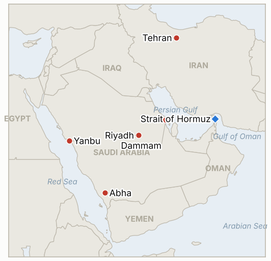

# Middle East Daily Briefing

**October 24, 2026**

- **Reporting window:** ~24 hours, October 23, 06:00 to October 24, 06:00 KST
- **Overall assessment:** The Houthis claimed four strikes on Saudi Arabia in 48 hours, reaching the defense ministry in Riyadh, Dammam airport, Yanbu and Abha, and Aramco evacuated its Dhahran headquarters for the first time in the war (§1.1). Trump said the US is not negotiating with Iran and "something will happen soon," while the IRGC threatened US bases if warships escort ships through mined waters (§1.2). Brent rose to about $117, its highest since early May, and was set for a third weekly gain, though I could not verify a settlement (§1.3). KOSPI recovered 0.3% to 5,550.30 after swinging more than 4% intraday, and the won held near 1,325 (§1.4).

---

## 1. What Happened

<figure style="float:right; width:46%; margin:2pt 0 8pt 14pt;">

<figcaption style="font-size:8pt; color:#666; text-align:center; margin-top:3pt; font-style:italic;">Major places of discussion</figcaption>
</figure>

### 1.1 Houthis claim four strikes in 48 hours across Saudi Arabia as Aramco evacuates its Dhahran headquarters

Houthi spokesman Yahya Saree listed attacks over 48 hours on the Defense Ministry headquarters in Riyadh, King Fahd International Airport in Dammam, an Aramco site in Yanbu and Abha International Airport; two people died in the Dammam attacks and several were injured ([The National](https://www.thenationalnews.com/business/energy/2026/10/23/oil-prices-rise-as-houthis-launch-another-wave-of-attacks-on-saudi-arabia/); [CBS News](https://www.cbsnews.com/live-updates/iran-war-trump-us-elections-saudi-arabia-yemen-houthis/)). The National and Gulf News both report that Aramco evacuated its Dhahran headquarters, the first such step since the war began, and Riyadh's King Khalid airport has reopened only to limited traffic; Etihad cancelled Abu Dhabi flights to Riyadh, Jeddah and Dammam through October 24 ([Gulf News](https://gulfnews.com/uae/us-israel-iran-war-updates-what-uae-residents-need-to-know-today-oct-23-2026-1.500720751)). Yesterday's Dhahran report now has a second outlet, but neither cites Aramco, and I found no Saudi statement on damage to production or export facilities. **Confidence: High that the Houthis claimed the strikes and that two died at Dammam (several outlets); Medium on the Dhahran evacuation (two outlets, no Aramco statement); Low on what each claimed strike actually hit (claims largely unverified).**

### 1.2 Trump says no talks and "something will happen soon" while the IRGC warns against US escorts

Trump said the US "knocked the hell out of" Iran, is not negotiating with it and may act "a little bit further," adding that "something will happen soon"; the New York Times reported the military plan is a short, intensive campaign after the November 3 midterms that he has not yet approved ([Gulf News](https://gulfnews.com/uae/us-israel-iran-war-updates-what-uae-residents-need-to-know-today-oct-23-2026-1.500720751); [JPost](https://www.jpost.com/middle-east/iran-news/article-912476)). The IRGC warned that US naval escorts through "mined waterways" could trigger direct action against American bases, and Iranian officials spoke of a possible "zero hour" with Israel. The IRGC also claimed four tankers hit while transferring oil and three more struck by mines; CENTCOM said no US warship was struck and called Iranian reports of explosions near the strait false ([Gulf News](https://gulfnews.com/uae/us-israel-iran-war-updates-what-uae-residents-need-to-know-today-oct-23-2026-1.500720751)). JPost says Pakistan-mediated diplomacy continues, which conflicts with Trump's statement. **Confidence: Medium on Trump's remarks and the NYT plan (relayed by Gulf News and JPost); Low on the IRGC ship claims (unverified, disputed by CENTCOM); Low on whether any talks are live (sources conflict).**

### 1.3 Brent reaches about $117, the highest since early May, on track for a third weekly gain

Brent rose about 3.6% to $117.20 in the Gulf evening after trading near $114.50 earlier, and WTI climbed to about $103; Thursday's settlement was already the highest since May 4 ([The National](https://www.thenationalnews.com/business/energy/2026/10/23/oil-prices-rise-as-houthis-launch-another-wave-of-attacks-on-saudi-arabia/)). A search snippet attributed to Bloomberg said Brent settled below $117 and gained more than 6% on the week, which fits last Friday's $109.86 settle, but I could not open it, so the settle is unverified. MUFG said Hormuz production and export flows remain close to pre-conflict levels with elevated shipping rates; I found no exact transit count. A Libyan pipeline valve closure that cut output of about 1.4 million bpd region-wide added to the move. **Confidence: Medium on the $117 level (single outlet, intraday); Low on the settle (snippet only); Medium on MUFG's flow view (conflicts with the 8.5 million bpd Kpler figure cited earlier this week).**

### 1.4 KOSPI rebounds 0.3% to 5,550.30 after an intraday plunge of more than 4%

KOSPI closed at 5,550.30, up 16.53 points or 0.3%, after opening 2.36% lower and falling as much as 4.12%; Samsung Electronics rose 0.47% to 215,500 won and SK hynix 4.42% to 1.28 million won ([Korea JoongAng Daily](https://www.koreajoongangdaily.com/business/kospi-closes-marginally-higher-on-bargain-hunting/12935698); [TradingKey](https://www.tradingkey.com/analysis/stocks/more/262235221-japan-korea-stocks-close-mixed-kospi-rebound-sk-hynix-samsung-kioxia-tradingkey)). The Nasdaq fell 2.6% overnight on AI spending worries, and retail investors turned to net buying; foreign flows were not reported. The won was at 1,324.6 per dollar at the 3:30 p.m. close. I found no new Korean government measure on the Middle East in the window. **Confidence: High on the KOSPI close (Yonhap based and independent sources agree); Medium on the won (single source); Low on foreign flows (not found).**

---

## 2. Deep Dive: Incentives and Motives

### 2.1 Why are the Houthis pressing four targets at once?

Striking the capital's defense ministry, two airports and an Aramco port in 48 hours shows they can reach the whole kingdom and forces Riyadh to spread its air defense thin. Each hit on civil aviation also raises airline and insurance costs across the Gulf, which pressures Saudi Arabia economically without needing to destroy oil capacity. Claims are cheap, and amplifying them adds to the market effect even where damage is unverified.

### 2.2 Why would Trump say "something will happen soon" while denying talks?

Public ambiguity keeps both options alive before the midterms: the threat of action pressures Tehran, while the denial of talks avoids looking weak if diplomacy through Pakistan fails. The report that he has not approved the post-midterm plan suggests the statement is signaling rather than a decision.

### 2.3 Why is the IRGC warning about escorts and claiming ship hits now?

Claiming hits and mines raises insurance and risk premiums without a naval battle, and the escort warning tries to deter the US from reopening the strait by force. Trump's charge that the claims are invented to lift oil prices shows each side treats the claims as a pre-election pressure tool.

### 2.4 Why did oil keep climbing even with Hormuz flows reportedly near normal?

Traders are pricing Saudi export and refining risk and a possible post-midterm war rather than current barrels. MUFG's view that flows are near pre-conflict levels sits beside elevated freight rates, so the premium is for risk, not lost supply, which makes the price more sensitive to headlines in either direction.

### 2.5 Why did KOSPI reverse a 4% drop?

Bargain hunting in chips (SK hynix up 4.4%) and retail buying lifted the index off a low driven by the Nasdaq's 2.6% fall. It shows the market's swing factor is AI spending sentiment more than the Gulf, though the Bank of Korea's signaled hike and oil at $117 leave little cushion.

---

## 3. Policy Implications for South Korea

**Exposure snapshot:** South Korea draws about 70.7% of its crude and 20.4% of its LNG from the Middle East (`instructions/korea-exposure.md`, no update needed). Latest prints (October 23): Brent about $117 intraday (no settle verified), WTI about $103 intraday, KOSPI 5,550.30, won 1,324.6 per dollar. The Saudi level 3 departure recommendation from October 11 stands; I found no new Korean announcement after the Dammam and Riyadh strikes.

**Implications by development:**

- **Strikes across Saudi Arabia and the Dhahran evacuation (§1.1):** Dhahran and Dammam are in the Eastern Province where Korean construction and energy firms operate, so a Level 4 upgrade or corporate staff cuts are the next signals (IND-20261022-1, IND-20261023-2).
- **Possible US action and the escort threat (§1.2):** Korea's mitigation is stockpiles and rerouting; a US escorted convoy or an IRGC attack on US bases would be the escalation to watch (IND-20261024-1, IND-20261023-3).
- **Brent near $117 (§1.3):** Each additional dollar raises the import bill and refiner costs; the next test is whether a settle above $120 follows (IND-20261024-2).
- **KOSPI and the Bank of Korea (§1.4):** Oil at this level on top of a likely November hike squeezes households and exporters together (IND-20261023-1, IND-20261024-3).

**Resolved today:** IND-20261015-3 **confirmed** (Thursday's Brent settle was the highest since May 4, above last week's $109.86, per The National; exact figure not found). IND-20261022-3 **confirmed** (Brent at about $117 intraday and a reported sub-$117 settle with a gain of more than 6% on the week; exact settle unverified). IND-20261019-3 **confirmed** (all five closes October 19 to 23 stayed above 5,100; the lowest was 5,533.77). IND-20261016-2 **falsified** (no close below 5,300; the intraday low of about 5,398 on October 23 did not breach it). IND-20261017-2 **expired** (I could not retrieve foreign flows for most sessions, and October 22 was net selling).

**Testable indicators:**

- **IND-20261024-1** (open, new): CENTCOM or the Pentagon confirming a US Navy escorted commercial convoy through Hormuz, or an IRGC attack on a US base, by ~2026-11-01 confirms; neither falsifies.
- **IND-20261024-2** (open, new): An ICE Brent front month settle above $120 by ~2026-10-30 confirms; none falsifies.
- **IND-20261024-3** (open, new): Any KOSPI close below 5,300 from October 26 to 30 confirms; none falsifies.
- **IND-20261023-1** (open): The Bank of Korea raising to 3.25% at its November meeting confirms; a hold falsifies (by ~2026-11-30).
- **IND-20261023-2** (open): Aramco or the Energy Ministry confirming the Dhahran evacuation or operational disruption at a facility by ~2026-10-30. Two outlets now report the evacuation, but there is no Aramco confirmation yet.
- **IND-20261023-3** (open): A disclosed US or Israeli strike on Iranian territory by ~2026-11-06.
- **IND-20261022-1** (open): Seoul raising its Saudi advisory above level 3 or ordering departure by ~2026-10-29.
- **IND-20261022-2** (open): An acknowledged US or Israeli strike on Iranian territory by ~2026-10-29.
- **Older open items** (open): no change found; Egypt's vote remains set for October 26 and Israel's election for October 27.

---

## 4. Watch List

- **Aramco confirmation on Dhahran and any facility damage (IND-20261023-2).**
- **Korean advisory for Saudi Arabia and corporate staff moves (IND-20261022-1).**
- **US escort convoys and IRGC reaction at Hormuz (IND-20261024-1).**
- **Brent settle above $120 and any Hormuz transit count (IND-20261024-2).**
- **KOSPI against 5,300 and the November Bank of Korea meeting (IND-20261024-3, IND-20261023-1).**
- **Egypt's October 26 vote, Israel's October 27 election and the November 3 midterms (IND-20261023-3).**

---

## 5. Source Quality Summary

| Claim | Sources | Confidence |
| --- | --- | --- |
| Houthi claims of four strikes in 48 hours; two dead at Dammam | The National, CBS News | High on claims and deaths; Low on targets hit |
| Aramco evacuated Dhahran headquarters | The National, Gulf News | Medium |
| Trump: no negotiations, "something will happen soon"; NYT post-midterm plan not approved | Gulf News, JPost | Medium |
| IRGC escort warning; four tankers and three mines claim; CENTCOM denial | Gulf News | Low |
| Brent about $117.20 intraday, WTI about $103 | The National | Medium (no settle) |
| Brent settled below $117, up more than 6% on week | Bloomberg snippet, unopened | Low |
| Hormuz flows near pre-conflict levels | MUFG via The National | Medium |
| KOSPI 5,550.30 (+0.3%), intraday low -4.12% | Korea JoongAng Daily (Yonhap), TradingKey | High |
| Won 1,324.6 at 3:30 p.m. | Korea JoongAng Daily | Medium |
| Foreign net flows; Hormuz exact transit count | Not reported | Not reported |
