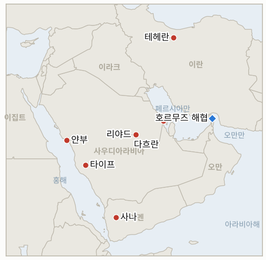

# 중동 일일 브리핑

**2026년 10월 25일**

- **보고 기간:** 약 24시간, 10월 24일 06:00 ~ 10월 25일 06:00 (한국시간)
- **종합 평가:** 이란 군 합참의장 알리 압돌라히는 미 군함을 "어떤 경우에도" 걸프에 들이지 않겠다고 밝혔다. 하루 전 톰 배럭 주튀르키예 미국 대사는 이르면 이번 주말 타격이 가능하다고 말했고, 월스트리트저널은 USS 조지 워싱턴호가 벙커버스터 폭탄으로 재무장 중이라고 보도했다(§1.1). 사우디 연합군은 타이프, 얀부, 리야드로 향한 후티 미사일을 요격하고 사나를 공습했으며, 로이터는 아람코가 다흐란 본사에 대피령을 내린 것이 맞다고 전했다(§1.2). 혁명수비대는 호르무즈에서 원유를 실은 초대형 유조선 2척이 기뢰에 피격됐다고 주장했고, 이란 당국자들은 로이터에 걸프 해저 케이블을 겨냥할 계획이 있다고 말했다(§1.3). 토요일이라 시장이 열리지 않았고, 금요일 브렌트유 정산가는 116.72달러로 확인됐다(§1.4).

**정정 및 업데이트:** 10월 24일자 브리핑은 브렌트유를 장중 약 117.20달러, WTI를 약 103달러로 제시하고 정산가는 확인하지 못했다고 했으며, 목요일 정산가가 5월 4일 이후 최고라고 적었다. 로이터가 전한 금요일 정산가는 브렌트유 116.72달러(3.55달러, 3.14% 상승, 4월 29일 이후 최고, 주간 약 6% 상승), WTI 103.27달러(3.8% 상승)다. 같은 브리핑은 다흐란 대피에 대한 통신사 보도가 없다고 했으나 이제 로이터가 이를 전한다. 다만 아람코가 논평했다는 보도는 찾지 못했다.

---

## 1. 무슨 일이 있었나

<figure style="float:right; width:46%; margin:2pt 0 8pt 14pt;">

<figcaption style="font-size:8pt; color:#666; text-align:center; margin-top:3pt; font-style:italic;">주요 논의 지점</figcaption>
</figure>

### 1.1 이란이 미 군함의 걸프 진입을 막겠다고 밝히고 미국 대사는 이번 주말 타격 가능성을 언급한다

이란 군 합참의장 알리 압돌라히는 토요일 미 군함이 "어떤 경우에도" 걸프에 들어올 수 없으며 트럼프가 "그 꿈을 무덤까지 가져갈 것"이라고 말했다고 이란 국영TV가 전했다([Gulf News](https://gulfnews.com/uae/us-israel-iran-war-what-uae-residents-need-to-know-today-october-24-2026-1.500722388)). 이에 앞서 톰 배럭 주튀르키예 미국 대사는 미국이 이르면 이번 주말 이란을 타격할 수 있다고 말했다. 월스트리트저널은 미 당국자를 인용해 USS 조지 워싱턴호가 아라비아해에서 벙커버스터 폭탄과 원거리 대지 미사일로 재무장 중이라고 보도했고, 제이 클레이턴 국가정보국장은 이란이 미국인을 겨냥한 노력을 "크게 늘렸다"고 말했다(이상 Gulf News 전언). 이는 군사 계획이 11월 3일 중간선거 이후의 작전이며 트럼프가 아직 승인하지 않았다는 뉴욕타임스 보도와 어긋난다. **신뢰도: 발언이 있었다는 점은 중간(이란 국영TV, WSJ, 배럭 발언을 한 매체가 전함); 타격이 실제로 임박했는지는 낮음(중간선거 이후 시점과 신호가 충돌).**

### 1.2 사우디 연합군이 후티 미사일을 요격하고 사나를 공습하며 로이터는 다흐란 대피를 확인한다

사우디 주도 연합군은 토요일 타이프와 얀부로 향한 후티 탄도미사일 2발을 요격했다고 밝혔다. 이에 앞서 리야드로 향한 미사일(폭발음 2회)을 요격하고 동부 주 상공에서 드론을 격추했다고 한다. 후티 운영 매체 알마시라는 사우디 공습이 사나와 인근 주를 타격해 한 공습에서 최소 3명이 숨졌고 모카에 약 20차례 공습이 있었다고 전했으나 확인되지 않았다([Gulf News](https://gulfnews.com/uae/us-israel-iran-war-what-uae-residents-need-to-know-today-october-24-2026-1.500722388)). 로이터는 아람코가 목요일 다흐란 본사에 대피령을 내렸다고 전했고, 후티가 지난달 바브엘만데브 쪽으로 이동한 뒤 교전이 격화됐다고 덧붙였다([FinanceFeeds, 로이터 인용](https://financefeeds.com/wti-crude-tops-103-and-brent-settles-at-116-72-after-houthi-strikes-on-saudi-arabia-the-oil-setup-for-fed-week/)). 사우디, 파키스탄, 이집트, 튀르키예 외교장관은 이스탄불에서 영국, 프랑스, 독일 외교장관과 이란과 예멘 문제를 논의 중이며, 이집트는 미국과 이란의 대화를 촉구하고 있다. **신뢰도: 요격과 사우디 공습이 있었다는 점은 높음(연합군 발표와 후티 매체); 다흐란 대피는 중간(2차 매체가 전한 로이터 보도, 아람코 발표 없음); 사상자 수는 낮음(후티 운영 매체).**

### 1.3 혁명수비대가 만재 초대형 유조선 2척의 기뢰 피격을 주장하고 이란은 걸프 해저 케이블 공격을 계획한다

혁명수비대는 450만 배럴 넘게 실은 초대형 유조선 2척이 금요일 호르무즈에서 기뢰에 부딪혀 항행 불능이 됐고 선원이 대피했다고 주장했으나 확인되지 않았다. 영국 해사무역기구(UKMTO)는 별도로 10월 22일 오만 리마 인근에서 미상의 발사체가 유조선을 타격했으나 선박은 항해를 계속했다고 밝혔다([Gulf News](https://gulfnews.com/uae/us-israel-iran-war-what-uae-residents-need-to-know-today-october-24-2026-1.500722388)). 이란 고위 안보 당국자 2명은 로이터에 미국과 이스라엘이 새 공격에 나서면 걸프 해저 인터넷 케이블을 겨냥할 계획을 세워 두었다고 말했다. 분석가들은 세계적 영향은 제한적일 수 있으나 걸프 지역 연결은 타격을 받을 수 있다고 본다. 유조선 기름 유출로 움 알쿠와인과 샤르자 알하므리야 해변이 폐쇄됐으나 전쟁과의 연관은 찾지 못했다. **신뢰도: 혁명수비대 기뢰 주장은 낮음(독립적 확인 없음); 케이블 계획은 중간(익명 당국자, 로이터 보도의 전언); UKMTO 사건은 중간.**

### 1.4 브렌트유 최종 정산가는 4월 29일 이후 최고인 116.72달러이며 주말 시장은 휴장했다

브렌트유는 금요일 116.72달러에 정산해 3.14% 올랐고 주간으로는 약 6% 올라 3주 연속 상승했으며, WTI는 103.27달러에 정산했다. 로이터는 후티의 사우디 공격, 다흐란 대피, 혁명수비대의 선박 피격 주장이 상승을 이끌었다고 전했다([FinanceFeeds, 로이터 인용](https://financefeeds.com/wti-crude-tops-103-and-brent-settles-at-116-72-after-houthi-strikes-on-saudi-arabia-the-oil-setup-for-fed-week/); [CNBC Africa](https://www.cnbcafrica.com/2026/brent-crude-hits-more-than-five-month-high-on-houthi-saudi-attacks-uae-oil-spill)). 토요일은 거래가 없어 코스피(5,550.30)와 원화(1,324.6원)는 금요일 종가 그대로다. 에티하드는 담맘과 리야드 노선을 11월 5일까지 취소했고, 플라이두바이는 리야드, 담맘, 아브하 노선을 10월 29일까지 취소했다. 이 기간 중동 관련 한국 정부의 새 조치는 찾지 못했다. **신뢰도: 정산가는 높음(두 매체가 재현한 로이터 수치); 한국의 새 정책은 낮음(찾지 못했으나 부재의 증거는 아님).**

---

## 2. 심층 분석: 유인과 동기

### 2.1 이란은 왜 지금 미 군함에 대해 공개적으로 선을 긋는가?

걸프를 미 군함에 닫겠다는 선언은 어떤 결정이 내려지기 전에 호위 선택지의 비용을 높이고, 주말 타격 가능성을 언급한 배럭에 억지 메시지로 답하는 효과가 있다. 또한 페제시키안이 10월 27일 푸틴과 만나기에 앞서 국내 강경파를 달래는 역할도 한다.

### 2.2 군사 계획이 중간선거 이후라는데 미국 대사는 왜 주말 타격을 거론하는가?

배럭의 발언과 조지 워싱턴호 재무장 보도는 대통령의 약속 없이 테헤란을 압박한다. 유출은 이란과 원유 시장의 반응을 떠보게 해 주지만, 타격이 없으면 신뢰를 잃는다.

### 2.3 이스탄불 회담이 열리는 가운데 후티는 왜 타이프, 얀부, 리야드를 계속 쏘는가?

외교 중에 사격을 이어가면 휴전 조건이 정해지기 전에 협상력이 커지며, 호르무즈를 우회하는 사우디 수출이 지나는 홍해 항구 얀부는 특히 중요하다. 사나와 모카에 대한 사우디의 공습은 리야드가 당분간 절제보다 압박을 택했음을 보여준다.

### 2.4 해저 케이블 계획은 왜 공개하는가?

비용이 들지 않는 위협은 걸프 금융과 데이터 거점에 대한 부담을 키워 미국과 이스라엘의 계획을 억제하며, 미군이 아니라 동맹국 경제를 겨냥한다. 로이터에 익명으로 흘리면 부인할 여지도 남는다.

### 2.5 확인되지 않은 주장이 이어진 주말에도 유가는 왜 고점 근처에서 정산했는가?

금요일 정산가에는 이미 사우디의 피해와 혁명수비대의 선박 주장이 반영됐고, 주말 시장 휴장으로 확전 소식은 월요일 장 시작에 반영된다. 이를 상쇄할 외교가 거의 없어 위험 프리미엄이 가격에 남는다.

---

## 3. 한국에 대한 정책적 함의

**익스포저 현황:** 한국은 원유의 약 70.7%, LNG의 약 20.4%를 중동에서 들여온다(`instructions/korea-exposure.md`, 갱신 불필요). 최신 수치(10월 23일 금요일, 토요일 거래 없음): 브렌트유 116.72달러, WTI 103.27달러(정산가), 코스피 5,550.30, 원화 달러당 1,324.6원이다. 10월 11일 사우디 여행경보 3단계(출국 권고)는 유지되며 새 한국 정부 발표는 찾지 못했다.

**사안별 함의:**

- **미국의 타격 신호와 이란의 걸프 선언(§1.1):** 한국에는 주말이나 주초 타격이 월요일 코스피 개장과 원화를 흔드는 것이 위험이며, 다음 정책 신호는 호르무즈 파병 결정이나 경보 변경이다(IND-20261025-1, IND-20261024-1).
- **사우디 전선과 다흐란(§1.2):** 동부 주의 한국 기업 사업장이 노출돼 있으며 4단계 상향이나 인력 감축이 뒤따를 수 있다(IND-20261022-1, IND-20261023-2).
- **기뢰와 케이블(§1.3):** 케이블 절단은 걸프 한국 건설사의 통신과 한국 해운 보험사에 타격을 주고, 유조선 피격은 운임을 올려 수입 비용을 키운다(IND-20261025-2).
- **유가 116.72달러(§1.4):** 1달러 오를 때마다 수입 부담이 커지며 다음 시험대는 120달러 초과 정산이다(IND-20261024-2). 한국은행의 인상 가능성이 부담을 더한다(IND-20261023-1).

**오늘 해소된 지표:** IND-20261009-1 **확인**(10월 23일까지 미국의 타격 공개 없음). IND-20261011-1 **반증**(미국의 후티 공습 참여를 찾지 못함). IND-20261010-3, IND-20261018-1, IND-20261004-2, IND-20260927-2 **만료**(해소 근거 보도를 찾지 못함). 이와 별도로 기한이 10월 14일까지인 오래된 지표 29건을 장부 정리에서 만료 처리했다(주간 리뷰 참조). 개별 재검증은 하지 않았다.

**검증 가능한 지표:**

- **IND-20261025-1**(신규, 진행 중): 2026-10-28경까지 미국의 이란 영토 타격이 공개되면 확인, 없으면 반증.
- **IND-20261025-2**(신규, 진행 중): 2026-11-06경까지 이란 소행으로 지목된 걸프 해저 케이블 절단 또는 지역 통신 장애가 확인되면 확인, 없으면 반증.
- **IND-20261025-3**(신규, 진행 중): 2026-10-31경까지 이스탄불 공동성명이 미국과 이란의 대화 또는 사우디와 후티의 휴전을 촉구하면 확인, 없으면 반증.
- **IND-20261024-1**(진행 중): 2026-11-01경까지 미 해군 호위 상선단의 호르무즈 통과 또는 이란 혁명수비대의 미군 기지 공격이 확인되면 확인.
- **IND-20261024-2**(진행 중): 2026-10-30경까지 브렌트유 정산가가 120달러를 넘으면 확인.
- **IND-20261024-3**(진행 중): 10월 26~30일 코스피 종가가 5,300 아래이면 확인.
- **IND-20261023-1**(진행 중): 11월 한국은행이 3.25%로 인상하면 확인, 동결하면 반증(2026-11-30경).
- **IND-20261023-2**(진행 중): 2026-10-30경까지 아람코가 다흐란 대피 또는 시설 가동 차질을 확인하면 확인. 로이터가 대피를 전했으나 아람코의 확인은 없다.
- **IND-20261023-3**(진행 중): 2026-11-06경까지 미국 또는 이스라엘의 이란 타격이 공개되면 확인.
- **IND-20261022-1**(진행 중): 2026-10-29경까지 한국 정부가 사우디 경보를 3단계 위로 올리면 확인.
- **기존 진행 중 지표**(진행 중): 변동 없음. 이집트 표결은 10월 26일, 이스라엘 총선은 10월 27일로 예정돼 있다.

---

## 4. 관찰 목록

- **월요일 장 시작: 브렌트유 120달러와 코스피 5,300선(IND-20261024-2, IND-20261024-3).**
- **배럭이 이번 주말 가능하다고 말한 미국의 이란 타격(IND-20261025-1).**
- **이스탄불 장관급 회담 결과와 10월 27일 페제시키안·푸틴 회동(IND-20261025-3).**
- **아람코의 다흐란 입장과 사우디 수출 차질(IND-20261023-2).**
- **걸프 케이블 사고(IND-20261025-2)와 호르무즈 기뢰·유조선 피격 확인.**
- **이집트의 10월 26일 표결, 이스라엘의 10월 27일 총선, 11월 3일 중간선거.**

---

## 5. 출처 신뢰도 요약

| 주장 | 출처 | 신뢰도 |
| --- | --- | --- |
| 이란: 미 군함 걸프 진입 불허; 배럭: 주말 타격 가능; WSJ의 조지 워싱턴호 보도 | Gulf News (이란 국영TV, WSJ 전언) | 중간 |
| 타이프, 얀부, 리야드 요격; 사나와 모카 사우디 공습 | Gulf News (연합군 발표, 알마시라) | 요격은 높음; 사상자는 낮음 |
| 아람코 다흐란 본사 대피령 | 로이터(FinanceFeeds 경유); Gulf News | 중간 |
| 혁명수비대: 초대형 유조선 2척(450만 배럴) 기뢰 피격 | Gulf News | 낮음 |
| 이란의 걸프 해저 케이블 공격 계획 | 로이터(Gulf News 경유) | 중간 |
| 이스탄불 외교장관 회담 | Gulf News | 중간 |
| 브렌트유 116.72달러, WTI 103.27달러 정산 | 로이터(FinanceFeeds 경유); CNBC Africa | 높음 |
| 코스피와 원화 불변(토요일) | 해당 없음, 시장 휴장 | 높음 |
| 호르무즈 정확한 통항 건수; 한국의 새 조치 | 보도 없음 | 보도 없음 |
