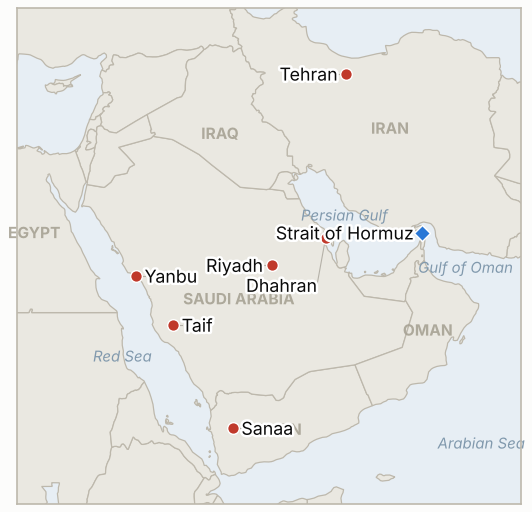

# Middle East Daily Briefing

**October 25, 2026**

- **Reporting window:** ~24 hours, October 24, 06:00 to October 25, 06:00 KST
- **Overall assessment:** Iran's armed forces chief said US warships will not be allowed into the Gulf "under any circumstances," a day after US ambassador Tom Barrack said Washington could strike as soon as this weekend and the Wall Street Journal reported the USS George Washington is being rearmed with bunker busters (§1.1). The Saudi coalition intercepted Houthi missiles aimed at Taif, Yanbu and Riyadh and struck Sanaa, and Reuters reports Aramco did order its Dhahran headquarters evacuated (§1.2). The IRGC claimed two loaded supertankers hit mines in Hormuz, and Iranian officials told Reuters they have plans to target Gulf undersea cables (§1.3). It was a Saturday, so markets were shut: the Friday Brent settle is now confirmed at $116.72 (§1.4).

**Corrections and updates:** The October 24 brief gave Brent as about $117.20 and WTI about $103 intraday with no settle verified, and said Thursday's settle was the highest since May 4. Reuters reports Friday's settles as Brent $116.72 (+$3.55, +3.14%, highest settle since April 29, about +6% on the week) and WTI $103.27 (+3.8%). The October 24 brief also said the Dhahran evacuation lacked a wire report; Reuters now carries it, though Aramco has not commented in anything I found.

---

## 1. What Happened

<figure style="float:right; width:46%; margin:2pt 0 8pt 14pt;">

<figcaption style="font-size:8pt; color:#666; text-align:center; margin-top:3pt; font-style:italic;">Major places of discussion</figcaption>
</figure>

### 1.1 Iran bars US warships from the Gulf as a US envoy says a strike could come this weekend

Iranian armed forces chief of staff Ali Abdollahi said on Saturday that US military ships would not be allowed into the Gulf "under any circumstances" and that Trump would "take that dream to his grave," per Iranian state television ([Gulf News](https://gulfnews.com/uae/us-israel-iran-war-what-uae-residents-need-to-know-today-october-24-2026-1.500722388)). That followed remarks by Tom Barrack, US ambassador to Turkey, that Washington could strike Iran as soon as this weekend. The Wall Street Journal, citing US officials, reported the USS George Washington is being rearmed in the Arabian Sea with bunker-buster bombs and standoff land-attack missiles, and national intelligence chief Jay Clayton said Iran has "substantially increased" efforts to target Americans (all relayed by Gulf News). This sits against the New York Times report that the military plan is a campaign after the November 3 midterms that Trump has not approved. **Confidence: Medium that the statements were made (single aggregator relaying Iranian TV, WSJ and Barrack); Low on whether a strike is actually imminent (signals conflict with the post-midterm timing).**

### 1.2 Saudi coalition intercepts Houthi missiles and strikes Sanaa; Reuters confirms the Dhahran evacuation

The Saudi-led coalition said it intercepted two Houthi ballistic missiles aimed at Taif and Yanbu on Saturday, after intercepting a missile aimed at Riyadh (two explosions heard) and downing a drone over the Eastern Province. The Houthi-run Al-Masirah said Saudi airstrikes hit Sanaa and its governorate, killing at least three in one strike, and about 20 strikes hit Mocha; these tolls are unconfirmed ([Gulf News](https://gulfnews.com/uae/us-israel-iran-war-what-uae-residents-need-to-know-today-october-24-2026-1.500722388)). Reuters reported that Aramco ordered its Dhahran headquarters evacuated on Thursday, as fighting intensified after the Houthis moved toward Bab el-Mandeb last month ([FinanceFeeds, citing Reuters](https://financefeeds.com/wti-crude-tops-103-and-brent-settles-at-116-72-after-houthi-strikes-on-saudi-arabia-the-oil-setup-for-fed-week/)). Foreign ministers of Saudi Arabia, Pakistan, Egypt and Turkey are meeting their UK, French and German counterparts in Istanbul on Iran and Yemen, with Egypt urging US-Iran dialogue. **Confidence: High that interceptions and Saudi strikes occurred (coalition statement plus Houthi media); Medium on the Dhahran evacuation (Reuters via a secondary outlet, no Aramco statement); Low on casualty figures (Houthi-run outlet).**

### 1.3 IRGC claims two loaded supertankers hit mines; Iran plans on Gulf undersea cables

The IRGC said two supertankers carrying more than 4.5 million barrels struck naval mines in Hormuz on Friday and were left disabled and abandoned; this is unconfirmed. UKMTO separately reported a tanker hit by an unknown projectile near Limah, Oman, on October 22 that continued its voyage ([Gulf News](https://gulfnews.com/uae/us-israel-iran-war-what-uae-residents-need-to-know-today-october-24-2026-1.500722388)). Two senior Iranian security officials told Reuters that Tehran has drawn up plans to target Gulf undersea internet cables if the US and Israel launch new attacks; analysts say global impact could be limited but Gulf connectivity could suffer. A tanker oil spill has closed beaches in Umm Al Quwain and Sharjah's Al Hamriya, with the cause not tied to the war in anything I found. **Confidence: Low on the IRGC mine claim (no independent confirmation); Medium on the cable plan (anonymous officials via Reuters, relayed); Medium on the UKMTO incident.**

### 1.4 Brent's final settle is $116.72, the highest since April 29; markets shut for the weekend

Brent settled Friday at $116.72, up 3.14% and about 6% on the week, its third straight weekly gain, and WTI settled at $103.27; Reuters tied the move to the Houthi attacks on Saudi Arabia, the Dhahran evacuation and the IRGC ship claims ([FinanceFeeds, citing Reuters](https://financefeeds.com/wti-crude-tops-103-and-brent-settles-at-116-72-after-houthi-strikes-on-saudi-arabia-the-oil-setup-for-fed-week/); [CNBC Africa](https://www.cnbcafrica.com/2026/brent-crude-hits-more-than-five-month-high-on-houthi-saudi-attacks-uae-oil-spill)). Saturday had no trading, so KOSPI (5,550.30) and the won (1,324.6) are unchanged from Friday's close. Etihad cancelled Dammam and Riyadh flights through November 5 and flydubai cancelled Riyadh, Dammam and Abha until October 29. I found no new Korean government measure on the Middle East in the window. **Confidence: High on the settles (Reuters figures reproduced by two outlets); Low on new Korean policy (nothing found, not proof of absence).**

---

## 2. Deep Dive: Incentives and Motives

### 2.1 Why does Iran draw a public line on US warships now?

Declaring the Gulf closed to US ships raises the cost of the escort option before any decision is made, and it answers Barrack's weekend remark with a deterrent statement. It also keeps Iran's domestic hardliners satisfied while Pezeshkian prepares to meet Putin on October 27.

### 2.2 Why would a US envoy float a weekend strike when the plan reportedly waits for the midterms?

Barrack's remark and the leaked rearming of the George Washington create pressure on Tehran without a presidential commitment. Leaks also let Washington test Iran's reaction and the oil market's tolerance, though they cost credibility if no strike follows.

### 2.3 Why are the Houthis still firing at Taif, Yanbu and Riyadh while talks convene in Istanbul?

Firing during diplomacy raises the Houthis' leverage before any ceasefire terms are set, and the Red Sea port of Yanbu matters because it carries Saudi exports that bypass Hormuz. Saudi strikes on Sanaa and Mocha show Riyadh is choosing pressure over restraint for now.

### 2.4 Why publicize plans against undersea cables?

A threat that costs nothing to issue deters US and Israeli planners by raising the cost of the broader campaign to Gulf finance and data hubs, and it targets allies' economies rather than US forces. Anonymous briefing to Reuters keeps deniability.

### 2.5 Why did oil settle near its high despite a weekend of unconfirmed claims?

Friday's settle already priced Saudi disruption and the IRGC ship claims, and with markets closed over the weekend any escalation lands in Monday's open. That asymmetry, with little offsetting diplomacy, keeps a risk premium in the price.

---

## 3. Policy Implications for South Korea

**Exposure snapshot:** South Korea draws about 70.7% of its crude and 20.4% of its LNG from the Middle East (`instructions/korea-exposure.md`, no update needed). Latest prints (Friday October 23, no trading Saturday): Brent $116.72 and WTI $103.27 settles, KOSPI 5,550.30, won 1,324.6 per dollar. The Saudi level 3 departure recommendation from October 11 stands; I found no new Korean announcement.

**Implications by development:**

- **US strike signals and Iran's Gulf line (§1.1):** The risk for Korea is a strike over the weekend or early in the week hitting Monday's KOSPI open and the won; the next policy signals are a Hormuz deployment decision or an advisory change (IND-20261025-1, IND-20261024-1).
- **Saudi front and Dhahran (§1.2):** Eastern Province operations of Korean firms are exposed; a Level 4 upgrade or staff cuts would follow (IND-20261022-1, IND-20261023-2).
- **Mines and cables (§1.3):** A cable cut would hit Gulf-based Korean contractors' communications and Korean shipping insurers; mined tankers would raise tanker rates and hence import costs (IND-20261025-2).
- **Oil at $116.72 (§1.4):** Each additional dollar raises the import bill; a settle above $120 is the next test (IND-20261024-2), and the Bank of Korea's likely hike compounds it (IND-20261023-1).

**Resolved today:** IND-20261009-1 **confirmed** (no disclosed US strike through October 23). IND-20261011-1 **falsified** (no US participation in strikes on the Houthis found). IND-20261010-3, IND-20261018-1, IND-20261004-2 and IND-20260927-2 **expired** (no resolving report found). In addition, 29 stale indicators with deadlines through October 14 were expired in a ledger cleanup (see the weekly review); they were not individually re-verified.

**Testable indicators:**

- **IND-20261025-1** (open, new): A disclosed US strike on Iranian territory by ~2026-10-28 confirms; none falsifies.
- **IND-20261025-2** (open, new): A confirmed Gulf undersea cable cut or regional outage attributed to Iran by ~2026-11-06 confirms; none falsifies.
- **IND-20261025-3** (open, new): An Istanbul joint statement calling for US-Iran talks or a Saudi-Houthi ceasefire by ~2026-10-31 confirms; none falsifies.
- **IND-20261024-1** (open): A confirmed US Navy escorted convoy through Hormuz, or an IRGC attack on a US base, by ~2026-11-01.
- **IND-20261024-2** (open): A Brent settle above $120 by ~2026-10-30.
- **IND-20261024-3** (open): Any KOSPI close below 5,300 from October 26 to 30.
- **IND-20261023-1** (open): The Bank of Korea hiking to 3.25% in November confirms; a hold falsifies (by ~2026-11-30).
- **IND-20261023-2** (open): Aramco confirming the Dhahran evacuation or a facility disruption by ~2026-10-30; Reuters now reports the evacuation but Aramco has not confirmed.
- **IND-20261023-3** (open): A disclosed US or Israeli strike on Iran by ~2026-11-06.
- **IND-20261022-1** (open): Seoul raising its Saudi advisory above level 3 by ~2026-10-29.
- **Older open items** (open): no change found; Egypt's vote is expected October 26 and Israel's election is October 27.

---

## 4. Watch List

- **Monday's open: Brent against $120 and KOSPI against 5,300 (IND-20261024-2, IND-20261024-3).**
- **A US strike on Iran, which Barrack said could come this weekend (IND-20261025-1).**
- **Istanbul ministerial outcome and Pezeshkian's October 27 meeting with Putin (IND-20261025-3).**
- **Aramco on Dhahran and any Saudi export disruption (IND-20261023-2).**
- **Gulf cable incidents (IND-20261025-2) and Hormuz mine or tanker confirmations.**
- **Egypt's October 26 vote, Israel's October 27 election and the November 3 midterms.**

---

## 5. Source Quality Summary

| Claim | Sources | Confidence |
| --- | --- | --- |
| Iran: no US warships in Gulf; Barrack: strike possible this weekend; WSJ on USS George Washington | Gulf News (relaying Iranian TV, WSJ) | Medium |
| Saudi interceptions at Taif, Yanbu, Riyadh; Saudi strikes on Sanaa and Mocha | Gulf News (coalition statement, Al-Masirah) | High on interceptions; Low on tolls |
| Aramco ordered Dhahran HQ evacuated | Reuters via FinanceFeeds; Gulf News | Medium |
| IRGC: two supertankers (4.5m barrels) mined | Gulf News | Low |
| Iranian plans to target Gulf undersea cables | Reuters via Gulf News | Medium |
| Istanbul foreign ministers' meeting | Gulf News | Medium |
| Brent $116.72, WTI $103.27 settles | Reuters via FinanceFeeds; CNBC Africa | High |
| KOSPI and won unchanged (Saturday) | Not applicable, markets closed | High |
| Hormuz exact transit count; new Korean measures | Not reported | Not reported |
