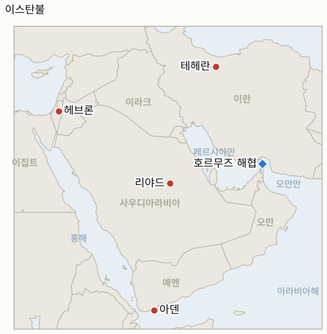

# 중동 일일 브리핑

**2026년 10월 26일**

- **보고 기간:** 약 24시간, 10월 25일 06:00 ~ 10월 26일 06:00 (한국시간)
- **종합 평가:** 트럼프는 이란에 "또 한 번의 작은 에픽 퓨리"를 할 수 있다고 말했지만 일요일 타격은 없다고 밝혔고, 이란은 군을 경계태세에 두었으며 당국자들은 자동 보복 체계인 "데드핸드" 독트린을 언급했다(§1.1). 후티는 사우디를 계속 공격하고 아덴 공항을 타격했으며 리야드 공항은 재개됐다(§1.2). 지난 브리핑이 예정된 것으로 묘사한 이스탄불 장관급 회의는 금요일에 열려 이란에 대한 새 공격보다 외교를 지지했다(§1.3). 이스라엘은 총선 하루 전 헤브론 공격 뒤 서안지구를 봉쇄했다(§1.4). 일요일 상황은 확인 가능한 보도가 적었고 시장도 휴장이어서 금요일 수치가 그대로 유지된다(§3).

**정정 및 업데이트:** 10월 25일자 브리핑(§1.2, §5)은 이스탄불 외교장관 회의를 진행 중이거나 예정된 것처럼 묘사했다. 알자지라, 사우디 가제트, 이집트투데이는 이 회의가 10월 23일 금요일에 열렸고 영국, 프랑스, 독일 외에 이탈리아도 참석했으며 미국과 이란은 참가하지 않았다고 전한다.

---

## 1. 무슨 일이 있었나

<figure style="float:right; width:46%; margin:2pt 0 8pt 14pt;">

<figcaption style="font-size:8pt; color:#666; text-align:center; margin-top:3pt; font-style:italic;">주요 논의 지점</figcaption>
</figure>

### 1.1 트럼프는 일요일 타격을 보류하되 "또 한 번의 작은 에픽 퓨리"를 열어 두고 이란은 경계태세에 들어간다

트럼프는 금요일 플로리다 유세에서 "또 한 번의 작은 에픽 퓨리를 할 수도 있다"고 말했으나 자세히 설명하지 않았다([Times of Israel](https://www.timesofisrael.com/liveblog_entry/trump-says-us-may-do-another-little-epic-fury-against-iran/)). 토요일에는 기자들에게 합의 가능성이 여전히 있다고 말했고, 해상 봉쇄가 100일간 이란의 석유 수입을 250억 달러 넘게 줄였다고 밝혔으며, 이란이 중간선거 전에 유가를 올리려고 선박 사건을 꾸민다고 비난했다([The Week](https://www.theweek.in/news/middle-east/2026/10/25/us-warns-of-imminent-air-strikes-on-iran-as-middle-east-tensions-reach-boiling-point.html)). 10월 25일자 타임스 오브 이스라엘 제목은 그가 미국이 그날 이란을 타격하지 않을 것이라고 말했다고 전한다. 이란군은 경계태세에 들어갔고, 혁명수비대는 제한적 타격에도 몇 배 큰 대응을 하겠다고 경고했으며, 이란 매체들은 국가 지도부가 타격당하면 31개 모든 주에서 지휘부가 지역 목표물을 공격하는 "데드핸드" 독트린을 언급했다([Al Jazeera](https://www.aljazeera.com/news/2026/10/24/iran-says-wont-allow-us-warships-to-get-close-as-trump-ponders-new-attacks); The Week). **신뢰도: 트럼프 발언은 중간(로이터와 타임스 오브 이스라엘, '오늘은 아니다'는 제목만 확인); 이란 발언은 중간(국영 성향 매체 전언); 타격이 임박했는지는 낮음(뉴욕타임스가 전한 중간선거 이후 시점과 신호가 충돌).**

### 1.2 후티가 사우디를 계속 공격하고 아덴 공항을 타격하는 가운데 리야드 공항이 재개된다

일요일 사우디 주도 연합군은 방공망이 리야드로 향한 탄도미사일을 파괴했다고 밝혔다. 후티 공격으로 2주간 폐쇄됐던 리야드 공항은 그날 재개될 예정이었으나 후티 대변인 야히야 사리는 이곳이 "안전하지 않으며" "군사 목표"라고 주장했다([Al Jazeera](https://www.aljazeera.com/news/2026/10/24/houthis-launch-attacks-on-saudi-arabia-and-yemens-aden)). 예멘 교통부는 탄도미사일 2발이 아덴 공항을 타격했으며 이달 들어 네 번째라고 밝혔고, 해안경비대 본부도 피격됐다. 사우디 민방위는 메카와 메디나로 향한 미사일을 요격했다고 밝혔으나 후티는 이를 "거대한 거짓말"이라며 공항, 석유 시설, 공군기지를 겨냥했다고 주장했다. 2차 매체는 연합군이 사우디 남부로 향한 탄도미사일 10발, 순항미사일 1발, 드론 2기를 추가로 격추했다고 전하나 다른 곳에서 확인하지 못했다([Profile News](https://www.profilenews.com/en/houthi-missile-attacks/)). 알마시라와 예멘군이 밝힌 사상자와 전과(작전 700건, 병력 300명)는 확인되지 않았다. **신뢰도: 공격과 요격이 있었다는 점은 높음(연합군과 예멘 정부 발표); 메카·메디나 주장과 사상자 수치는 낮음; 미사일 10발은 낮음(단일 2차 매체).**

### 1.3 이스탄불 장관들이 금요일 외교를 지지했고 미국도 이란도 자리하지 않았다

튀르키예 외교장관 하칸 피단은 참가국 어느 곳도 이란에 대한 추가 군사 개입을 승인하지 않는다고 말했다([Al Jazeera](https://www.aljazeera.com/news/2026/10/23/european-middle-east-ministers-urge-us-iran-diplomacy-not-new-attacks)). 참가국들은 6월 이슬라마바드 양해각서를 지지하고 호르무즈 통항의 제약 없는 보장을 촉구했다. 지역 4개국(사우디, 튀르키예, 이집트, 파키스탄)은 별도로 이스라엘의 점령이 "지역 불안정의 근본 원인"이라고 규정하고 후티의 "용납할 수 없는 확전"을 규탄하며 정치 절차로 돌아오라고 촉구했다([EgyptToday](https://egypttoday.com/Article/1/150237/R4-ministers-blame-Israeli-occupation-for-regional-instability-condemn-Houthi)). 튀르키예 보도에 따르면 앙카라는 방위 협정에 따라 자국 병력이 후티와 교전하는 일은 없을 것으로 본다([The National](https://www.thenationalnews.com/news/2026/10/24/turkey-rules-out-combat-with-houthis-under-defence-pact-as-foreign-ministers-meet-in-istanbul/)). **신뢰도: 회의와 성명이 있었다는 점은 높음(복수 매체); 실질적 무게는 중간(분쟁 당사자 두 곳이 불참).**

### 1.4 이스라엘이 총선 하루 전 헤브론 공격 뒤 서안지구를 봉쇄한다

네타냐후는 헤브론 인근 팔레스타인인 공격 뒤 점령 서안지구 봉쇄를 명령했다. 알자지라는 병사 2명이 숨졌다고 전하고, CBN은 5명이 다쳤고 2명이 중상이며 총격범 2명이 사살됐다고 전한다([Al Jazeera](https://www.aljazeera.com/news/2026/10/24/iran-says-wont-allow-us-warships-to-get-close-as-trump-ponders-new-attacks); [CBN](https://cbn.com/news/israel/us-israel-strategize-against-iran-weapons-advances-pm-closes-west-bank-after-pre)). 이스라엘은 10월 27일 투표하며, The Week는 에얄 자미르 참모총장이 총선 전 타격은 작전상 필요하지 않다고 비공개로 말했다고 전한다. **신뢰도: 공격과 봉쇄가 있었다는 점은 중간; 사상자 수는 낮음(출처 간 불일치).**

---

## 2. 심층 분석: 유인과 동기

### 2.1 트럼프는 왜 "또 한 번의 작은 에픽 퓨리"와 "오늘은 아니다"를 동시에 말하는가?

타격 가능성을 신뢰성 있게 유지하면 봉쇄와 함께 압박이 지속되고, 타격을 보류하면 중간선거 이후라는 일정을 지키며 11월 3일 직전의 유가 급등을 피할 수 있다. 이란이 유가를 올리려고 사건을 꾸민다는 주장은 가격 상승의 책임을 트럼프가 아니라 테헤란에 돌리는 틀이기도 하다.

### 2.2 이란은 왜 지금 "데드핸드" 독트린을 내세우는가?

이 독트린은 지도부 제거 공포에 대한 답으로, 모든 주에서 보복하겠다고 약속해 지도부 타격을 억지한다. 국영 성향 매체를 통한 공개는 비용이 들지 않으면서 트럼프가 방금 언급한 선택지의 대가를 높인다.

### 2.3 후티는 왜 리야드와 아덴의 공항을 계속 노리는가?

공항은 눈에 띄고 상징적이며 타격 비용이 낮고, 폐쇄될 때마다 리야드와 예멘 정부에 경제적 비용이 생긴다. 재개된 리야드 공항을 "군사 목표"라고 한 사리의 경고는 중재가 진행되는 동안에도 그 비용을 계속 부과하겠다는 신호다.

### 2.4 이스탄불 장관들은 왜 미국과 이란을 배제했는가?

지역과 유럽 국가들은 어느 교전 당사자도 하지 않을 말, 즉 새 공격 반대와 호르무즈 자유 통항 촉구를 할 수 있는 무대를 원한다. 튀르키예와 이집트는 후티에 병력을 투입하는 약속도 피하므로, 이 회의는 확전이 아니라 외교를 사 오는 장치다.

### 2.5 이스라엘은 왜 총선 전날 서안지구를 봉쇄하는가?

유권자를 마주한 정부에게 안보 대응은 정치적으로 비용이 낮고, 출처 간 사상자 수 논란과 무관하게 통제력을 보여 준다. 타격설이 도는 동안 국내 관심을 안보에 묶어 두는 효과도 있다.

---

## 3. 대한민국 정책적 함의

**노출도 개요:** 한국은 원유의 약 70.7%, LNG의 약 20.4%를 중동에서 들여온다(`instructions/korea-exposure.md`, 갱신 불필요). 보고 기간에 거래일이 없어 최신 수치는 여전히 10월 23일 금요일 기준이다. 브렌트유 정산가 116.72달러, WTI 103.27달러, 코스피 5,550.30, 원/달러 1,324.6원이다. 월요일 코스피 거래는 이 브리핑 이후 마감한다. 이번 주에는 10월 27~28일 연준 회의, 28일 SK하이닉스 실적, 29일 삼성전자 실적이 있다. 이 기간 중동 관련 한국 정부의 새 조치는 찾지 못했다.

**전개별 함의:**

- **타격 신호(§1.1):** 위험은 거래가 얇은 월요일 장에 타격이나 호위 결정이 나오는 것이며, 관찰 대상은 실제 타격(IND-20261025-1)과 가능성을 낮출 협상 개최(IND-20261026-1)다.
- **사우디 전선(§1.2):** 동부 주의 한국 기업은 공항 폐쇄와 항공편 취소에 계속 노출되며, 정부의 여행경보 상향이 다음 신호다(IND-20261022-1).
- **외교(§1.3):** 호르무즈 자유 통항 촉구는 한국 해운 이익에 부합하나 집행력이 없으며, 실질 시험대는 주간 공격 건수다(IND-20261026-3).
- **원화와 유가(§3):** 브렌트유가 116.72달러인데도 원화는 2년 내 최고 부근이다. 1,350원 초과 마감은 이탈 신호이고(IND-20261026-2), 브렌트유 정산가 120달러 초과는 수입 부담을 더한다(IND-20261024-2).

**오늘 종결:** IND-20261025-3 **확인**(이스탄불 회의가 후티에 정치 절차 복귀를 촉구했으나 날짜는 10월 23일이었다).

**검증 가능한 지표:**

- **IND-20261026-1**(진행 중, 신규): 2026-10-31경까지 미국과 이란의 협상 개최가 직접이든 중재든 공개되면 확인, 없으면 반증.
- **IND-20261026-2**(진행 중, 신규): 10월 26~30일 원/달러 종가가 1,350원을 넘으면 확인, 없으면 반증.
- **IND-20261026-3**(진행 중, 신규): 10월 24~30일 UKMTO 집계가 10건 이상이면 기록적 속도 유지로 확인, 미만이면 반증(2026-11-01경까지).
- **IND-20261025-1**(진행 중): 2026-10-28경까지 이란 영토에 대한 미국의 타격이 공개되는지.
- **IND-20261025-2**(진행 중): 2026-11-06경까지 이란의 소행으로 지목된 걸프 해저 케이블 절단이 확인되는지.
- **IND-20261024-1**(진행 중): 2026-11-01경까지 미 해군 호위 선단의 호르무즈 통과 또는 혁명수비대의 미군 기지 공격이 확인되는지.
- **IND-20261024-2**(진행 중): 2026-10-30경까지 브렌트유 정산가가 120달러를 넘는지.
- **IND-20261024-3**(진행 중): 10월 26~30일 코스피 종가가 5,300 아래로 내려가는지.
- **IND-20261022-1**(진행 중): 2026-10-29경까지 정부가 사우디 여행경보를 3단계 위로 올리는지.
- **그 밖의 진행 중 항목**(진행 중): 이집트 의회가 10월 26일 표결할 예정이었으나(IND-20261020-2, IND-20261018-2) 결과는 확인하지 못했다. 이스라엘 총선은 10월 27일이다.

---

## 4. 주시 목록

- **10월 26일 이집트 의회의 사우디 군사 지원 표결(IND-20261020-2).**
- **10월 27일 이스라엘 총선과 10월 28일(미국 시간) 연준 결정.**
- **10월 27일 페제시키안·푸틴 회담.**
- **월요일 코스피 5,300과 원/달러 1,350원 수준(IND-20261024-3, IND-20261026-2).**
- **미국의 타격 또는 협상 개최(IND-20261025-1, IND-20261026-1).**
- **다흐란에 대한 아람코 입장과 사우디 수출 차질(IND-20261023-2).**

---

## 5. 출처 품질 요약

| 주장 | 출처 | 신뢰도 |
| --- | --- | --- |
| 트럼프: "또 한 번의 작은 에픽 퓨리", 봉쇄로 이란 250억 달러 손실 | Times of Israel(로이터), The Week | 중간 |
| 트럼프: 일요일 이란 타격 없음 | Times of Israel 제목만 | 낮음 |
| 이란의 경계태세와 데드핸드 독트린 | Al Jazeera, The Week | 중간 |
| 리야드행 미사일 파괴, 아덴 공항 피격, 리야드 공항 재개 | Al Jazeera | 높음 |
| 사우디 남부로 향한 미사일 10발 | Profile News | 낮음 |
| 이스탄불 회의(10월 23일)와 R4 성명 | Al Jazeera, EgyptToday, The National | 높음 |
| 헤브론 공격과 서안지구 봉쇄, 사상자 | Al Jazeera, CBN | 중간; 사상자는 낮음 |
| 브렌트유 116.72달러, WTI 103.27달러, 코스피, 원화(금요일) | 이전 브리핑(FinanceFeeds 인용 로이터) | 높음 |
| 이집트 표결 결과, 호르무즈 통항 건수, 한국의 새 조치 | 보도 없음 | 보도 없음 |
