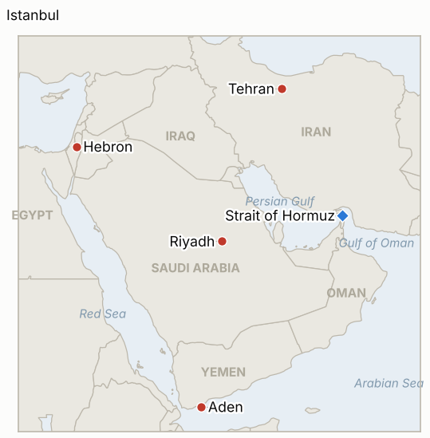

# Middle East Daily Briefing

**October 26, 2026**

- **Reporting window:** ~24 hours, October 25, 06:00 to October 26, 06:00 KST
- **Overall assessment:** Trump said the US "may do another little Epic Fury" against Iran but would not strike on Sunday, while Iran put its forces on alert and its officials pointed to a "dead hand" doctrine of automatic retaliation (§1.1). The Houthis kept firing at Saudi Arabia and hit Aden airport as Riyadh's airport reopened (§1.2). The Istanbul ministerial that the last brief described as upcoming took place on Friday and backed diplomacy over a new attack on Iran (§1.3). Israel locked down the West Bank after a Hebron attack, a day before its election (§1.4). Coverage of Sunday itself was thin in what I could retrieve, and markets were closed, so the Friday figures stand (§3).

**Corrections and updates:** The October 25 brief (§1.2, §5) described the Istanbul foreign ministers' meeting as under way or pending. Al Jazeera, Saudi Gazette and EgyptToday date it Friday October 23, with Italy also attending alongside the UK, France and Germany; neither the US nor Iran took part.

---

## 1. What Happened

<figure style="float:right; width:46%; margin:2pt 0 8pt 14pt;">

<figcaption style="font-size:8pt; color:#666; text-align:center; margin-top:3pt; font-style:italic;">Major places of discussion</figcaption>
</figure>

### 1.1 Trump holds off a Sunday strike but keeps "another little Epic Fury" open; Iran goes on alert

At a Florida rally on Friday Trump said "we may do another little Epic Fury," without elaborating ([Times of Israel](https://www.timesofisrael.com/liveblog_entry/trump-says-us-may-do-another-little-epic-fury-against-iran/)). On Saturday he told reporters a settlement was still possible, said the naval blockade had cost Iran more than $25 billion in oil revenue over 100 days, and accused Iran of staging ship incidents to lift prices before the midterms ([The Week](https://www.theweek.in/news/middle-east/2026/10/25/us-warns-of-imminent-air-strikes-on-iran-as-middle-east-tensions-reach-boiling-point.html)). A Times of Israel headline dated October 25 reports that he said the US would not strike Iran that day. Iran's forces were placed on alert, the IRGC warned that even a limited strike would draw a response several times larger, and Iranian media said a "dead hand" doctrine would let commands in all 31 provinces hit regional targets if national leadership were struck ([Al Jazeera](https://www.aljazeera.com/news/2026/10/24/iran-says-wont-allow-us-warships-to-get-close-as-trump-ponders-new-attacks); The Week). **Confidence: Medium on Trump's remarks (Reuters and Times of Israel; the "not today" line rests on a headline only); Medium on Iranian statements (state-linked media relayed); Low on whether any strike is imminent (signals conflict with the post-midterm timing reported by the NYT).**

### 1.2 Houthis keep firing at Saudi Arabia and hit Aden airport as Riyadh's airport reopens

On Sunday the Saudi-led coalition said air defenses destroyed a ballistic missile aimed at Riyadh; Riyadh's airport, closed for two weeks after Houthi strikes, was due to reopen that day, though Houthi spokesman Yahya Saree called it "unsafe" and a "military target" ([Al Jazeera](https://www.aljazeera.com/news/2026/10/24/houthis-launch-attacks-on-saudi-arabia-and-yemens-aden)). Yemen's Transport Ministry said two ballistic missiles hit Aden airport, the fourth such attack this month, and the coast guard headquarters was also hit. Saudi civil defense said missiles aimed at Mecca and Medina were intercepted; the Houthis called that a "huge lie" and said their targets were airports, oil infrastructure and an airbase. A secondary outlet reports the coalition downed ten more ballistic missiles aimed at southern Saudi Arabia, a cruise missile and two drones, which I could not confirm elsewhere ([Profile News](https://www.profilenews.com/en/houthi-missile-attacks/)). Casualty claims by Al Masirah and Yemen's army (700 operations, 300 fighters) are unverified. **Confidence: High that attacks and interceptions occurred (coalition and Yemeni government statements); Low on the Mecca and Medina claim and all casualty figures; Low on the ten-missile count (single secondary outlet).**

### 1.3 Istanbul ministers backed diplomacy on Friday, with neither Washington nor Tehran at the table

Turkish Foreign Minister Hakan Fidan said none of the participating countries approved another military intervention in Iran ([Al Jazeera](https://www.aljazeera.com/news/2026/10/23/european-middle-east-ministers-urge-us-iran-diplomacy-not-new-attacks)). The group backed the June Islamabad memorandum and called for unrestricted passage through Hormuz. The four regional states (Saudi Arabia, Turkey, Egypt, Pakistan) separately called Israeli occupation "the fundamental source of instability" and condemned the Houthis' "unacceptable escalation" while urging them to return to the political process ([EgyptToday](https://egypttoday.com/Article/1/150237/R4-ministers-blame-Israeli-occupation-for-regional-instability-condemn-Houthi)). Turkish reporting says Ankara does not expect its troops to fight the Houthis under its defense pact ([The National](https://www.thenationalnews.com/news/2026/10/24/turkey-rules-out-combat-with-houthis-under-defence-pact-as-foreign-ministers-meet-in-istanbul/)). **Confidence: High that the meeting and statements occurred (multiple outlets); Medium on their practical weight, since the two parties to the conflict were absent.**

### 1.4 Israel seals the West Bank after a Hebron attack, a day before its election

Netanyahu ordered a lockdown of the occupied West Bank after a Palestinian attack near Hebron. Al Jazeera says it killed two soldiers; CBN instead reports five wounded, two critically, with both gunmen killed ([Al Jazeera](https://www.aljazeera.com/news/2026/10/24/iran-says-wont-allow-us-warships-to-get-close-as-trump-ponders-new-attacks); [CBN](https://cbn.com/news/israel/us-israel-strategize-against-iran-weapons-advances-pm-closes-west-bank-after-pre)). Israel votes on October 27, and The Week reports army chief Eyal Zamir said privately that a strike before the vote was not operationally required. **Confidence: Medium that the attack and lockdown occurred; Low on the casualty figures (sources conflict).**

---

## 2. Deep Dive: Incentives and Motives

### 2.1 Why would Trump say both "another little Epic Fury" and "not today"?

Keeping a strike credible maintains pressure alongside the blockade, while holding off preserves the post-midterm timetable and avoids an oil spike days before November 3. His claim that Iran stages incidents to lift prices also frames any price rise as Tehran's doing rather than his.

### 2.2 Why is Iran advertising a "dead hand" doctrine now?

The doctrine answers a decapitation fear, so it deters a strike on leaders by promising reply from every province. Publicizing it through state-linked media costs nothing and raises the price of the option Trump has just floated.

### 2.3 Why do the Houthis keep targeting airports in Riyadh and Aden?

Airports are visible, symbolic and cheap to hit, and each closure imposes economic cost on Riyadh and the Yemeni government. Saree's "military target" warning on the reopened Riyadh airport signals they intend to keep that cost running while mediation proceeds.

### 2.4 Why did Istanbul's ministers exclude the US and Iran?

Regional and European states want a forum that can say what neither belligerent will, notably opposition to a new attack and a call for open passage through Hormuz. Turkey and Egypt also avoid committing forces against the Houthis, so the meeting buys diplomacy rather than escalation.

### 2.5 Why lock down the West Bank on the eve of Israel's vote?

A security response is politically cheap for a government facing voters and shows control regardless of the toll, which sources dispute. It also keeps domestic attention on security as strike speculation swirls.

---

## 3. Policy Implications for South Korea

**Exposure snapshot:** South Korea draws about 70.7% of its crude and 20.4% of its LNG from the Middle East (`instructions/korea-exposure.md`, no update needed). Latest prints, still Friday October 23 because the window had no trading day: Brent $116.72 and WTI $103.27 settles, KOSPI 5,550.30, won 1,324.6 per dollar. Monday's KOSPI session closes after this brief. The week brings the Fed on October 27 and 28 and SK Hynix earnings on October 28, with Samsung Electronics on October 29. I found no new Korean government measure on the Middle East in the window.

**Implications by development:**

- **Strike signals (§1.1):** The risk is a strike or an escort decision arriving over a thin Monday session; the watch items are an actual strike (IND-20261025-1) and a talks session that would cut the odds (IND-20261026-1).
- **Saudi front (§1.2):** Korean firms in the Eastern Province remain exposed to airport closures and flight cancellations; a Seoul advisory upgrade is the next signal (IND-20261022-1).
- **Diplomacy (§1.3):** A call for open passage through Hormuz supports Korean shipping interests but carries no enforcement; the practical test is the weekly attack tally (IND-20261026-3).
- **Won and oil (§3):** The won sits near a two-year high even with Brent at $116.72; a close above 1,350 would mark a break (IND-20261026-2), and a Brent settle above $120 would add import-bill pressure (IND-20261024-2).

**Resolved today:** IND-20261025-3 **confirmed** (the Istanbul meeting urged the Houthis back to the political process, though the date was October 23).

**Testable indicators:**

- **IND-20261026-1** (open, new): A disclosed US and Iran negotiating session, direct or mediated, by ~2026-10-31 confirms; none falsifies.
- **IND-20261026-2** (open, new): Any USD/KRW close above 1,350 from October 26 to 30 confirms; none falsifies.
- **IND-20261026-3** (open, new): A UKMTO tally of 10 or more attacks for October 24 to 30 confirms the record pace holds; fewer falsifies (by ~2026-11-01).
- **IND-20261025-1** (open): A disclosed US strike on Iranian territory by ~2026-10-28.
- **IND-20261025-2** (open): A confirmed Gulf undersea cable cut attributed to Iran by ~2026-11-06.
- **IND-20261024-1** (open): A US Navy escorted convoy through Hormuz or an IRGC attack on a US base by ~2026-11-01.
- **IND-20261024-2** (open): A Brent settle above $120 by ~2026-10-30.
- **IND-20261024-3** (open): Any KOSPI close below 5,300 from October 26 to 30.
- **IND-20261022-1** (open): Seoul raising its Saudi advisory above level 3 by ~2026-10-29.
- **Older open items** (open): Egypt's parliament was due to vote October 26 (IND-20261020-2, IND-20261018-2); I could not retrieve the result. Israel's election is October 27.

---

## 4. Watch List

- **Egypt's October 26 parliamentary vote on military support for Saudi Arabia (IND-20261020-2).**
- **Israel's October 27 election and the Fed decision on October 28 (U.S. time).**
- **Pezeshkian's October 27 meeting with Putin.**
- **Monday's KOSPI and won against 5,300 and 1,350 (IND-20261024-3, IND-20261026-2).**
- **Any US strike or talks session (IND-20261025-1, IND-20261026-1).**
- **Aramco on Dhahran and Saudi export disruption (IND-20261023-2).**

---

## 5. Source Quality Summary

| Claim | Sources | Confidence |
| --- | --- | --- |
| Trump: "another little Epic Fury"; blockade cost Iran $25bn | Times of Israel (Reuters); The Week | Medium |
| Trump: no strike on Iran Sunday | Times of Israel headline only | Low |
| Iranian alert, "dead hand" doctrine | Al Jazeera; The Week | Medium |
| Coalition downs missile aimed at Riyadh; Aden airport hit; Riyadh airport reopening | Al Jazeera | High |
| Ten missiles aimed at southern Saudi Arabia | Profile News | Low |
| Istanbul meeting (Oct 23) and R4 statement | Al Jazeera; EgyptToday; The National | High |
| Hebron attack and West Bank lockdown; casualties | Al Jazeera; CBN | Medium; Low on toll |
| Brent $116.72, WTI $103.27, KOSPI, won (Friday) | Prior brief (Reuters via FinanceFeeds) | High |
| Egypt vote result; Hormuz transit count; new Korean measures | Not reported | Not reported |
