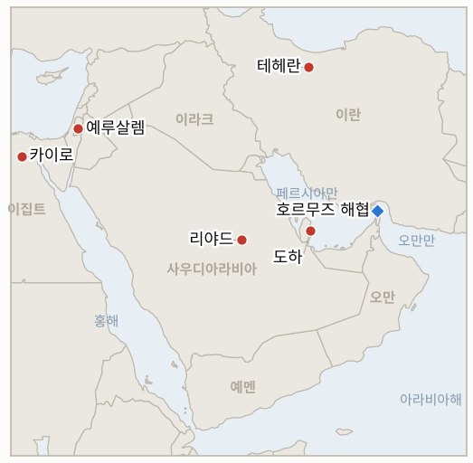

# 중동 일일 브리핑

**2026년 10월 27일**

- **보고 기간:** 약 24시간, 10월 26일 06:00 ~ 10월 27일 06:00 (한국시간)
- **종합 평가:** 외교는 분주해졌지만 전투는 멈추지 않았다. 사우디, 파키스탄, 튀르키예 당국자가 테헤란에서 이란 측과 만났고 카타르 중재단은 워싱턴과 조율했으며, 트럼프는 선택지를 "끝장내기"와 "합의"로 요약했다(§1.1). 이집트 의회는 사우디 군사 지원을 승인했고 후티는 재개된 리야드 공항을 몇 시간 만에 공격했다(§1.2). 브렌트유는 115.81달러에 정산됐고 코스피는 7개월 만의 최저로 내렸다(§1.3, §3). 이스라엘은 오늘 투표하며, 타격 시 이란의 대응이 여전히 더 큰 미지수다(§1.4).

---

## 1. 무슨 일이 있었나

<figure style="float:right; width:46%; margin:2pt 0 8pt 14pt;">

<figcaption style="font-size:8pt; color:#666; text-align:center; margin-top:3pt; font-style:italic;">주요 논의 지점</figcaption>
</figure>

### 1.1 지역 특사와 카타르 중재단이 테헤란을 오가고 트럼프는 합의와 "끝장내기" 사이에서 저울질한다

트럼프는 일요일 폭스뉴스에서 선택지가 "끝장내는 것, 아주 쉬운 일이다, 아니면 합의를 하는 것"이라고 말했고, 이후 "오늘 타격은 없을 것"이라고 밝혔다([CBS News](https://www.cbsnews.com/live-updates/iran-war-trump-us-diplomacy-oil-prices-strait-of-hormuz/); [Samaa](https://www.samaa.tv/2087359111-trump-rules-out-iran-strike-today-keeps-military-option-open)). 카타르 중재단이 테헤란을 방문했고 익명의 관리에 따르면 워싱턴과 조율했다. 월요일 CBS는 칼리드 빈 살만 사우디 국방장관, 아심 무니르 파키스탄 육군참모총장, 이브라힘 칼른 튀르키예 정보국장이 현지에서 이란 당국자들을 만나 미국과 이란의 합의를 촉구했고 예멘과 후티 공격도 의제였다고 전했다. 이란 당국자들은 회담이 "매우 좋았다"고 했으며 계속 대화하기로 했으나 구체적 발표는 없었다. 테헤란은 간접 메시지가 오가고 있다면서도 이른바 "완전한 항복" 요구는 거부하며, CNN은 트럼프가 선택하면 미국이 대규모 타격 계획을 갖고 있다고 보도한다([CNN](https://www.cnn.com/2026/10/26/politics/us-iran-strike-plans-trump)). **신뢰도: 테헤란 회동은 중간(사우디·파키스탄·튀르키예 대표단은 라이브 블로그 단일 출처); 트럼프가 두 선택지를 모두 열어 둔다는 점은 높음(복수 매체); 결과는 낮음.**

### 1.2 이집트가 사우디 군사 지원을 승인하고 후티는 재개된 리야드 공항을 공격한다

이집트 의회는 월요일 비공개 표결로 후티 공격에 맞선 군사 지원을 시시 대통령이 제공하도록 승인했고 이집트사회민주당은 기권했다([Washington Times](https://www.washingtontimes.com/news/2026/oct/26/egypts-parliament-authorizing-military-support-saudi-arabia-defend/); [Saudi Gazette](https://saudigazette.com.sa/article/665751/saudi-arabia/egypts-parliament-approves-military-assistance-to-saudi-arabia-possible-troop-deployment)). 한 지역 관리는 AP에 이집트가 방공 체계와 항공기를 보내되 지상군은 보내지 않을 것이라고 말했으며, 성명은 구체적 조치를 명시하지 않았고 시시는 이 임무를 방어적이라고 설명한다. 같은 날 후티는 항공편이 재개된 지 몇 시간 만에 리야드 킹 칼리드 공항에 탄도미사일을 쐈다고 주장했고 석유 펌프장에 대한 드론 공격도 주장했다. 사우디군은 미사일을 요격하고 사나의 발사대 2기를 파괴했다고 밝혔으며, 이후 미사일 저장 터널 5곳과 발사대 4기, 리야드와 남부 상공의 드론 3기 추가 격추를 덧붙였다([ABC News](https://abcnews.com/International/live-updates/iran-live-updates-houthis-claim-new-attack-riyadh/?id=137563447); CBS News). **신뢰도: 표결 통과와 미사일 요격은 높음(AP, 연합군 발표); 후티의 펌프장 공격 주장은 낮음(미확인), 이집트 파병 범위도 낮음.**

### 1.3 UKMTO가 운항불능 유조선과 화재 선박을 보고하고 브렌트유는 115.81달러로 내린다

UKMTO는 월요일, 금요일 08:39 UTC에 호르무즈 해협에서 유조선 한 척이 미확인 발사체에 맞아 운항불능이 됐고 선원은 무사하다고 밝혔으며, 이라크 알파우 남동쪽 63해리에서 화재 선박이 보고됐으나 확인된 공격이 아니라 의심 활동으로 분류했다([Defconlevel](https://www.defconlevel.com/alert/2026-10-26-ukmto-reports-vessel-on-fire-southeast-of-al-faw-iraq-after-tanker-struck-and-disabled-in-strait-of-hormuz); CBS News). 이란이 그날 유조선 4척을 공격했다는 주장은 여전히 확인되지 않았고, 트럼프는 이란이 유가를 올리려 공격을 꾸며낸다고 비난한다. 브렌트유는 장중 117달러를 잠시 넘은 뒤 91센트 내린 115.81달러, WTI는 1.51달러 내린 101.76달러에 정산됐으며, 거래자들은 차익을 실현하고 외교를 가격에 반영했다([Reuters via Yahoo Finance](https://finance.yahoo.com/news/oil-prices-down-almost-1-232445179.html)). 미 중부사령부는 봉쇄로 이란이 최소 250억 달러를 잃었다고 하고, Kpler는 이란의 해상 부유 저장분이 10월 중순에 바닥났다고 밝혔다. **신뢰도: 정산가는 높음(로이터); UKMTO 공지는 중간; 개별 공격의 책임 주체는 낮음.**

### 1.4 이스라엘이 오늘 투표하고 이란은 결과가 "아무 차이도 없다"고 하며 페제시키안은 모스크바로 향한다

이스라엘은 화요일 120석 크네세트를 선출하며, 여론조사는 네타냐후 진영(한 평균에서 약 50석)과 야권 모두 61석에 못 미치는 것으로 본다([CNBC](https://www.cnbc.com/2026/10/26/israel-election-netanyahu-iran-gaza-palestine.html); [Israel.com](https://www.israel.com/israel-election-2026)). 네타냐후는 이란과 대리 세력이 투표를 방해하려 할 수 있다고 경고했고, 경쟁자가 이기면 "전멸" 위험이 있다고 지지자들에게 말했다. 이란은 결과가 자국에 차이가 없다고 했고, 카츠 국방장관은 참모총장 자미르와의 불화설을 "전혀 근거 없다"고 했으나 이스라엘 고위 소식통은 CBS에 불화가 "신빙성 있어 보인다"고 말했다. 페제시키안은 가스 정상회의 계기에 모스크바에서 푸틴과 만날 예정이며 시점은 보도마다 엇갈린다. **신뢰도: 선거일과 여론조사 범위는 높음; 네타냐후와 자미르의 불화는 낮음(부인 대 검열 통과 소식통); 모스크바 회담 일정은 중간.**

---

## 2. 심층 분석: 유인과 동기

### 2.1 사우디, 파키스탄, 튀르키예는 왜 지금 테헤란에 특사를 보내는가?

리야드는 공항과 석유 시설에 대한 후티 공격을 감당하고 있으며, 이를 더 키울 새 미국·이란 전쟁 없이 자국 영토에 대한 압박이 걷히기를 원한다. 이슬라마바드 각서의 중재자인 파키스탄과 튀르키예를 쓰면 사우디는 테헤란과 직접 대화할 명분을 얻고, 이란의 "매우 좋았다"는 평가는 양보 없이 이 통로에 보상을 준다.

### 2.2 트럼프는 왜 계속 "끝장내기"와 "합의" 중 선택이라는 틀을 쓰는가?

이 틀은 봉쇄가 이란의 수입을 갉아먹는 동안 압박과 중간선거 이후 선택지를 모두 살려 둔다. 합의가 나오면 공을 챙기고 가격 상승의 책임은 테헤란에 돌릴 수 있다.

### 2.3 이집트 의회는 왜 지금 사우디 지원을 승인하면서도 모호하게만 했는가?

카이로는 지원을 승인해 걸프의 재정적·정치적 호의를 얻으면서 무엇을 보낼지는 유연하게 남긴다. 지상군과 예멘 타격을 배제하면 후티의 보복 위험이 줄며, 후티는 이미 위협을 내놓았다.

### 2.4 후티는 왜 공항이 재개된 날 리야드 공항을 쏘는가?

재개된 공항은 사우디가 일상을 되찾았다는 가장 분명한 신호이므로, 이를 타격하면 적은 비용으로 그 인상을 뒤집는다. 사우디가 테헤란에서 보이는 대화 의지가 자국 쪽의 자제로도 이어지는지 시험하는 행동이기도 하다.

### 2.5 이란은 왜 이스라엘 총선이 "아무 차이도 없다"고 말하는가?

이 발언은 이란의 계산이 이스라엘 집권자가 아니라 미국의 결정과 자체 억지력에 달려 있음을 알린다. 또 이란이 결과를 기다린다는 인상을 네타냐후가 선거운동에 쓰지 못하게 한다.

---

## 3. 대한민국 정책적 함의

**노출도 요약:** 한국은 원유의 약 70.7%, LNG의 약 20.4%를 중동에서 들여온다(`instructions/korea-exposure.md`, 갱신 불필요). 10월 26일 월요일 최신 수치는 브렌트유 115.81달러, WTI 101.76달러 정산가, 코스피 5,469.47(1.46% 하락, 4월 6일 이후 최저 종가, 외국인 약 6조 9,600억 원 순매도), 원/달러 1,323.1원으로 소폭 강세다(Korea Times, SBS, 서울경제). 다음 변수는 칩 실적(SK하이닉스 10월 28일, 삼성전자 10월 29일)과 미국 시간 10월 28일 연준 결정이다. 이번 기간에 중동 관련 한국 정부의 새 조치는 찾지 못했으며, 사우디 여행경보는 10월 11일부터 3단계(출국권고)다.

**전개별 함의:**

- **중재(§1.1):** 사우디·파키스탄·튀르키예의 테헤란 통로는 협상 신호에 가장 가깝지만 미국·이란 협상 개최는 공개되지 않았다(IND-20261026-1, IND-20261027-2).
- **사우디 전선(§1.2):** 이집트의 표결과 재개된 공항에 대한 공격은 동부 주 노출이 이어짐을 보여 주며, 다음 신호는 리야드 공항의 재폐쇄(IND-20261027-3)와 정부의 여행경보 상향(IND-20261022-1)이다.
- **해운과 유가(§1.3):** 브렌트유는 내렸으나 여전히 116달러 부근이다. 110달러 아래 정산은 외교가 가격에 반영되고 있다는 신호이고(IND-20261027-4), 120달러 초과는 수입 부담을 키운다(IND-20261024-2).
- **시장(§3):** 코스피는 5,300선보다 169포인트 위에 있고(IND-20261024-3), 원화는 외국인 매도에도 1,323원 부근을 지켜 1,350원 이탈선 아래다(IND-20261026-2).

**오늘 종결:** IND-20261018-2와 IND-20261020-2 **확인**(이집트 의회가 사우디 군사 지원을 승인했다). IND-20261016-3 **만료**(사우디·후티 회동 공개 없음), IND-20261019-1 **만료**(이란의 7개 항목 계획에 대한 공식 미국 답신 공개 없음).

**검증 가능한 지표:**

- **IND-20261027-1**(진행 중, 신규): 2026-11-10경까지 이집트의 방공 체계나 항공기 사우디 배치가 확인되면 확인, 없으면 반증.
- **IND-20261027-2**(진행 중, 신규): 2026-11-03경까지 미국·이란 협상 개최 또는 이란의 조건에 대한 미국 답신이 공개되면 확인, 없으면 반증.
- **IND-20261027-3**(진행 중, 신규): 2026-11-03경까지 리야드 공항 운항이 다시 중단되면 확인, 없으면 반증.
- **IND-20261027-4**(진행 중, 신규): 2026-10-30경까지 브렌트유 정산가가 110달러 아래로 내려가면 외교의 가격 반영으로 확인, 없으면 반증.
- **IND-20261026-1, -2, -3**(진행 중): 2026-10-31경까지 미국·이란 협상 개최; 10월 30일까지 원/달러 종가 1,350원 초과; 10월 24~30일 UKMTO 집계 10건 이상.
- **IND-20261025-1**(진행 중): 2026-10-28경까지 이란 영토에 대한 미국의 타격이 공개되는지.
- **IND-20261024-1, -2, -3**(진행 중): 2026-11-01경까지 미 호위 선단 또는 혁명수비대의 미군 기지 공격; 2026-10-30경까지 브렌트유 120달러 초과; 10월 30일까지 코스피 종가 5,300 미만.
- **IND-20261022-1**(진행 중): 2026-10-29경까지 정부가 사우디 여행경보를 3단계 위로 올리는지.

---

## 4. 주시 목록

- **이스라엘 총선 결과와 연정 구도(10월 27일).**
- **모스크바의 페제시키안·푸틴 회담과 러시아가 워싱턴에 메시지를 전하는지.**
- **사우디·파키스탄·튀르키예 당국자와의 테헤란 회동 결과 발표(IND-20261027-2).**
- **SK하이닉스, 삼성전자, 연준을 앞둔 코스피와 원화(IND-20261024-3, IND-20261026-2).**
- **이집트 파병 세부 내용(IND-20261027-1)과 리야드 공항 상황(IND-20261027-3).**
- **11월 3일 중간선거 전 미국의 타격(IND-20261025-1).**

---

## 5. 출처 품질 요약

| 주장 | 출처 | 신뢰도 |
| --- | --- | --- |
| 트럼프: "끝장내기" 또는 "합의"; 10월 25일 타격 없음 | CBS News, Samaa | 높음 |
| 카타르 중재단의 테헤란 방문과 미국 조율 | CBS News, Discovery Alert | 중간 |
| 사우디·파키스탄·튀르키예 당국자의 테헤란 회동 | CBS News 라이브 블로그만 | 중간 |
| 이집트 의회의 사우디 군사 지원 승인 | Washington Times(AP), Saudi Gazette, US News | 높음 |
| 리야드 공항행 후티 미사일 요격, 사나 발사대 파괴 | ABC News, CBS News | 높음 |
| 후티의 펌프장 공격 | OilPrice 인용 후티 주장 | 낮음 |
| 10월 23일 호르무즈 유조선 운항불능, 알파우 앞바다 화재 선박 | Defconlevel 인용 UKMTO, CBS News | 중간 |
| 브렌트유 115.81달러, WTI 101.76달러 | Yahoo Finance 인용 로이터 | 높음 |
| 코스피 5,469.47; 원화 1,323.1 | Korea Times, SBS, 서울경제, 연합뉴스 | 높음 |
| 이스라엘 총선 여론조사 | CNBC, Israel.com | 중간 |
| 네타냐후·자미르 불화 | CBS News(이스라엘 소식통) 대 카츠 부인 | 낮음 |
| 호르무즈 통항 건수, 한국의 새 조치 | 보도 없음 | 보도 없음 |
