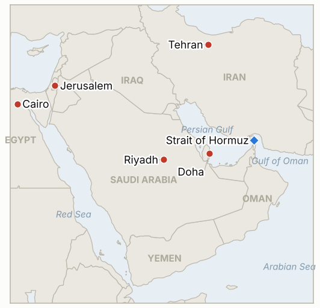
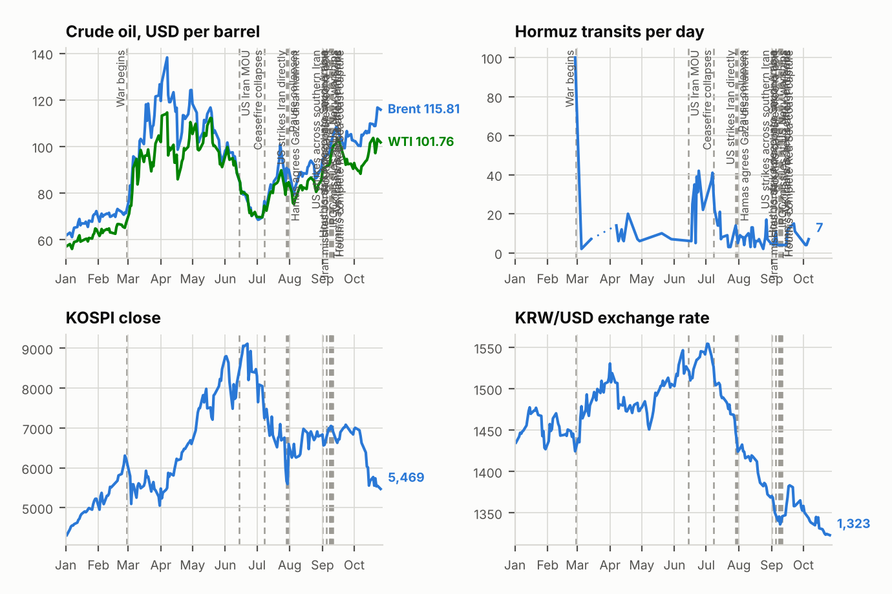

# Middle East Daily Briefing

**October 27, 2026**

- **Reporting window:** ~24 hours, October 26, 06:00 to October 27, 06:00 KST
- **Overall assessment:** Diplomacy got busier while the fighting did not stop: Saudi, Pakistani and Turkish officials met Iranians in Tehran, Qatari mediators coordinated with Washington, and Trump framed his choice as "finish it off" or "make a deal" (§1.1). Egypt's parliament authorized military support for Saudi Arabia, and the Houthis fired at Riyadh's airport hours after it reopened (§1.2). Brent settled at $115.81 and the KOSPI fell to a seven month low (§1.3, §3). Israel votes today with Iran's response to a strike still the larger unknown (§1.4).

---

## 1. What Happened

<figure style="float:right; width:46%; margin:2pt 0 8pt 14pt;">

<figcaption style="font-size:8pt; color:#666; text-align:center; margin-top:3pt; font-style:italic;">Major places of discussion</figcaption>
</figure>

### 1.1 Regional envoys and Qatari mediators work Tehran while Trump weighs a deal against "finishing it off"

On Sunday Trump said on Fox News the choice was whether to "finish it off, which would be very easy to do, or do I make a deal," and later said "there will not be a strike today" ([CBS News](https://www.cbsnews.com/live-updates/iran-war-trump-us-diplomacy-oil-prices-strait-of-hormuz/); [Samaa](https://www.samaa.tv/2087359111-trump-rules-out-iran-strike-today-keeps-military-option-open)). Qatari mediators visited Tehran, coordinated with Washington according to an unnamed official, and on Monday CBS reported that Saudi Defense Minister Khalid bin Salman, Pakistan's army chief Asim Munir and Turkey's intelligence chief Ibrahim Kalin met Iranian officials there to push for a US-Iran deal, with Yemen and the Houthi strikes reportedly on the agenda. Iranian officials called the talks "very good" and the sides agreed to keep talking, with no concrete announcement. Tehran says indirect messages continue but rejects what it calls US demands for "complete surrender," and CNN reports the US has plans for major strikes if Trump chooses ([CNN](https://www.cnn.com/2026/10/26/politics/us-iran-strike-plans-trump)). **Confidence: Medium that the Tehran meetings occurred (a single live-blog source for the Saudi, Pakistani and Turkish delegation); High that Trump keeps both options open (multiple outlets); Low on any outcome.**

### 1.2 Egypt authorizes military support for Saudi Arabia as the Houthis fire at Riyadh's reopened airport

Egypt's parliament voted in closed session on Monday to authorize President Sisi to provide military support against Houthi attacks, with the Egyptian Social Democratic Party abstaining ([Washington Times](https://www.washingtontimes.com/news/2026/oct/26/egypts-parliament-authorizing-military-support-saudi-arabia-defend/); [Saudi Gazette](https://saudigazette.com.sa/article/665751/saudi-arabia/egypts-parliament-approves-military-assistance-to-saudi-arabia-possible-troop-deployment)). A regional official told AP Egypt would send air defense systems and aircraft but no ground troops; the statement did not name specific measures, and Sisi calls the mission defensive. The same day the Houthis claimed a ballistic missile attack on King Khalid airport in Riyadh, hours after flights resumed, and drone strikes on oil pumping stations. Saudi forces said they intercepted the missile and destroyed two launchers in Sanaa, later adding five missile-storage tunnels and four launchers, and three more drones downed over Riyadh and the south ([ABC News](https://abcnews.com/International/live-updates/iran-live-updates-houthis-claim-new-attack-riyadh/?id=137563447); CBS News). **Confidence: High that the vote passed and that the missile was intercepted (AP, coalition statements); Low on the Houthi pumping station claim (unverified) and on the scope of any Egyptian deployment.**

### 1.3 UKMTO reports a disabled tanker and a ship on fire as Brent eases to $115.81

UKMTO said on Monday that a tanker was disabled by an unidentified projectile in the Strait of Hormuz on Friday at 08:39 UTC, with the crew safe, and separately logged a vessel on fire 63 nautical miles southeast of Al-Faw, Iraq, classed as suspicious activity rather than a confirmed attack ([Defconlevel](https://www.defconlevel.com/alert/2026-10-26-ukmto-reports-vessel-on-fire-southeast-of-al-faw-iraq-after-tanker-struck-and-disabled-in-strait-of-hormuz); CBS News). Iran's claimed strikes on four tankers that day remain uncorroborated, and Trump accuses Iran of inventing attacks to lift prices. Brent settled at $115.81, down 91 cents, and WTI at $101.76, down $1.51, after Brent briefly topped $117, as traders took profits and priced diplomacy ([Reuters via Yahoo Finance](https://finance.yahoo.com/news/oil-prices-down-almost-1-232445179.html)). CENTCOM says the blockade has cost Iran at least $25 billion, and Kpler says Iran's offshore floating storage ran dry in mid-October. **Confidence: High on the settlements (Reuters); Medium on the UKMTO notices; Low on attribution of any attack.**

### 1.4 Israel votes today; Iran says the result "makes no difference" as Pezeshkian heads to Moscow

Israel elects its 120-seat Knesset on Tuesday, with polls putting neither Netanyahu's bloc (roughly 50 seats on one average) nor the opposition at 61 ([CNBC](https://www.cnbc.com/2026/10/26/israel-election-netanyahu-iran-gaza-palestine.html); [Israel.com](https://www.israel.com/israel-election-2026)). Netanyahu warned Iran and its proxies could try to disrupt the vote and told supporters a rival win risked "annihilation." Iran said the outcome makes no difference to it, Defense Minister Katz called reports of a rift with army chief Zamir "entirely baseless," while a senior Israeli source told CBS the rift "seems credible." Pezeshkian is due to meet Putin in Moscow around a gas summit, with timing reported inconsistently. **Confidence: High on the election date and poll range; Low on the Netanyahu and Zamir rift (denial against a censor-cleared source); Medium on the Moscow meeting date.**

---

## 2. Deep Dive: Incentives and Motives

### 2.1 Why are Saudi Arabia, Pakistan and Turkey sending envoys to Tehran now?

Riyadh is absorbing Houthi strikes on its airports and oil sites and wants the pressure on its territory lifted without a new US-Iran war that would widen them. Using Pakistan, already the Islamabad memorandum's broker, and Turkey gives Saudi Arabia cover to talk to Tehran directly, and Iran's "very good" label rewards the channel without conceding anything.

### 2.2 Why does Trump keep posing the choice as "finish it off" versus "make a deal"?

The framing keeps both pressure and the post midterm option alive while the blockade works on Iran's revenue. It also lets him claim credit for any deal while pinning blame for price rises on Tehran.

### 2.3 Why did Egypt's parliament vote for Saudi support now, but only in vague terms?

Cairo gains Gulf financial and political goodwill by authorizing help, while keeping flexibility on what to send. Ruling out ground troops and strikes on Yemen limits exposure to Houthi retaliation, which the group has already threatened.

### 2.4 Why do the Houthis fire at Riyadh's airport the day it reopens?

A reopened airport is the clearest signal that Saudi Arabia has restored normal life, so hitting it reverses that at low cost. It also tests whether Saudi willingness to talk in Tehran is matched by restraint on its side.

### 2.5 Why does Iran say the Israeli election "makes no difference"?

The line signals that its calculations rest on US decisions and on its own deterrence, not on who governs Israel. It also denies Netanyahu a campaign image of an Iran waiting on the result.

---

## 3. Policy Implications for South Korea

**Exposure snapshot:** South Korea draws about 70.7% of its crude and 20.4% of its LNG from the Middle East (`instructions/korea-exposure.md`, no update needed). Latest prints, Monday October 26: Brent $115.81 and WTI $101.76 settles, KOSPI 5,469.47 (down 1.46%, lowest close since April 6, with foreigners net selling about 6.96 trillion won), and the won at 1,323.1 per dollar, slightly stronger (Korea Times, SBS, Seoul Economic Daily). Chip earnings (SK Hynix October 28, Samsung Electronics October 29) and the Fed decision on October 28 U.S. time are next. I found no new Korean government measure on the Middle East in the window; the Saudi advisory has stood at level 3 ("departure advised") since October 11.

**Implications by development:**

- **Mediation (§1.1):** A Saudi, Pakistani and Turkish channel into Tehran is the nearest thing to a talks signal, but no US-Iran session is disclosed (IND-20261026-1, IND-20261027-2).
- **Saudi front (§1.2):** Egypt's vote and fire at a reopened airport show the Eastern Province exposure persists; the next signals are another Riyadh closure (IND-20261027-3) and a Seoul advisory upgrade (IND-20261022-1).
- **Shipping and oil (§1.3):** Brent eased but remains near $116; a settle below $110 would signal that diplomacy is being priced in (IND-20261027-4), above $120 would raise import bills (IND-20261024-2).
- **Markets (§3):** The KOSPI is 169 points above the 5,300 line (IND-20261024-3), and the won held near 1,323 despite foreign selling, below the 1,350 break level (IND-20261026-2).

**Resolved today:** IND-20261018-2 and IND-20261020-2 **confirmed** (Egypt's parliament authorized military support for Saudi Arabia). IND-20261016-3 **expired** (no disclosed Saudi-Houthi meeting) and IND-20261019-1 **expired** (no disclosed formal US reply to Iran's seven point plan).

**Testable indicators:**

- **IND-20261027-1** (open, new): A confirmed Egyptian deployment of air defense or aircraft to Saudi Arabia by ~2026-11-10 confirms; none falsifies.
- **IND-20261027-2** (open, new): A disclosed US-Iran session or announced US reply to Iran's conditions by ~2026-11-03 confirms; none falsifies.
- **IND-20261027-3** (open, new): A new suspension of flights at Riyadh by ~2026-11-03 confirms; none falsifies.
- **IND-20261027-4** (open, new): Any Brent settle below $110 by ~2026-10-30 confirms diplomacy pricing in; none falsifies.
- **IND-20261026-1, -2, -3** (open): US-Iran session by ~2026-10-31; USD/KRW close above 1,350 by October 30; UKMTO tally of 10 or more for October 24 to 30.
- **IND-20261025-1** (open): A disclosed US strike on Iranian territory by ~2026-10-28.
- **IND-20261024-1, -2, -3** (open): US escorted convoy or IRGC attack on a US base by ~2026-11-01; Brent above $120 by ~2026-10-30; KOSPI close below 5,300 by October 30.
- **IND-20261022-1** (open): Seoul raising its Saudi advisory above level 3 by ~2026-10-29.

---

## 4. Watch List

- **Israel's election results and coalition math (Oct 27).**
- **Pezeshkian and Putin in Moscow, and whether Russia carries a message to Washington.**
- **Any readout from the Tehran meetings with Saudi, Pakistani and Turkish officials (IND-20261027-2).**
- **KOSPI and the won around SK Hynix, Samsung and the Fed (IND-20261024-3, IND-20261026-2).**
- **Egyptian deployment details (IND-20261027-1) and Riyadh airport status (IND-20261027-3).**
- **A US strike before the November 3 midterms (IND-20261025-1).**

---

## 5. Source Quality Summary

| Claim | Sources | Confidence |
| --- | --- | --- |
| Trump: "finish it off" or "make a deal"; no strike Oct 25 | CBS News; Samaa | High |
| Qatari mediators in Tehran, coordinated with US | CBS News; Discovery Alert | Medium |
| Saudi, Pakistani, Turkish officials met Iranians in Tehran | CBS News live blog only | Medium |
| Egypt parliament authorizes military support for Saudi Arabia | Washington Times (AP); Saudi Gazette; US News | High |
| Houthi missile at Riyadh airport intercepted; Sanaa launchers destroyed | ABC News; CBS News | High |
| Houthi strikes on pumping stations | Houthi claim via OilPrice | Low |
| Tanker disabled in Hormuz Oct 23; vessel on fire off Al-Faw | UKMTO via Defconlevel, CBS News | Medium |
| Brent $115.81, WTI $101.76 | Reuters via Yahoo Finance | High |
| KOSPI 5,469.47; won 1,323.1 | Korea Times; SBS; Seoul Economic Daily; Yonhap | High |
| Israel election polls | CNBC; Israel.com | Medium |
| Netanyahu and Zamir rift | CBS News (Israeli source) vs Katz denial | Low |
| Hormuz transit count; new Korean measures | Not reported | Not reported |
