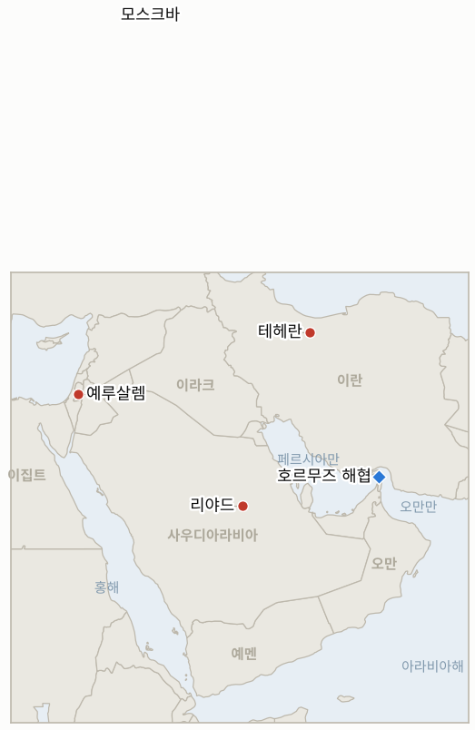

# 중동 일일 브리핑

**2026년 10월 28일**

- **보고 기간:** 약 24시간, 10월 27일 06:00 ~ 10월 28일 06:00 (한국시간)
- **종합 평가:** 이스라엘 총선 출구조사는 뚜렷한 승자를 내지 못했고, 네타냐후 블록은 약 50석, 야권은 약 52석으로 나타났다(§1.1). 이란 군 합참의장은 호르무즈가 "완전히 봉쇄됐다"고 했고 외무장관은 전쟁 전 체제로 돌아가지 않을 것이라고 했으며, 카타르 국왕은 모스크바에서 페제시키안 대통령을 만났다(§1.2). 트럼프는 타격 가능성을 열어 두었고, 후티는 이집트의 사우디 지원 조치를 선전포고라고 불렀다(§1.3, §1.4). 코스피는 3.09% 반등해 5,638.34로 마감했으나 화요일 유가 정산가는 확인하지 못했다(§3).

---

## 1. 무슨 일이 있었나

<figure style="float:right; width:46%; margin:2pt 0 8pt 14pt;">

<figcaption style="font-size:8pt; color:#666; text-align:center; margin-top:3pt; font-style:italic;">주요 논의 지점</figcaption>
</figure>

### 1.1 이스라엘이 투표했고 출구조사는 네타냐후와 아이젠코트 어느 쪽도 과반이 아니라고 나온다

화요일 크네세트 선거 출구조사는 네타냐후 블록을 50석(채널 12·13), 가디 아이젠코트 블록을 52~53석으로 예측했고, 친네타냐후 성향의 채널 14만 60대 43으로 달랐다. 과반은 120석 중 61석이다([Axios](https://www.axios.com/2026/10/27/netanyahu-eisenkot-israel-election-exit-polls); [PBS](https://www.pbs.org/newshour/world/no-clear-winner-in-israeli-election-exit-polls-indicate-as-netanyahus-fate-hangs-in-the-balance)). 투표율은 오후 8시까지 74.3%로 1988년 이후 같은 시각 최고였고, 채널 13은 아랍계 정당에 사상 최대인 18석을 줬다([Times of Israel](https://www.timesofisrael.com/qatar-iran-discuss-war-and-hormuz-in-moscow-meeting-as-another-ship-struck-in-strait/)). 두 지도자 모두 승리를 주장할 것으로 예상됐고, 정당들이 제기한 부정 의혹은 선관위가 기각했으며, 리쿠드가 "선거 도둑질" 주장을 준비했다는 보도도 있다. 최종 결과는 출구조사와 다를 수 있으며 며칠 안에 나온다. **신뢰도: 출구조사에서 어느 블록도 61석이 아니라는 점은 높음(여러 방송); 최종 의석은 중간; 부정 의혹은 낮음.**

### 1.2 이란이 호르무즈가 "완전히 봉쇄됐다"고 하고 카타르 국왕이 모스크바에서 페제시키안을 만난다

알리 압돌라히 군 합참의장은 해협이 이란의 통제 아래 "완전히 봉쇄됐다"고 했고, 아락치 외무장관은 해협의 항로와 관리가 "전쟁 전 상태로 돌아가지 않을 것"이라고 했다([Gulf News](https://gulfnews.com/world/mena/middle-east-war-trump-leaves-iran-attack-on-the-table-tehran-vows-changes-to-hormuz-strait-houthis-claim-saudi-strikes-1.500723497)). 이란군은 추적장치를 끈 유조선이 이란이 허가하지 않은 항로에서 기뢰에 걸려 불이 났다고 밝혔으나 독립적으로 확인되지 않았다([Times of Israel](https://www.timesofisrael.com/qatar-iran-discuss-war-and-hormuz-in-moscow-meeting-as-another-ship-struck-in-strait/); Dawn). 모스크바 가스수출국포럼 정상회의 계기에 카타르 국왕이 페제시키안을 만났고, 카타르 관리는 "이제 공은 이란 쪽에 있다"며 해협 재개방을 촉구했으며, 페제시키안은 푸틴과도 만날 예정이었다. 이란 관리는 봉쇄와 석유 제재가 풀리기 전에는 핵 문제를 논의하지 않겠다고 했다. **신뢰도: 이란 측 발언은 높음; 모스크바 회담 내용은 중간(카타르와 이란의 발표가 다름); 기뢰 사고는 낮음(이란 측 주장).**

### 1.3 트럼프가 타격은 "가능성"이라고 말하는 가운데 이란이 중간선거까지 협상을 끈다는 보도가 나온다

트럼프는 공격할 "가능성이 있다"고 하면서도 합의 가능성을 언급했고, 이란이 합의를 지킬지 의문을 제기했다([Gulf News](https://gulfnews.com/world/mena/middle-east-war-trump-leaves-iran-attack-on-the-table-tehran-vows-changes-to-hormuz-strait-houthis-claim-saudi-strikes-1.500723497)). CNN은 미군이 명령 후 96시간 안에 대규모 작전에 들어갈 수 있으나 결정은 내려지지 않았다고 보도했다. 이란 소식통을 인용한 로이터 보도의 검색 요약에 따르면 테헤란은 11월 3일 중간선거 전까지 트럼프를 약화시키려고 협상을 일부러 끌고 있으나 원문은 열람하지 못했다. 이 기간 미국의 타격은 공개되지 않았다. **신뢰도: 트럼프가 선택지를 열어 둔다는 점은 높음(여러 매체); 로이터의 지연 주장은 낮음(재인용, 익명 이란 소식통).**

### 1.4 후티가 이집트의 사우디 지원을 선전포고로 규정하고 코스피는 3.09% 급등한다

후티는 이집트 의회의 승인을 선전포고라고 불렀고, 러시아 위성이 이란 동맹의 사우디 공격을 도왔다는 보도도 있으나 독립적으로 검증되지 않았다([Times of Israel](https://www.timesofisrael.com/qatar-iran-discuss-war-and-hormuz-in-moscow-meeting-as-another-ship-struck-in-strait/)). 오만이 이란과의 회담에서 호르무즈 자유항행 복원의 개요가 나왔다고 밝힌 뒤 화요일 브렌트유는 약 114.7~116.4달러, WTI는 약 100.8~102.4달러에서 거래됐으나([Kitco](https://www.kitco.com/news/article/2026-10-27/precious-metals-weaken-hormuz-uncertainty-keeps-oil-elevated-ahead-fed)) 확인된 정산가는 찾지 못했다. 서울에서는 코스피가 AI 투자심리 회복으로 168.87포인트(3.09%) 오른 5,638.34로 마감했고 매수 사이드카가 발동됐으며, 원/달러 환율은 1,323.7원으로 마감했다([Newspim](https://www.newspim.com/news/view/20261027001206); [News1](https://www.news1.kr/finance/market-exr/6333624)). **신뢰도: 코스피와 환율 종가는 높음(국내 매체); 러시아 위성 보도는 낮음; 오만의 항행 개요는 중간(단일 검색 요약).**

---

## 2. 심층 분석: 유인과 동기

### 2.1 이란은 왜 특사들과 대화를 이어가면서 호르무즈가 "완전히 봉쇄됐다"고 선언하는가?

봉쇄는 미국의 해상 봉쇄에 맞선 테헤란의 핵심 지렛대이며, 전쟁 전 체제로 돌아가지 않겠다는 말은 재개방의 대가를 워싱턴이 치르게 만든다. 강경한 언어와 사우디·파키스탄·튀르키예 특사들과의 "매우 좋은" 대화를 병행하면 양보 없이 지역 통로를 살려 둘 수 있다.

### 2.2 이란은 왜 중간선거까지 협상을 끌려 하는가?

트럼프가 11월 3일 전에 유가를 낮추고 싶어 한다면 지연은 합의 거부의 비용을 키우고, 봉쇄와 제재 완화를 먼저 요구하는 이란의 조건은 맞바꾸기보다 유지하는 편이 싸다. 이 주장은 재인용이므로 계획이라기보다 이란 스스로의 신호로 보는 것이 맞다.

### 2.3 트럼프는 왜 타격 선택지를 분명하게 열어 두는가?

"내가 할 가능성이 있다"는 말은 CNN이 전한 계획을 유지한 채 테헤란과 걸프 중재자들을 압박한다. 또 중간선거 전에 성과로 내세울 수 있는 합의의 여지도 남긴다.

### 2.4 네타냐후와 아이젠코트는 왜 둘 다 승리를 주장하려 하는가?

어느 블록도 61석이 아닐 때 먼저 내놓는 승리 주장이 연정 서사와 군소 정당, 헤르조그 대통령의 조각 위임 선택에 대한 압박을 좌우한다. 네타냐후 측이 부정선거 서사를 준비했다는 점은 패배 가능성에도 대비하고 있음을 시사한다.

### 2.5 후티는 왜 이집트의 조치를 선전포고로 규정하는가?

이집트군의 가시적인 배치 비용을 높이고, 사우디 안의 이집트 자산이 표적이 될 수 있음을 카이로에 알린다. 또 후티를 침략자가 아니라 확대되는 연합에 맞서는 세력으로 보이게 한다.

---

## 3. 대한민국 정책적 함의

**노출도 요약:** 한국은 원유의 약 70.7%, LNG의 약 20.4%를 중동에서 들여온다(`instructions/korea-exposure.md`, 갱신 불필요). 10월 27일 화요일 최신 수치는 코스피 5,638.34(3.09% 상승, 외국인과 기관 순매수, 매수 사이드카 발동), 원/달러 환율 1,323.7원(0.6원 상승, 수출업체 달러 매도가 상승폭을 제한)이다(뉴스핌, 뉴시스, 뉴스1). 브렌트유와 WTI는 화요일 정산가를 확인하지 못했으며 월요일 정산가는 각각 115.81달러, 101.76달러였다. SK하이닉스는 10월 28일, 삼성전자는 10월 29일 실적을 발표하고, 연준은 미국 시간 10월 28일 결정한다. 이 기간 한국 정부의 새 중동 관련 조치는 확인하지 못했고, 사우디 여행경보는 10월 11일 이후 3단계에 머물러 있다.

**전개별 함의:**

- **이스라엘(§1.1):** 의회 교착은 이스라엘의 이란 관련 결정적 정책을 늦춰 이스라엘발 단기 타격 가능성을 낮추지만 연정 불확실성은 크다(IND-20261028-1, IND-20261028-2).
- **호르무즈(§1.2):** "완전 봉쇄" 발언은 한국 유조선의 항로와 보험 비용이 높게 유지됨을 뜻하며, 재개방 신호가 핵심 상방 시나리오다(IND-20261027-2, IND-20261027-4).
- **미국의 태세(§1.3):** 타격이 있으면 유가와 원화에 충격이 오며, IND-20261023-3의 기한은 11월 6일이다.
- **시장(§1.4):** 반등으로 코스피는 5,300선보다 338포인트 위에 있고(IND-20261024-3), 다음 시험대는 실적이며(IND-20261028-3), 원화는 1,350원 아래를 유지한다(IND-20261026-2).

**오늘 종결:** IND-20261020-1, IND-20261021-1, IND-20261021-2, IND-20261025-1 **만료**(기한까지 1,200만 bpd를 넘는 Kpler 주간 유량 자료 없음, 얀부·샤이바 피해 확인 없음, 미국·이란 협상 공개 없음, 미국의 타격 공개 없음).

**검증 가능한 지표:**

- **IND-20261028-1**(진행 중, 신규): 2026-11-02경까지 최종 개표에서 어느 한 블록이 61석 이상이면 확인, 없으면 반증.
- **IND-20261028-2**(진행 중, 신규): 2026-11-10경까지 헤르조그 대통령이 아이젠코트에게 조각 위임을 하면 야권 경로 확인, 네타냐후에게 위임하거나 위임이 없으면 반증.
- **IND-20261028-3**(진행 중, 신규): 10월 30일까지 코스피 종가가 5,800 초과이면 반등 지속으로 확인, 없으면 반증.
- **IND-20261027-1, -2, -3, -4**(진행 중): 2026-11-10경까지 이집트 파병; 2026-11-03경까지 미국·이란 협상 또는 미국 답신; 2026-11-03경까지 리야드 운항 재중단; 2026-10-30경까지 브렌트유 정산가 110달러 미만.
- **IND-20261026-1, -2, -3**(진행 중): 2026-10-31경까지 미국·이란 협상 개최; 10월 30일까지 원/달러 종가 1,350원 초과; 10월 24~30일 UKMTO 집계 10건 이상.
- **IND-20261024-1, -2, -3**(진행 중): 2026-11-01경까지 미 호위 선단 또는 혁명수비대의 미군 기지 공격; 2026-10-30경까지 브렌트유 120달러 초과; 10월 30일까지 코스피 종가 5,300 미만.
- **IND-20261022-1**(진행 중): 2026-10-29경까지 정부가 사우디 여행경보를 3단계 위로 올리는지.

---

## 4. 주시 목록

- **이스라엘 최종 개표와 헤르조그 대통령의 조각 위임(IND-20261028-1, -2).**
- **페제시키안·푸틴 회담 결과 발표와 러시아가 워싱턴에 전하는 메시지.**
- **오만이 밝힌 자유항행 개요에 이란이나 미국의 확인이 나오는지.**
- **SK하이닉스, 삼성전자, 연준을 앞둔 코스피와 원화(IND-20261028-3, IND-20261026-2).**
- **이집트 파병 세부 내용과 후티의 보복(IND-20261027-1, IND-20261027-3).**
- **11월 3일 중간선거 전 미국의 타격(IND-20261023-3).**

---

## 5. 출처 품질 요약

| 주장 | 출처 | 신뢰도 |
| --- | --- | --- |
| 이스라엘 출구조사: 과반 없음; 채널 14는 예외 | Axios, PBS, Times of Israel | 높음 |
| 투표율 74.3%; 아랍계 정당 18석 | Times of Israel 라이브 블로그(채널 13) | 중간 |
| 이란: 호르무즈 "완전 봉쇄"; 전쟁 전 상태 복귀 없음 | Gulf News | 높음 |
| 비허가 항로에서 유조선 기뢰 피격 | Times of Israel, Dawn 인용 이란군 | 낮음 |
| 카타르 국왕·페제시키안 모스크바 회담 | Times of Israel | 중간 |
| 트럼프 "가능성이 있다"; CNN 96시간 계획 | Gulf News, Gulf News 인용 CNN | 높음 |
| 이란의 중간선거까지 지연 | 검색 요약 속 로이터, 익명 이란 소식통 | 낮음 |
| 후티: 이집트 조치는 선전포고 | Times of Israel | 중간 |
| 러시아 위성의 사우디 공격 지원 | Times of Israel(보도) | 낮음 |
| 코스피 5,638.34; 원화 1,323.7 | 뉴스핌, 뉴시스, 뉴스1 | 높음 |
| 오만 자유항행 개요; 브렌트·WTI 거래 범위 | Kitco, 검색 요약 | 낮음 |
| 10월 27일 브렌트·WTI 정산가, 호르무즈 통항 건수, 한국의 새 조치 | 보도 없음 | 보도 없음 |
