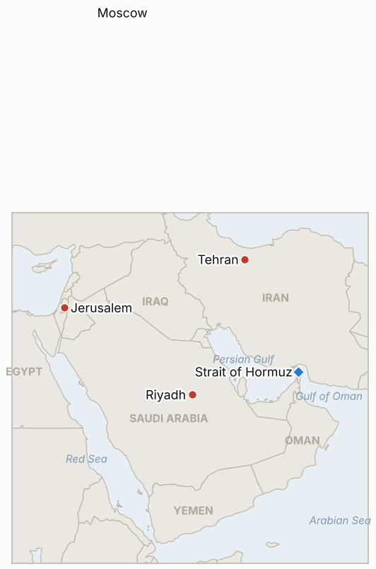

# Middle East Daily Briefing

**October 28, 2026**

- **Reporting window:** ~24 hours, October 27, 06:00 to October 28, 06:00 KST
- **Overall assessment:** Israel's election produced no clear winner in exit polls, with Netanyahu's bloc at about 50 seats and the opposition at about 52 (§1.1). Iran's armed forces chief called Hormuz "completely closed" and its foreign minister said pre-war arrangements will not return, while Qatar's emir met Pezeshkian in Moscow (§1.2). Trump left a strike open, and the Houthis called Egypt's step toward Saudi Arabia a declaration of war (§1.3, §1.4). The KOSPI rebounded 3.09% to 5,638.34; I could not confirm Tuesday's oil settles (§3).

---

## 1. What Happened

<figure style="float:right; width:46%; margin:2pt 0 8pt 14pt;">

<figcaption style="font-size:8pt; color:#666; text-align:center; margin-top:3pt; font-style:italic;">Major places of discussion</figcaption>
</figure>

### 1.1 Israel votes and exit polls show no majority for Netanyahu or Eisenkot

Exit polls after Tuesday's Knesset vote put Netanyahu's bloc at 50 seats (Channels 12 and 13) against 52 to 53 for Gadi Eisenkot's, with the pro-Netanyahu Channel 14 the outlier at 60 to 43; 61 of 120 seats are needed ([Axios](https://www.axios.com/2026/10/27/netanyahu-eisenkot-israel-election-exit-polls); [PBS](https://www.pbs.org/newshour/world/no-clear-winner-in-israeli-election-exit-polls-indicate-as-netanyahus-fate-hangs-in-the-balance)). Turnout was 74.3% by 8 p.m., the highest at that hour since 1988, and Channel 13 gave Arab parties a record 18 seats ([Times of Israel](https://www.timesofisrael.com/qatar-iran-discuss-war-and-hormuz-in-moscow-meeting-as-another-ship-struck-in-strait/)). Both leaders were expected to claim victory, parties alleged foul play that the election committee rejected, and Likud was reported to have prepared a "stolen election" claim. Final results may differ from the exit polls and are expected in the coming days. **Confidence: High that no bloc is at 61 in the exit polls (several channels); Medium on final seats; Low on the fraud allegations.**

### 1.2 Iran says Hormuz is "completely closed" as Qatar's emir meets Pezeshkian in Moscow

Armed forces chief Ali Abdollahi said the strait is "completely closed" under Iranian control, and Foreign Minister Araghchi said its routes and management "will not return to their pre-war state" ([Gulf News](https://gulfnews.com/world/mena/middle-east-war-trump-leaves-iran-attack-on-the-table-tehran-vows-changes-to-hormuz-strait-houthis-claim-saudi-strikes-1.500723497)). Iran's army said a tanker with its tracking off hit mines and caught fire on a route Tehran had not authorized, a claim not independently confirmed ([Times of Israel](https://www.timesofisrael.com/qatar-iran-discuss-war-and-hormuz-in-moscow-meeting-as-another-ship-struck-in-strait/); Dawn). In Moscow, Qatar's emir met Pezeshkian at a gas exporters summit; a Qatari official said "the ball is now in Iran's court" and urged Iran to reopen the strait, and Pezeshkian was due to see Putin. An Iranian official said the nuclear file stays off the table until the blockade and oil sanctions are lifted. **Confidence: High on the Iranian statements; Medium on the Moscow meeting contents (Qatari and Iranian readouts differ); Low on the mine strike (Iranian claim).**

### 1.3 Trump says a strike is "a possibility" while reports say Iran is stalling until the midterms

Trump said there was "a possibility I will" attack while also pointing to a possible deal, and questioned whether Iran would keep any agreement ([Gulf News](https://gulfnews.com/world/mena/middle-east-war-trump-leaves-iran-attack-on-the-table-tehran-vows-changes-to-hormuz-strait-houthis-claim-saudi-strikes-1.500723497)). CNN reported US forces could begin major operations within 96 hours of an order, with no decision made. A search summary of Reuters reporting, citing Iranian sources, says Tehran is deliberately prolonging talks to weaken Trump before the November 3 midterms; I could not open the original. No US strike was disclosed in the window. **Confidence: High that Trump keeps the option open (multiple outlets); Low on the Reuters stalling claim (secondhand, anonymous Iranian sources).**

### 1.4 Houthis call Egypt's Saudi support a declaration of war as the KOSPI jumps 3.09%

The Houthis answered Egypt's parliamentary authorization by calling it a declaration of war, and a report, not independently verified, says Russian satellites helped Iran's allies strike Saudi Arabia ([Times of Israel](https://www.timesofisrael.com/qatar-iran-discuss-war-and-hormuz-in-moscow-meeting-as-another-ship-struck-in-strait/)). Brent traded about $114.7 to $116.4 on Tuesday and WTI about $100.8 to $102.4 after Oman said talks with Iran produced an outline for free navigation in Hormuz ([Kitco](https://www.kitco.com/news/article/2026-10-27/precious-metals-weaken-hormuz-uncertainty-keeps-oil-elevated-ahead-fed)); I found no confirmed settles. In Seoul the KOSPI closed up 168.87 points (3.09%) at 5,638.34 on AI sentiment, with a buy sidecar triggered, and the won ended at 1,323.7 per dollar ([Newspim](https://www.newspim.com/news/view/20261027001206); [News1](https://www.news1.kr/finance/market-exr/6333624)). **Confidence: High on the KOSPI and won closes (Korean outlets); Low on the Russian satellite report; Medium on the Oman outline (single search summary).**

---

## 2. Deep Dive: Incentives and Motives

### 2.1 Why does Iran declare Hormuz "completely closed" while its envoys keep talking?

Closure is Tehran's main leverage against the blockade, and saying pre-war arrangements will not return makes any reopening a price to be paid by Washington. Pairing hard language with "very good" talks with Saudi, Pakistani and Turkish envoys keeps the regional channel alive without conceding.

### 2.2 Why would Iran stall until the midterms?

If Trump wants lower oil prices before November 3, delay raises the cost to him of refusing a deal, and Iran's conditions (blockade and sanctions relief first) are cheaper to hold than to trade. The claim is secondhand, so treat it as Iran's own signaling as much as a plan.

### 2.3 Why does Trump keep the strike option explicit?

Saying "a possibility I will" keeps pressure on Tehran and on Gulf mediators while the CNN plans stay ready. It also leaves room for a deal he could claim credit for before the midterms.

### 2.4 Why would Netanyahu and Eisenkot both claim victory?

With no bloc at 61, the first claim shapes the coalition story and pressure on small parties and President Herzog's choice of mandate holder. Netanyahu's team preparing a fraud narrative suggests it is also preparing for a loss.

### 2.5 Why do the Houthis frame Egypt's step as a declaration of war?

It raises the cost of a visible Egyptian deployment and signals to Cairo that Egyptian assets in Saudi Arabia would be targets. It also casts the Houthis as resisting an enlarging coalition rather than as the aggressor.

---

## 3. Policy Implications for South Korea

**Exposure snapshot:** South Korea draws about 70.7% of its crude and 20.4% of its LNG from the Middle East (`instructions/korea-exposure.md`, no update needed). Latest prints, Tuesday October 27: KOSPI 5,638.34 (up 3.09%, foreigners and institutions net buying, a buy sidecar triggered) and the won at 1,323.7 per dollar, 0.6 won weaker as exporter dollar sales limited the move (Newspim, Newsis, News1). Brent and WTI have no confirmed Tuesday settle in this brief; Monday's were $115.81 and $101.76. SK Hynix reports October 28, Samsung Electronics October 29, and the Fed decides October 28 U.S. time. I found no new Korean government Middle East measure in the window; the Saudi advisory has stood at level 3 since October 11.

**Implications by development:**

- **Israel (§1.1):** A hung Knesset delays any decisive Israeli policy on Iran, which lowers near term strike odds from Israel but keeps coalition risk high (IND-20261028-1, IND-20261028-2).
- **Hormuz (§1.2):** "Completely closed" language means Korean tanker routing and insurance costs stay elevated; a reopening signal remains the key upside case (IND-20261027-2, IND-20261027-4).
- **US posture (§1.3):** A strike would hit oil and the won; the deadline for IND-20261023-3 is November 6.
- **Markets (§1.4):** The rebound lifts the KOSPI 338 points above the 5,300 line (IND-20261024-3); earnings are the next test (IND-20261028-3), and the won remains below 1,350 (IND-20261026-2).

**Resolved today:** IND-20261020-1, IND-20261021-1, IND-20261021-2 and IND-20261025-1 **expired** (no Kpler weekly flow data above 12 million bpd, no confirmed damage at Yanbu or Shaybah, no disclosed US-Iran session, and no disclosed US strike by their deadlines).

**Testable indicators:**

- **IND-20261028-1** (open, new): Either Israeli bloc at 61 or more seats in the final count by ~2026-11-02 confirms; neither falsifies.
- **IND-20261028-2** (open, new): President Herzog gives the government mandate to Eisenkot by ~2026-11-10 confirms the opposition route; giving it to Netanyahu or no mandate falsifies.
- **IND-20261028-3** (open, new): A KOSPI close above 5,800 by October 30 confirms the rebound extends; none falsifies.
- **IND-20261027-1, -2, -3, -4** (open): Egyptian deployment by ~2026-11-10; US-Iran session or US reply by ~2026-11-03; new Riyadh flight suspension by ~2026-11-03; Brent settle below $110 by ~2026-10-30.
- **IND-20261026-1, -2, -3** (open): US-Iran session by ~2026-10-31; USD/KRW close above 1,350 by October 30; UKMTO tally of 10 or more for October 24 to 30.
- **IND-20261024-1, -2, -3** (open): US escorted convoy or IRGC attack on a US base by ~2026-11-01; Brent above $120 by ~2026-10-30; KOSPI close below 5,300 by October 30.
- **IND-20261022-1** (open): Seoul raising its Saudi advisory above level 3 by ~2026-10-29.

---

## 4. Watch List

- **Final Israeli count and who gets Herzog's mandate (IND-20261028-1, -2).**
- **Pezeshkian and Putin readout, and any Russian message to Washington.**
- **Whether Oman's reported free navigation outline gains Iranian or US confirmation.**
- **SK Hynix, Samsung and the Fed for the KOSPI and won (IND-20261028-3, IND-20261026-2).**
- **Egyptian deployment details and Houthi retaliation (IND-20261027-1, IND-20261027-3).**
- **A US strike before the November 3 midterms (IND-20261023-3).**

---

## 5. Source Quality Summary

| Claim | Sources | Confidence |
| --- | --- | --- |
| Israeli exit polls: no majority; Channel 14 outlier | Axios; PBS; Times of Israel | High |
| Turnout 74.3%; Arab parties 18 seats | Times of Israel live blog (Channel 13) | Medium |
| Iran: Hormuz "completely closed"; no return to pre-war state | Gulf News | High |
| Tanker hit mines on unauthorized route | Iranian army via Times of Israel, Dawn | Low |
| Qatar emir meets Pezeshkian in Moscow | Times of Israel | Medium |
| Trump: "a possibility I will"; CNN 96 hour plans | Gulf News; CNN via Gulf News | High |
| Iran stalling until midterms | Reuters via search summary, anonymous Iranian sources | Low |
| Houthis: Egypt step a declaration of war | Times of Israel | Medium |
| Russian satellites aided strikes on Saudi Arabia | Times of Israel (report) | Low |
| KOSPI 5,638.34; won 1,323.7 | Newspim; Newsis; News1 | High |
| Oman free navigation outline; Brent and WTI ranges | Kitco; search summaries | Low |
| Brent and WTI Oct 27 settles; Hormuz transit count; new Korean measures | Not reported | Not reported |
