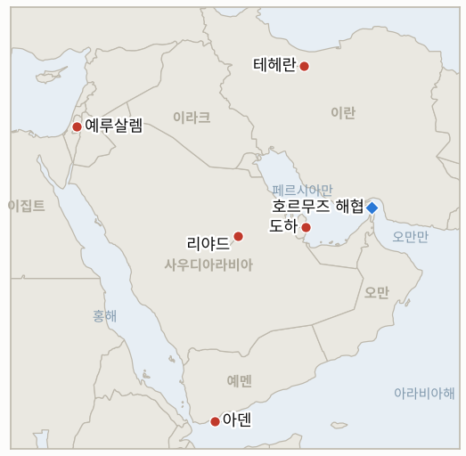

# 중동 일일 브리핑

**2026년 10월 29일**

- **보고 기간:** 약 24시간, 10월 28일 06:00 ~ 10월 29일 06:00 (한국시간)
- **종합 평가:** 이스라엘 개표율 약 90% 시점에서 네타냐후 블록은 53석, 야권은 67석(이 중 아랍계 정당 19석)으로 어느 블록도 61석에 근접하지 못했다(§1.1). WSJ는 밴스 부통령이 테헤란에 서한을 보냈다고 보도했고, 워싱턴은 걸프 국가들에 11월 3일 중간선거 뒤 짧고 강한 작전에 대비하라고 알렸다(§1.2). 이란 페르시아만 해협청은 11월 1일부터 한국 해운사 시노코에 법적 조치를 하겠다고 경고했다(§1.3). 코스피는 SK하이닉스의 사상 최대 이익에 6.63% 급등해 6,012.44로 마감했고, 원화는 1,337.7원으로 약세를 보였으며, 연준은 동결했다(§1.5).

---

## 1. 무슨 일이 있었나

<figure style="float:right; width:46%; margin:2pt 0 8pt 14pt;">

<figcaption style="font-size:8pt; color:#666; text-align:center; margin-top:3pt; font-style:italic;">주요 논의 지점</figcaption>
</figure>

### 1.1 이스라엘 개표율 약 90%에서 네타냐후는 53석이고 어느 블록도 과반에 근접하지 못한다

개표율 89.8% 시점에서 네타냐후 블록은 120석 중 53석, 야권은 67석(유대계 48석, 아랍계 정당 19석)이며, 리쿠드가 26석으로 1위, 아이젠코트의 야샤르가 21석이다([Times of Israel](https://www.timesofisrael.com/liveblog-october-28-2026/); [Ynet](https://www.ynetnews.com/article/hjnatbkaml)). 나머지 표(군인, 외교관, 수감자)는 10월 29일 저녁까지, 공식 결과는 11월 4일까지 나올 예정이며, 이후 헤르조그 대통령이 조각 시도자를 정한다([NBC](https://www.nbcnews.com/world/israel/live-blog/israel-election-live-updates-netanyahu-eisenkot-voters-war-iran-gaza-rcna604979)). 아랍계 정당과의 연정을 배제한 아이젠코트는 "주류 시온주의 다수"의 승리라고 주장했고, 네타냐후는 벤그비르·스모트리치와의 연정이 유지된다고 밝혔으며, 리베르만은 아이젠코트·네타냐후 통합 정부를 원한다고 보도됐다. 미국 관리는 백악관이 연정 협상에 개입할지 정하지 않았다고 말했다. **신뢰도: 53·67 구도는 높음(여러 매체, 거의 확정된 개표); 연정 움직임은 중간(채널 14와 익명 보도).**

### 1.2 WSJ가 밴스의 테헤란 서한을 보도하고 워싱턴은 걸프국에 중간선거 뒤 짧고 강한 작전에 대비하라고 알린다

WSJ는 밴스 부통령이 이란 최고국가안보회의 사무총장 모흐센 레자에이에게 협상 재개를 위한 서한을 보냈다고 전했으나 로이터는 확인하지 못했다([Times of Israel](https://www.timesofisrael.com/liveblog-october-28-2026/)). WSJ는 또 미국이 걸프 국가들에 11월 3일 이후 "짧고 강한" 작전에 대비하라고 알렸다고 보도했고, 트럼프는 네타냐후와 함께 "끝장을 내야 한다"면서 타격 가능성을 배제하지 않았다([Gulf News](https://gulfnews.com/world/mena/middle-east-war-netanyahu-says-he-could-work-with-trump-to-eliminate-iran-threat-after-israel-election-iran-war-cost-hits-471bn-hormuz-tensions-rise-1.500726349)). 외교 경로에서는 카타르가 일요일 테헤란에 합의 초안을 전했고 주말까지 답을 기대하고 있으나, 이란 고위 관리 한 명은 로이터에 카타르가 "받아들일 수 없는 생각일 뿐 제안이 아니다"라고 말했고, 아락치 외무장관은 전쟁 종식과 호르무즈 재개방을 위한 7일 계획의 이행 방안을 중재자들과 논의 중이라고 밝혔다. 파키스탄 구상은 사우디, 튀르키예, 파키스탄, 카타르를 보증국으로 삼는 것으로 알려졌고, 국방부는 전쟁 비용을 471억 달러로 집계했다. **신뢰도: 워싱턴이 두 선택지를 모두 열어 둔다는 점은 높음(여러 매체); 밴스 서한은 낮음(WSJ 단독, 미확인); 카타르 초안은 중간(이란 측 설명이 엇갈림).**

### 1.3 이란 페르시아만 해협청이 11월 1일부터 한국 시노코에 법적 조치를 예고한다

해협청은 최근 3개월간 통항 규정을 가장 많이 위반한 선박이 시노코 소속이며 이미 최소 7척에 조치를 취했고 11월 1일부터 시노코 소속 모든 선박에 법적 조치를 하겠다고 밝혔다. 한국 언론은 벌금, 억류, 몰수가 가능하다고 전한다([Gulf News](https://gulfnews.com/world/mena/middle-east-war-netanyahu-says-he-could-work-with-trump-to-eliminate-iran-threat-after-israel-election-iran-war-cost-hits-471bn-hormuz-tensions-rise-1.500726349); [뉴스1](https://www.news1.kr/world/middleeast-africa/6333997); [서울경제](https://www.sedaily.com/article/20106868)). 한국해운협회는 지목된 선박이 시노코 소유가 아니라 외국 석유회사에 재용선된 선박이고 승선 인력이 전원 외국인이라고 밝혔으며, 시노코는 그런 통보를 파악한 바 없다고 했다([파이낸셜뉴스](https://www.fnnews.com/news/202610281348448725)). 한국 언론이 인용한 블룸버그 분석에 따르면 시노코 소유 유조선은 9월 호르무즈 원유 물량의 약 37%(2억 8,630만 배럴 중 1억 560만 배럴)를 실어 날랐다. 별도로 UKMTO는 오만만과 호르무즈의 선박이 이란 항구 봉쇄에 따른 미군의 승선·검색을 받을 수 있다고 경고했다. **신뢰도: 경고 발표 사실은 높음(여러 매체); 법적 의미는 중간(조치 내용 미공개); 소유 관계는 중간(해운협회 발표).**

### 1.4 후티가 아덴 공항을 두 차례 타격하고 사우디는 리야드로 향한 미사일을 격추한다

사우디군은 리야드와 동부 지역을 겨냥한 후티 탄도미사일 5발을 파괴했고, 후티 미사일 한 발이 아덴 공항 경계 안에 떨어져 그날 두 번째 공격이 됐다([Gulf News](https://gulfnews.com/world/mena/middle-east-war-netanyahu-says-he-could-work-with-trump-to-eliminate-iran-threat-after-israel-election-iran-war-cost-hits-471bn-hormuz-tensions-rise-1.500726349)). 후티는 사우디의 알자우프주 공습으로 14명이 숨졌다고 했으나 잠정 집계이며 검증하지 못했다. 원유 거래자들은 후티 공격과 미국의 타격 위협을 브렌트유 상승 요인으로 꼽았다([The National](https://www.thenationalnews.com/business/energy/2026/10/28/oil-prices-up-due-to-houthi-strikes-and-us-threat-to-renew-iran-war/)). 영국은 역내 15개국에 "갑작스러운 확전" 경보를 냈고 호주는 사우디 전면 여행 자제를 권고했다. **신뢰도: 사우디의 요격은 높음(공식 발표, 여러 매체); 자우프 사망자 수는 낮음(후티 주장); 아덴 공격은 중간(단일 라이브 블로그).**

### 1.5 SK하이닉스 덕에 코스피가 6.63% 급등해 6,000을 넘고 연준은 동결하며 브렌트유는 오른다

코스피는 374.10포인트(6.63%) 오른 6,012.44로 마감해 10거래일 만에 6,000선을 회복했다. SK하이닉스가 3분기 영업이익 83조 3,000억 원으로 사상 최대를 기록하고 매출이 처음 100조 원을 넘었으며 약 100조 원 규모의 주주환원책을 발표한 데 따른 것으로, SK하이닉스는 약 11%, 삼성전자는 9% 올랐다([한국일보](https://www.hankookilbo.com/news/article/A2026102814530005167); [폴리뉴스](https://www.polinews.co.kr/news/articleView.html?idxno=747116)). 외국인이 약 8,160억 원, 기관이 약 9,610억 원 순매수했고 개인은 약 1조 8,000억 원 순매도했으며, 원/달러 환율은 14.0원 오른 1,337.7원에 마감했다. 브렌트유는 약 115.32달러, WTI는 102.78달러에 정산됐고([CNBC](https://www.cnbc.com/2026/10/28/oil-price-today-wti-brent-hormuz.html), 검색 요약 경유), 연준은 기준금리를 3.75~4.00%로 동결했으며 쿡과 해맥이 인상을 주장해 10대 2로 갈렸다([Fox Business](https://www.foxbusiness.com/economy/federal-reserve-interest-rate-decision-october-28-2026)). **신뢰도: 코스피, 하이닉스, 연준 수치는 높음(여러 매체); 원화 종가와 유가 정산가는 중간(단일 또는 재인용 출처).**

---

## 2. 심층 분석: 유인과 동기

### 2.1 워싱턴은 왜 테헤란에 서한을 보내면서 걸프국에는 작전을 예고하는가?

두 조치는 압박과 출구를 동시에 제공한다. 타격을 예상하는 걸프국은 11월 3일 전에 합의하라고 테헤란과 중재자들을 압박하고, 서한은 어떤 합의든 트럼프가 자기 성과로 내세울 수 있게 한다. 서한이 사실이라면 타격 발언보다 백악관이 중간선거 전에 결과를 원한다는 신호이기도 하다.

### 2.2 이란은 왜 카타르 초안에 엇갈린 답을 내놓는가?

엇갈린 설명은 초안이 이란이 수용하거나 공개 거부해야 하는 기준선이 되는 것을 막는다. 7일 계획과 사우디·튀르키예·파키스탄 관리와의 테헤란 회담은 이란이 워싱턴에 답을 미루는 동안 역내 경로를 자기 것으로 보이게 한다.

### 2.3 왜 지금 한국 해운사 시노코를 겨냥하는가?

시노코는 호르무즈 원유 수송에서 비중이 커서, 이 회사를 압박하면 강대국과 정면충돌하지 않고도 비허가 통항의 대가를 다른 선사들에 보여 줄 수 있다. 해운협회의 반박은 서울과 업계가 공개 충돌을 피하고 문제를 용선주를 통해 풀려 할 수 있음을 보여 준다.

### 2.4 53석 대 48석인데 네타냐후와 아이젠코트는 왜 계속 승리를 주장하는가?

둘 다 소수 정당이나 아랍계 정당 없이는 61석에 이를 수 없고 아이젠코트는 후자를 배제했으므로, 각자의 주장은 헤르조그 대통령과 군소 정당이 누구를 자연스러운 지도자로 보게 하느냐를 겨냥한다. 네타냐후가 트럼프와 이란을 끝장내겠다고 계속 말하는 것도 아이젠코트가 쉽게 맞서기 어려운 안보 논거가 된다.

### 2.5 후티는 왜 아덴과 리야드를 함께 타격하는가?

아덴 타격은 예멘 안의 사우디 지원 세력을, 리야드로 향한 미사일은 사우디 중심부를 겨냥해 방공망을 두 전선으로 분산시킨다. 또 이집트의 리야드 지원 승인에 맞서 합류의 대가를 보여 주는 효과도 있다.

---

## 3. 대한민국 정책적 함의

**노출도 요약:** 한국은 원유의 약 70.7%, LNG의 약 20.4%를 중동에서 들여온다(`instructions/korea-exposure.md`, 갱신 불필요). 10월 28일 수요일 최신 수치는 코스피 6,012.44(6.63% 상승, 외국인과 기관 순매수, 매수 사이드카 이틀째), 원/달러 환율 1,337.7원(14.0원 상승)이다. 브렌트유는 약 115.32달러, WTI는 102.78달러에 정산됐다. 삼성전자는 10월 29일 실적을 발표한다. 연준은 3.75~4.00%로 동결했고 워시 의장은 12월 전망 제시를 거부했다. 시노코 경고는 이 시리즈에서 한국을 직접 겨냥한 첫 호르무즈 조치이며, 한국해운협회는 소유 관계 전제를 반박했고 정부 부처의 대응은 확인하지 못했다. 사우디 여행경보는 10월 11일 이후 3단계에 머물러 있다.

**전개별 함의:**

- **이스라엘(§1.1):** 11월 4일 공식 결과까지 의회 교착이 이어지면 이란 관련 이스라엘 정책은 과도 정부 손에 남는다(IND-20261028-1, IND-20261028-2).
- **미국의 태세(§1.2):** 11월 3일 이후 "짧고 강한" 작전은 한국의 유가와 원화에 가장 큰 꼬리 위험이며, IND-20261023-3의 기한은 11월 6일이고 밴스 서한은 IND-20261029-3으로 추적한다.
- **시노코(§1.3):** 억류나 벌금이 나오면 9월 호르무즈 원유의 약 37%를 나른 선사가 타격을 받고, 서울이 영사·외교 개입에 나설지 시험대에 오른다(IND-20261029-1).
- **사우디 전선(§1.4):** 리야드와 아덴에 대한 공격이 이어지면 사우디 여행경보와 공항 운항 중단 지표가 계속 유효하다(IND-20261027-3).
- **시장(§1.5):** 코스피는 5,300선보다 712포인트 위에 있고(IND-20261024-3), 원화는 1,350원 기준선보다 12.3원 낮으며(IND-20261026-2), 삼성전자 실적이 다음 시험대다(IND-20261029-2).

**오늘 종결:** IND-20261028-3 **확인**(10월 28일 코스피 종가 6,012.44로 5,800 초과). IND-20261022-1, IND-20261022-2는 기한(약 2026-10-29)에 **만료**(3단계 초과 여행경보 상향 없음, 이란 영토에 대한 미국·이스라엘의 인정된 타격 없음).

**검증 가능한 지표:**

- **IND-20261029-1**(진행 중, 신규): 2026-11-08경까지 이란 페르시아만 해협청, 한국 정부 부처 또는 시노코가 시노코 소유·운영 선박에 대한 벌금, 억류 또는 나포를 확인하면 확인, 없으면 반증.
- **IND-20261029-2**(진행 중, 신규): 10월 30일 코스피 종가가 6,000 이상이면 삼성전자 실적 이후에도 반등 유지로 확인, 그보다 낮으면 반증.
- **IND-20261029-3**(진행 중, 신규): 2026-11-03경까지 미국 또는 이란 관리가 밴스 서한을 공식 확인하거나 테헤란이 카타르 초안에 공식 답하면 확인, 없으면 반증.
- **IND-20261028-1, -2**(진행 중): 2026-11-02경까지 최종 개표에서 어느 한 블록이 61석 이상; 2026-11-10경까지 헤르조그 대통령이 아이젠코트에게 조각 위임.
- **IND-20261027-1, -2, -3, -4**(진행 중): 2026-11-10경까지 이집트 파병; 2026-11-03경까지 미국·이란 협상 또는 미국 답신; 2026-11-03경까지 리야드 운항 재중단; 2026-10-30경까지 브렌트유 정산가 110달러 미만.
- **IND-20261026-1, -2, -3**(진행 중): 2026-10-31경까지 미국·이란 협상 개최; 10월 30일까지 원/달러 종가 1,350원 초과; 10월 24~30일 UKMTO 집계 10건 이상.
- **IND-20261024-1, -2, -3**(진행 중): 2026-11-01경까지 미 호위 선단 또는 혁명수비대의 미군 기지 공격; 2026-10-30경까지 브렌트유 120달러 초과; 10월 30일까지 코스피 종가 5,300 미만.

---

## 4. 주시 목록

- **오늘 밤 나오는 이스라엘 최종 개표와 11월 4일 공식 결과(IND-20261028-1, -2).**
- **워싱턴이나 테헤란이 밴스 서한을 확인하는지, 카타르 초안에 대한 이란의 답(IND-20261029-3, IND-20261027-2).**
- **11월 1일 시노코 기한과 한국 정부의 대응(IND-20261029-1).**
- **삼성전자 실적과 코스피 6,000선(IND-20261029-2).**
- **후티의 아덴·리야드 공격과 사우디의 자우프 보복(IND-20261027-3).**
- **11월 3일 중간선거 이후 미국의 타격(IND-20261023-3).**

---

## 5. 출처 품질 요약

| 주장 | 출처 | 신뢰도 |
| --- | --- | --- |
| 이스라엘 개표율 89.8%: 네타냐후 블록 53석, 야권 67석(48 + 아랍계 19) | Times of Israel 라이브 블로그, Ynet | 높음 |
| 연정 움직임; 통합 정부론 | Times of Israel 라이브 블로그(채널 14, 보도) | 중간 |
| 밴스의 레자에이 앞 서한 | WSJ(Times of Israel 라이브 블로그 경유), 로이터 확인 불가 | 낮음 |
| 미국이 걸프국에 짧고 강한 작전 대비 통보 | WSJ(Gulf News 경유) | 중간 |
| 카타르 초안; 이란 관리들의 엇갈린 설명 | Gulf News, 로이터 | 중간 |
| 아락치 7일 계획; 파키스탄 보증국 구상 | Gulf News | 중간 |
| 11월 1일부터 시노코 법적 조치 경고 | Gulf News, 뉴스1, 서울경제 | 높음 |
| 시노코 소유 관계 반박; 9월 호르무즈 원유의 37% | 파이낸셜뉴스, 한국 언론 인용 블룸버그 | 중간 |
| 후티의 아덴 타격; 리야드로 향한 미사일 5발 격추 | Gulf News 라이브 블로그 | 중간 |
| 자우프 사망자 14명 | 후티 발표 | 낮음 |
| 코스피 6,012.44; SK하이닉스 사상 최대 실적 | 한국일보, 폴리뉴스, 비즈니스코리아 | 높음 |
| 원화 1,337.7 | 알파경제(인베스팅닷컴 코리아) | 중간 |
| 브렌트 115.32, WTI 102.78 | CNBC(검색 요약 경유) | 중간 |
| 연준 3.75~4.00% 동결, 10대 2 | Fox Business, CNBC, CBS | 높음 |
| 호르무즈 통항 건수; 한국 정부의 새 조치 | 보도 없음 | 보도 없음 |
