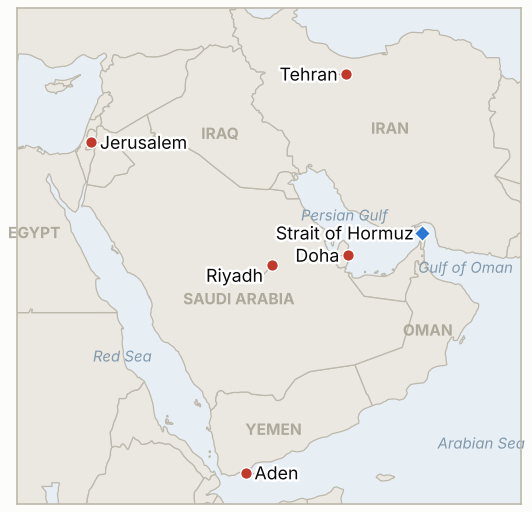

# Middle East Daily Briefing

**October 29, 2026**

- **Reporting window:** ~24 hours, October 28, 06:00 to October 29, 06:00 KST
- **Overall assessment:** With about 90% of Israeli votes counted, Netanyahu's bloc holds 53 seats and the opposition 67, of which 19 are Arab party seats, so no bloc nears 61 (§1.1). The WSJ reported that Vice President Vance wrote to Tehran while Washington told Gulf states to prepare for a short, intense campaign after the November 3 midterms (§1.2). Iran's Gulf Strait Authority threatened legal action against the Korean operator Sinokor from November 1 (§1.3). The KOSPI jumped 6.63% to 6,012.44 on SK Hynix's record profit, the won weakened to 1,337.7, and the Fed held (§1.5).

---

## 1. What Happened

<figure style="float:right; width:46%; margin:2pt 0 8pt 14pt;">

<figcaption style="font-size:8pt; color:#666; text-align:center; margin-top:3pt; font-style:italic;">Major places of discussion</figcaption>
</figure>

### 1.1 Israel's count at about 90% leaves Netanyahu at 53 seats and no bloc near a majority

With 89.8% of votes counted, Netanyahu's bloc holds 53 of 120 seats and his opponents 67, made up of 48 Jewish-led seats and 19 Arab party seats; Likud leads with 26 and Eisenkot's Yashar has 21 ([Times of Israel](https://www.timesofisrael.com/liveblog-october-28-2026/); [Ynet](https://www.ynetnews.com/article/hjnatbkaml)). The remaining ballots (soldiers, diplomats, prisoners) are due by the evening of October 29, and official results by November 4, after which President Herzog picks who tries to form a government ([NBC](https://www.nbcnews.com/world/israel/live-blog/israel-election-live-updates-netanyahu-eisenkot-voters-war-iran-gaza-rcna604979)). Eisenkot, who has ruled out governing with Arab parties, claimed a victory for the "mainstream Zionist majority," Netanyahu said his coalition with Ben Gvir and Smotrich stays together, and Liberman was reported to want an Eisenkot-Netanyahu unity government. A US official said the White House has not decided whether to intervene in coalition talks. **Confidence: High on the 53/67 split (several outlets, near-final count); Medium on coalition maneuvering (Channel 14 and anonymous reports).**

### 1.2 WSJ says Vance wrote to Tehran as Washington warns Gulf states of a short, intense campaign after the midterms

The WSJ reported that Vice President Vance sent a letter to Iran's Supreme National Security Council chief Mohsen Rezaei to revive talks, which Reuters could not verify ([Times of Israel](https://www.timesofisrael.com/liveblog-october-28-2026/)). The WSJ also reported that Washington told Gulf states to prepare for a "short, intense" campaign after November 3, and Trump said he and Netanyahu must "finish the job" while not ruling out strikes ([Gulf News](https://gulfnews.com/world/mena/middle-east-war-netanyahu-says-he-could-work-with-trump-to-eliminate-iran-threat-after-israel-election-iran-war-cost-hits-471bn-hormuz-tensions-rise-1.500726349)). On the diplomatic track, Qatar delivered a draft agreement to Tehran on Sunday with a reply expected by the end of the week, but one senior Iranian official told Reuters Qatar offered "unacceptable ideas and not an offer," and Araghchi said Tehran is discussing with mediators how to carry out its seven day plan to end the war and reopen Hormuz. A Pakistani plan reportedly would make Saudi Arabia, Turkey, Pakistan and Qatar guarantors, and the Pentagon put war costs at $47.1 billion. **Confidence: High that Washington keeps both options open (multiple outlets); Low on the Vance letter (single WSJ report, unverified); Medium on the Qatari draft (Iranian accounts conflict).**

### 1.3 Iran's Gulf Strait Authority threatens legal action against Korea's Sinokor from November 1

The authority said Sinokor vessels had committed the most transit rule violations in the strait over three months, that it had already acted against at least seven, and that all Sinokor ships would face legal action from November 1; Korean reports say that could mean fines, detention or confiscation ([Gulf News](https://gulfnews.com/world/mena/middle-east-war-netanyahu-says-he-could-work-with-trump-to-eliminate-iran-threat-after-israel-election-iran-war-cost-hits-471bn-hormuz-tensions-rise-1.500726349); [News1](https://www.news1.kr/world/middleeast-africa/6333997); [Seoul Economic Daily](https://www.sedaily.com/article/20106868)). The Korea Shipowners' Association said the ships named are chartered to foreign oil companies rather than owned by Sinokor and crewed entirely by foreign seamen, and Sinokor said it knew of no such notice ([Financial News](https://www.fnnews.com/news/202610281348448725)). Bloomberg analysis cited by Korean outlets put Sinokor-owned tankers at about 37% of September Hormuz crude volume (105.6 million of 286.3 million barrels). Separately, UKMTO warned ships in the Gulf of Oman and Hormuz may face US boarding and inspection under the blockade of Iranian ports. **Confidence: High that the warning was issued (several outlets); Medium on its legal meaning (measures unspecified); Medium on ownership details (shipping association statement).**

### 1.4 Houthis hit Aden airport twice as Saudi Arabia downs missiles aimed at Riyadh

Saudi forces destroyed five Houthi ballistic missiles aimed at Riyadh and the Eastern Region, and a Houthi missile struck inside the perimeter of Aden airport, the second attack there that day ([Gulf News](https://gulfnews.com/world/mena/middle-east-war-netanyahu-says-he-could-work-with-trump-to-eliminate-iran-threat-after-israel-election-iran-war-cost-hits-471bn-hormuz-tensions-rise-1.500726349)). The Houthis said Saudi strikes in Jawf province killed 14 people, a preliminary toll we could not verify. Oil traders cited the Houthi attacks and the US strike threat as reasons Brent rose ([The National](https://www.thenationalnews.com/business/energy/2026/10/28/oil-prices-up-due-to-houthi-strikes-and-us-threat-to-renew-iran-war/)). The UK issued security alerts for 15 regional countries warning of "sudden escalation," and Australia advised against all travel to Saudi Arabia. **Confidence: High on the Saudi interceptions (official statements via several outlets); Low on the Jawf toll (Houthi claim); Medium on the Aden strike (single live blog).**

### 1.5 KOSPI jumps 6.63% above 6,000 on SK Hynix as the Fed holds and Brent rises

The KOSPI closed up 374.10 points (6.63%) at 6,012.44, its first close above 6,000 in 10 sessions, after SK Hynix reported record third quarter operating profit of 83.3 trillion won and revenue above 100 trillion won and announced a shareholder return plan of about 100 trillion won; its shares rose about 11% and Samsung Electronics 9% ([Hankook Ilbo](https://www.hankookilbo.com/news/article/A2026102814530005167); [Polinews](https://www.polinews.co.kr/news/articleView.html?idxno=747116)). Foreigners net bought about 816 billion won and institutions about 961 billion won while individuals net sold about 1.8 trillion won, and the won closed at 1,337.7 per dollar, 14.0 weaker. Brent settled at about $115.32 and WTI at $102.78 ([CNBC](https://www.cnbc.com/2026/10/28/oil-price-today-wti-brent-hormuz.html), via search summary), and the Fed held at 3.75% to 4.00% in a 10 to 2 vote with Cook and Hammack dissenting for a hike ([Fox Business](https://www.foxbusiness.com/economy/federal-reserve-interest-rate-decision-october-28-2026)). **Confidence: High on the KOSPI, Hynix and Fed figures (several outlets); Medium on the won close and oil settles (single or secondhand sources).**

---

## 2. Deep Dive: Incentives and Motives

### 2.1 Why would Washington warn Gulf states of a campaign while sending Tehran a letter?

The two moves apply pressure and offer an exit at once: Gulf states that expect strikes press Tehran and mediators to deal before November 3, and a letter lets Trump claim any deal as his own. If the letter is real, it also signals that the White House wants a result before the midterms more than the strike talk suggests.

### 2.2 Why does Iran answer the Qatari draft with contradictions?

Contradictory Iranian accounts keep the draft from becoming a baseline that Tehran must accept or visibly reject. The seven day plan and the Tehran meeting with Saudi, Turkish and Pakistani officials let Iran frame the regional track as its own while it withholds a reply to Washington.

### 2.3 Why target Sinokor, a Korean shipper, now?

Sinokor carries a large share of Hormuz crude, so pressure on it shows other operators what unapproved transits cost without confronting a major power. The shipping association's rebuttal shows Seoul and the industry will avoid a public fight and may route the problem through charterers.

### 2.4 Why do Netanyahu and Eisenkot both keep claiming victory at 53 versus 48?

Neither can reach 61 without small parties or Arab parties, which Eisenkot has ruled out, so each claim is about shaping who Herzog and the small parties see as the natural leader. Netanyahu's steady talk about finishing Iran with Trump also gives him a security argument that Eisenkot cannot easily match.

### 2.5 Why do the Houthis keep striking Aden and Riyadh together?

Hitting Aden targets the Saudi-backed side in Yemen while missiles at Riyadh target the Saudi core, which stretches air defenses across two fronts. The attacks also answer Egypt's authorization of support for Riyadh by showing the cost of joining.

---

## 3. Policy Implications for South Korea

**Exposure snapshot:** South Korea draws about 70.7% of its crude and 20.4% of its LNG from the Middle East (`instructions/korea-exposure.md`, no update needed). Latest prints, Wednesday October 28: KOSPI 6,012.44 (up 6.63%, foreigners and institutions net buying, a buy sidecar a second day) and the won at 1,337.7 per dollar, 14.0 weaker. Brent settled about $115.32 and WTI $102.78. Samsung Electronics reports October 29. The Fed held at 3.75% to 4.00%, and Chair Warsh declined to guide on December. The Sinokor warning is the first Korea-specific Hormuz measure in this series; the Korea Shipowners' Association disputes the ownership premise, and I found no ministry response. The Saudi advisory has stood at level 3 since October 11.

**Implications by development:**

- **Israel (§1.1):** A hung Knesset into November, with official results due by November 4, keeps Israeli policy on Iran in the hands of a caretaker government (IND-20261028-1, IND-20261028-2).
- **US posture (§1.2):** A "short, intense" campaign after November 3 is the main tail risk for Korean oil prices and the won; the strike deadline for IND-20261023-3 is November 6, and the Vance letter is tracked in IND-20261029-3.
- **Sinokor (§1.3):** Any detention or fine would hit a carrier of about 37% of September Hormuz crude and would test whether Seoul seeks consular or diplomatic intervention (IND-20261029-1).
- **Saudi front (§1.4):** Continued strikes on Riyadh and Aden keep the Saudi advisory and airport suspension indicators live (IND-20261027-3).
- **Markets (§1.5):** The KOSPI is now 712 points above the 5,300 line (IND-20261024-3); the won at 1,337.7 sits 12.3 below the 1,350 trigger (IND-20261026-2), and Samsung's results set the next test (IND-20261029-2).

**Resolved today:** IND-20261028-3 **confirmed** (KOSPI closed at 6,012.44, above 5,800, on October 28). IND-20261022-1 and IND-20261022-2 **expired** at their ~2026-10-29 deadlines (no Seoul advisory above level 3 found; no acknowledged US or Israeli strike on Iranian territory).

**Testable indicators:**

- **IND-20261029-1** (open, new): Iran's Gulf Strait Authority, a Korean ministry or Sinokor confirming a fine, detention or seizure of a Sinokor owned or operated ship by ~2026-11-08 confirms; none falsifies.
- **IND-20261029-2** (open, new): A KOSPI close at or above 6,000 on October 30 confirms the rebound holds through Samsung's results; a lower close falsifies.
- **IND-20261029-3** (open, new): A US or Iranian official confirming on record the reported Vance letter, or Tehran's formal reply to the Qatari draft, by ~2026-11-03 confirms; none falsifies.
- **IND-20261028-1, -2** (open): Either Israeli bloc at 61 or more in the final count by ~2026-11-02; Herzog's mandate to Eisenkot by ~2026-11-10.
- **IND-20261027-1, -2, -3, -4** (open): Egyptian deployment by ~2026-11-10; US-Iran session or US reply by ~2026-11-03; new Riyadh flight suspension by ~2026-11-03; Brent settle below $110 by ~2026-10-30.
- **IND-20261026-1, -2, -3** (open): US-Iran session by ~2026-10-31; USD/KRW close above 1,350 by October 30; UKMTO tally of 10 or more for October 24 to 30.
- **IND-20261024-1, -2, -3** (open): US escorted convoy or IRGC attack on a US base by ~2026-11-01; Brent above $120 by ~2026-10-30; KOSPI close below 5,300 by October 30.

---

## 4. Watch List

- **Final Israeli count tonight and the November 4 official results (IND-20261028-1, -2).**
- **Whether Washington or Tehran confirms the Vance letter, and Iran's answer to the Qatari draft (IND-20261029-3, IND-20261027-2).**
- **November 1 Sinokor deadline and any Korean government response (IND-20261029-1).**
- **Samsung Electronics results and the KOSPI at 6,000 (IND-20261029-2).**
- **Houthi strikes on Aden and Riyadh and Saudi retaliation in Jawf (IND-20261027-3).**
- **A US strike after the November 3 midterms (IND-20261023-3).**

---

## 5. Source Quality Summary

| Claim | Sources | Confidence |
| --- | --- | --- |
| Israeli count 89.8%: bloc 53, opposition 67 (48 + 19 Arab) | Times of Israel live blog; Ynet | High |
| Coalition maneuvering; unity government talk | Times of Israel live blog (Channel 14, reports) | Medium |
| Vance letter to Rezaei | WSJ via Times of Israel live blog; Reuters could not verify | Low |
| US told Gulf states to prepare for short, intense campaign | WSJ via Gulf News | Medium |
| Qatari draft; Iranian officials contradict each other | Gulf News; Reuters | Medium |
| Araghchi seven day plan; Pakistani guarantor plan | Gulf News | Medium |
| Sinokor legal action warning from November 1 | Gulf News; News1; Seoul Economic Daily | High |
| Sinokor ownership rebuttal; 37% of September Hormuz crude | Financial News; Bloomberg via Korean outlets | Medium |
| Houthi strikes on Aden; five missiles downed aimed at Riyadh | Gulf News live blog | Medium |
| Jawf strike toll of 14 | Houthi statement | Low |
| KOSPI 6,012.44; SK Hynix record results | Hankook Ilbo; Polinews; Businesskorea | High |
| Won 1,337.7 | Alpha Economy via investing.com Korea | Medium |
| Brent 115.32, WTI 102.78 | CNBC via search summary | Medium |
| Fed holds 3.75% to 4.00%, 10 to 2 | Fox Business; CNBC; CBS | High |
| Hormuz transit count; new Korean government measure | Not reported | Not reported |
