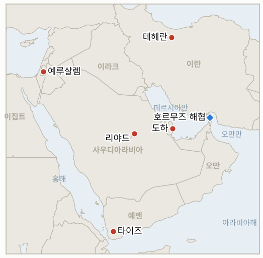

# 중동 일일 브리핑

**2026년 10월 30일**

- **보고 기간:** 약 24시간, 10월 29일 06:00 ~ 10월 30일 06:00 (한국시간)
- **종합 평가:** 이란은 미국이 권하는 호르무즈 남쪽 항로에서 유조선 4척이 기뢰에 부딪혔다고 주장했고, 혁명수비대는 중부사령부의 기뢰 제거 주장에 이의를 제기했다(§1.1). 트럼프는 밴스 부통령의 대이란 접촉을 승인했다고 인정했지만 협상이 아니라 의료 지원이라고 했으며, 11월 3일 중간선거 뒤를 겨냥한 군사 옵션 준비 보도가 이어졌다(§1.2). 이스라엘 개표는 거의 끝났으나 어느 블록도 61석에 근접하지 못했다(§1.3). 코스피는 삼성전자의 사상 최대 이익이 빈약한 자사주 계획과 만나 1.24% 내린 5,937.66으로 마감했다(§1.5).

**정정 및 업데이트:** 10월 29일자 브리핑(§1.2)은 밴스 서한을 WSJ 단독 보도라는 이유로 신뢰도 낮음으로 평가했다. 이제 트럼프가 공개적으로 접촉 승인을 인정했고 CBS와 악시오스는 서한이 카타르를 통해 전달됐다고 보도했다(IND-20261029-3 확인). 10월 29일자 IND-20261029-2(10월 30일 코스피 6,000 이상 마감)는 계속 열려 있다. 10월 29일 종가 5,937.66은 그 선 아래이지만 판단 대상은 10월 30일 종가다.

---

## 1. 무슨 일이 있었나

<figure style="float:right; width:46%; margin:2pt 0 8pt 14pt;">

<figcaption style="font-size:8pt; color:#666; text-align:center; margin-top:3pt; font-style:italic;">주요 논의 지점</figcaption>
</figure>

### 1.1 이란이 미국이 권하는 남쪽 항로에서 유조선 4척이 기뢰에 부딪혔다고 주장하고 혁명수비대는 중부사령부의 제거 주장에 이의를 제기한다

이란 해군은 유조선 4척이 미국이 권하는 남쪽 항로를 지나다 호르무즈 해협에서 기뢰에 부딪혔다고 밝혔고, 혁명수비대는 앞서 3척이 기능을 잃었다고 했다. 영국 해상무역작전센터는 불타는 선박을 확인했다([CBS News](https://www.cbsnews.com/live-updates/iran-war-donald-trump-qatar-mediators-new-proposal-end-war/)). UKMTO는 같은 항로로 빠져나오던 유조선이 발사체에 맞았다고 별도로 보고했으며 부상자는 없고 발사 주체는 불분명하다. 혁명수비대는 중부사령부에 "성명이 아니라 독립적 증거로 호르무즈 기뢰 제거 주장을 입증하라"고 요구했다. **신뢰도: 최소 1척 피격은 중간(UKMTO 연계 확인), 4척이라는 수치는 낮음(이란 해군 주장), 발사체 발사 주체는 낮음.**

### 1.2 트럼프가 밴스의 대이란 접촉을 의료 지원으로 승인했다고 밝히며 협상 재개는 부인한다

트럼프는 테헤란의 "의료 물자 지원 필요" 때문에 밴스의 접촉을 승인했다고 말했고 부통령에게 협상 재개를 지시했다는 점은 부인했다([Al Jazeera](https://www.aljazeera.com/news/liveblog/2026/10/29/iran-war-live-trump-says-he-approved-vance-outreach-over-medical-supplies)). CBS는 서한이 카타르를 통해 모흐센 레자이에게 전달됐고 밴스가 이끄는 조기 회동을 제안했다고 보도했으며, 악시오스는 새 공격을 막기 위한 대화가 이란 핵 프로그램을 다뤄야 한다고 전했다. 타스님은 이란이 답하지 않았고 미국의 항구 봉쇄 해제, 제재 완화, 동결 자산 반환 요구를 접지 않겠다고 전했다([CBS News](https://www.cbsnews.com/live-updates/iran-war-donald-trump-qatar-mediators-new-proposal-end-war/)). 미국 관리는 카타르 초안에 대한 이란의 답이 토요일쯤 나올 것이라고 CBS에 말했다. 한편 WSJ는 브래드 쿠퍼 중부사령관이 트럼프에게 대이란 군사 옵션을 보고했고, 패트리엇 체계가 텍사스에서 이스라엘로 운송되며, 일주일 새 미군 수송기 10여 대가 이스라엘 공군기지에 착륙했다고 전했다([Times of Israel](https://timesofisrael.com/liveblog-october-29-2026)). 헤그세스 국방장관은 이란전 정보 유출 혐의로 브렛 실비아 중장도 해임했다. **신뢰도: 트럼프의 접촉 인정은 높음(공개 발언), 서한 내용은 중간(악시오스·CBS 소식통), 군사 준비는 중간(WSJ, 로이터 인용, 비행 추적 분석가).**

### 1.3 이스라엘 개표가 거의 끝나 네타냐후 블록 53석, 야샤르 48석, 아랍계 정당 19석이다

개표가 거의 끝난 시점에 네타냐후 블록은 53석, 아이젠코트의 야샤르는 48석, 아랍계 정당은 19석이며 공식 최종 결과는 11월 4일 이전에는 나오지 않을 전망이다([Times of Israel](https://timesofisrael.com/liveblog-october-29-2026)). 아이젠코트는 정부 구성, 징병법 통과, 10월 7일 진상조사 설치를 약속했고, 네타냐후는 극우 파트너를 지키겠다고 다짐했으며, 라암의 만수르 아바스는 아랍계 정당이 외부에서 지원하는 소수 정부가 성립하기 어렵다고 보았다. 초정통파 유대교연합은 아이젠코트가 이끄는 소수 정부 지지를 검토 중이라는 보도가 있고 헤르초그 대통령은 또 다른 총선을 피하자고 촉구했다. 샤바크 소식통은 카타르 등 3개국이 연루된 것으로 전해진 외국의 선거 개입 의혹 조사가 결과를 바꿀 수 없다고 말했다. **신뢰도: 의석 분포는 높음(다수 매체), 연정 움직임은 중간(채널 12 등 보도), 외국 개입 주장은 낮음(익명 소식통).**

### 1.4 사우디군이 리야드로 향한 후티 미사일을 격추하고 타이즈에서 사우디 공습으로 12명이 숨졌다고 보도된다

사우디 주도 연합군은 리야드를 향해 발사된 후티 미사일 2발을 파괴했다고 밝혔다([Al Jazeera](https://www.aljazeera.com/news/liveblog/2026/10/29/iran-war-live-tehran-presses-7-day-hormuz-plan-trump-denies-peace-talks)). CBS는 타이즈주에서 사우디 공습으로 12명이 숨졌다고 전했고, 휴먼라이츠워치는 후티가 포위된 타이즈 시의 민간인에게 식량, 물, 의약품을 막고 있으며 이는 기아를 전쟁 수단으로 쓰는 전쟁범죄에 해당할 수 있다고 밝혔다. 유가 거래자들은 사우디 시설에 대한 후티 공격을 브렌트유 114달러 위 상승의 한 요인으로 꼽았다. **신뢰도: 요격은 높음(연합군 발표), 타이즈 사망자 수는 중간(단일 실시간 블로그), HRW의 주장 제기는 높음.**

### 1.5 삼성전자의 사상 최대 이익이 빈약한 자사주 계획과 만나 코스피가 1.24% 내린 5,937.66으로 마감한다

코스피는 장 초반 6,100을 넘었다가 장중 저점 5,817.92를 찍고 74.78포인트(1.24%) 내린 5,937.66으로 마감했다([한국일보](https://www.hankookilbo.com/news/article/A2026102916580005679); [글로벌이코노믹](https://www.g-enews.com/article/Securities/2026/10/202610291553189899923c501012_1)). 삼성전자는 3분기 매출 195조 3,000억 원에 영업이익 107조 4,000억 원으로 사상 최대 실적을 냈지만, 현금배당 약 30조 원만 발표하고 나머지 55조~75조 원의 2026년 주주환원 세부안을 내년 1월 말로 미뤄 주가가 4.13% 내린 23만 2,000원이 됐다. SK하이닉스는 60조 원 주주환원책을 내놓고 2.62% 오른 152만 6,000원이었다. 외국인은 약 700억 원 순매수했고 기관은 약 4,450억 원 순매도했다. 브렌트유와 WTI 정산가는 찾지 못했고, 그리니치 03:51 시세는 브렌트유 약 114.10달러, WTI 약 101.45달러로 평화 협상 기대에 모두 내렸으며 원화 종가도 찾지 못했다. **신뢰도: 코스피와 삼성전자 수치는 높음(다수 매체), 유가는 낮음(이른 시세, 정산가 없음), 원화는 미확인.**

---

## 2. 심층 분석: 동기와 유인

### 2.1 트럼프는 왜 밴스 서한을 의료 지원이라고 부르는가?

의료 지원이라고 부르면 중간선거 뒤 공격 위협을 지지층과 이스라엘에 믿을 만하게 유지하면서 대화 통로도 열어 둘 수 있다. 협상이라고 부른 적이 없으므로 테헤란이 거부해도 실패한 접근을 부인할 수 있다.

### 2.2 이란은 왜 기뢰와 타스님의 요구를 동시에 강조하는가?

미국이 권하는 항로의 유조선이 기뢰에 맞았다는 보도는 봉쇄와 호위 구상이 위험하다는 논리를 뒷받침해 보험료를 올리고 통항에 이란의 허가가 필요하다는 주장을 강화한다. 봉쇄, 제재, 동결 자산 요구를 되풀이하는 것은 밴스의 제안이 이란이 정한 값에 못 미친다는 신호다.

### 2.3 아이젠코트는 왜 지금 징병법과 10월 7일 진상조사를 약속하는가?

두 약속은 아랍계 정당 없이 소수 정부를 가능하게 할 수 있는 초정통파 정당과 중도 유권자를 겨냥한다. 또한 자신의 정부를 네타냐후의 파트너들과 단절된 것으로 규정한다.

### 2.4 삼성전자는 왜 자사주 세부안을 미루는가?

나머지 55조~75조 원을 1월로 미루면 시장이나 원화가 움직일 때 유연성을 유지할 수 있지만 주주환원 서사를 SK하이닉스에 넘겼다. 시장은 이익이 아니라 모호함을 벌했다.

### 2.5 사우디는 왜 리야드를 방어하면서 타이즈를 공습하는가?

후티 진지를 치는 것은 미사일 위협을 원천에서 줄이고 예멘 정부의 총동원을 뒷받침하려는 것이지만, 타이즈의 민간인 피해는 후티에 선전 소재를 준다. HRW의 기아 주장은 후티를 겨냥하고 있어 리야드가 같은 경쟁에서 활용할 것이다.

---

## 3. 한국에 대한 정책적 함의

**노출 현황:** 한국은 원유의 약 70.7%와 LNG의 20.4%를 중동에서 들여온다(`instructions/korea-exposure.md`, 갱신 불필요). 10월 29일 목요일 최신 수치: 코스피 5,937.66(1.24% 하락, 기관 약 4,450억 원 순매도), 브렌트유 약 114.10달러와 WTI 약 101.45달러(이른 시세, 정산가 없음), 원화 종가는 찾지 못했다(10월 28일 1,337.7원). 삼성전자의 사상 최대 이익도 6,000선을 지키지 못해 10월 30일이 시험대다. 이란의 11월 1일 경고에 대한 한국 정부나 시노코의 입장은 찾지 못했다.

**전개별 함의:**

- **호르무즈 기뢰(§1.1):** 미국이 권하는 항로의 기뢰 피격은 한국 선주들이 그 항로를 피하거나 전쟁위험 할증료를 더 낼 가능성을 높이고 시노코 노출을 부각한다(IND-20261030-1, IND-20261029-1).
- **밴스 서한(§1.2):** 공인된 대화 통로는 단기 공격 가능성을 약간 낮추지만 11월 3일 이후 군사 준비는 유가와 원화의 최대 꼬리 위험으로 남는다(IND-20261023-3, IND-20261026-1).
- **이스라엘(§1.3):** 연정 협상이 길어지면 적어도 11월 4일까지 이스라엘의 대이란 정책은 과도 정부에 남는다(IND-20261028-1, -2).
- **예멘과 사우디(§1.4):** 리야드를 향한 미사일 발사가 이어지면 사우디 여행경보와 공항 운항 중단 지표가 계속 유효하다(IND-20261027-3).
- **시장(§1.5):** 외국인 수급은 작았고 기관은 팔았으며 원화 종가는 없다(IND-20261030-3, IND-20261026-2). 시노코에 대한 서울의 침묵 자체가 지표다(IND-20261030-2).

**오늘 종결된 지표:** IND-20261029-3 **확인**(트럼프가 밴스 접촉을 공개적으로 인정). IND-20260928-2, IND-20261013-4, IND-20261016-1은 기한이 지나 **만료**(한국의 호르무즈 파견 후속 조치 미공개, 사우디 여행경보 3단계 유지, 구체적 안정화 조치 미확인).

**검증 가능한 지표:**

- **IND-20261030-1**(신규, 열림): 독립적 확인(UKMTO, JMIC, 선사, 중부사령부)이 ~2026-11-06까지 남쪽 항로의 추가 기뢰 또는 발사체 피격을 확인하면 충족, 없으면 불충족.
- **IND-20261030-2**(신규, 열림): ~2026-11-02까지 시노코 경고에 대한 한국 정부의 공식 입장이 나오면 충족, 침묵이면 불충족.
- **IND-20261030-3**(신규, 열림): ~2026-11-02까지 코스피가 한 번이라도 6,000 위로 마감하면 반등 충족, 아니면 불충족.
- **IND-20261029-1, -2**(열림): 시노코 선박 벌금, 억류, 나포 ~2026-11-08; 10월 30일 코스피 6,000 이상 마감.
- **IND-20261028-1, -2**(열림): ~2026-11-02까지 이스라엘 어느 블록이든 61석 이상; ~2026-11-10까지 헤르초그의 아이젠코트 지명.
- **IND-20261027-1, -2, -3, -4**(열림): ~2026-11-10까지 이집트 파병; ~2026-11-03까지 미·이란 회동 또는 미국 답신; ~2026-11-03까지 리야드 신규 항공편 중단; ~2026-10-30까지 브렌트유 정산가 110달러 미만.
- **IND-20261026-1, -2, -3**(열림): ~2026-10-31까지 미·이란 회동; 10월 30일까지 원·달러 종가 1,350원 초과; 10월 24~30일 UKMTO 집계 10건 이상.
- **IND-20261024-1, -2, -3**(열림): ~2026-11-01까지 미 호위 선단 또는 혁명수비대의 미군 기지 공격; ~2026-10-30까지 브렌트유 120달러 초과; 10월 30일까지 코스피 5,300 미만 마감.

---

## 4. 주시 목록

- **토요일쯤 나올 카타르 초안에 대한 이란의 답(IND-20261027-2).**
- **호르무즈 남쪽 항로의 추가 유조선 사고(IND-20261030-1).**
- **11월 1일 시노코 시한과 서울의 대응(IND-20261029-1, IND-20261030-2).**
- **11월 4일까지의 이스라엘 공식 결과와 헤르초그의 지명(IND-20261028-1, -2).**
- **11월 3일 중간선거 뒤 미국의 공격(IND-20261023-3).**
- **코스피 6,000선과 원화(IND-20261030-3).**

---

## 5. 출처 품질 요약

| 주장 | 출처 | 신뢰도 |
| --- | --- | --- |
| 이란, 남쪽 항로에서 유조선 4척 기뢰 피격 주장, 불타는 선박 | CBS 실시간 속보(이란 해군, 혁명수비대, UKMTO) | 중간 |
| 발사체 피격 유조선, 발사 주체 불분명 | CBS 실시간 속보(UKMTO) | 중간 |
| 트럼프, 밴스 접촉을 의료 지원으로 승인 | 알자지라, CBS | 높음 |
| 카타르 경유 밴스 서한, 회동 제안, 이란 무응답 | CBS, 악시오스, 타스님 | 중간 |
| 쿠퍼 옵션 보고, 패트리엇 이스라엘 운송, 미군 수송기 | Times of Israel(WSJ 로이터 인용, 비행 추적 분석가) | 중간 |
| 이스라엘 개표 53/48/19, 11월 4일 이전 공식 결과 없음 | Times of Israel | 높음 |
| 연정 움직임, 유대교연합, 아바스, 헤르초그 | Times of Israel(채널 12 등) | 중간 |
| 카타르 연루 외국 개입 조사 | Times of Israel(샤바크 소식통, 채널 12) | 낮음 |
| 리야드 향 미사일 2발 격추 | 알자지라 실시간 블로그 | 높음 |
| 타이즈 사우디 공습 12명 사망 | CBS 실시간 속보 | 중간 |
| 타이즈 관련 HRW 주장 | 알자지라 실시간 블로그 | 높음 |
| 코스피 5,937.66, 삼성전자 107조 4,000억 원, SK하이닉스 | 한국일보, 글로벌이코노믹 | 높음 |
| 브렌트유 약 114.10, WTI 약 101.45(이른 시세) | 유가 시황 검색 요약 | 낮음 |
| 원화 종가, 호르무즈 통항 건수, 시노코 관련 한국 정부 입장 | 미확인 | 미확인 |
