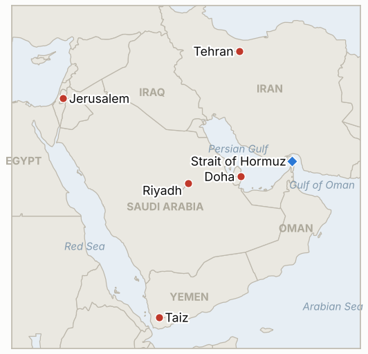

# Middle East Daily Briefing

**October 30, 2026**

- **Reporting window:** ~24 hours, October 29, 06:00 to October 30, 06:00 KST
- **Overall assessment:** Iran said four tankers struck mines on the southern Hormuz route that Washington promotes, while the IRGC challenged CENTCOM's mine clearing claims (§1.1). Trump acknowledged approving Vice President Vance's outreach to Tehran but called it medical aid, not talks, as reports say military options are being readied for after the November 3 midterms (§1.2). Israel's count is nearly complete with no bloc near 61 seats (§1.3). The KOSPI fell 1.24% to 5,937.66 as Samsung's record profit met a thin buyback plan (§1.5).

**Corrections and updates:** The October 29 brief (§1.2) rated the Vance letter Low confidence as a single WSJ report. It is now acknowledged: Trump said on the record he approved the outreach, and CBS and Axios say it went through Qatar (IND-20261029-3 confirmed). The October 29 brief's indicator IND-20261029-2 (KOSPI at or above 6,000 on October 30) remains open; the October 29 close of 5,937.66 is below that line but the test is the October 30 close.

---

## 1. What Happened

<figure style="float:right; width:46%; margin:2pt 0 8pt 14pt;">

<figcaption style="font-size:8pt; color:#666; text-align:center; margin-top:3pt; font-style:italic;">Major places of discussion</figcaption>
</figure>

### 1.1 Iran says four tankers hit mines on the southern Hormuz route as the IRGC disputes CENTCOM's clearing claims

Iran's navy said four oil tankers struck sea mines in the Strait of Hormuz while using the southern route the US promotes, and the IRGC earlier said three were disabled; the UK Marine Trade Operations Centre confirmed a burning vessel ([CBS News live updates](https://www.cbsnews.com/live-updates/iran-war-donald-trump-qatar-mediators-new-proposal-end-war/)). UKMTO separately reported a tanker hit by a projectile while leaving by the same route, with no injuries and the source unclear. The IRGC challenged CENTCOM to "prove your claim of mine-clearing in the Strait of Hormuz with independent evidence, not a statement." **Confidence: Medium that at least one vessel was hit (UKMTO-linked confirmation of a burning ship); Low on the count of four (Iranian navy claim); Low on who fired the projectile.**

### 1.2 Trump says he approved Vance's outreach to Iran as medical aid while denying a restart of talks

Trump said he approved the Vance contact because of Tehran's "need for help with medical supplies" and denied directing his deputy to restart talks ([Al Jazeera](https://www.aljazeera.com/news/liveblog/2026/10/29/iran-war-live-trump-says-he-approved-vance-outreach-over-medical-supplies)). CBS reported the letter went to Mohsen Rezaei via Qatar and proposed an early meeting led by Vance, and Axios said talks to prevent new strikes would have to cover Iran's nuclear program; Tasnim said Iran has not replied and will not drop its demands for lifting the US port blockade, easing sanctions and releasing frozen assets ([CBS News](https://www.cbsnews.com/live-updates/iran-war-donald-trump-qatar-mediators-new-proposal-end-war/)). A US official told CBS an Iranian answer to the Qatari draft is expected by Saturday. In parallel, the WSJ said CENTCOM commander Adm. Brad Cooper presented Iran military options to Trump, a Patriot system is being shipped from Texas to Israel, and more than 10 US transports landed at Israeli airbases in a week ([Times of Israel](https://timesofisrael.com/liveblog-october-29-2026)). Hegseth also fired Lt. Gen. Brett Sylvia over alleged leaks of Iran war information. **Confidence: High that Trump acknowledged the outreach (on record); Medium on the letter's contents (Axios, CBS via sources); Medium on the military preparations (WSJ via Reuters, flight tracking analysts).**

### 1.3 Israel's count is nearly complete: Netanyahu's bloc 53, Yashar 48, Arab parties 19

With nearly all votes counted, Netanyahu's bloc holds 53 seats, Eisenkot's Yashar 48 and Arab parties 19; official final results are not expected before November 4 ([Times of Israel](https://timesofisrael.com/liveblog-october-29-2026)). Eisenkot pledged to form a government, pass a conscription law and set up an October 7 inquiry, Netanyahu vowed to keep his far-right partners, and Ra'am's Mansour Abbas doubted a minority government backed from outside by Arab parties is viable. United Torah Judaism is reportedly considering backing an Eisenkot-led minority government, and President Herzog urged avoiding another election. Shin Bet sources said a probe into alleged foreign influence on the vote, reportedly involving Qatar and two other countries, cannot change the result. **Confidence: High on the seat split (several outlets); Medium on coalition maneuvering (Channel 12 and reports); Low on the foreign influence claims (anonymous sources).**

### 1.4 Saudi forces down Houthi missiles aimed at Riyadh as a Saudi strike in Taiz reportedly kills 12

Saudi-led coalition forces said they destroyed two Houthi missiles fired toward Riyadh ([Al Jazeera](https://www.aljazeera.com/news/liveblog/2026/10/29/iran-war-live-tehran-presses-7-day-hormuz-plan-trump-denies-peace-talks)). CBS reported a Saudi strike in Taiz province killed 12, and Human Rights Watch said the Houthis are denying civilians in besieged Taiz city food, water and medicine in a way that may amount to the war crime of starvation. Oil traders had cited Houthi attacks on Saudi sites as a driver of Brent above $114. **Confidence: High on the interceptions (coalition statement); Medium on the Taiz toll (single live blog); High that HRW made the allegation.**

### 1.5 KOSPI falls 1.24% to 5,937.66 as Samsung's record profit meets a thin buyback plan

The KOSPI closed down 74.78 points (1.24%) at 5,937.66 after touching 6,100 early and an intraday low of 5,817.92 ([Hankook Ilbo](https://www.hankookilbo.com/news/article/A2026102916580005679); [G-Enews](https://www.g-enews.com/article/Securities/2026/10/202610291553189899923c501012_1)). Samsung Electronics reported record third quarter operating profit of 107.4 trillion won on 195.3 trillion won of revenue, but its shares fell 4.13% to 232,000 won because it announced a cash dividend of about 30 trillion won and deferred details of the remaining 55 to 75 trillion won of 2026 shareholder returns to late January. SK Hynix rose 2.62% to 1,526,000 won after announcing a 60 trillion won return package. Foreigners net bought about 70 billion won while institutions net sold about 445 billion won. I found no settle for Brent or WTI; quotes at 03:51 GMT showed Brent about $114.10 and WTI about $101.45, both down on peace talk hopes, and no won close. **Confidence: High on the KOSPI and Samsung figures (several outlets); Low on oil (early quote, no settle); not reported for the won.**

---

## 2. Deep Dive: Incentives and Motives

### 2.1 Why does Trump call the Vance letter medical aid?

Calling it aid lets him keep the threat of post-midterm strikes credible to his base and to Israel while leaving a channel open. It also lets him disown a failed approach if Tehran rebuffs it, since he never called it talks.

### 2.2 Why does Iran stress mines and Tasnim's demands at once?

Reports of mined tankers on the US promoted route argue that the blockade and escort concept is unsafe, raising insurance costs and strengthening Tehran's claim that traffic needs its permission. Restating the demands on blockade, sanctions and frozen assets signals that the Vance offer does not reach the price Iran set.

### 2.3 Why does Eisenkot promise a conscription law and an October 7 inquiry now?

Both pledges target the ultra-Orthodox parties and centrist voters, the groups that could let him form a minority government without Arab parties. They also mark his government as a break from Netanyahu's partners.

### 2.4 Why does Samsung hold back buyback details?

Deferring the remaining 55 to 75 trillion won to January keeps flexibility if markets or the won move, but it let SK Hynix take the shareholder return story. The market punished the vagueness rather than the profit.

### 2.5 Why do Saudi forces strike in Taiz while defending Riyadh?

Striking Houthi positions is meant to reduce the missile threat at its source and support the Yemeni government's mobilization, but civilian tolls in Taiz hand the Houthis a propaganda line. HRW's starvation allegation targets the Houthis, which Riyadh will use in the same contest.

---

## 3. Policy Implications for South Korea

**Exposure snapshot:** South Korea draws about 70.7% of its crude and 20.4% of its LNG from the Middle East (`instructions/korea-exposure.md`, no update needed). Latest prints, Thursday October 29: KOSPI 5,937.66 (down 1.24%, institutions net selling about 445 billion won), Brent about $114.10 and WTI about $101.45 on early quotes with no settle found, and no won close found (October 28: 1,337.7). Samsung's record profit did not hold the 6,000 line, which makes October 30 the test. I found no Korean ministry or Sinokor statement on Iran's November 1 warning.

**Implications by development:**

- **Hormuz mines (§1.1):** Mine strikes on the route the US promotes raise the odds that Korean tanker owners avoid it or face higher war risk premiums, and they sharpen the Sinokor exposure (IND-20261030-1, IND-20261029-1).
- **Vance letter (§1.2):** An acknowledged channel lowers near term strike odds slightly but the post-November 3 military preparations remain the main tail risk for oil and the won (IND-20261023-3, IND-20261026-1).
- **Israel (§1.3):** A prolonged coalition process keeps Israeli Iran policy with a caretaker government through at least November 4 (IND-20261028-1, -2).
- **Yemen and Saudi (§1.4):** Continued missile fire at Riyadh keeps the Saudi advisory and airport suspension indicators live (IND-20261027-3).
- **Markets (§1.5):** Foreign flows were small while institutions sold, and a won close is missing (IND-20261030-3, IND-20261026-2). Sinokor's silence from Seoul is itself an indicator (IND-20261030-2).

**Resolved today:** IND-20261029-3 **confirmed** (Trump acknowledged the Vance outreach on record). IND-20260928-2, IND-20261013-4 and IND-20261016-1 **expired** past their deadlines (no disclosed Korean Hormuz deployment step; Saudi advisory stayed at level 3; no concrete stabilization measure found).

**Testable indicators:**

- **IND-20261030-1** (open, new): Independent confirmation (UKMTO, JMIC, operator or CENTCOM) of a further mine or projectile strike on the southern Hormuz route by ~2026-11-06 confirms; none falsifies.
- **IND-20261030-2** (open, new): An on-record Korean government statement on the Sinokor warning by ~2026-11-02 confirms; silence falsifies.
- **IND-20261030-3** (open, new): A KOSPI close above 6,000 on any session by ~2026-11-02 confirms recovery; none falsifies.
- **IND-20261029-1, -2** (open): A Sinokor fine, detention or seizure by ~2026-11-08; KOSPI close at or above 6,000 on October 30.
- **IND-20261028-1, -2** (open): Either Israeli bloc at 61 or more by ~2026-11-02; Herzog's mandate to Eisenkot by ~2026-11-10.
- **IND-20261027-1, -2, -3, -4** (open): Egyptian deployment by ~2026-11-10; US-Iran session or US reply by ~2026-11-03; new Riyadh flight suspension by ~2026-11-03; Brent settle below $110 by ~2026-10-30.
- **IND-20261026-1, -2, -3** (open): US-Iran session by ~2026-10-31; USD/KRW close above 1,350 by October 30; UKMTO tally of 10 or more for October 24 to 30.
- **IND-20261024-1, -2, -3** (open): US escorted convoy or IRGC attack on a US base by ~2026-11-01; Brent above $120 by ~2026-10-30; KOSPI close below 5,300 by October 30.

---

## 4. Watch List

- **Iran's reply to the Qatari draft, expected around Saturday (IND-20261027-2).**
- **Further tanker incidents on the southern Hormuz route (IND-20261030-1).**
- **November 1 Sinokor deadline and any Seoul response (IND-20261029-1, IND-20261030-2).**
- **Official Israeli results by November 4 and Herzog's mandate (IND-20261028-1, -2).**
- **A US strike after the November 3 midterms (IND-20261023-3).**
- **KOSPI at 6,000 and the won (IND-20261030-3).**

---

## 5. Source Quality Summary

| Claim | Sources | Confidence |
| --- | --- | --- |
| Iran says four tankers hit mines on southern route; burning vessel | CBS live updates (Iranian navy, IRGC, UKMTO) | Medium |
| Tanker hit by projectile, source unclear | CBS live updates (UKMTO) | Medium |
| Trump approved Vance outreach as medical aid | Al Jazeera; CBS | High |
| Vance letter via Qatar proposing meeting; Iran no reply | CBS; Axios; Tasnim | Medium |
| Cooper presented options; Patriot to Israel; US transports | Times of Israel (WSJ via Reuters; flight trackers) | Medium |
| Israeli count 53 / 48 / 19; results not before November 4 | Times of Israel | High |
| Coalition maneuvering; UTJ, Abbas, Herzog | Times of Israel (Channel 12, reports) | Medium |
| Foreign influence probe involving Qatar | Times of Israel (Shin Bet sources via Channel 12) | Low |
| Two missiles downed toward Riyadh | Al Jazeera live blog | High |
| Saudi strike in Taiz killed 12 | CBS live updates | Medium |
| HRW allegation on Taiz | Al Jazeera live blog | High |
| KOSPI 5,937.66; Samsung 107.4tn won; SK Hynix | Hankook Ilbo; G-Enews | High |
| Brent about 114.10, WTI about 101.45 (early quotes) | Search summary of oil wires | Low |
| Won close; Hormuz transit count; Korean government response on Sinokor | Not reported | Not reported |
