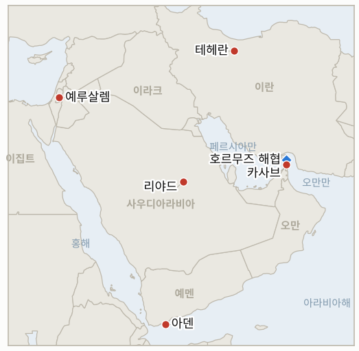

# 중동 일일 브리핑

**2026년 10월 31일**

- **보고 기간:** 약 24시간, 10월 30일 06:00 ~ 10월 31일 06:00 (한국시간)
- **종합 평가:** 카사브 앞바다에서 유조선이 흡착 기뢰로 불탔고 UKMTO는 10월을 전쟁 시작 이후 해상 사고가 가장 많은 달이라고 밝혔다(§1.1). 트럼프는 이란이 "대화를 원한다"고 말했고 국방부는 11월 3일 중간선거 뒤 공격 옵션을 보고했다(§1.2). 이스라엘 개표 결과는 그대로이며 새 크네세트는 11월 10일 선서한다(§1.3). 코스피는 AI 투자 우려와 대규모 외국인 매도로 3.48% 내린 5,730.74로 마감했고, 토요일쯤 나올 것으로 예상된 카타르 초안에 대한 이란의 답은 아직 공개되지 않았다(§1.5).

**정정 및 업데이트:** 10월 30일자 브리핑(§1.1)은 호르무즈 유조선 사고를 남쪽 항로의 기뢰 피격으로 서술했다. Fox News는 10월 29일 파나마 국적 유조선 루이즈 1호가 카사브 북동쪽 25해리에서 소형 보트가 흡착 기뢰 2개를 선체에 붙인 뒤 불탔고 배후를 자처한 곳은 없다고 전한다. 이를 이란 해군이 밝힌 유조선 4척과 연결할 근거는 찾지 못했다. 10월 29일자 및 10월 30일자 브리핑의 IND-20261029-2(10월 30일 코스피 6,000 이상 마감)는 종가 5,730.74로 불충족이 확정됐다.

---

## 1. 무슨 일이 있었나

<figure style="float:right; width:46%; margin:2pt 0 8pt 14pt;">

<figcaption style="font-size:8pt; color:#666; text-align:center; margin-top:3pt; font-style:italic;">주요 논의 지점</figcaption>
</figure>

### 1.1 카사브 앞바다에서 루이즈 1호가 흡착 기뢰에 피격되고 UKMTO는 10월을 전쟁 이후 최악의 달로 규정한다

파나마 국적 유조선 루이즈 1호는 10월 29일 오만 카사브 북동쪽 25해리에서 소형 보트가 흡착 기뢰 2개를 선체에 붙인 뒤 불탔다. 부상자는 없고 배후를 자처한 곳도 없으며, 전쟁 시작 이후 해협에서 성공한 첫 흡착 기뢰 공격이다([Fox News](https://www.foxnews.com/live-news/us-iran-war-oil-prices-strait-hormuz-10-30-26)). UKMTO는 10월이 전쟁 시작 이후 지역 해상 사고가 가장 많은 달이며 2월 28일 이후 144건이라고 밝혔고, 이란은 자국의 통항 제한을 어기는 선박을 겨냥한다고 말한다. 브래드 쿠퍼 중부사령관은 해협 상공을 비행했지만 혁명수비대 병력이 보이지 않았다며 이란 해군 괴멸을 이유로 들었고, 혁명수비대는 중부사령부의 기뢰 제거 주장에 이의를 제기해 왔다. 브렌트유 선물은 약 117.62달러로 월간 14% 가까이 올랐다. **신뢰도: 루이즈 1호 화재는 높음(다수 매체), 공격 주체는 낮음(배후 불명), UKMTO 집계는 중간(단일 보도), 유가는 낮음(장중 시세, 정산가 없음).**

### 1.2 트럼프가 이란이 "대화를 원한다"고 말하는 가운데 국방부는 중간선거 뒤 옵션을 보고한다

트럼프는 이란이 "대화를 원한다"며 군경에 급여도 주지 못하는 곤경에 처했다고 주장했고, 한 라디오 인터뷰에서는 전쟁이 "곧" 끝난다고 말했다([Fox News](https://www.foxnews.com/live-news/us-iran-war-oil-prices-strait-hormuz-10-30-26)). WSJ는 댄 케인 합참의장, 쿠퍼 사령관, 피트 헤그세스 국방장관이 목요일 트럼프에게 11월 3일 이후 공격 옵션을 보고했고, 트럼프가 유세에서 "또 한 번 작은 에픽 퓨리를 할 수도 있다"고 말했으며, 아랍 동맹국에는 짧지만 강한 작전에 대비하라고 알렸다고 전했다. 파키스탄 군은 아심 무니르 원수의 이달 두 번째 테헤란 방문 뒤 중재에 "조심스럽게 낙관한다"고 밝혔고 카타르 중재단도 테헤란에 돌아왔다([Al Jazeera](https://www.aljazeera.com/news/liveblog/2026/10/30/iran-war-live-irgc-says-four-tankers-struck-mines-in-strait-of-hormuz)). 이란 의원 마흐무드 나바비안은 핵확산금지조약 탈퇴를 촉구했다. 카타르 초안이나 밴스 서한에 대한 이란의 공개 답변은 찾지 못했다. **신뢰도: 트럼프 발언은 높음(공개 발언), 국방부 보고와 동맹국 통보는 중간(WSJ, Fox 인용), 파키스탄의 낙관은 중간(군 발표), 이란 재정 상태는 낮음(트럼프 주장).**

### 1.3 이스라엘 최종 개표는 53석, 48석, 19석으로 유지되고 네타냐후는 선거 도둑질을 주장한다

개표가 모두 끝난 결과 네타냐후 블록은 53석, 아이젠코트 블록은 48석, 아랍계 정당은 19석이며 투표율은 77.9%이고, 새 크네세트는 11월 10일 선서할 예정이다([Times of Israel](https://timesofisrael.com/liveblog-october-30-2026)). 네타냐후는 선거를 도둑맞았다고 주장하지만 선거 당국은 이를 일축하며, 중앙선거관리위원회는 부정 수사가 최종 결과에 영향을 주지 않는다고 밝혔다. 아이젠코트와 베네트는 아랍계 정당과 연정하지 않겠다고 했고, 리베르만은 "테러 지지자"와의 연정을 거부하며, 유대교연합은 아이젠코트가 이끄는 소수 정부 지지를 검토 중이라는 보도가 있다. 야권은 아미르 오하나 의장을 교체하기로 합의했고 야이르 라피드가 의장 후보로 거론된다. **신뢰도: 의석과 선서 일정은 높음(Times of Israel), 연정 움직임은 중간(보도), 외국 개입 조사는 낮음(익명 소식통).**

### 1.4 후티가 아덴을 공격하고 메카 지역에서 드론이 요격된다

예멘 국제승인 정부는 후티가 대통령궁과 아덴 공항을 탄도미사일로 겨냥했다고 밝혔고, 사우디 주도 연합군은 메카 지역에서 후티 드론을 요격했다고 밝혔으나 후티는 이를 부인한다([Al Jazeera](https://www.aljazeera.com/news/liveblog/2026/10/30/iran-war-live-irgc-says-four-tankers-struck-mines-in-strait-of-hormuz); [CBS News](https://www.cbsnews.com/live-updates/iran-war-donald-trump-qatar-mediators-new-proposal-end-war/)). 리야드 주재 미국 대사관은 사우디 공항에서 극도로 조심하라고 다시 당부했으며, 비필수 인력은 10월 23일부터 철수 명령을 받은 상태다. **신뢰도: 아덴 공격은 중간(예멘 정부 주장), 메카 요격은 중간(연합군 발표, 후티 부인), 대사관 공지는 높음.**

### 1.5 AI 투자 우려와 1조 6,000억 원대 외국인 매도로 코스피가 3.48% 내린 5,730.74로 마감한다

코스피는 알파벳의 부진한 실적이 AI 투자 우려를 되살리면서(알파벳 12% 넘게 하락, 나스닥 1.38% 하락) 206.92포인트(3.48%) 내린 5,730.74로 마감했고, 오전 10시 4분 프로그램 매도 사이드카가 발동됐다. 11거래일 만의 발동이다([한국경제](https://www.hankyung.com/article/2026103064646); [네이트뉴스](https://m.news.nate.com/view/20261030n24078)). 외국인은 약 1조 6,200억 원을 순매도했고 기관과 개인은 각각 약 7,430억 원, 6,210억 원을 순매수했다. SK하이닉스는 7.08% 내린 141만 8,000원, 삼성전자는 3.02% 내린 22만 5,000원이었고 코스닥은 3.83% 내린 724.38이었다. 원화는 주간 거래를 달러당 1,334.3원에 마쳐 2.5원 강세였다. 브렌트유와 WTI 정산가, 호르무즈 통항 건수는 찾지 못했다. **신뢰도: 코스피와 원화 수치는 높음(다수 매체), 유가 정산가와 통항 건수는 미확인.**

---

## 2. 심층 분석: 동기와 유인

### 2.1 트럼프는 왜 국방부가 공격을 준비하는 가운데 이란이 "대화를 원한다"고 말하는가?

두 메시지는 같은 압박 전략에 쓰인다. 공개적인 개방성은 유권자와 중재국에 그가 합의를 선호한다는 점을 보여 주고, 신뢰할 만한 선거 뒤 옵션은 테헤란이 11월 3일 전에 답하도록 압박한다. 이란이 군을 먹여 살리지 못한다는 주장은 기다림이 워싱턴에 유리하다는 틀을 만든다.

### 2.2 왜 지금 누군가 유조선에 흡착 기뢰를 쓰는가?

소형 보트를 이용한 흡착 기뢰 공격은 부인하기 쉽고 해군 배치로 막기 어려워 해협을 통제하고 있다는 쿠퍼의 주장을 흔든다. 이란이 책임지지 않으면서도 보험료를 올리고 미국이 권하는 항로를 시험할 수 있다.

### 2.3 네타냐후는 왜 선거 도둑질을 주장하는가?

53석으로 61석에 이를 길이 없는 상황에서 개표를 의심하면 아이젠코트가 파트너를 찾는 동안 지지층의 충성과 협상력을 지킬 수 있다. 유대교연합 등이 넘어가지 못하도록 압박하는 효과도 있다.

### 2.4 후티는 왜 아덴과 사우디 목표를 계속 때리는가?

아덴 공격은 예멘 정부를 압박하고, 리야드와 메카를 향한 사격은 워싱턴에 성급한 공격을 말리고 있는 사우디의 비용을 높인다. 후티가 메카 겨냥을 부인하는 것은 성지를 둘러싼 역풍을 피하려는 것이다.

### 2.5 한국 반도체주는 왜 알파벳 때문에 크게 떨어졌는가?

삼성전자와 SK하이닉스는 AI 설비투자 기대로 가격이 매겨져 있어 초대형 클라우드 기업의 현금 소진 경고가 향후 실적을 직접 때린다. 반등장에서 샀던 외국인 자금이 빠르게 팔았고, 중간선거를 앞둔 월말 위험 회피 분위기가 낙폭을 키웠다.

---

## 3. 한국에 대한 정책적 함의

**노출 현황:** 한국은 원유의 약 70.7%와 LNG의 20.4%를 중동에서 들여온다(`instructions/korea-exposure.md`, 갱신 불필요). 10월 30일 금요일 최신 수치: 코스피 5,730.74(3.48% 하락, 외국인 약 1조 6,200억 원 순매도), 원·달러 1,334.3원(주간 종가), 브렌트유 장중 약 117.62달러(정산가 없음). 11월 1일 시노코 시한이 다가왔지만 한국 정부의 공개 입장은 찾지 못했다.

**전개별 함의:**

- **흡착 기뢰 공격(§1.1):** 카사브 앞바다의 부인 가능한 공격은 한국 선주의 전쟁위험 할증료를 올리고 시노코 노출을 부각한다(IND-20261031-1, IND-20261029-1).
- **국방부 옵션(§1.2):** 11월 3일 뒤 공격 위험이 유가와 원화의 최대 꼬리 위험이며, 브렌트유가 118달러 안팎이어서 완충 여력이 작다(IND-20261031-3, IND-20261023-3).
- **이스라엘(§1.3):** 다툼이 있는 개표 결과로 이스라엘의 대이란 정책은 적어도 11월 10일까지 과도 정부 아래에 남는다(IND-20261028-1, -2).
- **예멘과 사우디(§1.4):** 계속되는 사격은 한국인 여행객과 건설 근로자에게 걸린 걸프 공항과 사우디 여행경보 위험을 유지한다(IND-20261027-3).
- **시장(§1.5):** 반도체 급락은 코스피가 전쟁보다 AI 심리에 더 크게 움직임을 보여 주며, 원화는 1,334원 안팎을 지켰다(IND-20261031-2, IND-20261030-3).

**오늘 종결된 지표:** IND-20261024-2, IND-20261024-3, IND-20261026-2, IND-20261027-4, IND-20261029-2는 **불충족**(브렌트유 정산가 120달러 초과 및 110달러 미만 없음, 코스피 5,300 미만 마감 없음, 10월 30일 6,000 마감 없음, 원화 1,350원 초과 마감 없음).

**검증 가능한 지표:**

- **IND-20261031-1**(신규, 열림): ~2026-11-07까지 상선에 대한 흡착 기뢰 또는 기뢰 공격이 추가로 확인되면 충족, 없으면 불충족.
- **IND-20261031-2**(신규, 열림): ~2026-11-06까지 외국인 순매도가 1조 원을 넘는 거래일이 있으면 충족, 없으면 불충족.
- **IND-20261031-3**(신규, 열림): ~2026-11-06까지 브렌트유 정산가가 120달러를 넘으면 충족, 아니면 불충족.
- **IND-20261030-1, -2, -3**(열림): ~2026-11-06까지 남쪽 항로 추가 피격; ~2026-11-02까지 시노코 관련 한국 정부 입장; ~2026-11-02까지 코스피 6,000 초과 마감.
- **IND-20261029-1**(열림): ~2026-11-08까지 시노코 선박 벌금, 억류, 나포.
- **IND-20261028-1, -2**(열림): ~2026-11-02까지 이스라엘 어느 블록이든 61석 이상; ~2026-11-10까지 헤르초그의 아이젠코트 지명.
- **IND-20261027-1, -2, -3**(열림): ~2026-11-10까지 이집트 파병; ~2026-11-03까지 미·이란 회동 또는 미국 답신; ~2026-11-03까지 리야드 신규 항공편 중단.
- **IND-20261026-1, -3**(열림): ~2026-10-31까지 미·이란 회동; 10월 24~30일 UKMTO 집계 10건 이상.
- **IND-20261024-1**(열림): ~2026-11-01까지 미 호위 선단 또는 혁명수비대의 미군 기지 공격.

---

## 4. 주시 목록

- **토요일쯤 나올 카타르 초안에 대한 이란의 답(IND-20261027-2).**
- **카사브 앞바다의 흡착 기뢰와 기뢰 공격(IND-20261031-1).**
- **11월 1일 시노코 시한과 서울의 대응(IND-20261029-1, IND-20261030-2).**
- **11월 3일 중간선거와 그 뒤 미국의 공격(IND-20261023-3).**
- **월요일 코스피: 외국인 수급과 6,000선(IND-20261031-2, IND-20261030-3).**
- **11월 10일 크네세트 선서와 헤르초그의 지명(IND-20261028-2).**

---

## 5. 출처 품질 요약

| 주장 | 출처 | 신뢰도 |
| --- | --- | --- |
| 루이즈 1호 카사브 앞바다 흡착 기뢰 피격, 배후 불명 | Fox News 실시간 속보(로이터) | 화재 높음, 공격 주체 낮음 |
| UKMTO: 2월 28일 이후 144건, 10월 최악 | Fox News 실시간 속보 | 중간 |
| 쿠퍼, 혁명수비대 병력 보이지 않음 | Fox News 실시간 속보 | 중간 |
| 트럼프, 이란이 대화 원한다, 전쟁 곧 끝난다 | Fox News 실시간 속보 | 높음 |
| 국방부, 11월 3일 이후 옵션 보고 | Fox News(WSJ) | 중간 |
| 파키스탄 조심스러운 낙관, 카타르 중재단 테헤란 복귀 | Fox News, Times of Israel, 알자지라 | 중간 |
| 이스라엘 53/48/19, 11월 10일 크네세트 선서 | Times of Israel | 높음 |
| 네타냐후의 선거 도둑질 주장, 연정 입장 | Times of Israel | 중간 |
| 아덴 후티 미사일, 메카 드론 요격 | 알자지라, CBS | 중간 |
| 코스피 5,730.74, 사이드카, 외국인 매도, 반도체 낙폭 | 한국경제, 네이트뉴스 | 높음 |
| 원·달러 1,334.3원 주간 종가 | 한국경제 | 높음 |
| 브렌트유 장중 약 117.62달러 | Fox News 실시간 속보 | 낮음 |
| 이란의 답, 호르무즈 통항 건수, WTI, 시노코 관련 한국 정부 입장 | 미확인 | 미확인 |
