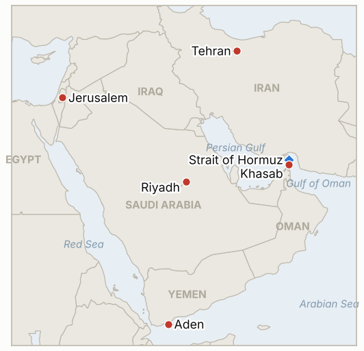

# Middle East Daily Briefing

**October 31, 2026**

- **Reporting window:** ~24 hours, October 30, 06:00 to October 31, 06:00 KST
- **Overall assessment:** A tanker was set on fire by limpet mines off Khasab, and UKMTO called October the worst month for shipping incidents since the war began (§1.1). Trump said Iran "wants to talk" while the Pentagon briefed him on options for strikes after the November 3 midterms (§1.2). Israel's count is unchanged and its new Knesset is due to be sworn in November 10 (§1.3). The KOSPI fell 3.48% to 5,730.74 on AI spending worries and heavy foreign selling, and Iran's reply to the Qatari draft, expected around Saturday, was not yet public (§1.5).

**Corrections and updates:** The October 30 brief (§1.1) described the Hormuz tanker incidents as mine strikes on the southern route. A Fox News report adds that on October 29 the Panama-flagged tanker Louise 1 caught fire after a small boat attached two limpet mines, 25 nautical miles northeast of Khasab, with no one claiming responsibility; I could not tie it to the Iranian navy's count of four tankers. The October 29 and 30 briefs' indicator IND-20261029-2 (KOSPI at or above 6,000 on October 30) is falsified by the 5,730.74 close.

---

## 1. What Happened

<figure style="float:right; width:46%; margin:2pt 0 8pt 14pt;">

<figcaption style="font-size:8pt; color:#666; text-align:center; margin-top:3pt; font-style:italic;">Major places of discussion</figcaption>
</figure>

### 1.1 Louise 1 is hit by limpet mines off Khasab as UKMTO calls October the worst month of the war

The Panama-flagged tanker Louise 1 caught fire on October 29 after a small boat attached two limpet mines to its hull 25 nautical miles northeast of Khasab, Oman; there were no injuries and no one claimed the attack, and it was the first successful limpet attack in the strait since the war began ([Fox News live updates](https://www.foxnews.com/live-news/us-iran-war-oil-prices-strait-hormuz-10-30-26)). UKMTO said October had the most maritime incidents in the region since the war began, 144 events since February 28, and Iran says it targets vessels that violate its movement restrictions. CENTCOM's Adm. Brad Cooper said he flew over the strait, saw no IRGC presence, and credited the destruction of Iran's navy; the IRGC has challenged CENTCOM's mine clearing claims. Brent futures traded around $117.62, up nearly 14% on the month. **Confidence: High that Louise 1 burned (several outlets); Low on who attacked (unclaimed); Medium on the UKMTO tally (single report); Low on oil (intraday, no settle found).**

### 1.2 Trump says Iran "wants to talk" as the Pentagon briefs him on options for after the midterms

Trump said Iran "wants to talk" and is in trouble, claiming it is not paying its soldiers or police, and told a radio interviewer the war will end "very soon" ([Fox News live updates](https://www.foxnews.com/live-news/us-iran-war-oil-prices-strait-hormuz-10-30-26)). The WSJ reported that Gen. Dan Caine, Adm. Cooper and Defense Secretary Pete Hegseth briefed him on Thursday on strike options after November 3, that Trump told a rally "we may do another little Epic Fury," and that Arab allies were told to prepare for a short but intense campaign. Pakistan's army said it is "cautiously optimistic" about mediation after Field Marshal Asim Munir's second Tehran visit this month, and Qatari mediators have returned to Tehran ([Al Jazeera](https://www.aljazeera.com/news/liveblog/2026/10/30/iran-war-live-irgc-says-four-tankers-struck-mines-in-strait-of-hormuz)). An Iranian lawmaker, Mahmoud Nabavian, urged leaving the Non-Proliferation Treaty. I found no public Iranian answer to the Qatari draft or the Vance letter. **Confidence: High that Trump made the remarks (on record); Medium on the Pentagon briefing and ally warnings (WSJ via Fox); Medium on Pakistan's optimism (military statement); Low on Iran's finances (Trump claim).**

### 1.3 Israel's final count stays at 53, 48 and 19 as Netanyahu alleges a stolen vote

With all votes counted, Netanyahu's bloc has 53 seats, Eisenkot's 48 and the Arab parties 19, on 77.9% turnout; the new Knesset is due to be sworn in November 10 ([Times of Israel](https://timesofisrael.com/liveblog-october-30-2026)). Netanyahu alleges the vote was stolen, which election officials dismiss, and the Central Elections Committee says the fraud investigation will not affect final results. Eisenkot and Bennett have ruled out sitting with Arab parties, Liberman refuses to join a coalition with "terror supporters," and UTJ is reportedly weighing support for an Eisenkot-led minority government. Opposition parties reportedly agreed to replace Speaker Amir Ohana, with Yair Lapid a possible speaker. **Confidence: High on seats and the swearing in date (Times of Israel); Medium on coalition maneuvering (reports); Low on the foreign influence probe (anonymous sources).**

### 1.4 Houthis fire at Aden and a drone is intercepted over the Mecca region

Yemen's internationally recognized government said the Houthis targeted the presidential palace and airport in Aden with ballistic missiles, and the Saudi-led coalition said it intercepted a Houthi drone in the Mecca region, which the Houthis deny ([Al Jazeera](https://www.aljazeera.com/news/liveblog/2026/10/30/iran-war-live-irgc-says-four-tankers-struck-mines-in-strait-of-hormuz); [CBS News](https://www.cbsnews.com/live-updates/iran-war-donald-trump-qatar-mediators-new-proposal-end-war/)). The US Embassy in Riyadh again urged extreme caution at Saudi airports, with non-emergency staff ordered out since October 23. **Confidence: Medium on the Aden strike (Yemeni government claim); Medium on the Mecca interception (coalition statement, Houthi denial); High on the embassy message.**

### 1.5 KOSPI falls 3.48% to 5,730.74 on AI spending worries and 1.6 trillion won of foreign selling

The KOSPI closed down 206.92 points (3.48%) at 5,730.74 after Alphabet's weak earnings revived worries about AI investment (Alphabet fell over 12%; the Nasdaq fell 1.38%), and a program sell sidecar fired at 10:04, the first in 11 sessions ([Hankyung](https://www.hankyung.com/article/2026103064646); [Nate News](https://m.news.nate.com/view/20261030n24078)). Foreigners net sold about 1.62 trillion won while institutions and individuals bought about 743 billion and 621 billion won. SK Hynix fell 7.08% to 1,418,000 won and Samsung Electronics 3.02% to 225,000 won; the KOSDAQ fell 3.83% to 724.38. The won closed the daytime session at 1,334.3 per dollar, 2.5 won stronger. I found no Brent or WTI settle and no Hormuz transit count. **Confidence: High on KOSPI and won figures (several outlets); not reported for oil settles and transits.**

---

## 2. Deep Dive: Incentives and Motives

### 2.1 Why does Trump say Iran "wants to talk" while the Pentagon prepares strikes?

Both messages serve a pressure strategy: public openness shows voters and mediators that he prefers a deal, while credible post-midterm options push Tehran to answer before November 3. Claiming Iran cannot pay its forces frames waiting as favorable to Washington.

### 2.2 Why would anyone use limpet mines on a tanker now?

Limpet attacks by small boat are deniable and hard to stop with naval presence, so they undercut Cooper's claim that the strait is under control. They raise insurance costs and test the US promoted route without Iran owning the attack.

### 2.3 Why does Netanyahu allege a stolen vote?

With 53 seats and no path to 61, questioning the count preserves his base's loyalty and his bargaining weight while Eisenkot seeks partners. It also pressures UTJ and others not to cross over.

### 2.4 Why do the Houthis keep hitting Aden and Saudi targets?

Aden strikes press the Yemeni government, and fire at Riyadh and Mecca raises costs for Saudi Arabia, which is pressing Washington against hasty strikes. The Houthis deny Mecca targeting to avoid backlash over the holy sites.

### 2.5 Why did Korean chip stocks fall so hard on Alphabet?

Samsung and SK Hynix are priced on AI capital spending, so a hyperscaler's cash burn warning hits their forward earnings. Foreign funds that had bought the rebound sold quickly, and a late month pre-midterm risk mood amplified it.

---

## 3. Policy Implications for South Korea

**Exposure snapshot:** South Korea draws about 70.7% of its crude and 20.4% of its LNG from the Middle East (`instructions/korea-exposure.md`, no update needed). Latest prints, Friday October 30: KOSPI 5,730.74 (down 3.48%, foreigners net selling about 1.62 trillion won), USD/KRW 1,334.3 (daytime close), Brent about $117.62 intraday with no settle found. The November 1 Sinokor deadline arrives without a public Korean government statement that I could find.

**Implications by development:**

- **Limpet attack (§1.1):** Deniable attacks off Khasab raise war risk premiums for Korean shipowners and sharpen the Sinokor exposure (IND-20261031-1, IND-20261029-1).
- **Pentagon options (§1.2):** Strike risk after November 3 is the main tail for oil and the won; Brent near $118 leaves little cushion (IND-20261031-3, IND-20261023-3).
- **Israel (§1.3):** A contested count leaves Israeli Iran policy with a caretaker government until at least November 10 (IND-20261028-1, -2).
- **Yemen and Saudi (§1.4):** Continued fire keeps Gulf airport and Saudi advisory risks live for Korean travel and construction workers (IND-20261027-3).
- **Markets (§1.5):** The chip rout shows the KOSPI trades on AI sentiment more than on the war; the won held near 1,334 (IND-20261031-2, IND-20261030-3).

**Resolved today:** IND-20261024-2, IND-20261024-3, IND-20261026-2, IND-20261027-4 and IND-20261029-2 **falsified** (no Brent settle above $120 or below $110; no KOSPI close below 5,300 or at 6,000 on October 30; no won close above 1,350).

**Testable indicators:**

- **IND-20261031-1** (open, new): Another confirmed limpet or mine attack on a merchant ship by ~2026-11-07 confirms; none falsifies.
- **IND-20261031-2** (open, new): Any session with foreign net selling above 1 trillion won by ~2026-11-06 confirms; none falsifies.
- **IND-20261031-3** (open, new): A Brent settle above $120 by ~2026-11-06 confirms; none falsifies.
- **IND-20261030-1, -2, -3** (open): Further southern route strike by ~2026-11-06; Korean statement on Sinokor by ~2026-11-02; KOSPI close above 6,000 by ~2026-11-02.
- **IND-20261029-1** (open): Sinokor fine, detention or seizure by ~2026-11-08.
- **IND-20261028-1, -2** (open): Either Israeli bloc at 61 or more by ~2026-11-02; Herzog's mandate to Eisenkot by ~2026-11-10.
- **IND-20261027-1, -2, -3** (open): Egyptian deployment by ~2026-11-10; US-Iran session or US reply by ~2026-11-03; new Riyadh flight suspension by ~2026-11-03.
- **IND-20261026-1, -3** (open): US-Iran session by ~2026-10-31; UKMTO tally of 10 or more for October 24 to 30.
- **IND-20261024-1** (open): US escorted convoy or IRGC attack on a US base by ~2026-11-01.

---

## 4. Watch List

- **Iran's reply to the Qatari draft, expected around Saturday (IND-20261027-2).**
- **Limpet and mine attacks off Khasab (IND-20261031-1).**
- **November 1 Sinokor deadline and any Seoul response (IND-20261029-1, IND-20261030-2).**
- **November 3 midterms and any US strike after (IND-20261023-3).**
- **KOSPI on Monday: foreign flows and the 6,000 line (IND-20261031-2, IND-20261030-3).**
- **Knesset swearing in November 10 and Herzog's mandate (IND-20261028-2).**

---

## 5. Source Quality Summary

| Claim | Sources | Confidence |
| --- | --- | --- |
| Louise 1 hit by limpet mines off Khasab; unclaimed | Fox News live updates (Reuters) | High on fire, Low on attacker |
| UKMTO: 144 incidents since Feb 28, October worst | Fox News live updates | Medium |
| Cooper saw no IRGC presence | Fox News live updates | Medium |
| Trump says Iran wants to talk; war ends very soon | Fox News live updates | High |
| Pentagon briefed Trump on post November 3 options | Fox News (WSJ) | Medium |
| Pakistan cautiously optimistic; Qatari mediators in Tehran | Fox News; Times of Israel; Al Jazeera | Medium |
| Israel 53 / 48 / 19; Knesset sworn in November 10 | Times of Israel | High |
| Netanyahu stolen vote claim; coalition positions | Times of Israel | Medium |
| Houthi missiles at Aden; Mecca drone intercepted | Al Jazeera; CBS | Medium |
| KOSPI 5,730.74; sidecar; foreign selling; chip moves | Hankyung; Nate News | High |
| USD/KRW 1,334.3 daytime close | Hankyung | High |
| Brent about 117.62 intraday | Fox News live updates | Low |
| Iran's reply; Hormuz transits; WTI; Korean Sinokor statement | Not reported | Not reported |
