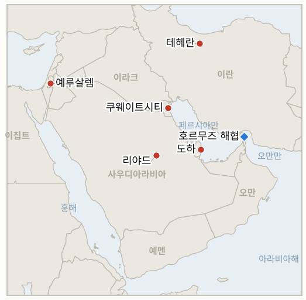

# 중동 일일 브리핑

**2026년 11월 1일**

- **보고 기간:** 약 24시간, 10월 31일 06:00 ~ 11월 1일 06:00 (한국시간)
- **종합 평가:** 이란 외무장관은 밴스의 서한을 "긍정적 조치"라고 평가하면서도 미국 측과 만날 계획은 없다고 말했고, 루비오는 트럼프가 타격 재개 여부를 정하지 않았다고 말했다(§1.2). 혁명수비대는 금요일 유조선 4척이 추가로 기뢰에 피격됐다고 밝혔으나 중부사령부의 항로 정리 주장은 이를 설명하지 못한다(§1.1). 브렌트유는 10월 한 달 13.6% 올랐고, 11월 1일 시노코 시한이 도래했지만 한국 정부의 공식 입장은 찾지 못했다(§1.3). 주말이라 증시가 열리지 않아 코스피와 원화 수치는 금요일 기준이다.

**정정 및 업데이트:** 10월 31일자 브리핑(§1.1, §3)은 브렌트유를 장중 약 117.62달러로, WTI를 미보고로 적었다. 로이터를 인용한 CNBC가 금요일 정산가를 전한다. 만기 12월물 브렌트유는 117.64달러, 거래가 더 활발한 1월물은 113.43달러, WTI는 104.12달러이며 시계열에 반영했다. 따라서 10월 30일에는 120달러 초과 브렌트유 정산가가 나오지 않았고 IND-20261031-3은 계속 열려 있다.

---

## 1. 무슨 일이 있었나

<figure style="float:right; width:46%; margin:2pt 0 8pt 14pt;">

<figcaption style="font-size:8pt; color:#666; text-align:center; margin-top:3pt; font-style:italic;">주요 논의 지점</figcaption>
</figure>

### 1.1 혁명수비대가 금요일 유조선 4척이 기뢰에 피격됐다고 밝히지만 중부사령부는 주요 항로가 깨끗하다고 말한다

이란 혁명수비대는 금요일 유조선 4척이 "허가되지 않은 항로"를 이용하다 호르무즈 해협에서 불타고 폭발했으며, 마지막은 200만 배럴 넘게 실은 초대형 유조선이 해상 기뢰에 걸린 것이라고 밝혔다([Al Jazeera](https://www.aljazeera.com/news/liveblog/2026/10/31/iran-war-live-oil-tankers-hit-in-hormuz-trump-says-conflict-will-end-soon); [Fox News](https://www.foxnews.com/live-news/us-iran-war-trump-israel-strait-hormuz-10-31-26)). 브래드 쿠퍼 미 중부사령관은 주요 통항로의 기뢰를 제거했다고 말해 왔고, 스콧 베센트 미국 재무장관은 이란산 원유를 제외한 호르무즈 통항이 전쟁 전 수준에 가깝게 회복됐다고 말했으며, 미국의 이란 항만 봉쇄는 계속된다. 4건의 피격에 대한 독립적 확인, 앞서 보도된 루이즈 1호 외의 선박 이름, 정확한 통항 건수는 찾지 못했다. **신뢰도: 혁명수비대가 이런 주장을 했다는 점은 중간(다수 매체), 4건의 기뢰 피격 자체는 낮음(이란 측 주장, 운영사나 UKMTO 확인 없음), 베센트의 전쟁 전 수준 회복 주장은 낮음(집계 없음).**

### 1.2 아라그치가 밴스의 서한을 "긍정적 조치"라 부르면서도 회담 계획은 없다고 하고, 루비오는 트럼프가 타격 여부를 정하지 않았다고 말한다

아바스 아라그치 외무장관은 알자지라에 테헤란이 JD 밴스 부통령의 서한을 검토했고 이를 바른 방향의 조치로 본다고 말했으며, 보좌관이 도하에서 중재국과 협의 중이지만 "미국 관리들과 만날 계획은 현재 없다"고 밝혔다([Al Jazeera](https://www.aljazeera.com/news/liveblog/2026/10/31/iran-war-live-oil-tankers-hit-in-hormuz-trump-says-conflict-will-end-soon)). 모흐센 레자에이 안보 책임자는 미국이 "어조를 바꿨다"며 이란의 7개 조건이 충족되면 외교가 열려 있다고 말했다. 마코 루비오 국무장관은 애틀랜타 G20 회의에서 트럼프가 타격 재개를 "결정하지 않았다"며 외교를 선호한다고 말했고, AP는 미국 외교·국방 당국자들이 화요일 중간선거 뒤 가능한 미국의 행동과 이란의 보복에 대비하라고 지역 파트너들에게 비공식 전달했다고 보도했다([Fox News](https://www.foxnews.com/live-news/us-iran-war-trump-israel-strait-hormuz-10-31-26)). 모즈타바 하메네이 최고지도자는 어떤 위협에도 지리적 제한 없이 "무제한" 대응하라고 지시했다. **신뢰도: 아라그치와 루비오의 발언은 높음(공개 발언), 파트너 사전 경고에 대한 AP 보도는 중간, 합의 근접 여부는 낮음(양측 입장 상충).**

### 1.3 브렌트유가 10월 한 달 13.6% 오르고 시노코 시한이 도래했지만 한국 정부 입장은 나오지 않는다

금요일 정산가는 만기 12월물 브렌트유가 117.64달러(2.4% 상승), WTI가 104.12달러(2.08% 상승)였고, 10월 한 달 브렌트유는 13.6%, WTI는 15.2% 올랐다. 사우디 에너지 시설에 대한 후티 공격, 호르무즈 유조선 공격, 중간선거 뒤 타격 우려가 배경이다([CNBC](https://www.cnbc.com/2026/10/30/oil-rises-on-supply-concerns-as-houthis-attack-saudi-arabia.html)). 삭소뱅크는 분쟁이 끝난 뒤에도 유가가 전쟁 전 60~70달러보다 높은 70~90달러에 머물 것으로 본다. 이란 페르시아만 해협청(PGSA)은 11월 1일부터 시노코 전 선박에 법적 조치를 취하겠다고 밝혔고, 블룸버그를 인용한 보도에 따르면 시노코 유조선은 9월 약 1억 560만 배럴을 해협으로 운송해 통과 원유의 약 40%를 차지했으며 이번 달 해협청 명단은 122척으로 늘었다([서울경제](https://m.sedaily.com/article/20106868)). 한국선주협회는 이미 조치를 받은 7척이 시노코 소유가 아니라는 입장을 냈고, 외교부나 해양수산부의 공식 입장은 찾지 못했다. **신뢰도: 정산가는 높음(로이터 인용 CNBC), 시노코 물량 비중은 중간(블룸버그 인용 국내 보도), 한국 정부 입장이 없다는 점은 중간(부재 확인).**

### 1.4 사우디 방공망이 리야드 상공 드론을 격추하고 AP는 이란이 미군 시설 26곳을 타격했다고 집계한다

사우디 방공망은 토요일 리야드 지역 상공에서 적대적 드론을 격추했고 파편이 떨어졌으나 부상자는 없었으며, 주리야드 미국 대사관은 공항 주변 주의를 다시 당부했다([Fox News](https://www.foxnews.com/live-news/us-iran-war-trump-israel-strait-hormuz-10-31-26)). AP 분석은 이란의 공격이 미군 시설 26곳의 구조물을 손상하거나 파괴했으며 대부분 쿠웨이트에 있다고 밝혔고, 숀 파넬 국방부 대변인은 미군이 잘 보호되고 있다고 말했다. 이집트 외무장관은 2차 전투가 "더 위험하고 더 파괴적일 것"이라고 경고했다. **신뢰도: 리야드 드론은 중간(사우디 발표를 인용한 Fox), AP 기지 분석이 나왔다는 점은 높음이나 수치는 중간, 이집트 발언은 높음.**

### 1.5 이스라엘 통합 정부 타진은 부인되고 레바논은 헤즈볼라 폭발물 트럭 사건으로 13명을 기소한다

이스라엘 최종 의석은 네타냐후 진영 53석, 아이젠코트 진영 48석, 아랍계 정당 19석으로 그대로이며, 아이젠코트의 야샤르 측은 이츠하크 헤르조그 대통령이 네타냐후와 아이젠코트의 통합 정부를 타진했다고 주장했으나 대통령실은 이를 단호히 부인했고 아이젠코트도 거부했다([Ynet](https://www.ynetnews.com/article/9coh9ipnh)). 새 크네세트는 11월 10일 선서할 예정이다. 레바논 군사법원은 헤즈볼라 소유 폭발물을 실은 채 압수된 트럭과 관련해 13명을 기소했다([Fox News](https://www.foxnews.com/live-news/us-iran-war-trump-israel-strait-hormuz-10-31-26)). **신뢰도: 의석은 높음, 헤르조그 보도는 중간(정당 관계자 주장, 부인됨), 레바논 기소는 중간(단일 출처).**

---

## 2. 심층 분석: 유인과 동기

### 2.1 아라그치는 왜 밴스의 서한을 칭찬하면서 회담은 배제하는가?

이란은 도하의 중재 채널을 유지하면서 중간선거 전에 워싱턴에 사진 찍을 기회를 주지 않는 편이 이득이다. "긍정적 조치"는 걸프와 파키스탄 중재국, 그리고 유가 시장에 개방성을 알리고, "계획 없음"은 위협 아래에서는 협상하지 않는다는 노선을 지킨다.

### 2.2 루비오는 왜 결정이 없다고 하면서 파트너에게는 대비를 요청하는가?

둘 다 선택지를 열어 두는 행동이다. 결정이 없다고 말하면 11월 3일 전에 답하라는 압박을 유지하면서 선거 전 공약을 피할 수 있고, 파트너에게 조용히 대비를 요청하면 중간선거 뒤 타격을 단기간에 실행할 수 있다.

### 2.3 혁명수비대는 왜 "허가되지 않은 항로"의 유조선 기뢰 피격을 공개하는가?

항로를 허가되지 않은 것이라 부르면 각 사건이 페르시아만 해협청의 허가 체제와 연결되고, 미국이 권하는 항로가 안전하다는 중부사령부의 주장을 반박할 수 있다. 이란이 특정 공격을 자처하지 않고도 전쟁위험 비용을 올린다.

### 2.4 이란은 왜 지금 시노코를 지목하는가?

시노코는 해협 원유 운송의 큰 몫을 차지해, 본보기 단속 하나로 보험사, 용선주, 서울을 한꺼번에 움직일 수 있다. 미국 동맹국 선사를 겨냥해 해협청 요구를 따르면 제재하겠다는 미국의 경고가 억지력이 있는지도 시험한다.

### 2.5 이스라엘 야권은 왜 통합 정부 회담을 부인하는가?

아이젠코트는 네타냐후 아래에서 일하지 않겠다고 약속했으므로, 통합 제안이 새어 나오기만 해도 아랍계 정당을 거부하는 연정 파트너들과의 구도가 흔들린다. 헤르조그 대통령실은 협의 시작 전에 대통령의 중립을 지키려고 부인한다.

---

## 3. 한국에 대한 정책적 함의

**노출 현황:** 한국은 원유의 약 70.7%와 LNG의 20.4%를 중동에서 들여온다(`instructions/korea-exposure.md`, 갱신 불필요). 10월 30일 금요일 최신 수치: 코스피 5,730.74(3.48% 하락), 원/달러 1,334.3원(주간 종가), 브렌트유 117.64달러(12월물 만기, 1월물 113.43달러), WTI 104.12달러. 시장은 11월 2일 월요일 다시 열린다.

**전개별 함의:**

- **호르무즈 기뢰 주장(§1.1):** "허가되지 않은 항로"의 유조선 기뢰 피격 주장이 늘면 한국 선주와 화물의 전쟁위험 할증료가 오르며, 베센트의 전쟁 전 수준 회복 주장에는 공표된 집계가 없다(IND-20261101-3, IND-20261031-1, IND-20261030-1).
- **외교와 타격(§1.2):** 도하 채널은 있으나 회담 일정이 없어 중간선거 뒤 타격 위험이 유가와 원화의 최대 꼬리 위험으로 남는다(IND-20261101-1, IND-20261023-3).
- **유가와 시노코(§1.3):** 한국 최대 원유 운반 선사가 오늘부터 노출되는데 서울은 침묵하고 있으며, 한국 선사에 대한 집행이 현실화하면 정부 대응이 불가피하다(IND-20261029-1, IND-20261030-2, IND-20261101-2).
- **걸프 안보(§1.4):** 리야드 인근 드론 사격이 계속되면 한국 근로자에게 걸린 사우디 3단계 출국 권고와 공항 위험이 유지된다(IND-20261027-3).
- **시장(§1.3):** 월요일 장은 금요일 3.48% 하락 뒤 외국인 매도가 이어지는지 가늠하는 시험대다(IND-20261031-2, IND-20261030-3).

**오늘 종결:** IND-20261024-1(11월 1일까지 미 해군 호송 상선이나 혁명수비대의 미군 기지 공격 없음), IND-20261026-1(10월 31일까지 공개된 미·이란 협상 없음), IND-20261028-1(최종 개표에서 어느 이스라엘 진영도 61석에 못 미침)은 **반증**됐고, IND-20261023-2(다란 대피 또는 시설 가동 중단 확인)와 IND-20261026-3(10월 24~30일 UKMTO 주간 집계 미확인)은 **만료**됐다.

**검증 가능한 지표:**

- **IND-20261101-1**(열림, 신규): ~2026-11-06까지 직접 또는 중재 방식의 미·이란 협상 회동이 공개되면 확증, 없으면 반증.
- **IND-20261101-2**(열림, 신규): ~2026-11-06까지 브렌트유 근월물 정산가가 110달러 아래로 내려가면 완화 확증, 없으면 반증.
- **IND-20261101-3**(열림, 신규): ~2026-11-08까지 공표된 호르무즈 전 선박 일일 통항 건수가 하루라도 70건 이상이면 전쟁 전 수준 주장을 뒷받침, 공표가 없거나 모두 미달이면 반증.
- **IND-20261031-1, -2, -3**(열림): ~2026-11-07까지 흡착 기뢰 또는 기뢰 공격 추가; ~2026-11-06까지 외국인 순매도 1조 원 초과; ~2026-11-06까지 브렌트유 120달러 초과 정산.
- **IND-20261030-1, -2, -3**(열림): ~2026-11-06까지 남쪽 항로 피격의 독립적 확인; ~2026-11-02까지 시노코 관련 한국 정부 입장; ~2026-11-02까지 코스피 6,000 초과 마감.
- **IND-20261029-1**(열림): ~2026-11-08까지 시노코 벌금, 억류 또는 나포.
- **IND-20261028-2**(열림): ~2026-11-10까지 헤르조그의 아이젠코트 조각 위임.
- **IND-20261027-1, -2, -3**(열림): ~2026-11-10까지 이집트 파병; ~2026-11-03까지 미·이란 협상 또는 미국의 답신; ~2026-11-03까지 리야드 항공편 추가 중단.
- **IND-20261025-2**(열림): ~2026-11-06까지 이란 소행으로 지목된 걸프 해저 케이블 절단.
- **IND-20261023-1, -3**(열림): 11월 한국은행 금리 인상; ~2026-11-06까지 공개된 미국의 타격.

---

## 4. 관찰 목록

- **도하 회동 또는 이란에 대한 미국의 답신(IND-20261101-1, IND-20261027-2).**
- **11월 3일 중간선거와 그 뒤의 타격(IND-20261023-3).**
- **시노코 단속과 서울의 입장(IND-20261029-1, IND-20261030-2).**
- **베센트 주장과 호르무즈 통항 집계의 대조(IND-20261101-3).**
- **월요일 코스피: 외국인 수급과 6,000선(IND-20261031-2, IND-20261030-3).**
- **11월 10일 크네세트 선서와 헤르조그의 조각 위임(IND-20261028-2).**

---

## 5. 출처 품질 요약

| 주장 | 출처 | 신뢰도 |
| --- | --- | --- |
| 혁명수비대, 금요일 유조선 4척 기뢰 피격 주장 | Al Jazeera, Fox News | 피격 낮음, 주장 자체 중간 |
| 쿠퍼 항로 정리, 베센트 전쟁 전 수준 회복 | Fox News | 낮음~중간 |
| 아라그치: 밴스 서한 검토, 회담 계획 없음, 도하 보좌관 | Al Jazeera | 높음 |
| 루비오: 트럼프 타격 미결정 | Fox News | 높음 |
| AP: 중간선거 뒤 행동 대비 요청 | Fox News(AP) | 중간 |
| 하메네이 무제한 대응 지시 | Al Jazeera, Fox News | 높음 |
| 브렌트유 117.64(12월물)·113.43(1월물), WTI 104.12, 10월 상승률 | CNBC(로이터) | 높음 |
| 시노코 시한, 명단 122척, 물량 비중 40% | 서울경제(블룸버그) | 중간 |
| 한국 정부의 시노코 입장 없음 | 국내 언론 검색 | 중간 |
| 리야드 드론 격추, AP 미군 시설 26곳 | Fox News(AP) | 중간 |
| 헤르조그 통합 정부 타진 부인 | Ynet | 중간 |
| 레바논 헤즈볼라 트럭 13명 기소 | Fox News | 중간 |
| 코스피 5,730.74, 원/달러 1,334.3(금요일) | 전 브리핑(한국경제) | 높음 |
| 호르무즈 통항 건수 | 보고되지 않음 | 보고되지 않음 |
