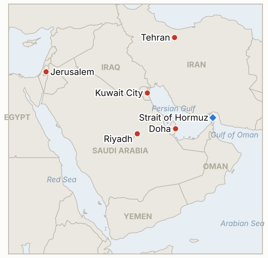

# Middle East Daily Briefing

**November 1, 2026**

- **Reporting window:** ~24 hours, October 31, 06:00 to November 1, 06:00 KST
- **Overall assessment:** Iran's foreign minister called Vance's letter a "positive step" but said no meeting with Americans is planned, while Rubio said Trump has not decided whether to resume strikes (§1.2). The IRGC said four more tankers were hit by mines on Friday, which CENTCOM's claim of cleared routes does not address (§1.1). Brent ended October up 13.6% and the November 1 Sinokor deadline arrived with no Korean government statement I could find (§1.3). The weekend had no market sessions, so the KOSPI and won prints are Friday's.

**Corrections and updates:** The October 31 brief (§1.1, §3) quoted Brent at about $117.62 intraday with no settle and WTI as unreported. Reuters via CNBC now gives Friday's settles: the expiring December Brent contract at $117.64 (the more active January contract at $113.43) and WTI at $104.12; both are recorded in the series. October 30 therefore did not see a Brent settle above $120, so IND-20261031-3 remains open.

---

## 1. What Happened

<figure style="float:right; width:46%; margin:2pt 0 8pt 14pt;">

<figcaption style="font-size:8pt; color:#666; text-align:center; margin-top:3pt; font-style:italic;">Major places of discussion</figcaption>
</figure>

### 1.1 The IRGC says four tankers hit mines on Friday while CENTCOM says the main routes are clear

Iran's Revolutionary Guards said four tankers caught fire and exploded in the Strait of Hormuz on Friday after using "unauthorised routes," the last a supertanker carrying more than 2 million barrels that hit a naval mine ([Al Jazeera](https://www.aljazeera.com/news/liveblog/2026/10/31/iran-war-live-oil-tankers-hit-in-hormuz-trump-says-conflict-will-end-soon); [Fox News](https://www.foxnews.com/live-news/us-iran-war-trump-israel-strait-hormuz-10-31-26)). CENTCOM's Adm. Brad Cooper has said the primary transit routes were cleared, and Treasury Secretary Scott Bessent said Hormuz transit is back near prewar levels excluding Iranian oil, while the US blockade of Iranian ports continues. I found no independent confirmation of the four hits, no vessel names beyond the earlier Louise 1 case, and no exact transit count. **Confidence: Medium that the IRGC made the claims (several outlets); Low on the four mine strikes themselves (Iranian claim, no operator or UKMTO confirmation); Low on Bessent's near prewar claim (no count).**

### 1.2 Araghchi calls Vance's letter a "positive step" but plans no meeting, and Rubio says Trump has not decided on strikes

Foreign Minister Abbas Araghchi told Al Jazeera that Tehran has studied Vice President JD Vance's letter and sees the outreach as a step in the right direction, that an aide is in Doha consulting mediators, and that there are "no plans for meetings with American officials" ([Al Jazeera](https://www.aljazeera.com/news/liveblog/2026/10/31/iran-war-live-oil-tankers-hit-in-hormuz-trump-says-conflict-will-end-soon)). Security chief Mohsen Rezaei said the US has "shifted tone" and diplomacy is open if Iran's seven conditions are met. Rubio, speaking at the G20 meeting in Atlanta, said Trump "hasn't made a decision" on resuming strikes and prefers diplomacy, while an AP report says US diplomats and defense officials privately told regional partners to prepare for possible US action and Iranian retaliation after Tuesday's midterms ([Fox News](https://www.foxnews.com/live-news/us-iran-war-trump-israel-strait-hormuz-10-31-26)). Supreme Leader Mojtaba Khamenei ordered an "unrestricted," geographically unlimited response to any threat. **Confidence: High on the statements by Araghchi and Rubio (on record); Medium on the AP report of partner warnings; Low on how close a deal is (positions conflict).**

### 1.3 Brent ends October up 13.6% and the Sinokor deadline arrives without a Korean government statement

Friday's settles were $117.64 for the expiring December Brent contract (up 2.4%) and $104.12 for WTI (up 2.08%); Brent gained 13.6% and WTI 15.2% in October on Houthi attacks on Saudi energy sites, the Hormuz tanker attacks and fears of strikes after the midterms ([CNBC](https://www.cnbc.com/2026/10/30/oil-rises-on-supply-concerns-as-houthis-attack-saudi-arabia.html)). Saxo Bank expects crude at $70 to $90 even after the conflict, above the prewar $60 to $70. Iran's Persian Gulf Strait Authority said all Sinokor vessels face legal action from November 1; Bloomberg-cited reporting says Sinokor tankers carried about 105.6 million barrels through the strait in September, roughly 40% of crude passing, and the authority's listed vessels rose to 122 this month ([Seoul Economic Daily](https://m.sedaily.com/article/20106868)). Korea's shipping association said the seven vessels already acted against are not Sinokor owned; I found no on record statement from the Foreign Ministry or Ministry of Oceans and Fisheries. **Confidence: High on the settles (Reuters via CNBC); Medium on the Sinokor volume share (Bloomberg via Korean press); Medium that no Korean government statement exists (absence of evidence).**

### 1.4 Saudi air defenses down a drone over Riyadh and an AP count finds 26 US sites hit by Iran

Saudi air defenses destroyed a hostile drone over the Riyadh region on Saturday, with falling fragments causing no injuries, and the US Embassy in Riyadh again urged caution around airports ([Fox News](https://www.foxnews.com/live-news/us-iran-war-trump-israel-strait-hormuz-10-31-26)). An AP analysis found Iranian strikes damaged or destroyed structures at 26 US military sites, most in Kuwait, while Pentagon spokesman Sean Parnell said US forces are well protected. Egypt's foreign minister warned a second round of fighting would be "more dangerous, more destructive." **Confidence: Medium on the Riyadh drone (Saudi statement via Fox); High that AP published the base analysis, Medium on its counts; High on the Egyptian statement.**

### 1.5 Unity government feelers in Israel are denied and Lebanon charges 13 over a Hezbollah explosives truck

Final Israeli seats remain 53 for Netanyahu's bloc, 48 for Eisenkot's and 19 for Arab parties; Eisenkot's Yashar party sources say President Isaac Herzog floated a Netanyahu and Eisenkot unity government, which the President's Office categorically denied and Eisenkot rejected ([Ynet](https://www.ynetnews.com/article/9coh9ipnh)). The new Knesset is still due to be sworn in on November 10. In Lebanon a military court charged 13 people over a seized truck carrying explosives that belonged to Hezbollah ([Fox News](https://www.foxnews.com/live-news/us-iran-war-trump-israel-strait-hormuz-10-31-26)). **Confidence: High on seats; Medium on the Herzog report (party sources, denied); Medium on the Lebanese charges (single source).**

---

## 2. Deep Dive: Incentives and Motives

### 2.1 Why does Araghchi praise Vance's letter but rule out a meeting?

Iran gains from keeping mediators in Doha engaged while denying Washington a photo opportunity before the midterms. A "positive step" signals openness to Gulf and Pakistani mediators and to oil markets, and "no plans" protects the line that Iran does not negotiate under threat.

### 2.2 Why would Rubio say no decision has been made while partners are told to prepare?

Both hold options open. Saying the decision is open keeps pressure on Tehran to answer before November 3 and avoids pre-election commitments, while quietly preparing allies makes a post-midterm strike executable on short notice.

### 2.3 Why does the IRGC publicize mine hits on tankers using "unauthorised routes"?

Naming the routes as unauthorised ties each incident to the Persian Gulf Strait Authority's permit regime and rebuts CENTCOM's claim that the US promoted lane is safe. It raises war risk costs without Iran needing to claim a specific attack.

### 2.4 Why is Iran singling out Sinokor now?

Sinokor carries a large share of strait crude, so an enforcement example moves insurers, charterers and Seoul at once. Targeting a US allied country's flagged operator also tests whether the US threat of sanctions on firms that obey the authority deters compliance.

### 2.5 Why are Netanyahu's rivals denying unity talks?

Eisenkot has promised not to serve under Netanyahu, so even a leaked unity offer risks his coalition with partners who refuse Arab parties. Herzog's office denies it to protect the president's neutrality before consultations begin.

---

## 3. Policy Implications for South Korea

**Exposure snapshot:** South Korea draws about 70.7% of its crude and 20.4% of its LNG from the Middle East (`instructions/korea-exposure.md`, no update needed). Latest prints, Friday October 30: KOSPI 5,730.74 (down 3.48%), USD/KRW 1,334.3 (daytime close), Brent $117.64 (December expiry; January $113.43), WTI $104.12. Markets reopen Monday, November 2.

**Implications by development:**

- **Hormuz mine claims (§1.1):** More mine hits on tankers using "unauthorised routes" raise war risk premiums for Korean shipowners and cargo; a Bessent claim of near prewar transit lacks a published count (IND-20261101-3, IND-20261031-1, IND-20261030-1).
- **Diplomacy and strikes (§1.2):** A Doha track with no scheduled meeting leaves the post midterm strike risk, the main tail for oil and the won, intact (IND-20261101-1, IND-20261023-3).
- **Oil and Sinokor (§1.3):** Korea's largest crude carrier operator is exposed from today, and Seoul has been silent; enforcement against a Korean operator would force a government response (IND-20261029-1, IND-20261030-2, IND-20261101-2).
- **Gulf security (§1.4):** Continuing drone fire near Riyadh keeps the level 3 Saudi departure recommendation and airport risks for Korean workers live (IND-20261027-3).
- **Markets (§1.3):** Monday's session will test whether foreign selling continues after Friday's 3.48% fall (IND-20261031-2, IND-20261030-3).

**Resolved today:** IND-20261024-1 (no US escorted convoy or IRGC attack on a US base by November 1), IND-20261026-1 (no disclosed US-Iran session by October 31) and IND-20261028-1 (final count left neither Israeli bloc at 61) **falsified**; IND-20261023-2 (Dhahran evacuation or confirmed facility outage) and IND-20261026-3 (no weekly UKMTO tally for October 24 to 30 found) **expired**.

**Testable indicators:**

- **IND-20261101-1** (open, new): A disclosed US-Iran negotiating session, direct or mediated, by ~2026-11-06 confirms; none falsifies.
- **IND-20261101-2** (open, new): A Brent front month settle below $110 by ~2026-11-06 confirms easing; none falsifies.
- **IND-20261101-3** (open, new): A published daily Hormuz all vessel transit count of 70 or more on any day by ~2026-11-08 supports the near prewar claim; none published or all below falsifies.
- **IND-20261031-1, -2, -3** (open): Another limpet or mine attack by ~2026-11-07; foreign net selling above 1 trillion won by ~2026-11-06; Brent settle above $120 by ~2026-11-06.
- **IND-20261030-1, -2, -3** (open): Independent confirmation of a southern route strike by ~2026-11-06; Korean statement on Sinokor by ~2026-11-02; KOSPI close above 6,000 by ~2026-11-02.
- **IND-20261029-1** (open): Sinokor fine, detention or seizure by ~2026-11-08.
- **IND-20261028-2** (open): Herzog's mandate to Eisenkot by ~2026-11-10.
- **IND-20261027-1, -2, -3** (open): Egyptian deployment by ~2026-11-10; US-Iran session or US reply by ~2026-11-03; new Riyadh flight suspension by ~2026-11-03.
- **IND-20261025-2** (open): Gulf undersea cable cut attributed to Iran by ~2026-11-06.
- **IND-20261023-1, -3** (open): Bank of Korea hike in November; disclosed US strike by ~2026-11-06.

---

## 4. Watch List

- **A Doha meeting or US reply to Iran (IND-20261101-1, IND-20261027-2).**
- **November 3 midterms and any strike after (IND-20261023-3).**
- **Sinokor enforcement and any Seoul statement (IND-20261029-1, IND-20261030-2).**
- **Hormuz transit counts versus Bessent's claim (IND-20261101-3).**
- **KOSPI on Monday: foreign flows and the 6,000 line (IND-20261031-2, IND-20261030-3).**
- **Knesset swearing in November 10 and Herzog's mandate (IND-20261028-2).**

---

## 5. Source Quality Summary

| Claim | Sources | Confidence |
| --- | --- | --- |
| IRGC says four tankers hit mines Friday | Al Jazeera; Fox News | Low on the strikes, Medium on the claim |
| Cooper: routes cleared; Bessent: transit near prewar | Fox News | Low to Medium |
| Araghchi: Vance letter studied, no meeting planned, aide in Doha | Al Jazeera | High |
| Rubio: Trump has not decided on strikes | Fox News | High |
| AP: partners told to prepare for post midterm action | Fox News (AP) | Medium |
| Khamenei orders unrestricted response | Al Jazeera; Fox News | High |
| Brent 117.64 (Dec) / 113.43 (Jan); WTI 104.12; October gains | CNBC (Reuters) | High |
| Sinokor deadline; 122 listed vessels; 40% volume share | Seoul Economic Daily (Bloomberg) | Medium |
| No Korean government Sinokor statement | Searches of Korean press | Medium |
| Saudi drone over Riyadh; AP count of 26 US sites | Fox News (AP) | Medium |
| Herzog unity feelers denied | Ynet | Medium |
| Lebanon charges 13 over Hezbollah truck | Fox News | Medium |
| KOSPI 5,730.74; won 1,334.3 (Friday) | Previous brief (Hankyung) | High |
| Hormuz transit count | Not reported | Not reported |
