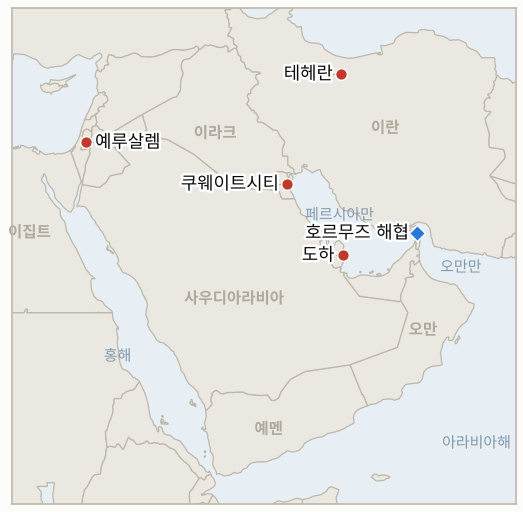

# 중동 일일 브리핑

**2026년 11월 2일**

- **보고 기간:** 약 24시간, 11월 1일 06:00 ~ 11월 2일 06:00 (한국시간)
- **종합 평가:** 압력의 축이 테헤란의 발언에서 워싱턴의 일정으로 옮겨갔다. 액시오스는 네타냐후가 화요일 중간선거 직후 타격하라고 트럼프를 압박한다고 보도했고, 이스라엘 당국자는 며칠 안에 전투가 재개될 가능성에 대비 중이라고 밝혔으며, 트럼프는 토요일 통화를 "좋은 대화"라고 말했다(§1.2). 해상에서는 영국 해사무역기구(UKMTO)가 호르무즈에서 선박이 미상 발사체에 피격됐다고 알렸고 혁명수비대는 유조선 2척이 추가로 기뢰에 걸렸다고 주장했다(§1.1). 이란 협상단은 도하에서 사흘째 협의했지만 육군, 국방부, 혁명수비대는 모두 "지리적 제한 없는" 대응을 경고했다(§1.3). 일요일이라 장이 열리지 않아 모든 가격은 여전히 금요일 수치이며, 한국 시장은 오늘 재개되는데 시노코의 11월 1일 시한은 지났고 서울의 입장은 확인되지 않는다(§1.5).

---

## 1. 무슨 일이 있었나

<figure style="float:right; width:46%; margin:2pt 0 8pt 14pt;">

<figcaption style="font-size:8pt; color:#666; text-align:center; margin-top:3pt; font-style:italic;">주요 논의 지점</figcaption>
</figure>

### 1.1 영국 해사무역기구가 호르무즈에서 선박이 미상 발사체에 피격됐다고 알리고 혁명수비대는 유조선 2척이 기뢰로 폭발했다고 주장한다

일요일 18:09 GMT에 UKMTO는 상선 선장의 신고를 받아 호르무즈 해협에서 선박이 미상 발사체에 피격됐다고 밝혔다. 약 2시간 뒤 이란 국영 매체에 따르면 혁명수비대 해군은 유조선 2척이 "허가되지 않은 항로"에서 기뢰에 걸려 "폭발했다"고 말했다([Iran International 라이브 블로그](https://www.iranintl.com/en/liveblog/202610312594)). 선박명, 국적, 사상자, 피해 규모는 제시되지 않았고, UKMTO 신고와 혁명수비대 주장의 연관성을 독립적으로 확인하지 못했다. **신뢰도: UKMTO가 경보를 냈다는 점은 높음. 원인과 혁명수비대의 기뢰 주장은 낮음(국영 매체 단독, 선박 미특정).**

### 1.2 액시오스는 네타냐후가 중간선거 직후 타격을 트럼프에게 압박하고 트럼프는 협상 지속을 원한다고 보도한다

액시오스는 베냐민 네타냐후 총리가 화요일 중간선거 직후 이란을 타격하라고 트럼프에게 촉구하고 있으며 트럼프는 협상을 이어가길 원한다고 보도했다. 이스라엘 측은 토요일 통화를 "강경했다", 미국 측은 "직설적이었다"고 각각 평했다([Iran International 라이브 블로그](https://www.iranintl.com/en/liveblog/202610312594), 액시오스와 월스트리트저널 인용). 알하다스는 이스라엘 당국자를 인용해 이스라엘이 며칠 안에 전투가 재개될 가능성에 대비하고 있으며 미·이란 협상에는 간극이 남아 있다고 전했다. 트럼프는 이후 네타냐후와 이란에 대해 "좋은 대화"를 했다고 말했다. **신뢰도: 압박 자체는 중간(액시오스·WSJ, 익명 취재원). 시점은 낮음(알하다스가 인용한 이스라엘 당국자 1명).**

### 1.3 이란 협상단이 도하에서 사흘째 협의하는 가운데 육군, 국방장관, 혁명수비대는 지리적 제한 없는 대응을 경고한다

로이터에 따르면 이란 협상단은 도하에서 카타르 중재자들과 사흘째 협의했다. 미국 대표단은 보도되지 않았으므로 IND-20261101-1이 요구하는 공개된 미·이란 협상 회동은 아직 아니다([Iran International 라이브 블로그](https://www.iranintl.com/en/liveblog/202610312594)). 이란 육군 대변인은 새 전쟁이 중동 밖으로 번질 수 있다고 경고했고, 국방장관은 군의 대응 태세를 "지리적 제한 없이" 높이고 있다고 말했으며, 혁명수비대 대변인 모하비는 새로운 표적을 식별했고 공격이 재개되면 새 능력을 쓰겠다고 밝혔다. 마누체르 모타키 의원은 미군 전투기를 수용하는 유럽 국가들이 미래 전쟁의 당사자가 될 것이라고 경고했다. **신뢰도: 발언이 있었다는 점은 높음. 도하 협의는 중간(라이브 블로그 경유 로이터, 협의 내용 미공개).**

### 1.4 이란이 영국 해군과 공군을 테러 조직으로, MI6를 적대 단체로 규정한다

이란 외무부는 영국 해군과 공군을 테러 조직으로 지정하고 MI6를 "적대 단체"라고 불렀다([Iran International 라이브 블로그](https://www.iranintl.com/en/liveblog/202610312594)). 테헤란은 2025년 12월 캐나다 해군, 2026년 2월 EU 회원국 해군과 공군에 대해서도 비슷한 지정을 했고, 영국은 최근 RAF 페어퍼드 인근 음모 의혹과 관련해 이란인 2명을 제재했다. 오늘의 지정을 전하는 두 번째 매체는 찾지 못했다. **신뢰도: 발표 여부는 중간(라이브 블로그 단일 항목). 과거 맞대응 지정 양상은 높음.**

### 1.5 시노코 시한이 지났으나 집행 사례도 한국 정부 입장도 확인되지 않는다

이란 페르시아만해협청은 11월 1일부터 시노코의 모든 선박에 법적 조치를 하겠다고 밝혔으나, 영어와 한국어 매체 검색에서 실제 벌금, 억류, 나포 보도는 찾지 못했고, 한국선주협회가 해당 선박은 외국 석유회사에 재용선된 것이라고 밝힌 이후 서울이나 시노코의 공식 입장도 나오지 않았다([Al-Monitor](https://www.al-monitor.com/originals/2026/10/iran-says-sinokor-vessels-face-legal-action-south-korean-shipowners-deny-link), [Gulf News](https://gulfnews.com/world/mena/iran-warns-south-korean-shipper-sinokor-legal-action-from-nov-1-1.500726271)). 별도로 쿠웨이트는 11월 1일부터 5일까지 남부에서 실탄 사격 훈련을 한다고 발표했다([Gulf News](https://gulfnews.com/world/mena/middle-east-war-saudi-intercepts-drone-iran-claims-3-tankers-hit-mines-in-hormuz-1.500730393)). **신뢰도: 집행이나 입장이 나오지 않았다는 점은 중간(검색상 부재이지 증명은 아님). 쿠웨이트 훈련 발표는 높음.**

---

## 2. 심층 분석: 유인과 동기

### 2.1 네타냐후는 왜 중간선거 직후 타격을 압박하는가?

이스라엘의 대미 영향력은 결정이 굳어지기 전에 가장 크고, 선거가 자연스러운 기한을 만든다. 연정 협상을 앞둔 네타냐후는 이란과의 협상을 시간 끌기로 규정하는 입장에서 이득을 얻고, 트럼프는 유권자가 판단하기 전에는 책임을 지지 않은 채 타격 선택지를 유지한다.

### 2.2 트럼프는 왜 네타냐후와의 통화를 "좋았다"고 하는데 액시오스는 강경했다고 전하는가?

화요일 전에 이스라엘과의 이견을 공개하고 싶지 않다면 둘 다 사실일 수 있다. "좋았다"는 표현은 날짜를 못 박지 않으면서 테헤란의 불확실성과 외교 트랙을 함께 유지한다.

### 2.3 이란은 왜 도하에 협상단을 두면서 지리적 제한 없는 대응을 위협하는가?

테헤란은 두 트랙으로 협상한다. 협의에 계속 참여하면 카타르와 파키스탄이 메시지를 전달하고 비난을 덜 받으며, 확전 발언은 선거 후 타격의 비용을 미국, 이스라엘, 미군 항공기를 수용하는 유럽 국가에 높여 놓는다.

### 2.4 혁명수비대는 왜 "허가되지 않은 항로"의 기뢰 피격을 계속 공개하는가?

각 발표는 피해를 해협청의 허가 체제와 연결하고 미국이 권하는 항로가 깨끗하다는 중부사령부의 주장을 흔든다. 고의 공격을 주장하지 않고도 보험료를 끌어올린다.

### 2.5 이란은 왜 지금 영국군을 테러 조직으로 지정하는가?

영국의 제재와 페어퍼드 음모 의혹에 대한 값싼 맞대응 신호이며, 전쟁이 재개되면 미군을 수용한 유럽 국가도 이란의 표적 논리에 들어간다는 경고다.

---

## 3. 한국에 대한 정책적 함의

**노출 현황:** 한국은 원유의 약 70.7%와 LNG의 20.4%를 중동에서 들여온다(`instructions/korea-exposure.md`, 갱신 불필요). 10월 30일 금요일 최신 수치: 코스피 5,730.74(3.48% 하락), 원/달러 1,334.3원(주간 종가), 브렌트유 117.64달러(12월물 만기, 1월물 113.43달러), WTI 104.12달러. 시장은 중간선거를 앞두고 오늘 11월 2일 월요일에 재개된다.

**전개별 함의:**

- **발사체·기뢰 주장(§1.1):** 해협 인근의 또 다른 피격은 한국 선사와 화물의 전쟁 위험 할증을 높게 유지시킨다(IND-20261030-1, IND-20261031-1, IND-20261101-3).
- **선거 후 타격 압박(§1.2, §1.3):** 유가와 원화의 꼬리 위험은 11월 3일 이후 며칠 안의 타격이며, 이스라엘의 대비 보도는 경고 시간을 줄인다(IND-20261102-1, IND-20261023-3).
- **도하 협의(§1.3):** 미국 대표단이 보도되지 않은 사흘째 협의는 외교적 완충을 입증하지 못한다(IND-20261102-2, IND-20261101-1, IND-20261027-2).
- **시노코(§1.5):** 시한은 조용히 지났지만 한국 운영사에 대한 첫 집행이 나오면 정부 대응이 불가피하다(IND-20261029-1, IND-20261030-2).
- **시장(§3):** 오늘 장은 금요일의 3.48% 하락이 안정되는지 시험한다(IND-20261102-3, IND-20261030-3, IND-20261031-2).

**오늘 종결:** 없음. IND-20261030-1은 종결하지 않았다. 일요일 UKMTO 경보에 항로 정보가 없어 남쪽 항로 피격의 독립적 확인으로 아직 볼 수 없다.

**검증 가능한 지표:**

- **IND-20261102-1**(열림, 신규): ~2026-11-08까지 이스라엘 또는 미국의 이란 영토 타격이 공개되면 선거 후 타격 시나리오 확증, 없으면 반증.
- **IND-20261102-2**(열림, 신규): ~2026-11-06까지 카타르, 파키스탄, 이란 또는 미국이 밴스 서한에 대한 이란의 서면 답신을 공개 확인하면 확증, 없으면 반증.
- **IND-20261102-3**(열림, 신규): 오늘 11월 2일 코스피가 금요일 종가 5,730.74를 넘어 마감하면 안정 확증, 같거나 낮으면 반증.
- **IND-20261101-1, -2, -3**(열림): ~2026-11-06까지 공개된 미·이란 협상 회동; ~2026-11-06까지 브렌트유 근월물 정산가 110달러 미만; ~2026-11-08까지 공표된 호르무즈 일일 통항 70건 이상.
- **IND-20261031-1, -2, -3**(열림): ~2026-11-07까지 흡착 기뢰 또는 기뢰 공격 추가; ~2026-11-06까지 외국인 순매도 1조 원 초과; ~2026-11-06까지 브렌트유 120달러 초과 정산.
- **IND-20261030-1, -2, -3**(열림): ~2026-11-06까지 남쪽 항로 피격의 독립적 확인; ~2026-11-02까지 시노코 관련 한국 정부 입장; ~2026-11-02까지 코스피 6,000 초과 마감.
- **IND-20261029-1**(열림): ~2026-11-08까지 시노코 벌금, 억류 또는 나포.
- **IND-20261028-2**(열림): ~2026-11-10까지 헤르조그의 아이젠코트 조각 위임.
- **IND-20261027-1, -2, -3**(열림): ~2026-11-10까지 이집트 파병; ~2026-11-03까지 미·이란 협상 또는 미국의 답신; ~2026-11-03까지 리야드 항공편 추가 중단.
- **IND-20261025-2**(열림): ~2026-11-06까지 이란 소행으로 지목된 걸프 해저 케이블 절단.
- **IND-20261023-1, -3**(열림): 11월 한국은행 금리 인상; ~2026-11-06까지 공개된 미국의 타격.

---

## 4. 관찰 목록

- **화요일 중간선거와 이후 타격(IND-20261102-1, IND-20261023-3).**
- **도하: 미국 대표단 또는 밴스 서한에 대한 이란의 답신(IND-20261102-2, IND-20261101-1).**
- **오늘 코스피와 외국인 수급(IND-20261102-3, IND-20261031-2).**
- **시노코 집행 여부와 서울의 입장(IND-20261029-1, IND-20261030-2).**
- **호르무즈 사건과 통항 건수(IND-20261030-1, IND-20261101-3).**
- **11월 10일 크네세트 선서와 헤르조그의 위임(IND-20261028-2).**

---

## 5. 출처 품질 요약

| 주장 | 출처 | 신뢰도 |
| --- | --- | --- |
| UKMTO: 호르무즈에서 선박 미상 발사체 피격(18:09 GMT) | Iran International 라이브 블로그(UKMTO) | 경보 높음, 원인 낮음 |
| 혁명수비대: 유조선 2척 기뢰 폭발, "허가되지 않은 항로" | Iran International 라이브 블로그(이란 국영 매체) | 낮음 |
| 네타냐후의 선거 후 타격 압박, 트럼프는 협상 원함 | Iran International 라이브 블로그(액시오스, WSJ) | 중간 |
| 이스라엘, 며칠 내 전투 대비 | Iran International 라이브 블로그(알하다스) | 낮음 |
| 이란 협상단 도하 사흘째 | Iran International 라이브 블로그(로이터) | 중간 |
| 육군·국방장관·혁명수비대의 지리적 제한 없는 위협 | Iran International 라이브 블로그 | 발언 자체 높음 |
| 이란, 영국 해군·공군 테러 조직, MI6 적대 단체 지정 | Iran International 라이브 블로그 | 중간 |
| 시노코 집행·서울 입장 확인 안 됨 | 영어·한국어 언론 검색 | 중간 |
| 쿠웨이트 실탄 훈련 11월 1~5일 | Gulf News | 높음 |
| 가격·한국 시장 수치(금요일) | 전 브리핑(CNBC, 한국경제) | 높음 |
| 호르무즈 통항 건수 | 보고되지 않음 | 보고되지 않음 |
