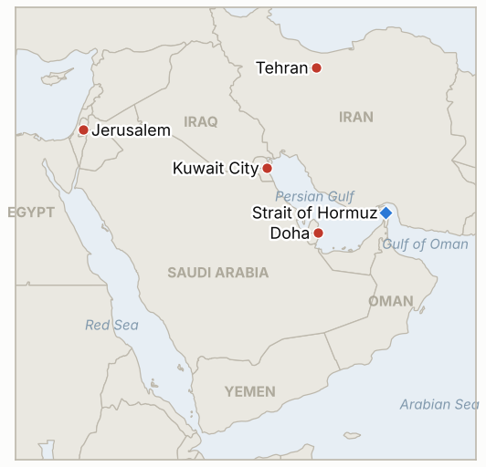

# Middle East Daily Briefing

**November 2, 2026**

- **Reporting window:** ~24 hours, November 1, 06:00 to November 2, 06:00 KST
- **Overall assessment:** The pressure point moved from Tehran's words to Washington's calendar: Axios reports Netanyahu is pressing Trump to strike right after Tuesday's midterms, an Israeli official says Israel is preparing for renewed fighting within days, and Trump called the Saturday call a "good talk" (§1.2). At sea, UKMTO reported another vessel hit by an unknown projectile in Hormuz and the IRGC said two more tankers hit mines (§1.1). Iranian negotiators were in Doha for a third day, yet the army, defense ministry and IRGC all warned of responses "without geographic limits" (§1.3). It was a Sunday with no market sessions, so every price here is still Friday's; Korea reopens today with Sinokor's November 1 deadline passed and no Seoul statement found (§1.5).

---

## 1. What Happened

<figure style="float:right; width:46%; margin:2pt 0 8pt 14pt;">

<figcaption style="font-size:8pt; color:#666; text-align:center; margin-top:3pt; font-style:italic;">Major places of discussion</figcaption>
</figure>

### 1.1 UKMTO reports a vessel hit by an unknown projectile in Hormuz and the IRGC says two more tankers exploded on mines

At 18:09 GMT on Sunday UKMTO said a vessel was hit by an unknown projectile in the Strait of Hormuz, after the merchant ship's captain reported the strike. About two hours later the IRGC Navy said two oil tankers "exploded" after hitting mines on an "unauthorized route," according to Iranian state media ([Iran International live blog](https://www.iranintl.com/en/liveblog/202610312594)). No vessel names, flags, casualties or damage were given, and I found no independent link between the UKMTO report and the IRGC claim. **Confidence: High that UKMTO issued the alert; Low on the cause and on the IRGC mine claim (state media only, no vessel identified).**

### 1.2 Axios says Netanyahu is pressing Trump to strike right after the midterms while Trump wants talks to continue

Axios reported that Prime Minister Benjamin Netanyahu is urging Trump to strike Iran immediately after Tuesday's midterm elections, while Trump wants negotiations to continue; Israeli and US sources described Saturday's call as "tough" and "direct" respectively ([Iran International live blog](https://www.iranintl.com/en/liveblog/202610312594), citing Axios and the Wall Street Journal). Al Hadath, citing an Israeli official, said Israel is preparing for possible renewed fighting within days and that a gap remains in the US-Iran talks. Trump afterward said he had a "good talk" with Netanyahu about Iran. **Confidence: Medium that the pressure exists (Axios and WSJ, anonymous sources); Low on timing, which rests on a single Israeli official quoted by Al Hadath.**

### 1.3 Iranian negotiators spend a third day in Doha as the army, defense ministry and IRGC threaten responses without geographic limits

Reuters reported Iranian negotiators were in Doha for a third day of talks with Qatari mediators; no US delegation was reported, so this is not yet the disclosed US-Iran session that IND-20261101-1 requires ([Iran International live blog](https://www.iranintl.com/en/liveblog/202610312594)). Iran's army spokesman warned a new war could extend beyond the Middle East, the defense minister said forces are raising readiness to respond "without geographic limits," and IRGC spokesman Mohabbi said the Guards have identified new targets and will use new capabilities if attacks resume. Parliament member Manouchehr Mottaki warned that European states hosting US jets would be partners in a future war. **Confidence: High that the statements were made; Medium on the Doha talks (Reuters via a live blog, no readout of substance).**

### 1.4 Iran labels Britain's Royal Navy and RAF terrorist organizations and MI6 a hostile group

Iran's Foreign Ministry designated the UK's Royal Navy and Royal Air Force terrorist organizations and called MI6 a "hostile group" ([Iran International live blog](https://www.iranintl.com/en/liveblog/202610312594)). Tehran has made similar designations of Canada's navy in December 2025 and of EU naval and air forces in February 2026, and the UK has recently sanctioned two Iranians over a suspected plot near RAF Fairford; I could not find a second outlet carrying today's designation. **Confidence: Medium that it was announced (single live blog entry); High on the pattern of earlier reciprocal designations.**

### 1.5 The Sinokor deadline passes with no reported enforcement and no Korean government statement

Iran's Persian Gulf Strait Authority had said all Sinokor vessels would face legal action from November 1; my searches of English and Korean press found no report of an actual fine, detention or seizure, and no on-record statement from Seoul or Sinokor since the Korea Shipowners' Association said the cited ships were sub-chartered to a foreign oil company ([Al-Monitor](https://www.al-monitor.com/originals/2026/10/iran-says-sinokor-vessels-face-legal-action-south-korean-shipowners-deny-link); [Gulf News](https://gulfnews.com/world/mena/iran-warns-south-korean-shipper-sinokor-legal-action-from-nov-1-1.500726271)). Separately, Kuwait announced live-fire exercises in its south from November 1 to 5 ([Gulf News](https://gulfnews.com/world/mena/middle-east-war-saudi-intercepts-drone-iran-claims-3-tankers-hit-mines-in-hormuz-1.500730393)). **Confidence: Medium that no enforcement or statement has surfaced (absence in searches, not proof); High on the Kuwait exercise announcement.**

---

## 2. Deep Dive: Incentives and Motives

### 2.1 Why is Netanyahu pushing for a strike right after the midterms?

Israel's leverage over Washington peaks before a decision is locked in, and the election gives a natural date. Netanyahu, with coalition talks pending, gains from a stance that portrays Iranian talks as a stall, while Trump keeps the strike option without owning it before voters decide.

### 2.2 Why does Trump call the Netanyahu conversation "good" while Axios describes it as tough?

Both can be true if Trump wants to avoid public daylight with Israel before Tuesday. Calling it good keeps Tehran uncertain and the diplomatic track alive without committing to a date.

### 2.3 Why would Iran keep negotiators in Doha while threatening responses with no geographic limits?

Tehran is bargaining on two tracks: staying visibly engaged lets Qatar and Pakistan carry its message and lowers blame, while the escalation language raises the cost of a post-midterm strike for the US, Israel and European hosts of US aircraft.

### 2.4 Why does the IRGC keep announcing mine hits on "unauthorized routes"?

Each announcement ties a casualty to the strait authority's permit regime and undercuts CENTCOM's claim that the US-promoted lanes are clear. It raises insurance costs without Iran needing to claim a deliberate attack.

### 2.5 Why designate Britain's armed forces terrorist organizations now?

It is a cheap reciprocal signal that follows the UK's sanctions and its accusation over the Fairford plot, and it warns European hosts of US forces that they are in Iran's target logic if the war resumes.

---

## 3. Policy Implications for South Korea

**Exposure snapshot:** South Korea draws about 70.7% of its crude and 20.4% of its LNG from the Middle East (`instructions/korea-exposure.md`, no update needed). Latest prints, Friday October 30: KOSPI 5,730.74 (down 3.48%), USD/KRW 1,334.3 (daytime close), Brent $117.64 (December expiry; January $113.43), WTI $104.12. Markets reopen today, Monday November 2, ahead of the midterms.

**Implications by development:**

- **Projectile and mine claims (§1.1):** Another strike near the strait keeps war risk premiums high for Korean shipowners and cargo (IND-20261030-1, IND-20261031-1, IND-20261101-3).
- **Post-midterm strike pressure (§1.2, §1.3):** The tail risk for oil and the won is a strike in the days after November 3; Israel's reported preparation shortens the warning time (IND-20261102-1, IND-20261023-3).
- **Doha talks (§1.3):** A third day of talks with no US delegation reported leaves the diplomatic offset unproven (IND-20261102-2, IND-20261101-1, IND-20261027-2).
- **Sinokor (§1.5):** The deadline passed quietly, but the first enforcement action against a Korean operator would force a government response (IND-20261029-1, IND-20261030-2).
- **Markets (§3):** Today's session tests whether Friday's 3.48% fall stabilizes (IND-20261102-3, IND-20261030-3, IND-20261031-2).

**Resolved today:** None. IND-20261030-1 is not resolved: UKMTO's Sunday alert gave no route, so it does not yet count as independent confirmation of a southern route strike.

**Testable indicators:**

- **IND-20261102-1** (open, new): A disclosed Israeli or US strike on Iranian territory by ~2026-11-08 confirms the post-midterm strike scenario; none falsifies.
- **IND-20261102-2** (open, new): Qatar, Pakistan, Iran or the US publicly confirms an Iranian written reply to the Vance letter by ~2026-11-06; none falsifies.
- **IND-20261102-3** (open, new): KOSPI closes today, November 2, above Friday's 5,730.74 confirms stabilization; a close at or below falsifies.
- **IND-20261101-1, -2, -3** (open): Disclosed US-Iran session by ~2026-11-06; Brent front month settle below $110 by ~2026-11-06; published daily Hormuz transit count of 70 or more by ~2026-11-08.
- **IND-20261031-1, -2, -3** (open): Another limpet or mine attack by ~2026-11-07; foreign net selling above 1 trillion won by ~2026-11-06; Brent settle above $120 by ~2026-11-06.
- **IND-20261030-1, -2, -3** (open): Independent confirmation of a southern route strike by ~2026-11-06; Korean statement on Sinokor by ~2026-11-02; KOSPI close above 6,000 by ~2026-11-02.
- **IND-20261029-1** (open): Sinokor fine, detention or seizure by ~2026-11-08.
- **IND-20261028-2** (open): Herzog's mandate to Eisenkot by ~2026-11-10.
- **IND-20261027-1, -2, -3** (open): Egyptian deployment by ~2026-11-10; US-Iran session or US reply by ~2026-11-03; new Riyadh flight suspension by ~2026-11-03.
- **IND-20261025-2** (open): Gulf undersea cable cut attributed to Iran by ~2026-11-06.
- **IND-20261023-1, -3** (open): Bank of Korea hike in November; disclosed US strike by ~2026-11-06.

---

## 4. Watch List

- **Tuesday's midterms and any strike after (IND-20261102-1, IND-20261023-3).**
- **Doha: a US delegation or an Iranian reply to Vance (IND-20261102-2, IND-20261101-1).**
- **KOSPI today and foreign flows (IND-20261102-3, IND-20261031-2).**
- **Sinokor enforcement and any Seoul statement (IND-20261029-1, IND-20261030-2).**
- **Hormuz incidents and transit counts (IND-20261030-1, IND-20261101-3).**
- **Knesset swearing in November 10 and Herzog's mandate (IND-20261028-2).**

---

## 5. Source Quality Summary

| Claim | Sources | Confidence |
| --- | --- | --- |
| UKMTO: vessel hit by unknown projectile in Hormuz (18:09 GMT) | Iran International live blog (UKMTO) | High on the alert, Low on cause |
| IRGC: two tankers exploded on mines, "unauthorized route" | Iran International live blog (Iranian state media) | Low |
| Netanyahu pressing for post-midterm strike; Trump wants talks | Iran International live blog (Axios, WSJ) | Medium |
| Israel preparing for fighting within days | Iran International live blog (Al Hadath) | Low |
| Iranian negotiators in Doha, third day | Iran International live blog (Reuters) | Medium |
| Army, defense minister, IRGC threats without geographic limits | Iran International live blog | High that said |
| Iran designates UK Royal Navy and RAF terrorist, MI6 hostile | Iran International live blog | Medium |
| No Sinokor enforcement or Seoul statement found | Searches of English and Korean press | Medium |
| Kuwait live-fire exercises November 1 to 5 | Gulf News | High |
| Prices and Korean market levels (Friday) | Previous brief (CNBC, Hankyung) | High |
| Hormuz transit count | Not reported | Not reported |
