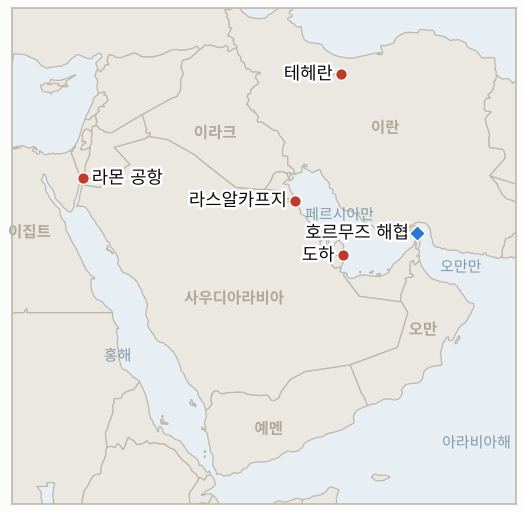

# 중동 일일 브리핑

**2026년 11월 3일**

- **보고 기간:** 약 24시간, 11월 2일 06:00 ~ 11월 3일 06:00 (한국시간)
- **종합 평가:** 이날은 확전이 아니라 외교가 흐름을 이끌었다. 트럼프는 이란이 "합의를 원한다"며 화요일 중간선거 전에는 타격하지 않겠다고 밝혔고, 브렌트유는 7.6% 하락한 104.77달러로 수개월 만에 가장 큰 낙폭을 기록했다(§1.1). 이란 협상단은 도하를 떠났고 합의 초안이 돌고 있으며, 아락치는 미국이 먼저 움직이고 이란이 이튿날 호르무즈를 다시 여는 이틀짜리 순서를 설명하지만 테헤란은 봉쇄가 풀려야 시작할 수 있다고 말한다(§1.2). 해상 위협은 멈추지 않아 라스알카프지 동쪽에서 원유 운반선이 또 피격됐고(§1.3), 라몬 공항의 미군 공중급유기 집결 보도와 네타냐후의 압박은 선거 후 타격 시나리오를 살려 둔다(§1.4). 코스피는 2.24% 반등한 5,859.08에 마감했다(§1.5).

**정정 및 갱신:** 11월 2일자 브리핑은 도하 협의가 이어지고 미국 대표단이 보도되지 않았다고 했으나, 이후 보도에 따르면 이란 협상단은 11월 1일 일요일 도하를 떠났으며 협상의 어려움 때문은 아니었다(로이터, Oilprice 인용). 해당 브리핑의 금요일 가격은 그대로 유효하다.

---

## 1. 무슨 일이 있었나

<figure style="float:right; width:46%; margin:2pt 0 8pt 14pt;">

<figcaption style="font-size:8pt; color:#666; text-align:center; margin-top:3pt; font-style:italic;">주요 논의 지점</figcaption>
</figure>

### 1.1 트럼프가 이란이 합의를 원하며 중간선거 전에는 타격하지 않겠다고 밝히자 브렌트유가 7.6% 하락한 104.77달러에 마감한다

브렌트유는 7.6% 하락한 배럴당 104.77달러에 정산됐고, WTI는 7.4% 하락한 96.46달러로 마감해 7월 27일 이후 일간 최대 낙폭을 기록했다([CNBC](https://www.cnbc.com/2026/11/02/oil-prices-fall-as-iran-us-pursue-diplomacy.html)). 트럼프는 기자들에게 이란이 "합의를 원하고 성사될 수 있다"고 말했으며 중간선거 전에는 공격하지 않겠다는 입장이다. 루비오는 트럼프가 재타격을 "결정하지 않았고" 평화적 방식을 선호한다고 밝혔다. TD증권 애널리스트는 탱커와 후티의 공격이 이어지는 한 헤드라인만으로는 위험 프리미엄이 줄기 어렵다고 경고했고, ING는 선거 후 미국과 이스라엘의 타격 가능성을 지적했다([Oilprice](https://oilprice.com/Latest-Energy-News/World-News/Oil-Prices-Plunge-as-Draft-Proposal-to-End-US-Iran-War-is-Circulated.html)). **신뢰도: 정산 가격은 높음(CNBC), 외교적 동인은 중간(합의된 조치가 아닌 발언).**

### 1.2 이란 협상단이 도하를 떠나고 합의 초안이 돌며 아락치가 호르무즈 재개방 이틀 계획을 설명한다

한 당국자는 로이터에 이란 협상단이 일요일 카타르를 떠난 뒤 전쟁 종식을 위한 합의 초안이 돌고 있다고 말했다. 내용은 공개되지 않았고 후속 회동의 기초가 될 수 있다고 설명됐다([Oilprice](https://oilprice.com/Latest-Energy-News/World-News/Oil-Prices-Plunge-as-Draft-Proposal-to-End-US-Iran-War-is-Circulated.html)). 아락치 외무장관은 카타르 중재 협의에서 첫날 미국이 조치를 하고 이튿날 이란이 호르무즈를 다시 열어 정상 항행을 회복하는 계획이 나왔다고 밝혔다. 기존 7일 계획을 줄인 것이며 최종 합의는 없다([Gulf News](https://gulfnews.com/uae/us-israel-iran-war-what-uae-residents-need-to-know-today-nov-2-2026-1.500732326)). 바가이 외무부 대변인은 미국의 해상 봉쇄가 끝나기 전에는 호르무즈를 열 수 없다고 말했고, 하메네이 최고지도자는 위협에 "즉각적이고 효과적이며 지리적 제한 없는 대응"을 하라고 군에 촉구했다([CNBC](https://www.cnbc.com/2026/11/02/oil-prices-fall-as-iran-us-pursue-diplomacy.html)). **신뢰도: 초안 존재는 중간(로이터 단일 취재원, 내용 없음), 이란 당국자 발언은 높음.**

### 1.3 영국 해사무역기구가 라스알카프지 동쪽에서 원유 운반선이 미상 발사체 2발에 피격됐다고 알린다

UKMTO는 11월 1일 23:47 UTC에 사우디아라비아 라스알카프지 동쪽 약 72해리에서 원유 운반선이 미상 발사체 2발에 피격됐다고 밝혔다. 선박 이름은 공개되지 않았다([Gulf News](https://gulfnews.com/uae/us-israel-iran-war-what-uae-residents-need-to-know-today-nov-2-2026-1.500732326)). 검색 요약에는 카타르 LNG 운반선이 미상 물체에 피격됐다는 언급도 있었으나 직접 확인한 출처가 없어 미확인으로 본다. 위치가 호르무즈 기뢰 주장 지점과 떨어진 걸프 북부라는 점은 위협이 해협에만 국한되지 않음을 시사한다. **신뢰도: UKMTO 경보 발령은 높음, 공격 주체와 LNG 운반선 보도는 낮음.**

### 1.4 미국 공중급유기가 라몬 공항에 집결했다는 보도가 나오고 네타냐후는 선거 후 타격을 압박한다

언론 보도에 따르면 10월 31일 위성영상에서 에일라트 인근 라몬 공항에 미 공군 공중급유기 최소 25대가 확인됐고, 시어도어 루스벨트 항모강습단과 제13해병원정대를 태운 마킨 아일랜드 상륙군이 중동으로 이동 중이다. 공식 확인은 없다([Gulf News](https://gulfnews.com/uae/us-israel-iran-war-what-uae-residents-need-to-know-today-nov-2-2026-1.500732326)). 액시오스는 네타냐후가 화요일 선거 직후 타격하라고 트럼프를 압박하고 트럼프는 협상이 진행되도록 두길 선호한다고 보도했다. **신뢰도: 전력 집결은 중간(영상 기반 보도, 공식 발표 없음), 네타냐후의 압박은 중간(액시오스, 익명 취재원).**

### 1.5 코스피가 2.24% 반등한 5,859.08에 마감하고 원화는 1,343.8원으로 약세를 보인다

코스피는 1.62% 하락 출발한 뒤 2.24% 상승한 5,859.08에 마감했다. 기관이 매수하고 외국인과 개인은 순매도했다. 원·달러 환율은 1,343.8원으로 9.5원 올랐다(원화 약세)([Korea Times](https://www.koreatimes.co.kr/economy/20261102/kospi-rallies-over-2-as-investors-look-past-us-tech-rout), [MoneyToday](https://mt.co.kr/en/stock/2026/11/02/2026110215393141110)). 미국 반도체주 급락에도 지수는 회복했다. 시노코 집행이나 서울의 입장 보도는 새로 찾지 못했으나 한국어 매체 전수 검색은 반복하지 않았다. **신뢰도: 종가는 높음, 시노코 관련 무보도는 낮음~중간.**

---

## 2. 심층 분석: 유인과 동기

### 2.1 트럼프는 왜 중간선거 직전에 외교 신호를 보내는가?

화요일 전에 타격하면 유가 상승과 선거 전날의 전쟁 헤드라인을 감수해야 하지만, 합의 기대는 유가를 낮추고 선택지를 열어 둔다. 루비오의 "결정하지 않았다"는 말은 약속 없이 선거 후 결정을 보존한다.

### 2.2 이란은 왜 이틀짜리 계획을 말하면서 봉쇄 해제를 먼저 요구하는가?

순서를 이틀로 압축하면 테헤란은 빠르게 호르무즈를 열 준비가 된 것처럼 보이고, 봉쇄 해제라는 첫걸음은 워싱턴에 넘길 수 있다. 미국이 거부하면 실패의 책임을 돌리고 해운에 대한 영향력을 유지할 수 있다.

### 2.3 하메네이는 왜 협상 중에 지리적 제한 없는 대응을 촉구하는가?

선거 후 타격의 예상 비용을 미국, 이스라엘, 미군 주둔국에 높여 주고, 협상이 굴복이 아니라는 신호를 강경파에 준다.

### 2.4 협상이 진전될 수 있는데 네타냐후는 왜 행동을 압박하는가?

이란의 능력과 호르무즈 영향력을 그대로 두는 합의는 이스라엘 안에서 설득하기 어렵다. 미국의 관심이 가장 열려 있는 지금 압박해 틀이 굳기 전에 선거 후 결정을 유리하게 만들려는 것이다.

### 2.5 시장은 왜 발언만으로 7.6%나 급락하는가?

트레이더들이 트럼프 발언에 전쟁 프리미엄 일부를 걷어 냈지만, 애널리스트들은 공격이 재개되면 앞선 안도 랠리가 되돌려졌다고 지적한다. 이번 낙폭은 프리미엄이 헤드라인에 얼마나 얇게 기대고 있는지 보여 준다.

---

## 3. 한국에 대한 정책적 함의

**노출 현황:** 한국은 원유의 약 70.7%와 LNG의 20.4%를 중동에서 들여온다(`instructions/korea-exposure.md`, 갱신 불필요). 11월 2일 월요일 최신 수치: 코스피 5,859.08(2.24% 상승), 원·달러 1,343.8원, 브렌트유 104.77달러, WTI 96.46달러. 화요일 미국 중간선거는 한국시간 저녁에 열린다.

**전개별 함의:**

- **유가 급락(§1.1):** 브렌트유가 13달러 가까이 빠지면 수입 부담과 원화 압력이 줄지만, 이 하락은 발언에 기댄다(IND-20261103-2, IND-20261031-3).
- **이틀 계획(§1.2):** 이행되면 호르무즈 재개방은 한국의 에너지와 해운 비용에 가장 큰 완화 요인이나 아직 검증되지 않았다(IND-20261101-1, IND-20261103-1).
- **걸프 북부 피격(§1.3):** 해협 밖 공격은 한국 선사가 위험을 반영해야 할 범위를 넓힌다(IND-20261031-1, IND-20261101-3).
- **선거 후 위험(§1.4):** 꼬리 위험은 11월 3일 이후 며칠 안의 타격이다(IND-20261102-1).
- **시장(§1.5):** 코스피는 5,860 부근으로 돌아왔으나 6,000에는 못 미친다(IND-20261103-3, IND-20261031-2).

**오늘 종결:** IND-20261102-3 **확인**(코스피 종가 5,859.08로 5,730.74 상회). IND-20261101-2 **확인**(브렌트유 104.77달러로 110달러 하회, 닷새 앞서). IND-20261030-3 **반증**(11월 2일까지 6,000 상회 종가 없음). IND-20261030-2 **반증**(기한까지 한국 정부의 공식 입장을 찾지 못함, 제한적 검색 기준).

**검증 가능한 지표:**

- **IND-20261103-1**(신규, 진행 중): 미국이 "첫날" 조치를 했거나 호르무즈 재개방이 시작됐다고 워싱턴이나 테헤란이 ~2026-11-10까지 공개 확인하면 확인, 없으면 반증.
- **IND-20261103-2**(신규, 진행 중): 브렌트유 근월물이 ~2026-11-06까지 한 번이라도 110달러 위에서 정산하면 외교 할인이 사라진 것으로 확인, 아니면 반증.
- **IND-20261103-3**(신규, 진행 중): 코스피가 ~2026-11-06까지 한 번이라도 6,000 위에서 마감하면 확인, 아니면 반증.
- **IND-20261102-1, -2**(진행 중): ~2026-11-08까지 이스라엘 또는 미국의 이란 타격 공개, ~2026-11-06까지 밴스 서한에 대한 이란의 서면 답신 확인.
- **IND-20261101-1, -3**(진행 중): ~2026-11-06까지 공개된 미·이란 협상 회동, ~2026-11-08까지 일일 호르무즈 통과 선박 70척 이상 공표.
- **IND-20261031-1, -2, -3**(진행 중): ~2026-11-07까지 또 다른 부착형 기뢰 또는 기뢰 공격, ~2026-11-06까지 외국인 순매도 1조 원 초과, ~2026-11-06까지 브렌트유 120달러 초과 정산.
- **IND-20261030-1**(진행 중): ~2026-11-06까지 남쪽 항로 피격의 독립적 확인.
- **IND-20261029-1**(진행 중): ~2026-11-08까지 시노코 벌금, 억류 또는 나포.
- **IND-20261028-2**(진행 중): ~2026-11-10까지 헤르조그의 아이젠코트 지명.
- **IND-20261027-1, -2, -3**(진행 중): ~2026-11-10까지 이집트 파병, ~2026-11-03까지 미·이란 회동 또는 미국 답신, ~2026-11-03까지 리야드 신규 항공 중단(뒤의 둘은 오늘이 기한이며 이번 보고 기간 보도로는 종결되지 않았다).
- **IND-20261025-2**(진행 중): ~2026-11-06까지 이란 소행으로 지목된 걸프 해저 케이블 절단.
- **IND-20261023-1, -3**(진행 중): 11월 한국은행 금리 인상, ~2026-11-06까지 미국 타격 공개.

---

## 4. 관찰 목록

- **화요일 중간선거와 이후 결정(IND-20261102-1, IND-20261023-3).**
- **미국이 봉쇄와 관련해 "첫날" 조치를 하는지(IND-20261103-1, IND-20261101-1).**
- **브렌트유의 110달러 상회 반등 또는 추가 하락(IND-20261103-2, IND-20261031-3).**
- **코스피의 6,000 돌파 여부와 외국인 수급(IND-20261103-3, IND-20261031-2).**
- **걸프 북부와 호르무즈의 선박 공격(IND-20261031-1, IND-20261030-1).**
- **시노코 집행과 서울의 입장(IND-20261029-1).**
- **11월 10일 크네세트 선서와 헤르조그의 지명(IND-20261028-2).**

---

## 5. 출처 품질 요약

| 주장 | 출처 | 신뢰도 |
| --- | --- | --- |
| 브렌트유 104.77달러(7.6% 하락), WTI 96.46달러(7.4% 하락) 정산 | CNBC | 높음 |
| 트럼프: 이란이 합의 원함, 선거 전 타격 없음, 루비오 결정 안 함 | CNBC | 중간 |
| 이란 협상단 도하 출발 후 합의 초안 유통 | Oilprice(로이터 취재원) | 중간 |
| 아락치 이틀 계획, 바가이의 봉쇄 조건 | Gulf News, Oilprice | 중간 |
| 하메네이의 지리적 제한 없는 대응 촉구 | CNBC | 발언 사실은 높음 |
| 라스알카프지 동쪽 72해리 원유 운반선 피격(23:47 UTC) | Gulf News(UKMTO) | 경보는 높음, 원인은 낮음 |
| 카타르 LNG 운반선 피격 | 검색 요약뿐 | 낮음 |
| 라몬 공항 미군 급유기 25대 이상, 항모단 이동 | Gulf News(언론, 위성영상) | 중간 |
| 네타냐후의 선거 후 타격 압박 | Gulf News(액시오스) | 중간 |
| 코스피 5,859.08, 원·달러 1,343.8원 | Korea Times, MoneyToday(연합뉴스) | 높음 |
| 새로운 시노코 집행 보도 없음 | 제한적 검색 | 낮음~중간 |
| 호르무즈 통과 선박 수 | 보도 없음 | 보도 없음 |
