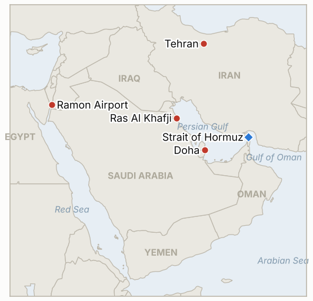
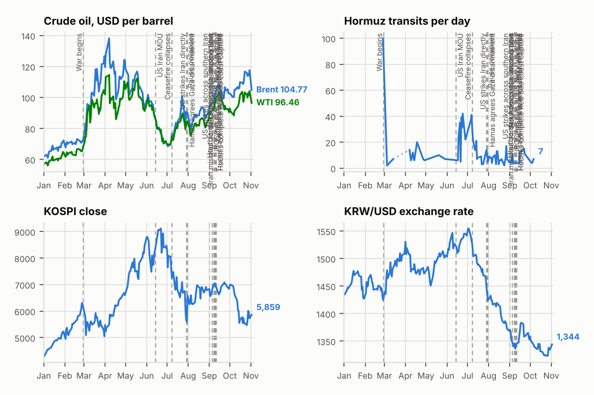

# Middle East Daily Briefing

**November 3, 2026**

- **Reporting window:** ~24 hours, November 2, 06:00 to November 3, 06:00 KST
- **Overall assessment:** Diplomacy, not escalation, drove the day: Trump said Iran wants to "make a deal" and that he will not strike before Tuesday's midterms, and Brent fell 7.6% to $104.77, its biggest drop in months (§1.1). Iranian negotiators left Doha, a draft proposal is circulating, and Araghchi describes a two day sequence in which the US moves first and Iran reopens Hormuz second, but Tehran says the blockade must end before anything starts (§1.2). The shipping threat did not pause, with another crude carrier hit east of Ras Al Khafji (§1.3), and reports of US tanker aircraft at Ramon Airport and Netanyahu's push keep the post-election strike option alive (§1.4). Korea's KOSPI recovered 2.24% to 5,859.08 (§1.5).

**Corrections and updates:** The November 2 brief said Doha talks continued and that no US delegation had been reported; later reporting says the Iranian team left Doha on Sunday, November 1, and that the departure was not due to difficulties (Reuters via Oilprice). Friday's prices in that brief remain correct.

---

## 1. What Happened

<figure style="float:right; width:46%; margin:2pt 0 8pt 14pt;">

<figcaption style="font-size:8pt; color:#666; text-align:center; margin-top:3pt; font-style:italic;">Major places of discussion</figcaption>
</figure>

### 1.1 Brent falls 7.6% to $104.77 as Trump says Iran wants a deal and he will not strike before the midterms

Brent settled at $104.77 a barrel, down 7.6%, and WTI closed at $96.46, down 7.4%, its biggest daily loss since July 27 ([CNBC](https://www.cnbc.com/2026/11/02/oil-prices-fall-as-iran-us-pursue-diplomacy.html)). Trump told reporters Iran wants to "make a deal and that could happen," and has said he will not attack before the midterms; Rubio said Trump "hasn't made a decision" on striking again and would prefer a peaceful route. An analyst at TD Securities cautioned that headlines alone are unlikely to erode the risk premium while tanker and Houthi attacks continue, and ING flagged possible US-Israeli strikes after the election ([Oilprice](https://oilprice.com/Latest-Energy-News/World-News/Oil-Prices-Plunge-as-Draft-Proposal-to-End-US-Iran-War-is-Circulated.html)). **Confidence: High on the settlement prices (CNBC); Medium on the diplomatic drivers, which are statements rather than agreed steps.**

### 1.2 Iranian negotiators leave Doha, a draft proposal circulates and Araghchi describes a two day plan to reopen Hormuz

An official told Reuters that a draft proposal to end the war was circulating after Iranian negotiators left Qatar on Sunday; the terms were not disclosed and it was described as a basis for a possible follow-up meeting ([Oilprice](https://oilprice.com/Latest-Energy-News/World-News/Oil-Prices-Plunge-as-Draft-Proposal-to-End-US-Iran-War-is-Circulated.html)). Foreign Minister Araghchi said the Qatar-mediated talks produced a plan in which the US acts on day one and Iran reopens Hormuz and restores normal navigation on day two, shortened from an earlier seven day version, but that no final agreement exists ([Gulf News](https://gulfnews.com/uae/us-israel-iran-war-what-uae-residents-need-to-know-today-nov-2-2026-1.500732326)). Foreign Ministry spokesman Baghaei said Hormuz cannot reopen until the US naval blockade ends; Supreme Leader Khamenei meanwhile called for an "immediate, impactful, and geographically unrestricted response" to threats ([CNBC](https://www.cnbc.com/2026/11/02/oil-prices-fall-as-iran-us-pursue-diplomacy.html)). **Confidence: Medium that a draft exists (one Reuters source, no terms); High that the Iranian officials made these statements.**

### 1.3 UKMTO reports a crude carrier hit by two unidentified projectiles off Ras Al Khafji

UKMTO said a crude oil tanker was hit by two unidentified projectiles about 72 nautical miles east of Ras Al Khafji, Saudi Arabia, at 23:47 UTC on November 1; the ship was not named ([Gulf News](https://gulfnews.com/uae/us-israel-iran-war-what-uae-residents-need-to-know-today-nov-2-2026-1.500732326)). A search summary also referred to a Qatari LNG tanker hit by unidentified objects, which I could not confirm in a fetched source and treat as unverified. The location is in the northern Gulf, far from the Hormuz mine claims, which suggests the threat is not confined to the strait. **Confidence: High that UKMTO issued the warning; Low on attribution and on the LNG tanker report.**

### 1.4 Reports of US tanker aircraft massing at Ramon Airport while Netanyahu presses for a post-midterm strike

Media reports cite satellite imagery from October 31 showing at least 25 US Air Force refueling aircraft at Ramon Airport near Eilat, and say the USS Theodore Roosevelt strike group and the USS Makin Island group with the 13th Marine Expeditionary Unit are moving toward the region; none of this is officially confirmed ([Gulf News](https://gulfnews.com/uae/us-israel-iran-war-what-uae-residents-need-to-know-today-nov-2-2026-1.500732326)). Axios reported that Netanyahu is urging Trump to strike right after Tuesday's vote while Trump prefers to let talks play out. **Confidence: Medium that the buildup is occurring (imagery-based reports, no official statement); Medium on Netanyahu's pressure (Axios, anonymous sources).**

### 1.5 KOSPI rebounds 2.24% to 5,859.08 and the won weakens to 1,343.8

The KOSPI closed at 5,859.08, up 2.24%, after opening 1.62% lower, with institutions buying while foreigners and retail investors were net sellers; the won closed at 1,343.8 per dollar, 9.5 won weaker ([Korea Times](https://www.koreatimes.co.kr/economy/20261102/kospi-rallies-over-2-as-investors-look-past-us-tech-rout); [MoneyToday](https://mt.co.kr/en/stock/2026/11/02/2026110215393141110)). The index recovered despite a US semiconductor sell-off. I found no new report of Sinokor enforcement or a Seoul statement, but did not repeat a full Korean press sweep. **Confidence: High on the closes; Low-to-Medium on the absence of Sinokor news.**

---

## 2. Deep Dive: Incentives and Motives

### 2.1 Why is Trump signaling diplomacy right before the midterms?

A strike before Tuesday would risk higher fuel prices and a war headline on election eve, while talk of a deal pulls oil down and keeps the option open. Rubio's "hasn't made a decision" preserves a post-election choice without a commitment.

### 2.2 Why does Iran describe a short two day plan while insisting the blockade end first?

Compressing the sequence to two days lets Tehran look ready to reopen Hormuz quickly while placing the first move, lifting the blockade, on Washington. If the US declines, Iran can blame it for the failure and keep its leverage over shipping.

### 2.3 Why does Khamenei call for a geographically unrestricted response during talks?

It raises the expected cost of a post-election strike for the US, Israel and countries hosting US forces, and it reassures hardliners that talks are not capitulation.

### 2.4 Why does Netanyahu push for action when talks may be advancing?

A deal that leaves Iran's capabilities and Hormuz leverage intact would be hard to sell in Israel, so pressing now, when US attention is most open, tries to shape the post-election decision before a framework hardens.

### 2.5 Why would the market sell off 7.6% on talk alone?

Traders priced out part of the war premium on Trump's comments, but analysts note earlier relief rallies reversed when attacks resumed; the move shows how thinly the premium rests on headlines.

---

## 3. Policy Implications for South Korea

**Exposure snapshot:** South Korea draws about 70.7% of its crude and 20.4% of its LNG from the Middle East (`instructions/korea-exposure.md`, no update needed). Latest prints, Monday November 2: KOSPI 5,859.08 (up 2.24%), USD/KRW 1,343.8, Brent $104.77, WTI $96.46. Tuesday's US midterms fall today in Korea's time zone evening.

**Implications by development:**

- **Oil drop (§1.1):** A $13 fall in Brent eases import bill and won pressure, but the fall rests on rhetoric (IND-20261103-2, IND-20261031-3).
- **Two day plan (§1.2):** If implemented, Hormuz reopening would be the single largest relief for Korean energy and shipping costs; it is unproven (IND-20261101-1, IND-20261103-1).
- **Northern Gulf strike (§1.3):** Attacks beyond the strait widen the area Korean shippers must price (IND-20261031-1, IND-20261101-3).
- **Post-midterm risk (§1.4):** The tail risk remains a strike in the days after November 3 (IND-20261102-1).
- **Markets (§1.5):** KOSPI is back near 5,860 but under 6,000 (IND-20261103-3, IND-20261031-2).

**Resolved today:** IND-20261102-3 **confirmed** (KOSPI closed 5,859.08 above 5,730.74). IND-20261101-2 **confirmed** (Brent settled $104.77, below $110, five days early). IND-20261030-3 **falsified** (no KOSPI close above 6,000 by November 2). IND-20261030-2 **falsified** (no on-record Korean government statement on Sinokor found by the deadline, based on limited searching).

**Testable indicators:**

- **IND-20261103-1** (open, new): Washington or Tehran publicly confirms that the US took the "day one" measures or that Hormuz reopening began, by ~2026-11-10; none falsifies.
- **IND-20261103-2** (open, new): Brent front month settles above $110 on any session by ~2026-11-06 confirms the diplomacy discount faded; none falsifies.
- **IND-20261103-3** (open, new): KOSPI closes above 6,000 on any session by ~2026-11-06 confirms; none falsifies.
- **IND-20261102-1, -2** (open): Disclosed Israeli or US strike on Iran by ~2026-11-08; confirmed Iranian written reply to the Vance letter by ~2026-11-06.
- **IND-20261101-1, -3** (open): Disclosed US-Iran session by ~2026-11-06; published daily Hormuz transit count of 70 or more by ~2026-11-08.
- **IND-20261031-1, -2, -3** (open): Another limpet or mine attack by ~2026-11-07; foreign net selling above 1 trillion won by ~2026-11-06; Brent settle above $120 by ~2026-11-06.
- **IND-20261030-1** (open): Independent confirmation of a southern route strike by ~2026-11-06.
- **IND-20261029-1** (open): Sinokor fine, detention or seizure by ~2026-11-08.
- **IND-20261028-2** (open): Herzog's mandate to Eisenkot by ~2026-11-10.
- **IND-20261027-1, -2, -3** (open): Egyptian deployment by ~2026-11-10; US-Iran session or US reply by ~2026-11-03; new Riyadh flight suspension by ~2026-11-03 (the last two reach their deadline today and were not resolved by this window's reporting).
- **IND-20261025-2** (open): Gulf undersea cable cut attributed to Iran by ~2026-11-06.
- **IND-20261023-1, -3** (open): Bank of Korea hike in November; disclosed US strike by ~2026-11-06.

---

## 4. Watch List

- **Tuesday's midterms and the decision after (IND-20261102-1, IND-20261023-3).**
- **Whether the US takes any "day one" step on the blockade (IND-20261103-1, IND-20261101-1).**
- **Brent's rebound above $110 or further slide (IND-20261103-2, IND-20261031-3).**
- **KOSPI against 6,000 and foreign flows (IND-20261103-3, IND-20261031-2).**
- **Shipping attacks in the northern Gulf and Hormuz (IND-20261031-1, IND-20261030-1).**
- **Sinokor enforcement and any Seoul statement (IND-20261029-1).**
- **Knesset swearing in November 10 and Herzog's mandate (IND-20261028-2).**

---

## 5. Source Quality Summary

| Claim | Sources | Confidence |
| --- | --- | --- |
| Brent $104.77 (-7.6%), WTI $96.46 (-7.4%) settle | CNBC | High |
| Trump: Iran wants a deal; no strike before midterms; Rubio no decision | CNBC | Medium |
| Draft proposal circulating after Iranian team left Doha | Oilprice (Reuters source) | Medium |
| Araghchi two day plan; Baghaei blockade condition | Gulf News, Oilprice | Medium |
| Khamenei call for geographically unrestricted response | CNBC | High that said |
| Crude carrier hit 72 nm east of Ras Al Khafji (23:47 UTC) | Gulf News (UKMTO) | High on alert, Low on cause |
| Qatari LNG tanker hit | Search summary only | Low |
| 25+ US tankers at Ramon Airport; carrier groups moving | Gulf News (media, satellite imagery) | Medium |
| Netanyahu pressing post-midterm strike | Gulf News (Axios) | Medium |
| KOSPI 5,859.08 and USD/KRW 1,343.8 | Korea Times, MoneyToday (Yonhap) | High |
| No new Sinokor enforcement found | Limited searches | Low to Medium |
| Hormuz transit count | Not reported | Not reported |
