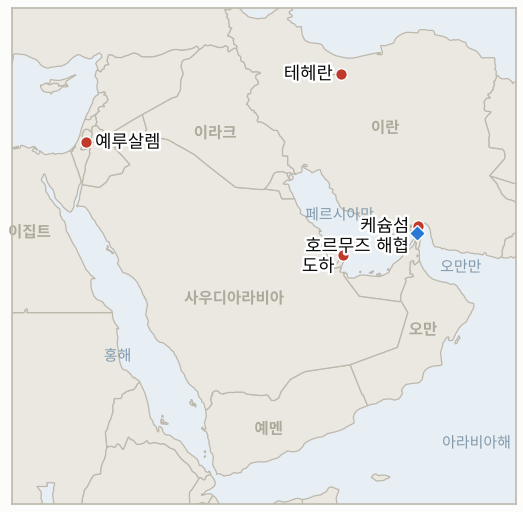

# 중동 일일 브리핑

**2026년 11월 4일**

- **보고 기간:** 약 24시간, 11월 3일 06:00 ~ 11월 4일 06:00 (한국시간)
- **종합 평가:** 미국 선거일에 협상과 무력이 나란히 움직였다. 미국은 이란 케슘섬에 대한 제한 타격을 인정했고(§1.1), 이란의 모흐센 레자에이 최고국가안보회의 서기는 미국의 답변이 "설득력 없다"며 호르무즈 재개방을 7개 조건에 연계했다. 그사이 카타르 중재단은 테헤란을 오갔고 약 36시간 안에 양측 회신이 예상된다(§1.2). 브렌트유는 이틀째 하락해 103.60달러에 정산됐고(§1.3), 트럼프는 연 약 40억 달러의 대이스라엘 지원이 올해 말 끝난다고 밝혔다(§1.4). 코스피는 AI 투자 우려로 3.59% 하락한 5,648.79에 마감했고 정유주는 유가 하락에 타격을 입었다(§1.5).

**정정 및 갱신:** 11월 3일자 브리핑은 트럼프가 중간선거 전에는 타격하지 않겠다고 했다며 이날을 순수한 외교의 날로 묘사했으나, 이후 보도(월스트리트저널, 트럼프가 "경미한 공격"으로 확인)에 따르면 미국은 11월 2일 월요일 케슘섬의 대공 시설을 타격했으며 이는 조용히 진행돼 온 일련의 제한 타격의 일부다. 해당 브리핑의 11월 2일 가격과 코스피 수치는 그대로 유효하다.

---

## 1. 무슨 일이 있었나

<figure style="float:right; width:46%; margin:2pt 0 8pt 14pt;">

<figcaption style="font-size:8pt; color:#666; text-align:center; margin-top:3pt; font-style:italic;">주요 논의 지점</figcaption>
</figure>

### 1.1 미국이 중간선거 전날 케슘섬을 제한 타격하고 혁명수비대는 드론 격추를 주장한다

월스트리트저널은 미국 당국자를 인용해 호르무즈 해협 최대 섬인 케슘섬에 대한 미국의 타격을 보도하며 이를 최근 몇 주간 조용히 진행된 일련의 "제한 타격"의 하나라고 전했다. 트럼프는 표적이 이란이 지은 대공 시설이었다며 "경미한 공격"이라고 말했다([Gulf News](https://gulfnews.com/world/mena/middle-east-conflict-us-carries-out-defensive-strikes-on-irans-qeshm-island-near-strait-of-hormuz-as-tensions-escalate-1.500733555)). 이란 IRNA는 연이은 폭발 5건을 보도했고, 혁명수비대는 미국 MQM-170 드론을 격추·나포하고 MQ-9을 파괴했다고 주장했으나 중부사령부는 이를 허위라고 했으며 국방부도 확인하지 않았다. 이스라엘은 개입하지 않았다고 밝혔다. 트럼프는 필요하면 "한 시간 안에" 픽액스 마운틴 핵시설을 타격할 수 있다고 덧붙였다([Korea Times](https://www.koreatimes.co.kr/world/20261104/iran-us-still-far-apart-on-deal-to-end-war-as-qatar-pushes-mediation)). **신뢰도: 미국 타격 사실은 높음(트럼프가 인정), 혁명수비대의 드론 주장은 낮음(미확인).**

### 1.2 레자에이가 미국의 답변이 "설득력 없다"며 7개 조건을 제시하고 카타르가 테헤란을 오간다

모흐센 레자에이 이란 최고국가안보회의 서기는 X에 미국의 답변이 "설득력 없다"고 썼고, 호르무즈가 완전히 열리려면 미국이 이란의 7개 조건에 "완전하고 명시적으로" 답해야 한다고 말했다. 알려진 조건에는 중동 전역의 휴전, 동결 자산 해제, 석유 제재 해제, 미국의 해상 봉쇄 종료, 배상, 미군 철수가 포함된다([Türkiye Today](https://www.turkiyetoday.com/region/iran-says-us-response-not-convincing-links-hormuz-reopening-to-seven-conditions-3231667)). 카타르 대표단은 월요일 밤 테헤란에서 약 3시간 협의한 뒤 도하로 돌아갔고, 협상 사정에 밝은 당국자는 36시간 안에 양측 회신이 나올 것으로 본다. 이란의 한 고위 당국자는 마감이 없다고 말한다([Korea Times](https://www.koreatimes.co.kr/world/20261104/iran-us-still-far-apart-on-deal-to-end-war-as-qatar-pushes-mediation)). 알아라비 알자디드는 미국이 카타르의 합의 초안을 승인했다고 보도했으나 다른 매체의 확인은 없다. **신뢰도: 레자에이 발언은 높음, 미국의 초안 승인은 낮음(단일 출처).**

### 1.3 브렌트유 103.60달러, WTI 96.09달러에 정산돼 이틀 연속 하락한다

브렌트유는 1.17달러 내린 103.60달러에 정산됐고 WTI는 장중 95달러 아래로 내려갔다가 37센트 하락한 96.09달러에 마감했다. 합의 진전 보도가 케슘섬 타격 소식을 압도했다([CNBC](https://www.cnbc.com/2026/11/03/oil-prices-climb-after-us-reportedly-strikes-irans-qeshm-island.html)). 유가는 선거 후 타격 우려로 10월에 10% 넘게 올랐고, CNBC는 이달 들어 상선 공격이 최소 4건 있었다고 센다. 장중에는 케슘섬 보도로 브렌트유가 약 106달러까지 올랐다가(Grafa) 되돌려, 정산가는 장중 변동성을 과소 반영한다. **신뢰도: 정산가는 높음(CNBC), 장중 범위는 중간(2차 집계 매체).**

### 1.4 트럼프가 연 약 40억 달러의 대이스라엘 지원이 올해 말 끝난다고 밝힌다

트럼프는 선거일 아침 미국의 대이스라엘 지원 연 약 40억 달러가 올해 말 끝난다며 네타냐후와 "몇 달 전" 합의했고 이스라엘은 계속 미국 무기를 구매할 수 있다고 말했다([CNN](https://www.cnn.com/2026/11/03/politics/trump-us-aid-israel), [Al Jazeera](https://www.aljazeera.com/news/2026/11/3/trump-announces-that-us-will-stop-paying-israel-after-year-end)). 네타냐후 총리실은 입장을 내지 않았고 야권의 아이젠코트와 골란은 실패라고 비판했다. 예산은 의회가 승인하며 현행 양해각서는 2028년까지 연 약 38억 달러를 규정하므로, 알자지라가 인용한 전문가는 연말 중단에 회의적이다. 별도로 Gulf News는 사우디군이 후티의 드론과 미사일을 요격했고 오만 앞바다에서 선박이 피격돼 인도인 선원이 숨졌다고 전했다. **신뢰도: 트럼프 발언은 높음, 이행 가능성은 낮음(의회 승인 필요).**

### 1.5 AI 투자 우려로 코스피가 3.59% 하락한 5,648.79에 마감하고 외국인이 1조 5,000억 원을 순매도한다

코스피는 2.46% 낮게 출발해 210.29포인트 하락한 5,648.79에 마감했다. 외국인은 1조 5,000억 원을 순매도했고, 지수는 금요일 7.2% 하락에 이어 3.4% 떨어진 미국 필라델피아 반도체지수를 따랐다([JoongAng Daily](https://www.koreajoongangdaily.com/business/kospi-dips-over-3-following-escalating-ai-concerns/12953462), [Seoul Economic Daily](https://en.sedaily.com/finance/2026/11/03/kospi-closes-down-359-percent-at-564879)). 삼성전자는 4.15%, SK하이닉스는 5.03% 하락했고 유가 하락에 정유주 에쓰오일(11.77% 하락)과 SK이노베이션(9.36% 하락)이 급락했다. 원화는 달러당 약 1,341원에 마감했으나, 출처의 등락 방향 표현이 전일 종가 1,343.8원과 맞지 않는다. 시노코 관련 한국 정부의 새 입장은 찾지 못했다. **신뢰도: 코스피 종가는 높음, 원화 수준은 중간.**

---

## 2. 심층 분석: 유인과 동기

### 2.1 미국은 합의를 원한다면서 왜 케슘섬을 타격했는가?

호르무즈 인근 대공망에 대한 제한 타격은 미군 감시 드론을 보호하고, 투표를 앞두고 확전 헤드라인 없이 테헤란에 압박을 유지한다. "경미"하고 비공개로 두면 외교 경로를 지키면서 선거 후 선택지가 살아 있음을 알릴 수 있다.

### 2.2 레자에이는 왜 미국의 답변을 설득력 없다고 하며 7개 조건을 공개하는가?

극대화한 조건을 공개하면 강경파에 협상이 항복이 아님을 보여 주고 첫 조치의 부담을 워싱턴에 넘긴다. 나중에 더 좁은 패키지를 받아들이고도 요구를 관철했다고 주장할 여지도 생긴다.

### 2.3 카타르는 왜 지금 중재를 강화하는가?

도하는 선거 후 결정 시한이 닫히기 전에 틀을 마련하려 한다. 36시간 안의 회신은 미국의 타격 선택지가 다시 열리기 전에 양측이 약속할지를 시험한다.

### 2.4 트럼프는 왜 선거일에 대이스라엘 지원 종료를 밝히는가?

해외 지원에 회의적인 유권자에게 호소하고, 타격을 로비하는 네타냐후에 대한 지렛대를 더한다. 중단에 법적 제약이 있어 당장 바뀌는 것보다 보내는 신호가 크다.

### 2.5 유가가 내리는데 한국 정유주는 왜 급락했는가?

유가 하락이 정유주가 반영한 재고 평가이익과 전쟁 프리미엄을 줄였고, 반도체주는 별개의 AI 자금 조달 불안으로 떨어졌다. 한국 시장은 경제에 서로 다른 방향으로 작용하는 두 충격에 반응하고 있다.

---

## 3. 한국에 대한 정책적 함의

**노출도 현황:** 한국은 원유의 약 70.7%, LNG의 약 20.4%를 중동에서 들여온다(`instructions/korea-exposure.md`, 갱신 불필요). 11월 3일 화요일 최신 수치: 코스피 5,648.79(3.59% 하락), 원·달러 약 1,341원, 브렌트유 103.60달러, WTI 96.09달러.

**전개별 함의:**

- **케슘섬 타격(§1.1):** 협상 중에도 미국이 무력을 쓴다는 점은 한국 선사의 해상보험료를 높게 유지시킨다(IND-20261104-2, IND-20261031-1).
- **7개 조건(§1.2):** 조건이 충족되기 전까지 호르무즈는 닫혀 있어 한국의 원유·LNG 부담 완화는 아직 합의되지 않은 틀에 달려 있다(IND-20261104-1, IND-20261103-1).
- **유가 정산(§1.3):** 104달러 아래로의 하락은 수입 부담을 덜지만 시장은 여전히 헤드라인에 할인을 적용한다(IND-20261103-2).
- **대이스라엘 지원(§1.4):** 한국의 직접 노출은 작지만 미국·이스라엘 불협화음은 타격 시점을 바꿀 수 있다(IND-20261102-1은 해소).
- **시장(§1.5):** 코스피는 걸프보다 AI 자금 조달 우려에 좌우되며 외국인 매도가 전달 경로다(IND-20261104-3).

**오늘 해소된 지표:** IND-20261031-2 **확인**(11월 3일 외국인이 1조 5,000억 원 순매도해 1조 원 초과). IND-20261102-1과 IND-20261023-3 **확인**(이란 영토에 대한 미국 타격이 공개됐으나 선거 후 대규모 작전이 아닌 제한 타격). IND-20261027-2 **확인**(미국의 답변과 카타르가 전달한 초안이 보도됨). IND-20261027-3 **만료**(리야드 신규 운항 중단 확인 안 됨).

**검증 가능한 지표:**

- **IND-20261104-1**(진행 중, 신규): 워싱턴, 테헤란 또는 도하가 양해각서나 틀에 합의했다고 공개 발표하면 2026-11-10까지 확인, 없으면 반증.
- **IND-20261104-2**(진행 중, 신규): 호르무즈 연안 대공망을 넘어 핵시설이나 핵심 군사 표적에 대한 미국 또는 이스라엘의 타격이 2026-11-10까지 공개되면 확인, 없으면 반증.
- **IND-20261104-3**(진행 중, 신규): 코스피가 2026-11-09까지 한 번이라도 5,500 아래로 마감하면 추가 하락 확인, 없으면 반증.
- **IND-20261103-1, -2, -3**(진행 중): "첫날 조치"의 공개 확인 2026-11-10까지, 브렌트유 정산가 110달러 초과 2026-11-06까지, 코스피 6,000 초과 마감 2026-11-06까지.
- **IND-20261102-2**(진행 중): 밴스 서한에 대한 이란의 서면 회신 확인 2026-11-06까지.
- **IND-20261101-1, -3**(진행 중): 미국·이란 협의 공개 2026-11-06까지, 일일 호르무즈 통과 70척 이상 공표 2026-11-08까지.
- **IND-20261031-1, -3**(진행 중): 흡착 기뢰 또는 기뢰 공격 재발 2026-11-07까지, 브렌트유 정산가 120달러 초과 2026-11-06까지.
- **IND-20261030-1**(진행 중): 남부 항로 타격의 독립 확인 2026-11-06까지.
- **IND-20261029-1**(진행 중): 시노코에 대한 과태료·억류·나포 2026-11-08까지.
- **IND-20261028-2**(진행 중): 헤르초그의 아이젠코트 위임 2026-11-10까지.
- **IND-20261027-1**(진행 중): 이집트 병력 배치 2026-11-10까지.
- **IND-20261025-2**(진행 중): 이란 소행으로 지목된 걸프 해저 케이블 절단 2026-11-06까지.
- **IND-20261023-1**(진행 중): 11월 한국은행 금리 인상.

---

## 4. 관찰 목록

- **36시간 회신 시한과 합의 틀 발표 여부(IND-20261104-1, IND-20261103-1).**
- **미국의 제한 타격이 호르무즈 대공망을 넘어 확대되는지(IND-20261104-2).**
- **중간선거 결과와 트럼프의 이란 대응 재량.**
- **브렌트유 110달러 돌파 여부와 AI발 코스피 하락(IND-20261103-2, IND-20261104-3).**
- **후티의 사우디 공격과 걸프 해상 사건(IND-20261031-1).**
- **시노코 집행과 서울의 입장(IND-20261029-1).**
- **11월 10일 크네세트 선서와 헤르초그의 위임(IND-20261028-2).**

---

## 5. 출처 품질 요약

| 주장 | 출처 | 신뢰도 |
| --- | --- | --- |
| 미국의 케슘섬 대공 시설 제한 타격, 트럼프는 경미하다고 말함 | Gulf News(WSJ, IRNA), Korea Times | 높음 |
| 혁명수비대의 드론 격추 주장 | Gulf News, Korea Times | 낮음 |
| 레자에이: 미국 답변 설득력 없음, 7개 조건 | Türkiye Today, Korea Times | 발언 사실은 높음 |
| 카타르 대표단 테헤란 협의, 36시간 내 회신 | Korea Times | 중간 |
| 미국이 카타르 합의 초안 승인 | 알아라비 알자디드(검색 요약 경유) | 낮음 |
| 브렌트유 103.60달러(1.17달러 하락), WTI 96.09달러(37센트 하락) 정산 | CNBC | 높음 |
| 트럼프의 연 약 40억 달러 대이스라엘 지원 연말 종료 발언 | CNN, Al Jazeera | 발언은 높음, 이행은 낮음 |
| 사우디의 후티 공격 요격, 오만 앞바다 인도인 선원 사망 | Gulf News | 중간 |
| 코스피 5,648.79(3.59% 하락), 외국인 1조 5,000억 원 순매도 | JoongAng Daily, Seoul Economic Daily | 높음 |
| 원·달러 약 1,341원 | JoongAng Daily | 중간 |
| 호르무즈 통과 선박 수 | 보도 없음 | 보도 없음 |
