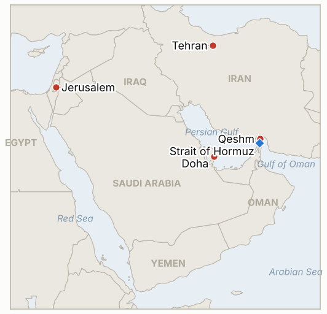

# Middle East Daily Briefing

**November 4, 2026**

- **Reporting window:** ~24 hours, November 3, 06:00 to November 4, 06:00 KST
- **Overall assessment:** Talks and force ran side by side on US Election Day: Washington acknowledged limited strikes on Iran's Qeshm Island (§1.1), while Iran's security chief Rezaei called the US reply "not convincing" and tied Hormuz to seven conditions even as Qatari mediators shuttled to Tehran and feedback is expected within about 36 hours (§1.2). Brent slipped a second day to $103.60 (§1.3), Trump said the roughly $4 billion in annual US aid to Israel ends at year's end (§1.4), and Korea's KOSPI fell 3.59% to 5,648.79 on AI spending fears, with refiners hit by lower crude (§1.5).

**Corrections and updates:** The November 3 brief said Trump would not strike before the midterms and framed the day as pure diplomacy; later reporting (WSJ, confirmed by Trump as a "minor attack") shows the US hit a Qeshm Island anti-aircraft site on Monday, November 2, as part of a series of low-profile limited strikes. Its price and KOSPI figures for November 2 remain correct.

---

## 1. What Happened

<figure style="float:right; width:46%; margin:2pt 0 8pt 14pt;">

<figcaption style="font-size:8pt; color:#666; text-align:center; margin-top:3pt; font-style:italic;">Major places of discussion</figcaption>
</figure>

### 1.1 US limited strikes hit Qeshm Island on the eve of the midterms, and the IRGC claims drone kills

The Wall Street Journal, citing US officials, reported a US strike on Qeshm, the largest island in the Strait of Hormuz, as one of a series of "limited strikes" kept low-profile in recent weeks; Trump said the target was an anti-aircraft facility Iran had built and called it a "minor attack" ([Gulf News](https://gulfnews.com/world/mena/middle-east-conflict-us-carries-out-defensive-strikes-on-irans-qeshm-island-near-strait-of-hormuz-as-tensions-escalate-1.500733555)). IRNA reported five rapid explosions; the IRGC said it downed and captured a US MQM-170 drone and destroyed an MQ-9, which CENTCOM called false and the Pentagon did not confirm; Israel said it was not involved. Trump added that the US could hit the Pickaxe Mountain nuclear site "within an hour" if needed ([Korea Times](https://www.koreatimes.co.kr/world/20261104/iran-us-still-far-apart-on-deal-to-end-war-as-qatar-pushes-mediation)). **Confidence: High that a US strike occurred (Trump acknowledged it); Low on the IRGC's drone claims, which are unverified.**

### 1.2 Rezaei calls the US reply "not convincing" and sets seven conditions while Qatar shuttles to Tehran

Mohsen Rezaei, secretary of Iran's Supreme National Security Council, wrote on X that Washington's response was "not convincing" and that the US must answer Iran's seven conditions "completely and explicitly" before Hormuz fully reopens; reported conditions include a regionwide ceasefire, release of frozen assets, lifting oil sanctions, ending the US naval blockade, reparations and US troop withdrawal ([Türkiye Today](https://www.turkiyetoday.com/region/iran-says-us-response-not-convincing-links-hormuz-reopening-to-seven-conditions-3231667)). A Qatari delegation held about three hours of talks in Tehran on Monday night and returned to Doha, and an official briefed on the talks expects feedback from both capitals within 36 hours, while a senior Iranian official says there is no deadline ([Korea Times](https://www.koreatimes.co.kr/world/20261104/iran-us-still-far-apart-on-deal-to-end-war-as-qatar-pushes-mediation)). Al-Araby Al-Jadeed reported that the US had approved the Qatari draft memorandum; no other outlet confirmed it. **Confidence: High that Rezaei said this; Low on the claim that Washington approved the draft (single source).**

### 1.3 Brent settles at $103.60 and WTI at $96.09 for a second daily decline

Brent settled $1.17 lower at $103.60 and WTI closed 37 cents lower at $96.09, after dipping below $95 earlier, as reports of progress toward a deal outweighed the Qeshm strike ([CNBC](https://www.cnbc.com/2026/11/03/oil-prices-climb-after-us-reportedly-strikes-irans-qeshm-island.html)). Prices rose more than 10% in October on fear of post-election strikes, and CNBC counts at least four attacks on commercial ships since the start of the month. Intraday Brent traded as high as about $106 on the Qeshm report before reversing (Grafa), so the settle understates the session's volatility. **Confidence: High on settles (CNBC); Medium on intraday range (secondary aggregators).**

### 1.4 Trump says the roughly $4 billion in annual US aid to Israel ends at year's end

On Election Day morning Trump said US aid to Israel of about $4 billion a year will end at the end of the year, saying he and Netanyahu agreed "months ago" and that Israel can still buy US weapons ([CNN](https://www.cnn.com/2026/11/03/politics/trump-us-aid-israel); [Al Jazeera](https://www.aljazeera.com/news/2026/11/3/trump-announces-that-us-will-stop-paying-israel-after-year-end)). Netanyahu's office had not commented; opposition leaders Eisenkot and Golan called it a failure. Congress appropriates the money and the current memorandum provides about $3.8 billion a year through 2028, so an expert cited by Al Jazeera doubts a cutoff by year's end. Separately, Gulf News reported Saudi forces intercepting Houthi drones and a missile and an Indian sailor killed after a vessel was struck off Oman. **Confidence: High that Trump said it; Low on implementation, which needs Congress.**

### 1.5 KOSPI falls 3.59% to 5,648.79 on AI spending fears as foreigners sell 1.5 trillion won

The KOSPI closed at 5,648.79, down 210.29 points, after opening 2.46% lower; foreigners net sold 1.5 trillion won and the index followed a 3.4% fall in the US chip index after a 7.2% drop on Friday ([JoongAng Daily](https://www.koreajoongangdaily.com/business/kospi-dips-over-3-following-escalating-ai-concerns/12953462); [Seoul Economic Daily](https://en.sedaily.com/finance/2026/11/03/kospi-closes-down-359-percent-at-564879)). Samsung Electronics fell 4.15% and SK hynix 5.03%, while refiners S-Oil (down 11.77%) and SK Innovation (down 9.36%) fell as crude eased. The won closed at about 1,341 per dollar, though the source's wording on the direction of the move is inconsistent with the prior close of 1,343.8. I found no new Korean government statement on Sinokor. **Confidence: High on the KOSPI close; Medium on the won level.**

---

## 2. Deep Dive: Incentives and Motives

### 2.1 Why did Washington strike Qeshm while saying it wants a deal?

Limited strikes on air defenses near Hormuz protect US surveillance drones and keep pressure on Tehran without a headline escalation before the vote. Keeping them "minor" and unannounced preserves the diplomatic track while signaling that the post-election option remains.

### 2.2 Why does Rezaei call the US reply unconvincing and publish seven conditions?

Public maximal terms let hardliners show talks are not capitulation and push the burden of the first move onto Washington. They also give Iran room to accept a narrower package later and claim it met the demands.

### 2.3 Why is Qatar intensifying its shuttle now?

Doha wants a framework in place before the post-election decision window closes; a quick exchange within 36 hours tests whether either side will commit before the US strike option reopens.

### 2.4 Why would Trump announce an end to Israel aid on Election Day?

It plays to voters who question foreign aid, and it adds leverage over Netanyahu, who is lobbying for strikes. Legal limits on the cutoff mean the announcement signals more than it changes in the near term.

### 2.5 Why did Korean refiners fall as oil eased while the broader index sank?

Lower crude cut the inventory gains and the war premium refiners had priced in, while chip stocks fell on a separate AI funding scare. Korea's market is reacting to two shocks that point in different directions for the economy.

---

## 3. Policy Implications for South Korea

**Exposure snapshot:** South Korea draws about 70.7% of its crude and 20.4% of its LNG from the Middle East (`instructions/korea-exposure.md`, no update needed). Latest prints, Tuesday November 3: KOSPI 5,648.79 (down 3.59%), USD/KRW about 1,341, Brent $103.60, WTI $96.09.

**Implications by development:**

- **Qeshm strikes (§1.1):** Limited strikes near Hormuz show the US willing to use force during talks, which keeps shipping insurance elevated for Korean carriers (IND-20261104-2, IND-20261031-1).
- **Seven conditions (§1.2):** Hormuz stays closed until conditions are met, so Korean crude and LNG relief depends on a framework that is not yet agreed (IND-20261104-1, IND-20261103-1).
- **Oil settle (§1.3):** A fall below $104 eases the import bill, but the market still discounts headlines (IND-20261103-2).
- **Israel aid (§1.4):** Little direct Korean exposure, but a US-Israel rift could change strike timing (IND-20261102-1 resolved).
- **Markets (§1.5):** The KOSPI is driven by AI funding fears more than by the Gulf; foreign selling is the transmission channel (IND-20261104-3).

**Resolved today:** IND-20261031-2 **confirmed** (foreigners net sold 1.5 trillion won on November 3, above 1 trillion). IND-20261102-1 **confirmed** and IND-20261023-3 **confirmed** (US strike on Iranian territory disclosed, though limited rather than the post-election campaign). IND-20261027-2 **confirmed** (a US reply and Qatari-carried draft are reported). IND-20261027-3 **expired** (no new Riyadh flight suspension found).

**Testable indicators:**

- **IND-20261104-1** (open, new): A public statement from Washington, Tehran or Doha that a memorandum or framework was agreed, by ~2026-11-10; none falsifies.
- **IND-20261104-2** (open, new): A disclosed US or Israeli strike on nuclear or core military sites beyond the Hormuz coastal air defense set, by ~2026-11-10; none falsifies.
- **IND-20261104-3** (open, new): KOSPI close below 5,500 on any session by ~2026-11-09 confirms further drawdown; none falsifies.
- **IND-20261103-1, -2, -3** (open): Public confirmation of "day one" measures by ~2026-11-10; Brent settle above $110 by ~2026-11-06; KOSPI close above 6,000 by ~2026-11-06.
- **IND-20261102-2** (open): Confirmed Iranian written reply to the Vance letter by ~2026-11-06.
- **IND-20261101-1, -3** (open): Disclosed US-Iran session by ~2026-11-06; published daily Hormuz transit count of 70 or more by ~2026-11-08.
- **IND-20261031-1, -3** (open): Another limpet or mine attack by ~2026-11-07; Brent settle above $120 by ~2026-11-06.
- **IND-20261030-1** (open): Independent confirmation of a southern route strike by ~2026-11-06.
- **IND-20261029-1** (open): Sinokor fine, detention or seizure by ~2026-11-08.
- **IND-20261028-2** (open): Herzog's mandate to Eisenkot by ~2026-11-10.
- **IND-20261027-1** (open): Egyptian deployment by ~2026-11-10.
- **IND-20261025-2** (open): Gulf undersea cable cut attributed to Iran by ~2026-11-06.
- **IND-20261023-1** (open): Bank of Korea hike in November.

---

## 4. Watch List

- **The 36 hour feedback window and any announced framework (IND-20261104-1, IND-20261103-1).**
- **Whether limited US strikes widen beyond Hormuz air defenses (IND-20261104-2).**
- **Midterm results and what they mean for Trump's Iran latitude.**
- **Brent against $110 and the AI driven KOSPI slide (IND-20261103-2, IND-20261104-3).**
- **Houthi attacks on Saudi Arabia and Gulf shipping incidents (IND-20261031-1).**
- **Sinokor enforcement and any Seoul statement (IND-20261029-1).**
- **Knesset swearing in November 10 and Herzog's mandate (IND-20261028-2).**

---

## 5. Source Quality Summary

| Claim | Sources | Confidence |
| --- | --- | --- |
| US limited strike on Qeshm anti-aircraft site, called minor by Trump | Gulf News (WSJ, IRNA), Korea Times | High |
| IRGC drone downing claims | Gulf News, Korea Times | Low |
| Rezaei: US reply not convincing; seven conditions | Türkiye Today, Korea Times | High that said |
| Qatari delegation in Tehran; feedback within 36 hours | Korea Times | Medium |
| US approved Qatari draft MOU | Al-Araby Al-Jadeed (via search summary) | Low |
| Brent $103.60 (-$1.17), WTI $96.09 (-37c) settle | CNBC | High |
| Trump ends roughly $4bn Israel aid at year end | CNN, Al Jazeera | High that said, Low on implementation |
| Saudi intercepts of Houthi fire; Indian sailor killed off Oman | Gulf News | Medium |
| KOSPI 5,648.79 (-3.59%); foreigners sold 1.5tn won | JoongAng Daily, Seoul Economic Daily | High |
| Won about 1,341 per dollar | JoongAng Daily | Medium |
| Hormuz transit count | Not reported | Not reported |
